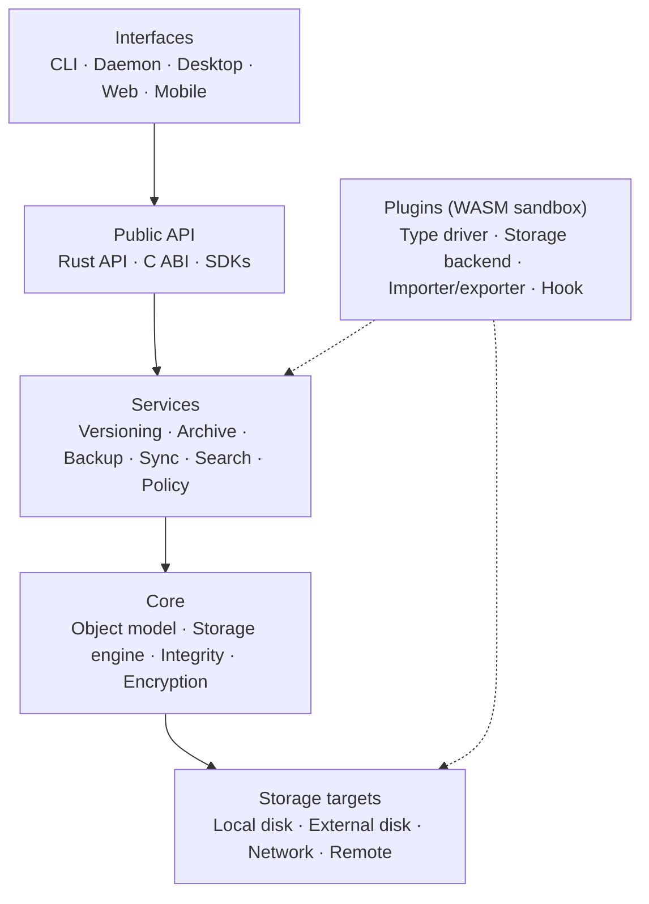

> **Türkçe:** [README.tr.md](README.tr.md)

# Apeiron

> A general-purpose data management engine that unifies version control, archiving, backup, synchronisation and integrity checking in a single core.

Apeiron treats a developer's repository, a musician's project and a family photo archive the same way: as snapshots of content-addressed, immutable objects. Backup, archive, sync and versioning are different policies over the same object graph, not four separate engines. It is local first: no core function needs a cloud, an account or an internet connection.

> **Status:** Early development. Stage 0 (format and core) is done; Stage 1 (local MVP) is done; Stage 2 (remote and sync) is done; Stage 3 (developer and ecosystem) is in progress. The `apeiron` command can already back up, list, compare and restore folders, but there is no release or stable API yet. See [docs/ROADMAP.md](docs/ROADMAP.md).

## Core principles

| # | Principle | In short |
| --- | --- | --- |
| 1 | Generality | Git concepts belong to a plugin, not the core; no data type is the default |
| 2 | Local first | Everything works offline, without an account or a cloud |
| 3 | Data ownership | The storage format is open and documented ([docs/FORMAT.md](docs/FORMAT.md)) |
| 4 | Integrity | Every object is verified with a cryptographic hash; corruption is never silent |
| 5 | Reversibility | Destructive operations can be undone; permanent deletion is a separate step |
| 6 | Secure defaults | Encryption, permissions and audit log are designed in from the start |
| 7 | Thin core | The core knows data, history and policy; domain meaning lives in plugins |
| 8 | API first | The CLI and all interfaces use the same public API as everyone else |
| 9 | Resource awareness | A Raspberry Pi 4 is a real target, not a test target |
| 10 | Progressive complexity | Simple tasks are simple; advanced control is not restricted |

The full list and the requirements are in [docs/VISION.md](docs/VISION.md).

## Architecture



Each layer uses only the layer directly below it. Details: [docs/ARCHITECTURE.md](docs/ARCHITECTURE.md).

## Layers and crates

| Layer | Crate | Role | Status |
| --- | --- | --- | --- |
| Core | `apeiron-core` | Object model, chunking, pack/index files, refs and reflogs | In progress |
| Storage targets | `apeiron-core`, `apeiron-remote` | Folder (local or external disk), SFTP and S3 remotes | Done |
| Services | `apeiron-services` | Backup, restore, listing, diff and sync today; archive, search and policy later | In progress |
| Public API | `apeiron` | Rust API for all operations ([docs/API.md](docs/API.md) §8) | In progress |
| System calls | `apeiron-sys` | Operating system calls that need `unsafe` (Windows write-through) | Done |
| C ABI | — | Stable C interface; may use `unsafe` | Planned |
| CLI | `apeiron-cli` | The `apeiron` command ([docs/CLI.md](docs/CLI.md)) | In progress |
| Background service | `apeiron-daemon` | Scheduled jobs and the restore test ([docs/DAEMON.md](docs/DAEMON.md)) | Done |
| Git | `apeiron-git` | Import and export of Git repositories with the same commit ids ([docs/GIT.md](docs/GIT.md)) | Done |
| Plugins | — | WebAssembly plugin host | Planned |

Crate names for planned layers are chosen when the layer is started.

## Technology stack

| Area | Choice | Status |
| --- | --- | --- |
| Language | Rust (edition 2024, minimum 1.85); C only for the ABI | In use |
| Hashing | BLAKE3, keyed mode for object ids (`blake3`) | In use |
| Chunking | FastCDC 2020, average 1 MiB (`fastcdc`) | In use |
| Compression | zstd (`zstd`) | In use |
| Configuration | TOML (`toml`, `serde`) | In use |
| Errors | Typed errors (`thiserror`) | In use |
| Structured objects | Canonical CBOR (`minicbor`) | In use |
| Git compatibility | gitoxide (`gix`) | Planned |
| Plugins | WebAssembly component model, Wasmtime | Planned |
| Async runtime | Tokio (network, sync and daemon layers only) | Planned |
| CI | GitHub Actions: fmt, clippy, tests on Linux x86_64/aarch64, macOS, Windows | In use |

Why each choice was made: [docs/DECISIONS.md](docs/DECISIONS.md).

## Roadmap summary

| Stage | Scope | Status |
| --- | --- | --- |
| 0. Format and core | Format specification, storage engine, integrity, Rust API draft | Done |
| 1. Local MVP | CLI, snapshots, history, restore, local backup targets, tar, zip and 7z export | Done |
| 2. Remote and sync | Daemon, encryption, SFTP/S3, sync, restore test | Done |
| 3. Developer and ecosystem | Branch/merge, Git import/export, C ABI, Python SDK, plugins | In progress |
| 4. Interfaces and multi-user | Desktop and web UI, permissions, audit log, sharing | Planned |
| 5. Enterprise | Central identity, replication, high availability | Planned |

Details and exit criteria: [docs/ROADMAP.md](docs/ROADMAP.md).

## Development

```bash
cargo fmt --all --check
cargo clippy --all-targets -- -D warnings
cargo test
```

Rules for code, commits and format changes: [CONTRIBUTING.md](CONTRIBUTING.md).

## Documentation

| Document | Content |
| --- | --- |
| [Vision](docs/VISION.md) | Product vision, principles, requirements, performance targets |
| [Architecture](docs/ARCHITECTURE.md) | Layers, object model, data flows, plugin boundary, security model |
| [Storage format](docs/FORMAT.md) | On-disk format specification, version 1 |
| [Decisions](docs/DECISIONS.md) | Architecture decision records (ADR) |
| [Roadmap](docs/ROADMAP.md) | Stages 0–5, scope, exit criteria, current status |
| [API](docs/API.md) | Design principles of the planned public API (draft) |
| [CLI](docs/CLI.md) | Design of the `apeiron` command (draft) |
| [SDK](docs/SDK.md) | Design of the C ABI and language SDKs (draft) |
| [Background service](docs/DAEMON.md) | Scheduled jobs and the restore test |
| [Sync](docs/SYNC.md) | Folder sync between devices and conflict detection |
| [Git](docs/GIT.md) | Importing a Git repository with its history and exporting it back |
| [Branches](docs/BRANCH.md) | Branching and merging |
| [User guide](docs/GUIDE.md) | Installation, daily backup, restore and the one-month test |
| [Glossary](docs/GLOSSARY.md) | Terms with English–Turkish equivalents |
| [Contributing](CONTRIBUTING.md) | Development environment and rules |
| [Security](SECURITY.md) | Reporting vulnerabilities, security principles |

## Licence

Dual-licensed under either of

- MIT licence ([LICENSE-MIT](LICENSE-MIT))
- Apache License, Version 2.0 ([LICENSE-APACHE](LICENSE-APACHE))

at your option. Unless you explicitly state otherwise, any contribution you submit is dual-licensed as above, without additional terms.
