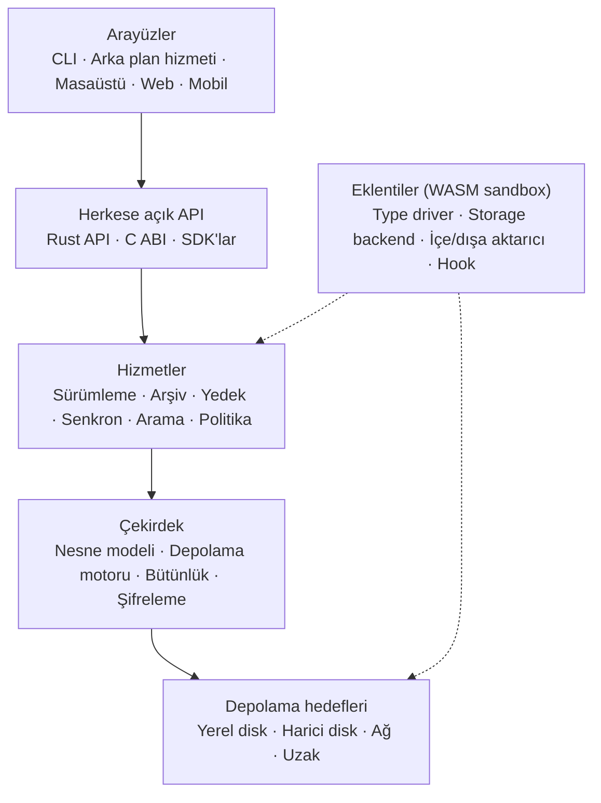

> **English:** [README.md](README.md)

# Apeiron

> Sürüm kontrolü, arşivleme, yedekleme, senkronizasyon ve bütünlük denetimini tek bir çekirdekte birleştiren, genel amaçlı bir veri yönetim motoru.

Apeiron, bir yazılımcının deposuna, bir müzisyenin projesine ve bir ailenin fotoğraf arşivine aynı gözle bakar: hepsi, içerik adresli ve değişmez nesnelerden oluşan snapshot'lardır. Yedek, arşiv, senkron ve sürümleme dört ayrı motor değil, aynı nesne grafiği üzerinde çalışan farklı politikalardır. Yerel önceliklidir: hiçbir temel işlev bulut, hesap ya da internet bağlantısı istemez.

> **Durum:** Erken geliştirme. Aşama 0 (format ve çekirdek) tamamlandı; Aşama 1 (yerel MVP) tamamlandı; Aşama 2 (uzak ve senkron) tamamlandı; Aşama 3 (geliştirici ve ekosistem) tamamlandı; Aşama 4 (arayüzler ve çok kullanıcı) tamamlandı; Aşama 5 (kurumsal) devam ediyor. `apeiron` komutu klasörleri yedekleyebiliyor, senkronlayabiliyor, dallayıp birleştirebiliyor, arayabiliyor ve geri yükleyebiliyor, Git depolarını içe aktarabiliyor; ancak henüz bir sürüm ya da kararlı API yok. Bkz. [docs/ROADMAP.tr.md](docs/ROADMAP.tr.md).

## Temel ilkeler

| # | İlke | Kısaca |
| --- | --- | --- |
| 1 | Genel amaçlılık | Git kavramları çekirdeğin değil bir eklentinin konusudur; hiçbir veri türü varsayılan değildir |
| 2 | Yerel öncelik | Her şey çevrimdışı, hesapsız ve bulutsuz çalışır |
| 3 | Veri sahipliği | Depolama formatı açık ve belgelidir ([docs/FORMAT.tr.md](docs/FORMAT.tr.md)) |
| 4 | Bütünlük | Her nesne kriptografik özetle doğrulanır; bozulma hiçbir zaman sessiz kalmaz |
| 5 | Geri alınabilirlik | Yıkıcı işlemler geri alınabilir; kalıcı silme ayrı bir adımdır |
| 6 | Güvenli varsayılanlar | Şifreleme, izinler ve denetim kaydı baştan tasarımın parçasıdır |
| 7 | İnce çekirdek | Çekirdek veriyi, geçmişi ve politikayı bilir; alana özgü anlam eklentilerdedir |
| 8 | API önceliği | CLI ve tüm arayüzler, herkesin kullandığı aynı herkese açık API'yi kullanır |
| 9 | Kaynak bilinci | Raspberry Pi 4 bir test hedefi değil, gerçek bir hedeftir |
| 10 | Kademeli karmaşıklık | Basit iş basit kalır; ileri düzey kontrol kısıtlanmaz |

İlkelerin tamamı ve gereksinimler: [docs/VISION.tr.md](docs/VISION.tr.md).

## Mimari



Her katman yalnızca hemen altındaki katmanı kullanır. Ayrıntılar: [docs/ARCHITECTURE.tr.md](docs/ARCHITECTURE.tr.md).

## Katmanlar ve crate'ler

| Katman | Crate | Rol | Durum |
| --- | --- | --- | --- |
| Çekirdek | `apeiron-core` | Nesne modeli, chunk bölme, paket/indeks dosyaları, ref ve reflog | Devam ediyor |
| Depolama hedefleri | `apeiron-core`, `apeiron-remote` | Klasör (yerel ya da harici disk), SFTP ve S3 uzak depoları | Tamamlandı |
| Hizmetler | `apeiron-services` | Bugün yedek, geri yükleme, listeleme, fark, senkron, birleştirme ve arama; arşiv ve politika sonra | Devam ediyor |
| Herkese açık API | `apeiron` | Tüm işlemler için Rust API ([docs/API.tr.md](docs/API.tr.md) §8) | Devam ediyor |
| Sistem çağrıları | `apeiron-sys` | `unsafe` gerektiren işletim sistemi çağrıları (Windows write-through) | Tamamlandı |
| C ABI | `apeiron-ffi` | `apeiron.h` başlık dosyasıyla kararlı C arayüzü `libapeiron` ve onun üzerindeki Python SDK'sı ([docs/SDK.tr.md](docs/SDK.tr.md)); `unsafe` kullanabilir | Tamamlandı |
| CLI | `apeiron-cli` | `apeiron` komutu ([docs/CLI.tr.md](docs/CLI.tr.md)) | Devam ediyor |
| Arka plan hizmeti | `apeiron-daemon` | Zamanlanmış işler ve geri yükleme testi ([docs/DAEMON.tr.md](docs/DAEMON.tr.md)) | Tamamlandı |
| Masaüstü arayüzü | `apeiron-server`, `apeiron-desktop` | Komut satırı olmadan yedeklemek ve geri yüklemek için sayfalar, yerel bir sunucu ve bir pencere ([docs/DESKTOP.tr.md](docs/DESKTOP.tr.md)) | Tamamlandı |
| Web arayüzü | `apeiron-server`, `apeiron-cli` | Aynı sayfaların başka bilgisayarlara TLS ile, rolleri ve kendi yedekleri olan kullanıcılara sunulması ([docs/WEB.tr.md](docs/WEB.tr.md), [docs/USERS.tr.md](docs/USERS.tr.md)) | Tamamlandı |
| Git | `apeiron-git` | Git depolarını aynı commit kimlikleriyle içe ve dışa aktarma ([docs/GIT.tr.md](docs/GIT.tr.md)) | Tamamlandı |
| Eklentiler | `apeiron-plugin` | WebAssembly eklenti ortamı; tür sürücüleri dosyaları birleştirir ([docs/PLUGIN.tr.md](docs/PLUGIN.tr.md)) | Tamamlandı |

Planlanan katmanların crate adları, o katmana başlanırken belirlenir.

## Teknoloji yığını

| Alan | Seçim | Durum |
| --- | --- | --- |
| Dil | Rust (2024 sürümü, en az 1.97); C yalnızca ABI için | Kullanımda |
| Özet | BLAKE3, nesne kimliklerinde anahtarlı mod (`blake3`) | Kullanımda |
| Chunk bölme | FastCDC 2020, ortalama 1 MiB (`fastcdc`) | Kullanımda |
| Sıkıştırma | zstd (`zstd`) | Kullanımda |
| Ayar dosyası | TOML (`toml`, `serde`) | Kullanımda |
| Hatalar | Tipli hatalar (`thiserror`) | Kullanımda |
| Yapısal nesneler | Kanonik CBOR (`minicbor`) | Kullanımda |
| Git uyumu | gitoxide (`gix`) | Planlandı |
| Eklentiler | WebAssembly bileşen modeli, Wasmtime | Kullanımda |
| Asenkron çalışma zamanı | Tokio (yalnızca ağ, senkron ve arka plan hizmeti katmanları) | Planlandı |
| CI | GitHub Actions: Linux x86_64/aarch64, macOS ve Windows'ta fmt, clippy, testler | Kullanımda |

Her seçimin gerekçesi: [docs/DECISIONS.tr.md](docs/DECISIONS.tr.md).

## Yol haritası özeti

| Aşama | Kapsam | Durum |
| --- | --- | --- |
| 0. Format ve çekirdek | Format spesifikasyonu, depolama motoru, bütünlük, Rust API taslağı | Tamamlandı |
| 1. Yerel MVP | CLI, snapshot, geçmiş, geri yükleme, yerel yedek hedefleri, tar, zip ve 7z dışa aktarma | Tamamlandı |
| 2. Uzak ve senkron | Arka plan hizmeti, şifreleme, SFTP/S3, senkron, geri yükleme testi | Tamamlandı |
| 3. Geliştirici ve ekosistem | Dal/birleştirme, Git içe/dışa aktarma, C ABI, Python SDK, eklentiler | Tamamlandı |
| 4. Arayüzler ve çok kullanıcı | Masaüstü ve web arayüzü, izinler, denetim kaydı, paylaşım | Devam ediyor |
| 5. Kurumsal | Merkezi kimlik, replikasyon, yüksek erişilebilirlik | Planlandı |

Ayrıntılar ve çıkış kriterleri: [docs/ROADMAP.tr.md](docs/ROADMAP.tr.md).

## Geliştirme

```bash
cargo fmt --all --check
cargo clippy --all-targets -- -D warnings
cargo test
```

Kod, commit ve format değişikliği kuralları: [CONTRIBUTING.tr.md](CONTRIBUTING.tr.md).

## Dokümantasyon

| Belge | İçerik |
| --- | --- |
| [Vizyon](docs/VISION.tr.md) | Ürün vizyonu, ilkeler, gereksinimler, performans hedefleri |
| [Mimari](docs/ARCHITECTURE.tr.md) | Katmanlar, nesne modeli, veri akışları, eklenti sınırı, güvenlik modeli |
| [Depolama formatı](docs/FORMAT.tr.md) | Disk formatı spesifikasyonu, sürüm 1 |
| [Kararlar](docs/DECISIONS.tr.md) | Mimari karar kayıtları (ADR) |
| [Yol haritası](docs/ROADMAP.tr.md) | Aşama 0–5, kapsam, çıkış kriterleri, güncel durum |
| [API](docs/API.tr.md) | Planlanan herkese açık API'nin tasarım ilkeleri (taslak) |
| [CLI](docs/CLI.tr.md) | `apeiron` komutunun tasarımı (taslak) |
| [SDK](docs/SDK.tr.md) | C ABI ve dil SDK'ları |
| [Arka plan hizmeti](docs/DAEMON.tr.md) | Zamanlanmış işler ve geri yükleme testi |
| [Senkron](docs/SYNC.tr.md) | Klasörlerin cihazlar arası senkronu ve çatışma tespiti |
| [Git](docs/GIT.tr.md) | Bir Git deposunu geçmişiyle içe almak ve geri dışa aktarmak |
| [Dallar](docs/BRANCH.tr.md) | Dallanma ve birleştirme |
| [Arama](docs/SEARCH.tr.md) | Dosyaları ada, üst veriye ve metne göre, geçmişte de bulmak |
| [Eklentiler](docs/PLUGIN.tr.md) | WebAssembly eklentileri ve tür sürücüleri |
| [Metin eklentisi](docs/TEXT.tr.md) | Metin dosyalarını satır satır birleştirmek ve farklarını göstermek |
| [Masaüstü arayüzü](docs/DESKTOP.tr.md) | Komut satırı olmadan, bir pencerede yedekleme ve geri yükleme |
| [Web arayüzü](docs/WEB.tr.md) | Bir yedek sunucusunu başka bir bilgisayardaki tarayıcıdan kullanmak |
| [Kullanıcılar ve izinler](docs/USERS.tr.md) | Tek bir yedek sunucusunda, her biri kendi yedekleriyle birkaç kişi |
| [Denetim kaydı](docs/AUDIT.tr.md) | Web arayüzünde kimin ne yaptığının, fark edilmeden değiştirilemeyen kaydı |
| [Merkezi kimlik](docs/IDENTITY.tr.md) | Web arayüzünde bir kurumun OpenID Connect kimlik sağlayıcısı üzerinden oturum açmak |
| [Çok kiracılı kullanım](docs/TENANTS.tr.md) | Tek bir web sunucusunda, her biri kendi adresinde kendi deposu, kullanıcıları ve kayıtlarıyla birkaç kurum |
| [Replikasyon](docs/REPLICATION.tr.md) | Her yedeği ikinci bir yerde tutmak ve görevi devralmaya hazır bir yedek sunucu |
| [Değiştirilemez arşiv](docs/ARCHIVE.tr.md) | Saklanması gereken süre dolmadan kimsenin değiştiremeyeceği ya da silemeyeceği yedekler |
| [Uyumluluk raporları](docs/REPORTS.tr.md) | Denetçiler için tek belge: ne yedekleniyor, eksiksiz, kopyalanmış, korunuyor ve saklanıyor mu ve kimin erişimi vardı |
| [Paylaşım](docs/SHARE.tr.md) | Hesabı olmayan birinin, bitene kadar bir yedeğin sürümünü, klasörünü ya da dosyasını indirebildiği bağlantılar |
| [Kullanım rehberi](docs/GUIDE.tr.md) | Kurulum, günlük yedek, geri yükleme ve bir aylık deneme |
| [Sözlük](docs/GLOSSARY.tr.md) | Terimler ve İngilizce–Türkçe karşılıkları |
| [Katkı](CONTRIBUTING.tr.md) | Geliştirme ortamı ve kurallar |
| [Güvenlik](SECURITY.tr.md) | Güvenlik açığı bildirme, güvenlik ilkeleri |

## Lisans

İki lisanslıdır; dilediğinizi seçebilirsiniz:

- MIT lisansı ([LICENSE-MIT](LICENSE-MIT))
- Apache Lisansı, Sürüm 2.0 ([LICENSE-APACHE](LICENSE-APACHE))

Aksini açıkça belirtmediğiniz sürece gönderdiğiniz her katkı, ek koşul olmadan yukarıdaki gibi iki lisanslı kabul edilir.
