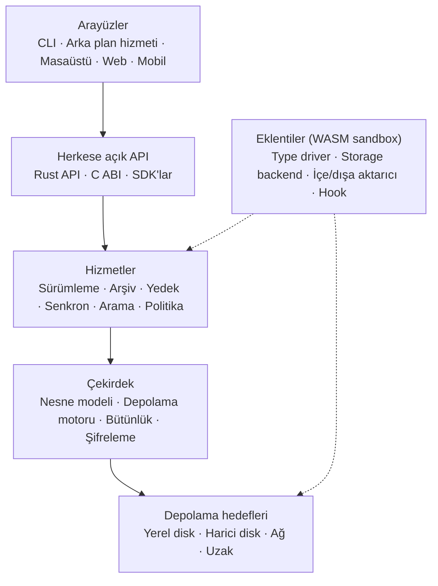

> **English:** [README.md](README.md)

# Apeiron

> Sürüm kontrolü, arşivleme, yedekleme, senkronizasyon ve bütünlük denetimini tek bir çekirdekte birleştiren, genel amaçlı bir veri yönetim motoru.

Apeiron, bir yazılımcının deposuna, bir müzisyenin projesine ve bir ailenin fotoğraf arşivine aynı gözle bakar: hepsi, içerik adresli ve değişmez nesnelerden oluşan snapshot'lardır. Yedek, arşiv, senkron ve sürümleme dört ayrı motor değil, aynı nesne grafiği üzerinde çalışan farklı politikalardır. Yerel önceliklidir: hiçbir temel işlev bulut, hesap ya da internet bağlantısı istemez.

> **Durum:** Erken geliştirme (Aşama 0 — format ve çekirdek). Henüz kullanılabilir bir sürüm, CLI ya da kararlı API yok. Yalnızca `apeiron-core` içindeki depolama motoru yazıldı. Bkz. [docs/ROADMAP.tr.md](docs/ROADMAP.tr.md).

## Temel ilkeler

| # | İlke | Kısaca |
| --- | --- | --- |
| 1 | Genel amaçlılık | Git kavramları çekirdeğin değil bir eklentinin konusudur; hiçbir veri türü varsayılan değildir |
| 2 | Yerel öncelik | Her şey çevrimdışı, hesapsız ve bulutsuz çalışır |
| 3 | Veri sahipliği | Depolama formatı açık ve belgelidir ([docs/FORMAT.tr.md](docs/FORMAT.tr.md)) |
| 4 | Bütünlük | Her nesne kriptografik özetle doğrulanır; bozulma hiçbir zaman sessiz kalmaz |
| 5 | Geri alınabilirlik | Yıkıcı işlemler geri alınabilir; kalıcı silme ayrı bir adımdır |
| 6 | Güvenli varsayılanlar | Şifreleme, izinler ve denetim kaydı baştan tasarımın parçasıdır |
| 7 | İnce çekirdek | Çekirdek veriyi, geçmişi ve politikayı bilir; alana özgü anlam eklentilerdedir |
| 8 | API önceliği | CLI ve tüm arayüzler, herkesin kullandığı aynı herkese açık API'yi kullanır |
| 9 | Kaynak bilinci | Raspberry Pi 4 bir test hedefi değil, gerçek bir hedeftir |
| 10 | Kademeli karmaşıklık | Basit iş basit kalır; ileri düzey kontrol kısıtlanmaz |

İlkelerin tamamı ve gereksinimler: [docs/VISION.tr.md](docs/VISION.tr.md).

## Mimari



Her katman yalnızca hemen altındaki katmanı kullanır. Ayrıntılar: [docs/ARCHITECTURE.tr.md](docs/ARCHITECTURE.tr.md).

## Katmanlar ve crate'ler

| Katman | Crate | Rol | Durum |
| --- | --- | --- | --- |
| Çekirdek | `apeiron-core` | Nesne modeli, chunk bölme, paket/indeks dosyaları, ref ve reflog | Devam ediyor |
| Depolama hedefleri | — | Yerel, harici, SFTP, S3 hedefleri | Planlandı |
| Hizmetler | — | Sürümleme, arşiv, yedek, senkron, arama, politika | Planlandı |
| Herkese açık API | — | Tüm işlemler için kararlı Rust API | Planlandı |
| C ABI | — | Kararlı C arayüzü; `unsafe` kullanabilen tek crate | Planlandı |
| CLI | — | Komut satırı arayüzü | Planlandı |
| Eklentiler | — | WebAssembly eklenti ortamı | Planlandı |

Planlanan katmanların crate adları, o katmana başlanırken belirlenir.

## Teknoloji yığını

| Alan | Seçim | Durum |
| --- | --- | --- |
| Dil | Rust (2024 sürümü, en az 1.85); C yalnızca ABI için | Kullanımda |
| Özet | BLAKE3, nesne kimliklerinde anahtarlı mod (`blake3`) | Kullanımda |
| Chunk bölme | FastCDC 2020, ortalama 1 MiB (`fastcdc`) | Kullanımda |
| Sıkıştırma | zstd (`zstd`) | Kullanımda |
| Ayar dosyası | TOML (`toml`, `serde`) | Kullanımda |
| Hatalar | Tipli hatalar (`thiserror`) | Kullanımda |
| Yapısal nesneler | Kanonik CBOR (`minicbor`) | Kullanımda |
| Git uyumu | gitoxide (`gix`) | Planlandı |
| Eklentiler | WebAssembly bileşen modeli, Wasmtime | Planlandı |
| Asenkron çalışma zamanı | Tokio (yalnızca ağ, senkron ve arka plan hizmeti katmanları) | Planlandı |
| CI | GitHub Actions: Linux x86_64/aarch64, macOS ve Windows'ta fmt, clippy, testler | Kullanımda |

Her seçimin gerekçesi: [docs/DECISIONS.tr.md](docs/DECISIONS.tr.md).

## Yol haritası özeti

| Aşama | Kapsam | Durum |
| --- | --- | --- |
| 0. Format ve çekirdek | Format spesifikasyonu, depolama motoru, bütünlük, Rust API taslağı | Devam ediyor |
| 1. Yerel MVP | CLI, snapshot, geçmiş, geri yükleme, yerel yedek hedefleri, tar/zip dışa aktarma | Planlandı |
| 2. Uzak ve senkron | Arka plan hizmeti, şifreleme, SFTP/S3, senkron, geri yükleme testi | Planlandı |
| 3. Geliştirici ve ekosistem | Dal/birleştirme, Git içe/dışa aktarma, C ABI, Python SDK, eklentiler | Planlandı |
| 4. Arayüzler ve çok kullanıcı | Masaüstü ve web arayüzü, izinler, denetim kaydı, paylaşım | Planlandı |
| 5. Kurumsal | Merkezi kimlik, replikasyon, yüksek erişilebilirlik | Planlandı |

Ayrıntılar ve çıkış kriterleri: [docs/ROADMAP.tr.md](docs/ROADMAP.tr.md).

## Geliştirme

```bash
cargo fmt --all --check
cargo clippy --all-targets -- -D warnings
cargo test
```

Kod, commit ve format değişikliği kuralları: [CONTRIBUTING.tr.md](CONTRIBUTING.tr.md).

## Dokümantasyon

| Belge | İçerik |
| --- | --- |
| [Vizyon](docs/VISION.tr.md) | Ürün vizyonu, ilkeler, gereksinimler, performans hedefleri |
| [Mimari](docs/ARCHITECTURE.tr.md) | Katmanlar, nesne modeli, veri akışları, eklenti sınırı, güvenlik modeli |
| [Depolama formatı](docs/FORMAT.tr.md) | Disk formatı spesifikasyonu, sürüm 1 |
| [Kararlar](docs/DECISIONS.tr.md) | Mimari karar kayıtları (ADR) |
| [Yol haritası](docs/ROADMAP.tr.md) | Aşama 0–5, kapsam, çıkış kriterleri, güncel durum |
| [API](docs/API.tr.md) | Planlanan herkese açık API'nin tasarım ilkeleri (taslak) |
| [Sözlük](docs/GLOSSARY.tr.md) | Terimler ve İngilizce–Türkçe karşılıkları |
| [Katkı](CONTRIBUTING.tr.md) | Geliştirme ortamı ve kurallar |
| [Güvenlik](SECURITY.tr.md) | Güvenlik açığı bildirme, güvenlik ilkeleri |

## Lisans

İki lisanslıdır; dilediğinizi seçebilirsiniz:

- MIT lisansı ([LICENSE-MIT](LICENSE-MIT))
- Apache Lisansı, Sürüm 2.0 ([LICENSE-APACHE](LICENSE-APACHE))

Aksini açıkça belirtmediğiniz sürece gönderdiğiniz her katkı, ek koşul olmadan yukarıdaki gibi iki lisanslı kabul edilir.
