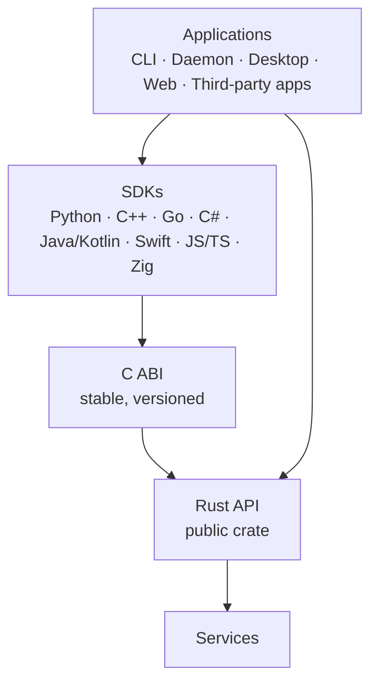
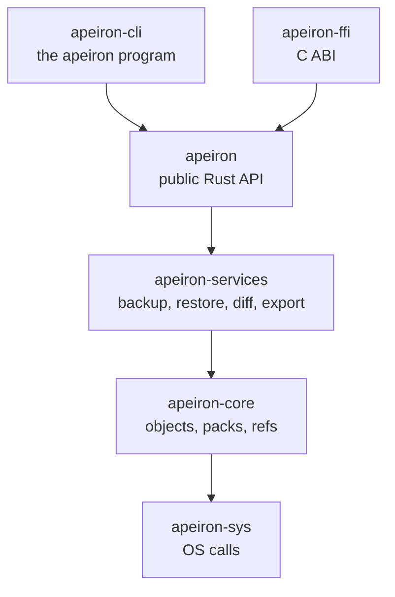

> **Türkçe:** [API.tr.md](API.tr.md)

# Apeiron Public API — Design Principles

> **Status: Draft for review.** Sections 1–7 are the principles of the API; section 8 is the specification of the public `apeiron` crate, implemented in Stage 1; section 9 lists the core functions that already exist. The C ABI and the SDKs are specified in [SDK.md](SDK.md).

The public API is the only way into Apeiron. The CLI, the background service, the desktop and web interfaces and every external application use it; there is no hidden back door ([VISION.md](VISION.md), principle 8).

## 1. Layers



| Layer | Role | Status |
| --- | --- | --- |
| Rust API | The single source of truth; every operation is defined here | In progress (the `apeiron` crate, section 8) |
| C ABI | A stable C interface over the Rust API; one of the two crates allowed to use `unsafe` (with `apeiron-sys`) | Done (`apeiron-ffi`) |
| SDKs | Thin wrappers over the C ABI that follow each language's habits | In progress (Python done) |

SDKs never re-implement logic; they only wrap the C ABI. That is how the same operation gives the same result in every language.

## 2. Operation model

| Principle | Description | Status |
| --- | --- | --- |
| One model, two modes | The same operations and types work in embedded use (library in the same process) and remote use (through the background service) | Planned |
| Complete coverage | Every versioning, archive, backup, sync and administration operation is available; if the CLI can do it, the API can do it | Planned |
| Explicit results | Every critical operation ends in an explicit success or a typed error; there is no "probably done" state | Planned |
| Plain-data inputs and outputs | Requests and results are plain data types that can be serialised (for the remote mode and the C ABI) | Planned |

Long operations (backup, restore, sync, verification) are started as **jobs**. A job can be observed, cancelled and queried for its result (section 8.5).

## 3. Progress and cancellation

| Principle | Description | Status |
| --- | --- | --- |
| Progress reporting | Long jobs report progress (items and bytes done and total, current phase) | Planned |
| Cancellation | Every long job can be cancelled; cancellation leaves the repository in a valid state (old or new, never half) | Planned |
| Timeouts | SDKs support timeouts using the same cancellation mechanism | Planned |
| Result query | A finished job's result can be read later, including in remote mode | Planned |

Cancellation is safe by construction: objects become visible only after they are flushed, and refs are updated last ([FORMAT.md](FORMAT.md) §9).

## 4. Streaming

| Principle | Description | Status |
| --- | --- | --- |
| Streams, not buffers | File content goes in and out as streams (`Read`/`Write` in Rust); content is never loaded into memory whole | Partly done (chunk writing streams in `apeiron-core`) |
| Bounded memory | Memory use is independent of file size; target under 256 MB while adding a 10 GB file on a Raspberry Pi 4 ([VISION.md](VISION.md)) | Planned (to be measured in Stage 1) |
| Lazy listing | History, trees and search results are returned as iterators or pages, not as one big list | Planned |

## 5. Error types

| Principle | Description | Status |
| --- | --- | --- |
| Typed errors | Errors are typed enums (`thiserror`), not strings | Done in `apeiron-core` |
| Corruption is its own error | Data that fails verification produces a distinct corruption error and is never returned | Done in `apeiron-core` |
| Concurrency errors are explicit | "Locked" and "conflict" (compare-and-swap failed) are separate errors so callers can retry or ask the user | Done in `apeiron-core` |
| Non-exhaustive | Error enums are `#[non_exhaustive]` so new errors can be added without breaking callers | Done in `apeiron-core` |
| Stable codes | Every error has a stable numeric code for the C ABI and SDKs | Done |
| No panics across boundaries | A panic never crosses the C ABI; it becomes an error code | Done |

## 6. Versioning policy

| Principle | Description | Status |
| --- | --- | --- |
| Semantic versioning | The Rust API, the C ABI and each SDK follow SemVer | Planned |
| Before 1.0 | Breaking changes are allowed between minor versions and are listed in release notes | Planned |
| From 1.0 | Breaking changes only in a new major version, with a written compatibility policy | Planned |
| Separate versions | The storage format ([FORMAT.md](FORMAT.md)), the C ABI and the plugin API have their own version numbers | Format: Done (version 1); others Planned |
| Minimum Rust version | The workspace declares its minimum supported Rust version (currently 1.97) | Done |

## 7. C ABI and SDK layer

| Principle | Description | Status |
| --- | --- | --- |
| Opaque handles | Repositories, jobs and iterators are opaque pointers with explicit free functions | Done |
| Error codes and messages | Every function returns a status code; a separate call returns the message | Done |
| Ownership is explicit | Every function documents who frees which memory | Done |
| Polled progress | Progress is read with a function call and a job is stopped with a cancel call; no callbacks cross the boundary (section 8.5) | Done |
| Generated header | The C header is generated from the Rust code and checked in CI | Done |
| Shared test suite | The same scenarios run against every SDK and their results are compared | Done |

| SDK wave | Languages | Status |
| --- | --- | --- |
| First | Rust (native), C (ABI), Python | Done |
| First | C++ | Planned |
| Next | Go, C#, Java/Kotlin, Swift, JavaScript/TypeScript, Zig | Planned |

## 8. Rust API specification

This section is the contract of the public `apeiron` crate, version 0.1. The core functions of the Stage 0 draft (section 9) are building blocks below it and are not part of the contract.

### 8.1 Crates



| Crate | Role | Status |
| --- | --- | --- |
| `apeiron` | The only crate applications use: repository handle, operations, jobs, errors | In progress |
| `apeiron-services` | Turns folders into trees and snapshots and back; diff; tar, zip and 7z export | In progress |
| `apeiron-cli` | The `apeiron` command ([CLI.md](CLI.md)) | In progress |
| `apeiron-ffi` | C ABI over `apeiron` ([SDK.md](SDK.md)) | Done |

### 8.2 Repository handle

| Function | What it does |
| --- | --- |
| `Repository::init(path)` | Creates an empty repository and opens it |
| `Repository::init_encrypted(path, password)` | Creates an empty encrypted repository ([FORMAT.md](FORMAT.md) §14), opens it and returns its recovery key, which is never stored and is shown to the user once |
| `Repository::open(path)` | Opens an existing repository; an encrypted one fails with `Key` |
| `Repository::unlock(path, secret)` | Opens a repository with a password or the recovery key |
| `Repository::clone_from(request)` | Long: makes a new repository in a new or empty folder from a remote copy (URL as for `add_remote`), pulls every ref and adds the remote as `origin` ([FORMAT.md](FORMAT.md) §15.6); the request carries the password of an encrypted copy. Returns `CloneReport`: a `TransferReport` per ref |
| `repo.info()` | Returns the path, format version, chunker settings, whether the repository is encrypted and files found damaged when opening |

A `Repository` can be shared between threads (`Send + Sync`). Operations that only read run in parallel; operations that write wait for each other inside the process. Every operation holds the repository lock shared while it runs and garbage collection holds it exclusive ([FORMAT.md](FORMAT.md) §12), so garbage collection never runs beside another program; other writers can work at the same time because refs are updated with compare-and-swap.

### 8.3 Operations

Every operation takes one plain request value and returns one plain result value. Long operations return a job (section 8.5).

| Operation | Request | Result | Long |
| --- | --- | --- | --- |
| `backup` | source folder, ref name, message, author, host, meta | `BackupReport`: snapshot id, counts of files, folders and bytes, bytes newly stored, warnings | Yes |
| `restore` | snapshot, target folder, optional path inside the snapshot | `RestoreReport`: counts, warnings | Yes |
| `export` | snapshot, output file, format (`tar`, `zip` or `7z`; from the extension when absent), optional path | `ExportReport`: counts, warnings | Yes |
| `verify` | — | `VerifyReport`: objects checked, damaged files and objects | Yes |
| `restore_test` | snapshot, bytes to restore (default 100 MiB) | `RestoreTestReport`: files and bytes restored and checked, damaged files | Yes |
| `log` | start snapshot, maximum count | `LogPage`: snapshots, newest first, and where the next page starts | No |
| `list` | snapshot, path | `Vec<EntryInfo>`: name, kind, size, mode, mtime | No |
| `read_file` | snapshot, path of a file | the file's size; its content is written to a `Write` as it is read, so it is not in the JSON API ([SHARE.md](SHARE.md)) | No |
| `diff` | two snapshots | `Vec<Change>`: path and added, removed or modified | No |
| `diff_text` | two snapshots | `Vec<TextDiff>`: path, kind, and the changed lines a plugin shows or why it could not ([TEXT.md](TEXT.md)) | No |
| `refs` | — | `Vec<RefInfo>`: name and snapshot id | No |
| `reflog` | ref name | `Vec<ReflogEntry>` | No |
| `resolve` | snapshot spec (section 8.4) | snapshot id | No |
| `delete_ref` | ref name, expected snapshot | — | No |
| `repair` | — | `RepairReport`: removed locks, repaired reflogs, packs indexed anew, damaged indexes removed | No |
| `gc` | days of reflog to keep (default 90), dry run | `GcReport`: live objects, removed objects, bytes and packs, packs written | Yes |
| `keys` | — | `Vec<KeyInfo>`: id, kind (`password` or `recovery`), when it was added, whether it opened the repository | No |
| `add_password` | new password | `AddedKey`: id | No |
| `add_recovery_key` | — | `AddedKey`: id and the new recovery key, shown to the user once | No |
| `remove_key` | key id or its first characters | the whole id; the last key cannot be removed, and the repository lock is taken exclusive | No |
| `create_ref` | ref name, snapshot spec | the snapshot id; `already_exists` if the ref exists ([BRANCH.md](BRANCH.md)) | No |
| `merge` | snapshot spec to merge, ref to move (default `main`), message, author, dry run | `MergeReport`: action (`up_to_date`, `fast_forward` or `merged`), the snapshot the ref points to now and before, changed paths, conflicts with their copies, files merged by plugins, plugin warnings | No |
| `search` | snapshot spec (absent: `main`, or every ref with history), history, name pattern, text, larger, smaller, after, before, limit (default 1000) | `SearchReport`: hits (path, entry, the newest snapshot holding that version and its time, the first line with the text), whether there were more, snapshots searched, files too large for text ([SEARCH.md](SEARCH.md)); `invalid_input` without a criterion | Yes |
| `plugins`, `add_plugin`, `remove_plugin` (free functions) | plugin folder (default: the user's), file or name | `Vec<PluginInfo>`, `PluginAdded` (info, whether one was replaced), `PluginInfo` ([PLUGIN.md](PLUGIN.md)) | No |
| `use_plugin_dir` | folder | —; merges and sync of this handle use the plugins there | No |
| `remotes` | — | `Vec<Remote>`: name and URL, sorted by name | No |
| `add_remote` | name, URL: a folder path (absolute or relative) `sftp://[user@]host[:port]/path` or `s3://bucket/path?endpoint=…&region=…` | `Remote`, a folder as an absolute path; SFTP and S3 remotes need an encrypted repository | No |
| `remove_remote` | name | —; the remote copy itself is not touched | No |
| `push` | remote name, ref name (default `main`) | `TransferReport`: snapshot the remote ref points to now, the one before, objects and stored bytes copied; `conflict` if the remote has snapshots this copy does not | Yes |
| `pull` | remote name, ref name (default `main`) | `TransferReport`, the same for the local ref; `conflict` if the local ref has snapshots the remote does not | Yes |
| `push_all`, `pull_all` | remote name | `MirrorReport`: per ref its name and either a `TransferReport` or the `conflict` that left it; other errors stop them all ([REPLICATION.md](REPLICATION.md) §2, [FORMAT.md](FORMAT.md) §15.7) | Yes |
| `git_import` | Git repository path, ref prefix (default `git`) | `GitImportReport`: commits and tags stored, refs moved (Git name, ref, Git id, snapshot, previous), skipped refs with the reason, stale refs ([GIT.md](GIT.md)) | Yes |
| `git_export` | Git repository path (created bare if missing), ref prefix | `GitExportReport`: commits and tags written, refs updated, skipped refs, Git ids not reproduced | Yes |
| `sync` | folder, remote name, ref name (default `sync/<folder name>`), mode (`two-way`, `send` or `receive`), dry run | `SyncReport`: ref, action (`up_to_date`, `sent`, `received` or `merged`), snapshot, the backup made, what was fetched and pushed, folder changes, conflicts with their copies, files merged by plugins, paths left for the next round, warnings, rounds run ([SYNC.md](SYNC.md)); `conflict` in `send` mode when the remote has snapshots this copy does not | Yes |

### 8.4 Naming a snapshot

| Form | Example | Meaning |
| --- | --- | --- |
| Ref name | `main`, `backup/home` | The snapshot the ref points to |
| Full id | 64 hex characters | That snapshot |
| Id prefix | 8 or more hex characters | The only stored snapshot whose id starts with them; an error if none or several |
| `~N` suffix | `main~2` | Go N steps back through first parents |

### 8.5 Jobs, progress and cancellation

```rust
// Shape of the API, not final code.
let job = repo.backup(BackupRequest::new("/home/ada/Documents", "main"))?;
while !job.is_finished() {
    let p = job.progress();           // a copy of the current progress
    println!("{} files, {} bytes", p.items_done, p.bytes_done);
    std::thread::sleep(Duration::from_millis(200));
}
let report = job.wait()?;            // or job.cancel()
```

| Rule | Description |
| --- | --- |
| Threads, not async | A job runs on its own thread. The public API is synchronous; no async runtime is needed to use it |
| Polled progress | `job.progress()` returns a copy of `Progress`: phase, items and bytes done, totals when known, current path. Callers read it as often as they like; there are no callbacks, which keeps the C ABI simple |
| Cancellation | `job.cancel()` asks the job to stop. The job checks between files and chunks, stops within a short time and returns the `Cancelled` error. Data written so far stays invisible; refs are not moved |
| One result | `job.wait()` returns the result exactly once; `job.wait_timeout(d)` returns early if the job is still running |
| Dropping a job | Dropping a job without waiting cancels it |

### 8.6 Errors

Every error has a kind with a stable number, a message and, when it applies, a path. The numbers are shared by the C ABI and all SDKs and never change meaning.

| Code | Kind | Meaning |
| --- | --- | --- |
| 1 | `Io` | The operating system reported an error (disk full, permission denied, …) |
| 2 | `NotFound` | Repository, ref, snapshot or path does not exist |
| 3 | `AlreadyExists` | The target exists and the operation does not overwrite |
| 4 | `InvalidInput` | A request value is not valid (bad ref name, bad snapshot spec, …) |
| 5 | `Ambiguous` | An id prefix matches more than one snapshot |
| 6 | `Corrupt` | Stored data failed verification |
| 7 | `Locked` | Another writer holds a lock |
| 8 | `Conflict` | A ref changed concurrently (compare-and-swap failed) |
| 9 | `Cancelled` | The job was cancelled |
| 10 | `Unsupported` | Unknown format version or unsupported feature |
| 11 | `Internal` | A bug in Apeiron; please report it |
| 12 | `Key` | The repository is encrypted and the password or recovery key is missing or wrong |

Problems that do not stop an operation (an unreadable file during a backup, a file that changed while it was read, a skipped device file) are **warnings** in the result, each with a path, a kind and a message.

### 8.7 Plain data

| Rule | Description |
| --- | --- |
| Serialisable | Every request, result, progress and error value can be written as JSON (`serde`). The CLI's `--json` output, the C ABI and the future remote mode use this form |
| Ids | Object ids are 64-character lowercase hex strings in JSON |
| Times | Unix seconds and nanoseconds, UTC |
| Paths and names | A string when the bytes are valid UTF-8; otherwise an object `{"hex": "…"}` holding the raw bytes, so no name is ever lost |
| Additive changes | New optional fields can be added to requests and results in minor versions; readers ignore unknown fields |

### 8.8 Versioning

`apeiron::API_VERSION` holds the version of this contract (0.1). Before 1.0, breaking changes raise the minor version and are listed in the release notes (section 6).

## 9. Stage 0 core functions

These functions of `apeiron-core` are the building blocks of section 8. Applications do not call them directly.

| Area | Functions | Status |
| --- | --- | --- |
| Repository | `init`, `open`, `repair`, `verify` | Done |
| Writing | `writer`, `put_file`, `put_tree`, `put_snapshot`, `finish` | Done |
| Reading | `read_file`, `read_tree`, `read_snapshot`, `history` | Done |
| Refs | `read_ref`, `update_ref`, `reflog`, `list_refs` | Done |
| Types | `ObjectId`, `Blob`, `Tree`, `TreeEntry`, `EntryKind`, `Snapshot`, `Time`, `ReflogEntry`, `VerifyReport`, `Error` | Done |
