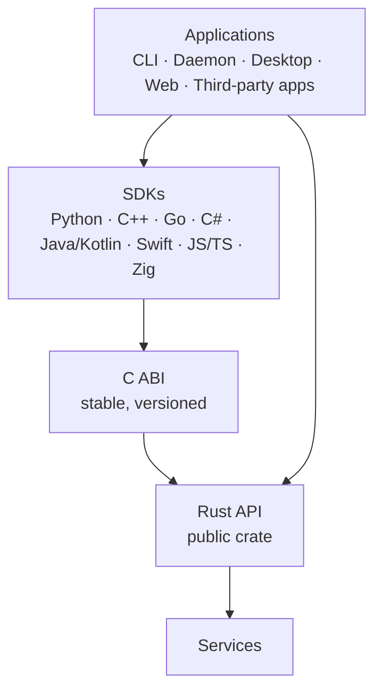

> **Türkçe:** [API.tr.md](API.tr.md)

# Apeiron Public API — Design Principles

> **Status: Draft.** No public API exists yet. This document records the principles the API will follow; names and signatures below are illustrative, not a contract. The types inside `apeiron-core` (for example `Repository`) are internal building blocks and will change.

The public API is the only way into Apeiron. The CLI, the background service, the desktop and web interfaces and every external application use it; there is no hidden back door ([VISION.md](VISION.md), principle 8).

## 1. Layers



| Layer | Role | Status |
| --- | --- | --- |
| Rust API | The single source of truth; every operation is defined here | In progress (Stage 0 draft in `apeiron-core`, section 8) |
| C ABI | A stable C interface over the Rust API; one of the two crates allowed to use `unsafe` (with `apeiron-sys`) | Planned (Stage 3) |
| SDKs | Thin wrappers over the C ABI that follow each language's habits | Planned (Stage 3 onward) |

SDKs never re-implement logic; they only wrap the C ABI. That is how the same operation gives the same result in every language.

## 2. Operation model

| Principle | Description | Status |
| --- | --- | --- |
| One model, two modes | The same operations and types work in embedded use (library in the same process) and remote use (through the background service) | Planned |
| Complete coverage | Every versioning, archive, backup, sync and administration operation is available; if the CLI can do it, the API can do it | Planned |
| Explicit results | Every critical operation ends in an explicit success or a typed error; there is no "probably done" state | Planned |
| Plain-data inputs and outputs | Requests and results are plain data types that can be serialised (for the remote mode and the C ABI) | Planned |

Long operations (backup, restore, sync, verification) are started as **jobs**. A job can be observed, cancelled and queried for its result. An illustrative shape:

```rust
// Illustrative only — not an existing API.
let job = repo.backup(BackupRequest { source, target_ref })?;
job.on_progress(|p| println!("{} / {} bytes", p.done, p.total));
let report = job.wait()?; // or job.cancel()
```

## 3. Progress and cancellation

| Principle | Description | Status |
| --- | --- | --- |
| Progress reporting | Long jobs report progress (items and bytes done and total, current phase) | Planned |
| Cancellation | Every long job can be cancelled; cancellation leaves the repository in a valid state (old or new, never half) | Planned |
| Timeouts | SDKs support timeouts using the same cancellation mechanism | Planned |
| Result query | A finished job's result can be read later, including in remote mode | Planned |

Cancellation is safe by construction: objects become visible only after they are flushed, and refs are updated last ([FORMAT.md](FORMAT.md) §9).

## 4. Streaming

| Principle | Description | Status |
| --- | --- | --- |
| Streams, not buffers | File content goes in and out as streams (`Read`/`Write` in Rust); content is never loaded into memory whole | Partly done (chunk writing streams in `apeiron-core`) |
| Bounded memory | Memory use is independent of file size; target under 256 MB while adding a 10 GB file on a Raspberry Pi 4 ([VISION.md](VISION.md)) | Planned (to be measured in Stage 1) |
| Lazy listing | History, trees and search results are returned as iterators or pages, not as one big list | Planned |

## 5. Error types

| Principle | Description | Status |
| --- | --- | --- |
| Typed errors | Errors are typed enums (`thiserror`), not strings | Done in `apeiron-core` |
| Corruption is its own error | Data that fails verification produces a distinct corruption error and is never returned | Done in `apeiron-core` |
| Concurrency errors are explicit | "Locked" and "conflict" (compare-and-swap failed) are separate errors so callers can retry or ask the user | Done in `apeiron-core` |
| Non-exhaustive | Error enums are `#[non_exhaustive]` so new errors can be added without breaking callers | Done in `apeiron-core` |
| Stable codes | Every error has a stable numeric code for the C ABI and SDKs | Planned |
| No panics across boundaries | A panic never crosses the C ABI; it becomes an error code | Planned |

## 6. Versioning policy

| Principle | Description | Status |
| --- | --- | --- |
| Semantic versioning | The Rust API, the C ABI and each SDK follow SemVer | Planned |
| Before 1.0 | Breaking changes are allowed between minor versions and are listed in release notes | Planned |
| From 1.0 | Breaking changes only in a new major version, with a written compatibility policy | Planned |
| Separate versions | The storage format ([FORMAT.md](FORMAT.md)), the C ABI and the plugin API have their own version numbers | Format: Done (version 1); others Planned |
| Minimum Rust version | The workspace declares its minimum supported Rust version (currently 1.85) | Done |

## 7. C ABI and SDK layer

| Principle | Description | Status |
| --- | --- | --- |
| Opaque handles | Repositories, jobs and iterators are opaque pointers with explicit free functions | Planned |
| Error codes and messages | Every function returns a status code; a separate call returns the message | Planned |
| Ownership is explicit | Every function documents who frees which memory | Planned |
| Callbacks for progress | Progress and cancellation use callbacks and cancel tokens | Planned |
| Generated header | The C header is generated from the Rust code and checked in CI | Planned |
| Shared test suite | The same scenarios run against every SDK and their results are compared | Planned |

| SDK wave | Languages | Status |
| --- | --- | --- |
| First | Rust (native), C (ABI), Python, C++ | Planned |
| Next | Go, C#, Java/Kotlin, Swift, JavaScript/TypeScript, Zig | Planned |

## 8. Stage 0 Rust API draft

Stage 0 ends with a first draft of the Rust API on top of the storage engine. It covers storing and reading data, refs and integrity; jobs, progress and the services above come in later stages. All functions below exist in `apeiron-core`.

### 8.1 Repository

| Function | What it does | Status |
| --- | --- | --- |
| `Repository::init(path)` | Creates an empty repository in a new or empty folder | Done |
| `Repository::open(path)` | Opens a repository; finds packs left without an index by a crash | Done |
| `repo.repair()` | Removes ref locks older than 10 minutes and adds reflog lines lost in a crash | Done |
| `repo.verify()` | Reads and checks every pack, index and object; returns a report of what is damaged | Done |

### 8.2 Writing data

| Function | What it does | Status |
| --- | --- | --- |
| `repo.writer()` | Starts a batch of writes; nothing is visible until `finish` | Done |
| `writer.put_file(reader)` | Splits a stream into chunks, stores them and the blob; returns the size and blob id (none for an empty file) | Done |
| `writer.put_tree(&tree)` | Checks and stores a tree | Done |
| `writer.put_snapshot(&snapshot)` | Checks and stores a snapshot; its tree and parents must already be stored | Done |
| `writer.finish()` | Makes every object of the batch durable and readable | Done |
| `writer.put(type, bytes)`, `writer.put_chunks(reader)` | Low-level writes used by the functions above | Done; to become internal |

### 8.3 Reading data

| Function | What it does | Status |
| --- | --- | --- |
| `repo.read_file(blob_id, writer)` | Writes a file's content to a stream chunk by chunk, verifying each chunk | Done |
| `repo.read_tree(id)` | Reads, verifies and decodes a tree | Done |
| `repo.read_snapshot(id)` | Reads, verifies and decodes a snapshot | Done |
| `repo.history(id)` | Walks snapshots from `id` back through their first parents, lazily | Done |
| `repo.contains(id)`, `repo.read_object(id)` | Low-level object access | Done; to become internal |

### 8.4 Refs

| Function | What it does | Status |
| --- | --- | --- |
| `repo.read_ref(name)` | Returns the snapshot a ref points to, if any | Done |
| `repo.update_ref(name, expected, new)` | Moves, creates or deletes a ref only if it still points to `expected` | Done |
| `repo.reflog(name)` | Returns the change history of a ref | Done |
| `repo.list_refs()` | Lists all refs and their targets | Done |

### 8.5 Data types

| Type | Content | Status |
| --- | --- | --- |
| `ObjectId`, `ObjectType` | 32-byte object id; chunk, blob, tree or snapshot | Done |
| `Blob`, `Tree`, `TreeEntry`, `EntryKind`, `Snapshot`, `Time` | The structured objects of [FORMAT.md](FORMAT.md) §6 | Done |
| `ReflogEntry`, `RefOp` | One reflog line | Done |
| `VerifyReport` | Damaged packs, indexes and objects found by `verify` | Done |
| `Error` | Typed errors (section 5) | Done |

Open question: the public API may live in a separate `apeiron` crate that only re-exports what callers need, so that `apeiron-core` can change freely. The proposal is to create it when the first caller outside the core (the CLI) appears.
