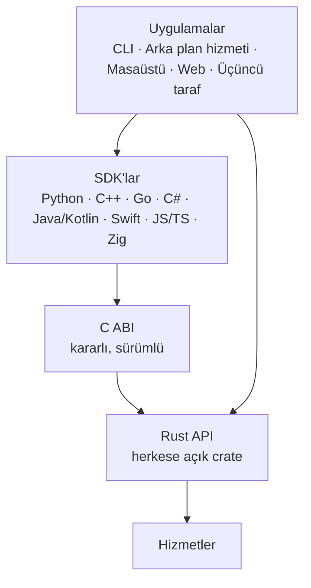

> **English:** [API.md](API.md)

# Apeiron Herkese Açık API — Tasarım İlkeleri

> **Durum: Taslak.** Henüz herkese açık bir API yok. Bu belge API'nin uyacağı ilkeleri kayda geçirir; aşağıdaki adlar ve imzalar örnektir, bağlayıcı değildir. `apeiron-core` içindeki türler (ör. `Repository`) iç yapı taşlarıdır ve değişecektir.

Herkese açık API, Apeiron'a girmenin tek yoludur. CLI, arka plan hizmeti, masaüstü ve web arayüzleri ve tüm dış uygulamalar onu kullanır; gizli iç kapı yoktur ([VISION.tr.md](VISION.tr.md), ilke 8).

## 1. Katmanlar



| Katman | Rol | Durum |
| --- | --- | --- |
| Rust API | Tek doğruluk kaynağı; her işlem burada tanımlanır | Devam ediyor (Aşama 0 taslağı `apeiron-core` içinde, bölüm 8) |
| C ABI | Rust API üzerinde kararlı bir C arayüzü; `unsafe` kullanabilen tek crate | Planlandı (Aşama 3) |
| SDK'lar | C ABI'yi saran, her dilin alışkanlıklarına uyan ince katmanlar | Planlandı (Aşama 3 ve sonrası) |

SDK'lar mantığı yeniden yazmaz, yalnızca C ABI'yi sarar. Aynı işlemin her dilde aynı sonucu vermesi böyle sağlanır.

## 2. İşlem modeli

| İlke | Açıklama | Durum |
| --- | --- | --- |
| Tek model, iki kullanım | Aynı işlemler ve türler gömülü kullanımda (aynı süreçte kütüphane) ve uzak kullanımda (arka plan hizmeti üzerinden) çalışır | Planlandı |
| Eksiksiz kapsam | Sürümleme, arşiv, yedek, senkron ve yönetim işlemlerinin hepsi erişilebilir; CLI'ın yapabildiği her şeyi API de yapabilir | Planlandı |
| Açık sonuç | Her kritik işlem açık bir başarıyla ya da tipli bir hatayla biter; "muhtemelen oldu" durumu yoktur | Planlandı |
| Düz veri giriş ve çıkışları | İstekler ve sonuçlar, serileştirilebilen düz veri türleridir (uzak kullanım ve C ABI için) | Planlandı |

Uzun işlemler (yedek, geri yükleme, senkron, doğrulama) **iş** (job) olarak başlatılır. Bir iş izlenebilir, iptal edilebilir ve sonucu sorgulanabilir. Örnek bir biçim:

```rust
// Yalnızca örnek — var olan bir API değildir.
let job = repo.backup(BackupRequest { source, target_ref })?;
job.on_progress(|p| println!("{} / {} bayt", p.done, p.total));
let report = job.wait()?; // ya da job.cancel()
```

## 3. İlerleme ve iptal

| İlke | Açıklama | Durum |
| --- | --- | --- |
| İlerleme bildirimi | Uzun işler ilerlemeyi bildirir (biten ve toplam öğe ve bayt, o anki evre) | Planlandı |
| İptal | Her uzun iş iptal edilebilir; iptal, depoyu geçerli bir durumda bırakır (eski ya da yeni, asla yarım) | Planlandı |
| Zaman aşımı | SDK'lar aynı iptal mekanizmasıyla zaman aşımını destekler | Planlandı |
| Sonuç sorgulama | Biten bir işin sonucu sonradan okunabilir; uzak kullanımda da | Planlandı |

İptal, tasarım gereği güvenlidir: nesneler ancak diske sabitlendikten sonra görünür ve ref'ler en son güncellenir ([FORMAT.tr.md](FORMAT.tr.md) §9).

## 4. Akış

| İlke | Açıklama | Durum |
| --- | --- | --- |
| Tampon değil akış | Dosya içeriği akış olarak girer ve çıkar (Rust'ta `Read`/`Write`); içerik hiçbir zaman tamamen belleğe alınmaz | Kısmen tamamlandı (`apeiron-core` içinde chunk yazma akışla çalışıyor) |
| Sınırlı bellek | Bellek kullanımı dosya boyutundan bağımsızdır; hedef, Raspberry Pi 4'te 10 GB'lık bir dosya eklerken 256 MB altı ([VISION.tr.md](VISION.tr.md)) | Planlandı (Aşama 1'de ölçülecek) |
| Tembel listeleme | Geçmiş, tree'ler ve arama sonuçları tek büyük liste olarak değil, yineleyici (iterator) ya da sayfalar olarak döner | Planlandı |

## 5. Hata türleri

| İlke | Açıklama | Durum |
| --- | --- | --- |
| Tipli hatalar | Hatalar metin değil, tipli enum'lardır (`thiserror`) | `apeiron-core` içinde tamamlandı |
| Bozulma ayrı bir hatadır | Doğrulamadan geçemeyen veri ayrı bir bozulma hatası üretir ve hiçbir zaman döndürülmez | `apeiron-core` içinde tamamlandı |
| Eşzamanlılık hataları açıktır | "Kilitli" ve "çakışma" (karşılaştır-ve-değiştir başarısız) ayrı hatalardır; çağıran yeniden deneyebilir ya da kullanıcıya sorabilir | `apeiron-core` içinde tamamlandı |
| Genişletilebilir | Hata enum'ları `#[non_exhaustive]` işaretlidir; yeni hatalar çağıranları bozmadan eklenebilir | `apeiron-core` içinde tamamlandı |
| Kararlı kodlar | Her hatanın C ABI ve SDK'lar için kararlı bir sayısal kodu vardır | Planlandı |
| Sınırda panik yok | Panik hiçbir zaman C ABI'yi geçmez; bir hata koduna dönüşür | Planlandı |

## 6. Sürümleme politikası

| İlke | Açıklama | Durum |
| --- | --- | --- |
| Semantik sürümleme | Rust API, C ABI ve her SDK SemVer'e uyar | Planlandı |
| 1.0 öncesi | Küçük sürümler arasında uyumu bozan değişikliklere izin verilir ve sürüm notlarında listelenir | Planlandı |
| 1.0'dan sonra | Uyumu bozan değişiklik yalnızca yeni ana sürümde, yazılı bir uyumluluk politikasıyla | Planlandı |
| Ayrı sürümler | Depolama formatının ([FORMAT.tr.md](FORMAT.tr.md)), C ABI'nin ve eklenti API'sinin kendi sürüm numaraları vardır | Format: Tamamlandı (sürüm 1); diğerleri Planlandı |
| En düşük Rust sürümü | Workspace desteklenen en düşük Rust sürümünü belirtir (şu an 1.85) | Tamamlandı |

## 7. C ABI ve SDK katmanı

| İlke | Açıklama | Durum |
| --- | --- | --- |
| Opak tutamaçlar | Depolar, işler ve yineleyiciler, açık serbest bırakma işlevleri olan opak işaretçilerdir (opaque handle) | Planlandı |
| Hata kodları ve mesajlar | Her işlev bir durum kodu döndürür; mesajı ayrı bir çağrı verir | Planlandı |
| Sahiplik açıktır | Her işlev hangi belleği kimin serbest bırakacağını belgeler | Planlandı |
| İlerleme için geri çağrılar | İlerleme ve iptal, geri çağrılar (callback) ve iptal belirteçleriyle yapılır | Planlandı |
| Üretilen başlık dosyası | C başlık dosyası Rust kodundan üretilir ve CI'da denetlenir | Planlandı |
| Ortak test paketi | Aynı senaryolar her SDK'da çalıştırılır ve sonuçlar karşılaştırılır | Planlandı |

| SDK dalgası | Diller | Durum |
| --- | --- | --- |
| İlk | Rust (yerel), C (ABI), Python, C++ | Planlandı |
| Sonraki | Go, C#, Java/Kotlin, Swift, JavaScript/TypeScript, Zig | Planlandı |

## 8. Aşama 0 Rust API taslağı

Aşama 0, depolama motorunun üzerinde Rust API'nin ilk taslağıyla biter. Taslak veri saklama ve okuma, ref'ler ve bütünlük işlerini kapsar; işler (job), ilerleme ve üstteki hizmetler sonraki aşamalarda gelir. Aşağıdaki işlevlerin tümü `apeiron-core` içinde vardır.

### 8.1 Depo

| İşlev | Ne yapar | Durum |
| --- | --- | --- |
| `Repository::init(path)` | Yeni ya da boş bir klasörde boş bir depo oluşturur | Tamamlandı |
| `Repository::open(path)` | Depoyu açar; bir çökme yüzünden indekssiz kalan paketleri bulur | Tamamlandı |
| `repo.repair()` | 10 dakikadan eski ref kilitlerini kaldırır ve çökmede kaybolan reflog satırlarını ekler | Tamamlandı |
| `repo.verify()` | Her paketi, indeksi ve nesneyi okuyup denetler; bozuk olanların raporunu döndürür | Tamamlandı |

### 8.2 Veri yazma

| İşlev | Ne yapar | Durum |
| --- | --- | --- |
| `repo.writer()` | Bir yazma grubu başlatır; `finish` çağrılana kadar hiçbir şey görünmez | Tamamlandı |
| `writer.put_file(reader)` | Bir akışı chunk'lara böler, onları ve blob'u saklar; boyutu ve blob kimliğini döndürür (boş dosyada kimlik yok) | Tamamlandı |
| `writer.put_tree(&tree)` | Bir tree'yi denetler ve saklar | Tamamlandı |
| `writer.put_snapshot(&snapshot)` | Bir snapshot'ı denetler ve saklar; tree'si ve ebeveynleri önceden saklanmış olmalıdır | Tamamlandı |
| `writer.finish()` | Gruptaki tüm nesneleri kalıcı ve okunabilir yapar | Tamamlandı |
| `writer.put(type, bytes)`, `writer.put_chunks(reader)` | Yukarıdaki işlevlerin kullandığı alt düzey yazma | Tamamlandı; iç kullanıma alınacak |

### 8.3 Veri okuma

| İşlev | Ne yapar | Durum |
| --- | --- | --- |
| `repo.read_file(blob_id, writer)` | Bir dosyanın içeriğini chunk chunk bir akışa yazar, her chunk'ı doğrular | Tamamlandı |
| `repo.read_tree(id)` | Bir tree'yi okur, doğrular ve çözer | Tamamlandı |
| `repo.read_snapshot(id)` | Bir snapshot'ı okur, doğrular ve çözer | Tamamlandı |
| `repo.history(id)` | `id`'den başlayıp ilk ebeveynler üzerinden geriye doğru snapshot'ları, gerektikçe okuyarak dolaşır | Tamamlandı |
| `repo.contains(id)`, `repo.read_object(id)` | Alt düzey nesne erişimi | Tamamlandı; iç kullanıma alınacak |

### 8.4 Ref'ler

| İşlev | Ne yapar | Durum |
| --- | --- | --- |
| `repo.read_ref(name)` | Ref'in gösterdiği snapshot'ı (varsa) döndürür | Tamamlandı |
| `repo.update_ref(name, expected, new)` | Ref'i yalnızca hâlâ `expected`'ı gösteriyorsa taşır, oluşturur ya da siler | Tamamlandı |
| `repo.reflog(name)` | Bir ref'in değişiklik geçmişini döndürür | Tamamlandı |
| `repo.list_refs()` | Tüm ref'leri ve hedeflerini listeler | Tamamlandı |

### 8.5 Veri türleri

| Tür | İçerik | Durum |
| --- | --- | --- |
| `ObjectId`, `ObjectType` | 32 baytlık nesne kimliği; chunk, blob, tree ya da snapshot | Tamamlandı |
| `Blob`, `Tree`, `TreeEntry`, `EntryKind`, `Snapshot`, `Time` | [FORMAT.tr.md](FORMAT.tr.md) §6'daki yapısal nesneler | Tamamlandı |
| `ReflogEntry`, `RefOp` | Bir reflog satırı | Tamamlandı |
| `VerifyReport` | `verify`'ın bulduğu bozuk paketler, indeksler ve nesneler | Tamamlandı |
| `Error` | Tipli hatalar (bölüm 5) | Tamamlandı |

Açık soru: herkese açık API, yalnızca çağıranların ihtiyaç duyduğunu dışa açan ayrı bir `apeiron` crate'inde olabilir; böylece `apeiron-core` serbestçe değişebilir. Öneri, bu crate'in çekirdek dışındaki ilk kullanıcı (CLI) ortaya çıkınca oluşturulmasıdır.
