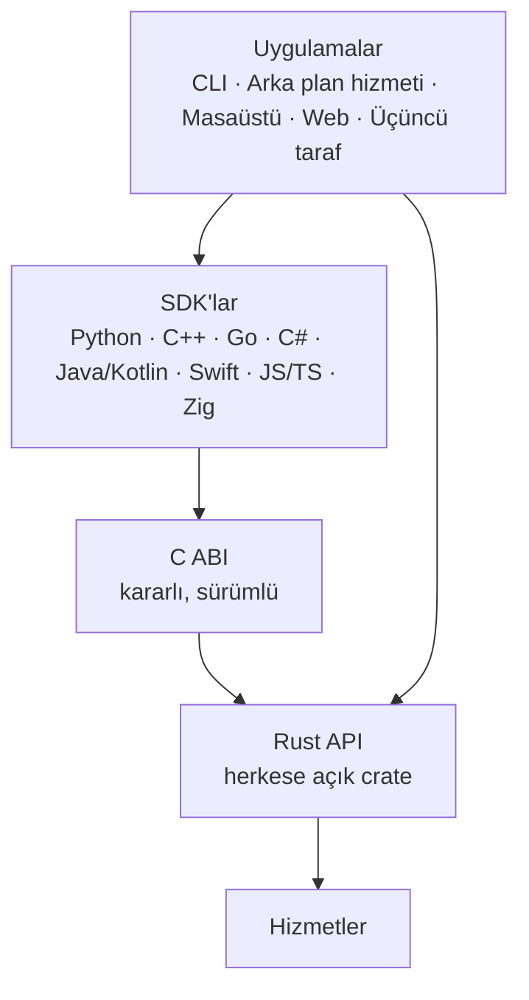
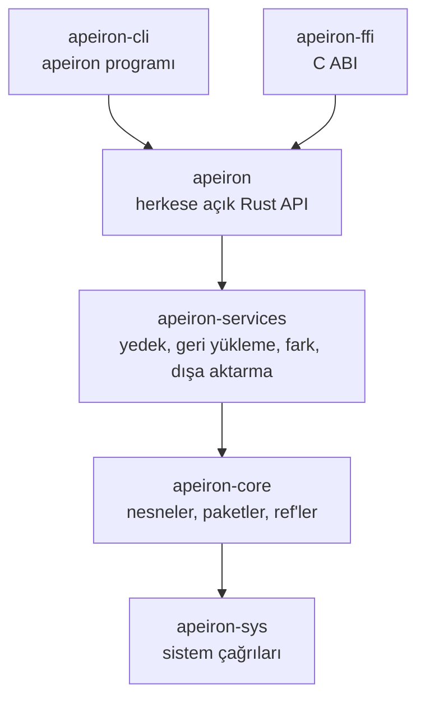

> **English:** [API.md](API.md)

# Apeiron Herkese Açık API — Tasarım İlkeleri

> **Durum: İncelemeye sunulan taslak.** Bölüm 1–7 API'nin ilkeleridir; bölüm 8, Aşama 1'de uygulanmış olan herkese açık `apeiron` crate'inin spesifikasyonudur; bölüm 9 zaten var olan çekirdek işlevleri listeler. C ABI ve SDK'lar [SDK.tr.md](SDK.tr.md) içinde tanımlanır.

Herkese açık API, Apeiron'a girmenin tek yoludur. CLI, arka plan hizmeti, masaüstü ve web arayüzleri ve tüm dış uygulamalar onu kullanır; gizli iç kapı yoktur ([VISION.tr.md](VISION.tr.md), ilke 8).

## 1. Katmanlar



| Katman | Rol | Durum |
| --- | --- | --- |
| Rust API | Tek doğruluk kaynağı; her işlem burada tanımlanır | Devam ediyor (`apeiron` crate'i, bölüm 8) |
| C ABI | Rust API üzerinde kararlı bir C arayüzü; `unsafe` kullanabilen iki crate'ten biri (`apeiron-sys` ile birlikte) | Tamamlandı (`apeiron-ffi`) |
| SDK'lar | C ABI'yi saran, her dilin alışkanlıklarına uyan ince katmanlar | Devam ediyor (Python tamamlandı) |

SDK'lar mantığı yeniden yazmaz, yalnızca C ABI'yi sarar. Aynı işlemin her dilde aynı sonucu vermesi böyle sağlanır.

## 2. İşlem modeli

| İlke | Açıklama | Durum |
| --- | --- | --- |
| Tek model, iki kullanım | Aynı işlemler ve türler gömülü kullanımda (aynı süreçte kütüphane) ve uzak kullanımda (arka plan hizmeti üzerinden) çalışır | Planlandı |
| Eksiksiz kapsam | Sürümleme, arşiv, yedek, senkron ve yönetim işlemlerinin hepsi erişilebilir; CLI'ın yapabildiği her şeyi API de yapabilir | Planlandı |
| Açık sonuç | Her kritik işlem açık bir başarıyla ya da tipli bir hatayla biter; "muhtemelen oldu" durumu yoktur | Planlandı |
| Düz veri giriş ve çıkışları | İstekler ve sonuçlar, serileştirilebilen düz veri türleridir (uzak kullanım ve C ABI için) | Planlandı |

Uzun işlemler (yedek, geri yükleme, senkron, doğrulama) **iş** (job) olarak başlatılır. Bir iş izlenebilir, iptal edilebilir ve sonucu sorgulanabilir (bölüm 8.5).

## 3. İlerleme ve iptal

| İlke | Açıklama | Durum |
| --- | --- | --- |
| İlerleme bildirimi | Uzun işler ilerlemeyi bildirir (biten ve toplam öğe ve bayt, o anki evre) | Planlandı |
| İptal | Her uzun iş iptal edilebilir; iptal, depoyu geçerli bir durumda bırakır (eski ya da yeni, asla yarım) | Planlandı |
| Zaman aşımı | SDK'lar aynı iptal mekanizmasıyla zaman aşımını destekler | Planlandı |
| Sonuç sorgulama | Biten bir işin sonucu sonradan okunabilir; uzak kullanımda da | Planlandı |

İptal, tasarım gereği güvenlidir: nesneler ancak diske sabitlendikten sonra görünür ve ref'ler en son güncellenir ([FORMAT.tr.md](FORMAT.tr.md) §9).

## 4. Akış

| İlke | Açıklama | Durum |
| --- | --- | --- |
| Tampon değil akış | Dosya içeriği akış olarak girer ve çıkar (Rust'ta `Read`/`Write`); içerik hiçbir zaman tamamen belleğe alınmaz | Kısmen tamamlandı (`apeiron-core` içinde chunk yazma akışla çalışıyor) |
| Sınırlı bellek | Bellek kullanımı dosya boyutundan bağımsızdır; hedef, Raspberry Pi 4'te 10 GB'lık bir dosya eklerken 256 MB altı ([VISION.tr.md](VISION.tr.md)) | Planlandı (Aşama 1'de ölçülecek) |
| Tembel listeleme | Geçmiş, tree'ler ve arama sonuçları tek büyük liste olarak değil, yineleyici (iterator) ya da sayfalar olarak döner | Planlandı |

## 5. Hata türleri

| İlke | Açıklama | Durum |
| --- | --- | --- |
| Tipli hatalar | Hatalar metin değil, tipli enum'lardır (`thiserror`) | `apeiron-core` içinde tamamlandı |
| Bozulma ayrı bir hatadır | Doğrulamadan geçemeyen veri ayrı bir bozulma hatası üretir ve hiçbir zaman döndürülmez | `apeiron-core` içinde tamamlandı |
| Eşzamanlılık hataları açıktır | "Kilitli" ve "çakışma" (karşılaştır-ve-değiştir başarısız) ayrı hatalardır; çağıran yeniden deneyebilir ya da kullanıcıya sorabilir | `apeiron-core` içinde tamamlandı |
| Genişletilebilir | Hata enum'ları `#[non_exhaustive]` işaretlidir; yeni hatalar çağıranları bozmadan eklenebilir | `apeiron-core` içinde tamamlandı |
| Kararlı kodlar | Her hatanın C ABI ve SDK'lar için kararlı bir sayısal kodu vardır | Tamamlandı |
| Sınırda panik yok | Panik hiçbir zaman C ABI'yi geçmez; bir hata koduna dönüşür | Tamamlandı |

## 6. Sürümleme politikası

| İlke | Açıklama | Durum |
| --- | --- | --- |
| Semantik sürümleme | Rust API, C ABI ve her SDK SemVer'e uyar | Planlandı |
| 1.0 öncesi | Küçük sürümler arasında uyumu bozan değişikliklere izin verilir ve sürüm notlarında listelenir | Planlandı |
| 1.0'dan sonra | Uyumu bozan değişiklik yalnızca yeni ana sürümde, yazılı bir uyumluluk politikasıyla | Planlandı |
| Ayrı sürümler | Depolama formatının ([FORMAT.tr.md](FORMAT.tr.md)), C ABI'nin ve eklenti API'sinin kendi sürüm numaraları vardır | Format: Tamamlandı (sürüm 1); diğerleri Planlandı |
| En düşük Rust sürümü | Workspace desteklenen en düşük Rust sürümünü belirtir (şu an 1.85) | Tamamlandı |

## 7. C ABI ve SDK katmanı

| İlke | Açıklama | Durum |
| --- | --- | --- |
| Opak tutamaçlar | Depolar, işler ve yineleyiciler, açık serbest bırakma işlevleri olan opak işaretçilerdir (opaque handle) | Tamamlandı |
| Hata kodları ve mesajlar | Her işlev bir durum kodu döndürür; mesajı ayrı bir çağrı verir | Tamamlandı |
| Sahiplik açıktır | Her işlev hangi belleği kimin serbest bırakacağını belgeler | Tamamlandı |
| Sorgulanan ilerleme | İlerleme bir işlev çağrısıyla okunur, iş bir iptal çağrısıyla durdurulur; sınırı hiçbir geri çağrı (callback) geçmez (bölüm 8.5) | Tamamlandı |
| Üretilen başlık dosyası | C başlık dosyası Rust kodundan üretilir ve CI'da denetlenir | Tamamlandı |
| Ortak test paketi | Aynı senaryolar her SDK'da çalıştırılır ve sonuçlar karşılaştırılır | Tamamlandı |

| SDK dalgası | Diller | Durum |
| --- | --- | --- |
| İlk | Rust (yerel), C (ABI), Python | Tamamlandı |
| İlk | C++ | Planlandı |
| Sonraki | Go, C#, Java/Kotlin, Swift, JavaScript/TypeScript, Zig | Planlandı |

## 8. Rust API spesifikasyonu

Bu bölüm herkese açık `apeiron` crate'inin 0.1 sürümlü sözleşmesidir. Aşama 0 taslağının çekirdek işlevleri (bölüm 9) bunun altındaki yapı taşlarıdır ve sözleşmenin parçası değildir.

### 8.1 Crate'ler



| Crate | Görev | Durum |
| --- | --- | --- |
| `apeiron` | Uygulamaların kullandığı tek crate: depo tutamacı, işlemler, işler, hatalar | Devam ediyor |
| `apeiron-services` | Klasörleri tree ve snapshot'a, onları da geri klasöre çevirir; fark; tar, zip ve 7z dışa aktarma | Devam ediyor |
| `apeiron-cli` | `apeiron` komutu ([CLI.tr.md](CLI.tr.md)) | Devam ediyor |
| `apeiron-ffi` | `apeiron` üzerinde C ABI ([SDK.tr.md](SDK.tr.md)) | Tamamlandı |

### 8.2 Depo tutamacı

| İşlev | Ne yapar |
| --- | --- |
| `Repository::init(path)` | Boş bir depo oluşturur ve açar |
| `Repository::init_encrypted(path, password)` | Boş, şifreli bir depo oluşturur ([FORMAT.tr.md](FORMAT.tr.md) §14), açar ve kurtarma anahtarını döndürür; bu anahtar hiçbir yerde saklanmaz ve kullanıcıya bir kez gösterilir |
| `Repository::open(path)` | Var olan bir depoyu açar; şifreli bir depoda `Key` hatası verir |
| `Repository::unlock(path, secret)` | Bir depoyu bir parola ya da kurtarma anahtarıyla açar |
| `Repository::clone_from(request)` | Uzun: yeni ya da boş bir klasörde, bir uzak kopyadan yeni bir depo oluşturur (URL `add_remote`'taki gibi), her ref'i pull eder ve uzak depoyu `origin` olarak ekler ([FORMAT.tr.md](FORMAT.tr.md) §15.6); şifreli bir kopyanın parolası istekle verilir. `CloneReport` döndürür: her ref için bir `TransferReport` |
| `repo.info()` | Yolu, format sürümünü, chunk bölme ayarlarını, deponun şifreli olup olmadığını ve açılırken bozuk bulunan dosyaları döndürür |

Bir `Repository` iş parçacıkları arasında paylaşılabilir (`Send + Sync`). Yalnızca okuyan işlemler paralel çalışır; yazan işlemler süreç içinde birbirini bekler. Her işlem çalışırken depo kilidini paylaşımlı, çöp toplama ise özel tutar ([FORMAT.tr.md](FORMAT.tr.md) §12); böylece çöp toplama hiçbir zaman başka bir programla aynı anda çalışmaz. Diğer yazıcılar aynı anda çalışabilir, çünkü ref'ler karşılaştır ve değiştir ile güncellenir.

### 8.3 İşlemler

Her işlem tek bir düz istek değeri alır ve tek bir düz sonuç değeri döndürür. Uzun işlemler bir iş döndürür (bölüm 8.5).

| İşlem | İstek | Sonuç | Uzun |
| --- | --- | --- | --- |
| `backup` | kaynak klasör, ref adı, açıklama, yazar, cihaz, meta | `BackupReport`: snapshot kimliği, dosya, klasör ve bayt sayıları, yeni saklanan baytlar, uyarılar | Evet |
| `restore` | snapshot, hedef klasör, isteğe bağlı snapshot içi yol | `RestoreReport`: sayılar, uyarılar | Evet |
| `export` | snapshot, çıktı dosyası, biçim (`tar`, `zip` ya da `7z`; verilmezse uzantıdan), isteğe bağlı yol | `ExportReport`: sayılar, uyarılar | Evet |
| `verify` | — | `VerifyReport`: denetlenen nesneler, bozuk dosyalar ve nesneler | Evet |
| `restore_test` | snapshot, geri yüklenecek bayt (varsayılan 100 MiB) | `RestoreTestReport`: geri yüklenip denetlenen dosyalar ve baytlar, bozuk dosyalar | Evet |
| `log` | başlangıç snapshot'ı, en fazla sayı | `LogPage`: en yeniden başlayan snapshot'lar ve sonraki sayfanın başladığı yer | Hayır |
| `list` | snapshot, yol | `Vec<EntryInfo>`: ad, tür, boyut, izinler, değişiklik zamanı | Hayır |
| `diff` | iki snapshot | `Vec<Change>`: yol ve eklendi, silindi ya da değişti | Hayır |
| `refs` | — | `Vec<RefInfo>`: ad ve snapshot kimliği | Hayır |
| `reflog` | ref adı | `Vec<ReflogEntry>` | Hayır |
| `resolve` | snapshot belirteci (bölüm 8.4) | snapshot kimliği | Hayır |
| `delete_ref` | ref adı, beklenen snapshot | — | Hayır |
| `repair` | — | `RepairReport`: kaldırılan kilitler, onarılan reflog'lar, yeniden indekslenen paketler, silinen bozuk indeksler | Hayır |
| `gc` | saklanacak reflog günü (varsayılan 90), deneme çalıştırması | `GcReport`: canlı nesneler; silinen nesneler, baytlar ve paketler; yazılan paketler | Evet |
| `keys` | — | `Vec<KeyInfo>`: kimlik, tür (`password` ya da `recovery`), eklendiği zaman, depoyu onun açıp açmadığı | Hayır |
| `add_password` | yeni parola | `AddedKey`: kimlik | Hayır |
| `add_recovery_key` | — | `AddedKey`: kimlik ve kullanıcıya bir kez gösterilen yeni kurtarma anahtarı | Hayır |
| `remove_key` | anahtar kimliği ya da ilk karakterleri | tam kimlik; son anahtar silinemez ve depo kilidi özel alınır | Hayır |
| `create_ref` | ref adı, snapshot belirteci | snapshot kimliği; ref varsa `already_exists` ([BRANCH.tr.md](BRANCH.tr.md)) | Hayır |
| `merge` | birleştirilecek snapshot belirteci, taşınacak ref (varsayılan `main`), mesaj, yazar, deneme çalışması | `MergeReport`: eylem (`up_to_date`, `fast_forward` ya da `merged`), ref'in şimdi ve önceden işaret ettiği snapshot, değişen yollar, kopyalarıyla çatışmalar | Hayır |
| `search` | snapshot belirteci (yoksa `main`, ya da geçmişle her ref), geçmiş, ad deseni, metin, en az boyut, en çok boyut, sonra, önce, sınır (varsayılan 1000) | `SearchReport`: sonuçlar (yol, girdi, o sürümü tutan en yeni snapshot ve zamanı, metni içeren ilk satır), daha fazlasının olup olmadığı, aranan snapshot sayısı, metin için fazla büyük dosyalar ([SEARCH.tr.md](SEARCH.tr.md)); ölçüt yoksa `invalid_input` | Evet |
| `remotes` | — | `Vec<Remote>`: ad ve URL, ada göre sıralı | Hayır |
| `add_remote` | ad, URL: bir klasör yolu (mutlak ya da göreli) `sftp://[user@]host[:port]/path` ya da `s3://bucket/path?endpoint=…&region=…` | `Remote`, klasör mutlak yol olarak; SFTP ve S3 uzak depoları şifreli bir depo ister | Hayır |
| `remove_remote` | ad | —; uzak kopyanın kendisine dokunulmaz | Hayır |
| `push` | uzak depo adı, ref adı (varsayılan `main`) | `TransferReport`: uzaktaki ref'in şimdi ve önceden gösterdiği snapshot'lar, kopyalanan nesneler ve saklanan baytlar; uzak depoda bu kopyada olmayan snapshot'lar varsa `conflict` | Evet |
| `pull` | uzak depo adı, ref adı (varsayılan `main`) | yerel ref için aynısı, `TransferReport`; yerel ref'te uzak depoda olmayan snapshot'lar varsa `conflict` | Evet |
| `git_import` | Git deposu yolu, ref öneki (varsayılan `git`) | `GitImportReport`: saklanan commit ve etiketler, taşınan ref'ler (Git adı, ref, Git kimliği, snapshot, önceki), nedeniyle atlanan ref'ler, eskimiş ref'ler ([GIT.tr.md](GIT.tr.md)) | Evet |
| `git_export` | Git deposu yolu (yoksa çıplak olarak oluşturulur), ref öneki | `GitExportReport`: yazılan commit ve etiketler, güncellenen ref'ler, atlanan ref'ler, yeniden üretilemeyen Git kimlikleri | Evet |
| `sync` | klasör, uzak depo adı, ref adı (varsayılan `sync/<klasör adı>`), kip (`two-way`, `send` ya da `receive`), deneme çalışması | `SyncReport`: ref, eylem (`up_to_date`, `sent`, `received` ya da `merged`), snapshot, alınan yedek, ne çekildiği ve push edildiği, klasördeki değişiklikler, kopyalarıyla çatışmalar, sonraki tura bırakılan yollar, uyarılar, çalışan tur sayısı ([SYNC.tr.md](SYNC.tr.md)); `send` kipinde uzak depoda bu kopyada olmayan snapshot'lar varsa `conflict` | Evet |

### 8.4 Bir snapshot'ı adlandırma

| Biçim | Örnek | Anlamı |
| --- | --- | --- |
| Ref adı | `main`, `backup/home` | Ref'in gösterdiği snapshot |
| Tam kimlik | 64 hex karakter | O snapshot |
| Kimlik öneki | 8 ya da daha fazla hex karakter | Kimliği bunlarla başlayan tek saklı snapshot; hiç yoksa ya da birden fazlaysa hata |
| `~N` eki | `main~2` | İlk ebeveynler üzerinden N adım geri gider |

### 8.5 İşler, ilerleme ve iptal

```rust
// API'nin biçimi, son kod değildir.
let job = repo.backup(BackupRequest::new("/home/ada/Documents", "main"))?;
while !job.is_finished() {
    let p = job.progress();           // anlık ilerlemenin bir kopyası
    println!("{} dosya, {} bayt", p.items_done, p.bytes_done);
    std::thread::sleep(Duration::from_millis(200));
}
let report = job.wait()?;            // ya da job.cancel()
```

| Kural | Açıklama |
| --- | --- |
| Async değil, iş parçacığı | Bir iş kendi iş parçacığında çalışır. Herkese açık API senkrondur; kullanmak için bir async çalışma zamanı gerekmez |
| Sorgulanan ilerleme | `job.progress()`, `Progress`'in bir kopyasını döndürür: aşama, tamamlanan öğe ve baytlar, biliniyorsa toplamlar, o anki yol. Çağıran istediği sıklıkta okur; geri çağrı yoktur, bu da C ABI'yi basit tutar |
| İptal | `job.cancel()` işin durmasını ister. İş, dosyalar ve chunk'lar arasında denetler, kısa sürede durur ve `Cancelled` hatasını döndürür. O ana kadar yazılan veri görünmez kalır; ref'ler taşınmaz |
| Tek sonuç | `job.wait()` sonucu tam bir kez döndürür; `job.wait_timeout(d)` iş hâlâ sürüyorsa erken döner |
| İşi bırakmak | Beklemeden bırakılan (drop) bir iş iptal edilir |

### 8.6 Hatalar

Her hatanın sabit numaralı bir türü, bir mesajı ve gerekiyorsa bir yolu vardır. Numaralar C ABI ve tüm SDK'larca paylaşılır ve anlamları asla değişmez.

| Kod | Tür | Anlamı |
| --- | --- | --- |
| 1 | `Io` | İşletim sistemi bir hata bildirdi (disk dolu, izin reddedildi, …) |
| 2 | `NotFound` | Depo, ref, snapshot ya da yol yok |
| 3 | `AlreadyExists` | Hedef var ve işlem üzerine yazmaz |
| 4 | `InvalidInput` | Bir istek değeri geçersiz (hatalı ref adı, hatalı snapshot belirteci, …) |
| 5 | `Ambiguous` | Bir kimlik öneki birden fazla snapshot'a uyuyor |
| 6 | `Corrupt` | Saklanan veri doğrulamadan geçemedi |
| 7 | `Locked` | Başka bir yazıcı bir kilidi tutuyor |
| 8 | `Conflict` | Bir ref eşzamanlı olarak değişti (karşılaştır ve değiştir başarısız) |
| 9 | `Cancelled` | İş iptal edildi |
| 10 | `Unsupported` | Bilinmeyen format sürümü ya da desteklenmeyen özellik |
| 11 | `Internal` | Apeiron'da bir hata; lütfen bildirin |
| 12 | `Key` | Depo şifreli ve parola ya da kurtarma anahtarı eksik veya yanlış |

Bir işlemi durdurmayan sorunlar (yedek sırasında okunamayan bir dosya, okunurken değişen bir dosya, atlanan bir aygıt dosyası) sonuçta **uyarı** olarak yer alır; her birinin bir yolu, türü ve mesajı vardır.

### 8.7 Düz veri

| Kural | Açıklama |
| --- | --- |
| Serileştirilebilir | Her istek, sonuç, ilerleme ve hata değeri JSON olarak yazılabilir (`serde`). CLI'ın `--json` çıktısı, C ABI ve ileride uzak kullanım bu biçimi kullanır |
| Kimlikler | Nesne kimlikleri JSON'da 64 karakterlik küçük harfli hex metinlerdir |
| Zamanlar | Unix saniyesi ve nanosaniye, UTC |
| Yollar ve adlar | Baytlar geçerli UTF-8 ise metin; değilse ham baytları tutan bir `{"hex": "…"}` nesnesi; böylece hiçbir ad kaybolmaz |
| Eklemeli değişiklik | Ara sürümlerde isteklere ve sonuçlara yeni isteğe bağlı alanlar eklenebilir; okuyucular bilinmeyen alanları yok sayar |

### 8.8 Sürümleme

`apeiron::API_VERSION` bu sözleşmenin sürümünü (0.1) tutar. 1.0'dan önce geriye uyumsuz değişiklikler ara sürümü yükseltir ve sürüm notlarında listelenir (bölüm 6).

## 9. Aşama 0 çekirdek işlevleri

`apeiron-core`'un bu işlevleri bölüm 8'in yapı taşlarıdır. Uygulamalar bunları doğrudan çağırmaz.

| Alan | İşlevler | Durum |
| --- | --- | --- |
| Depo | `init`, `open`, `repair`, `verify` | Tamamlandı |
| Yazma | `writer`, `put_file`, `put_tree`, `put_snapshot`, `finish` | Tamamlandı |
| Okuma | `read_file`, `read_tree`, `read_snapshot`, `history` | Tamamlandı |
| Ref'ler | `read_ref`, `update_ref`, `reflog`, `list_refs` | Tamamlandı |
| Türler | `ObjectId`, `Blob`, `Tree`, `TreeEntry`, `EntryKind`, `Snapshot`, `Time`, `ReflogEntry`, `VerifyReport`, `Error` | Tamamlandı |
