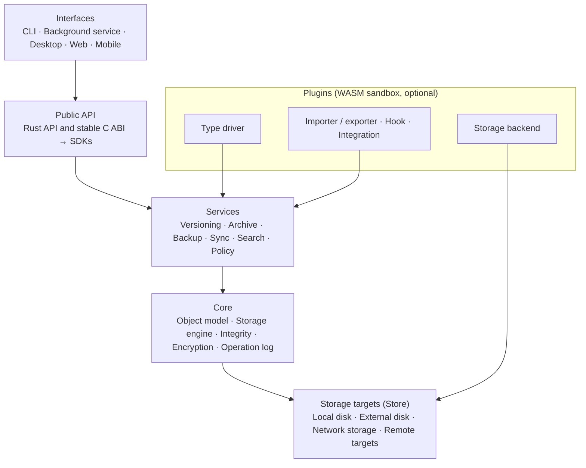
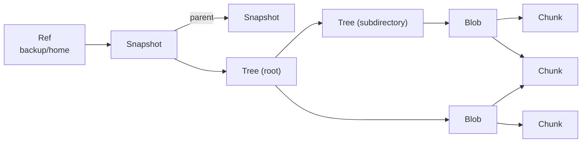
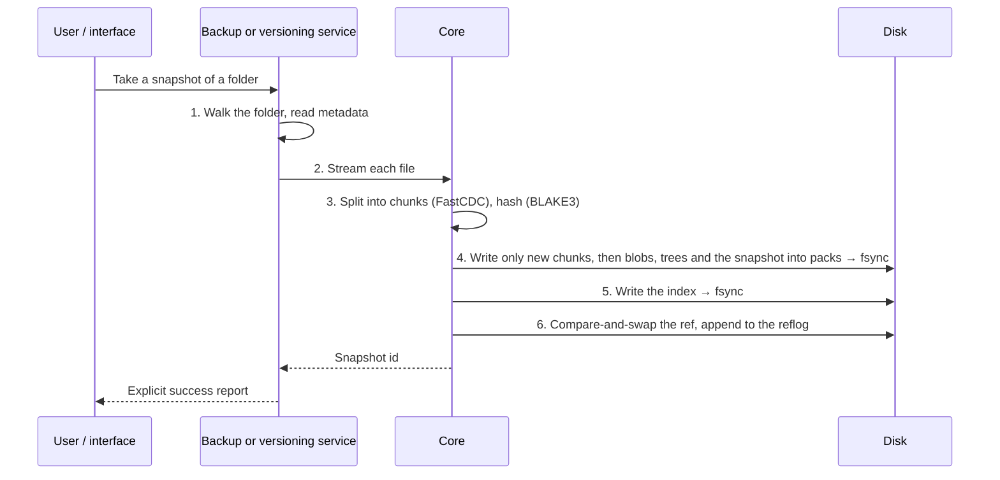
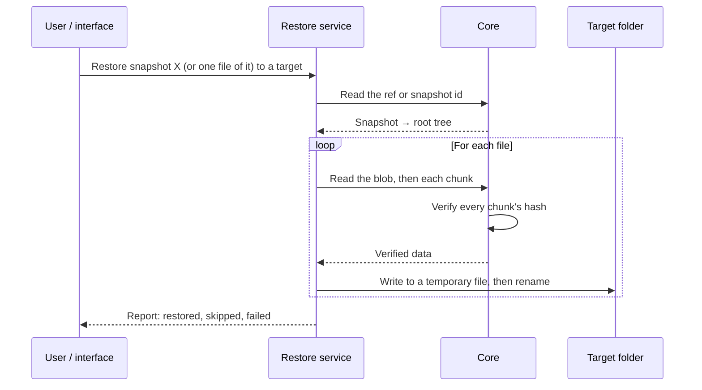
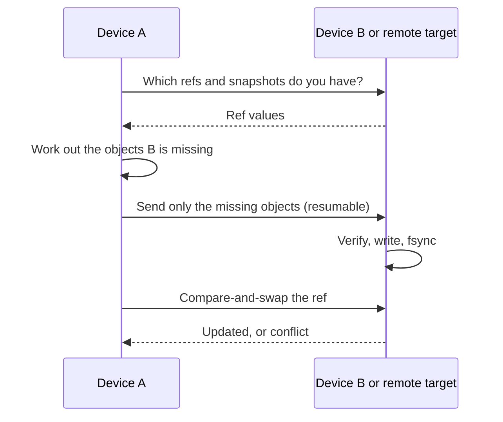
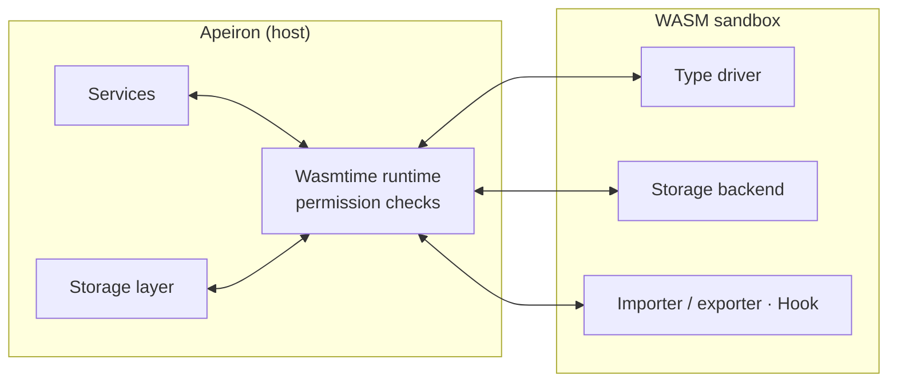

> **Türkçe:** [ARCHITECTURE.tr.md](ARCHITECTURE.tr.md)

# Apeiron Architecture

This document describes how Apeiron is structured: the layers, the object model, how data flows when a snapshot is taken, restored or synchronised, where plugins attach and how security is built in. The goals behind it are in [VISION.md](VISION.md); the exact on-disk format is in [FORMAT.md](FORMAT.md).

Every section states its status. Most of the system is **Planned**; only the storage engine in `apeiron-core` is written.

## 1. Overview

Key design ideas:

- **One object graph, many policies.** Versioning, backup, archiving and sync all read and write the same chunks, blobs, trees, snapshots and refs. There is no separate engine for each.
- **Strict layering.** Each layer uses only the layer directly below it. The core knows no plugin and no interface.
- **Immutable, content-addressed objects.** An object is named by its hash and never modified. Every write follows "write → `fsync` → atomically update the ref".
- **The core is synchronous.** Tokio is used only in the network, sync and daemon layers; the core stays plain blocking code so it is easy to embed and to test.
- **No hidden back door.** The CLI and every interface use the same public API that external developers use.

## 2. Layers and crates

| Layer | Responsibility | Crate | Status |
| --- | --- | --- | --- |
| Interfaces | CLI, background service, desktop, web, mobile | — | Planned |
| Public API | Stable Rust API; C ABI for other languages; SDKs on top | — | Planned |
| Services | Versioning, archive, backup, sync, search, policy | — | Planned |
| Core | Object model, storage engine, integrity, encryption, operation log | `apeiron-core` | In progress |
| Storage targets | Local disk, external disk, network storage, remote targets | — | Planned |
| Plugins | Type drivers, storage backends, importers/exporters, hooks | — | Planned |

Rules that apply to every crate:

- Every layer is a separate crate under `crates/`.
- `unsafe` is allowed only in the FFI (C ABI) crate and in `apeiron-sys`, which holds operating system calls for the core (ADR-014); every other crate has `#![forbid(unsafe_code)]`.
- Library crates use typed errors (`thiserror`) and never call `unwrap`/`expect`.

What `apeiron-core` contains today:

| Module | Content | Status |
| --- | --- | --- |
| `id` | Object identifiers, object types, keyed BLAKE3 | Done |
| `chunker` | FastCDC chunking parameters and streaming splitter | Done |
| `pack` | Pack file writer and reader | Done |
| `index` | Index file writer and reader | Done |
| `refs` | Ref files, compare-and-swap updates, reflogs | Done |
| `config` | The repository `config` file | Done |
| `repo` | Opening/creating a repository, writing and reading objects | Done |
| Blob, tree, snapshot encoding | Canonical CBOR (FORMAT.md §6) | Planned |
| Encryption, operation log | — | Planned |

## 3. Object model

A ref names a snapshot; a snapshot points at a root tree and at its parent snapshots; a tree lists files and subdirectories; a blob lists the chunks of one file. Because chunks are content-addressed, two files (or two versions of one file) that share content share chunks — in the diagram `C2` is stored once.

| Concept | What it is | Status |
| --- | --- | --- |
| Chunk | A content-defined piece of a file, about 1 MiB, addressed by its hash | Done |
| Blob | The ordered chunk list of one file | Done |
| Tree | A directory: names, kinds, permissions, times, attributes | Done |
| Snapshot | The state of a data set at a moment, with parents, author and message | Done |
| Ref | A name pointing at a snapshot; branch, tag and backup point alike | Done |
| Store | Where objects are kept; the same interface for every target | In progress (local directory only) |
| Policy | Retention, encryption, sync and verification rules | Planned |
| Type driver | Type-specific diff, merge, preview and indexing, as a plugin | Planned |

Blob, tree and snapshot are encoded in canonical CBOR with `minicbor`. Nothing creates them from real files yet; that is the job of the backup and versioning services.

## 4. Storage on disk

The full specification is [FORMAT.md](FORMAT.md). In short:

| Part | Purpose | Status |
| --- | --- | --- |
| `config` | Format version, repository id, id key, chunker settings | Done |
| `packs/` | Objects grouped into pack files of 16–64 MiB, zstd-compressed | Done |
| `index/` | Which object is in which pack; a cache that can be rebuilt | Done |
| `refs/`, `logs/` | Ref files and their append-only change logs | Done |
| `tmp/` | Files being written; never repository content | Done |
| `locks/`, `keys/` | Repository locks (Stage 1) and encryption keys (Stage 2) | Planned |

## 5. Data flows

### 5.1 Taking a snapshot

Status: steps 3–6 (storage) are Done; scanning, building trees and the service layer are Planned.

Memory stays bounded: a file is processed as a stream, at most one chunk (`max_size`) is held at a time, and unchanged chunks are recognised by their identifier and not written again.

### 5.2 Restoring

Status: Planned (reading and verifying objects is Done).

A chunk that fails verification is never written to the target; the error is reported. Repair from another verified copy is planned for Stage 1.

### 5.3 Synchronising

Status: Planned (Stage 2). The transfer protocol is not designed yet; the flow below shows the intended principle from [VISION.md](VISION.md).

Sync is not backup: every device keeps its own history and reflogs, so a deletion or corruption that spreads through sync can still be undone on each device. A conflicting ref update is rejected, never silently overwritten.

## 6. Plugin boundary

Status: Planned (Stage 3).

- Plugins are WebAssembly components run by Wasmtime. They see only the capabilities they declared and the user approved.
- Type drivers and importers/exporters attach to the service layer; storage backends attach to the storage layer. The core never calls a plugin.
- The plugin API is versioned separately; an incompatible plugin is not loaded.
- A plugin that crashes or times out is isolated and its operation is rolled back.
- Everything works without any plugin installed.

## 7. Security model

| Area | Rule | Status |
| --- | --- | --- |
| Integrity | Every object read is verified against its identifier; corruption returns a typed error | Done |
| Integrity | Pack and index files are named by their plain BLAKE3 hash, so anyone can check them without the key | Done |
| Integrity | Ref files and reflog lines carry checksums | Done |
| Privacy | Object identifiers use keyed BLAKE3, so a remote target cannot test whether a known file is stored | Done |
| Crash safety | Write → `fsync` → rename → directory `fsync`; refs are updated with compare-and-swap | Done |
| Encryption | Client-side encryption; the remote target never sees plaintext; keys stay with the user | Planned (Stage 2) |
| Identity and permissions | Separate read, write, delete, share and admin permissions | Planned (Stage 4) |
| Audit log | Sensitive operations are logged; sensitive data never is | Planned (Stage 4) |
| Plugins | WASM sandbox with declared, user-approved permissions | Planned (Stage 3) |
| Memory safety | `unsafe` only in the FFI crate and `apeiron-sys` | In effect |
| Remote access | Off by default; configured explicitly | Planned (Stage 2) |
| Telemetry | Off by default; data is never sent to a third party as a requirement | In effect (there is no telemetry) |

Reporting vulnerabilities: [SECURITY.md](../SECURITY.md).

## 8. Concurrency and crash safety

Status: Done for the storage engine.

- **Writers never conflict on objects.** Packs are written under random temporary names and named by their hash; two writers storing the same object simply produce two valid copies.
- **Refs are updated with compare-and-swap.** A writer states the value it expects; if the ref changed in the meantime the update is rejected with a conflict error instead of overwriting.
- **Lock files are exclusive.** A ref's `.lock` file is created with "create only if absent"; a second writer gets a "locked" error.
- **Objects become visible only when complete.** A ref can point only at a snapshot that is already stored and indexed, so it can never point at a missing or half-written object.
- **Interruptions leave a known state.** The expected state after a power failure at every step is listed in [FORMAT.md](FORMAT.md) §10; these cases are the Stage 0 fault-injection tests.
