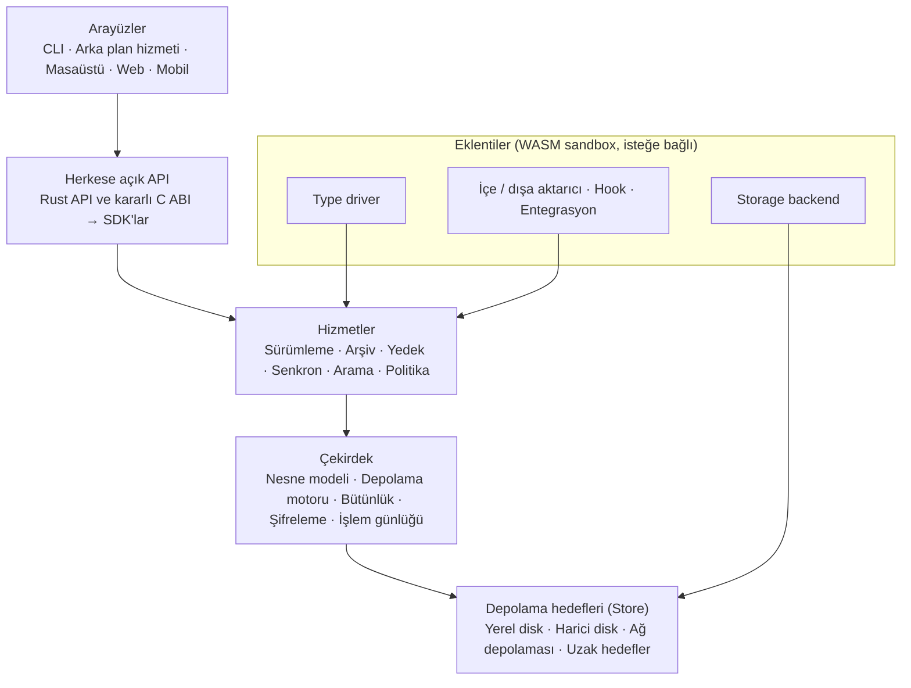
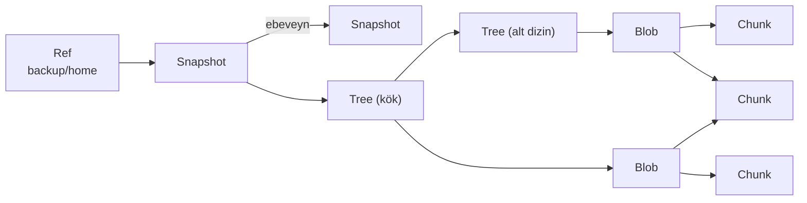
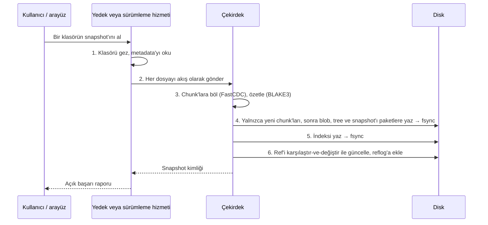
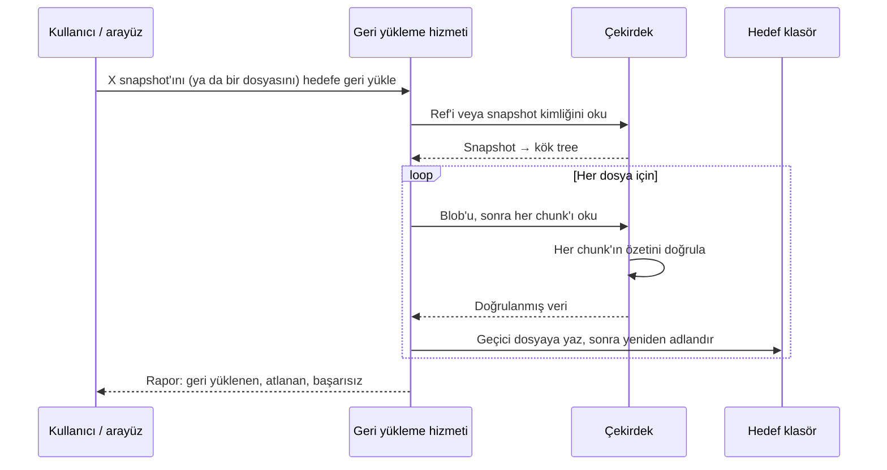
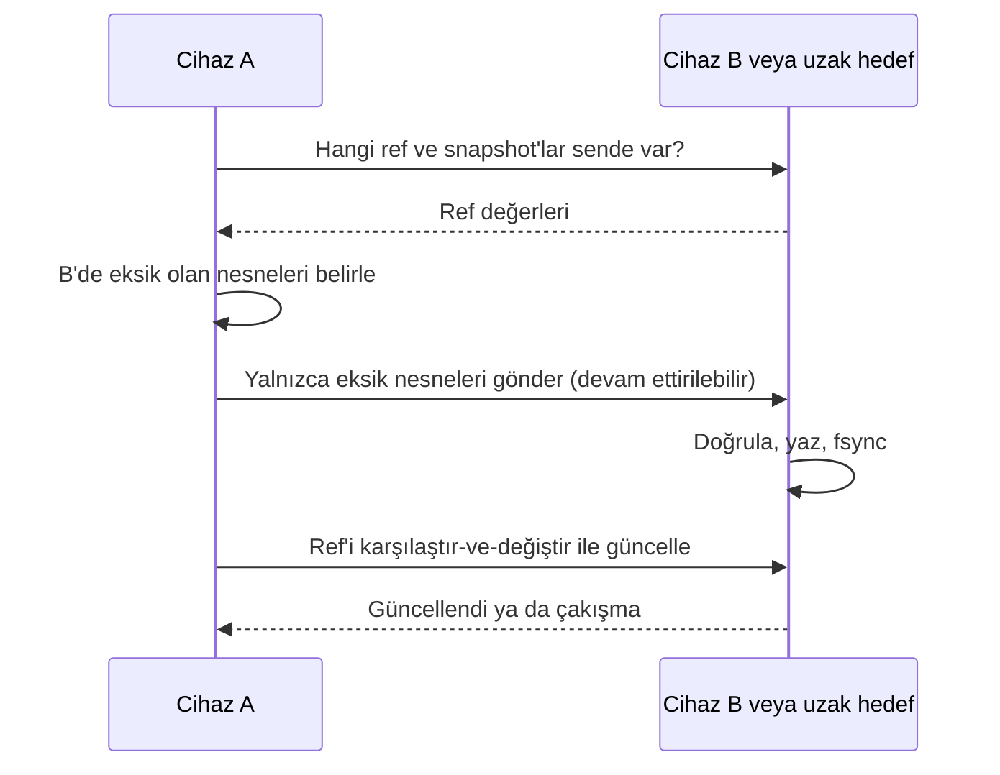
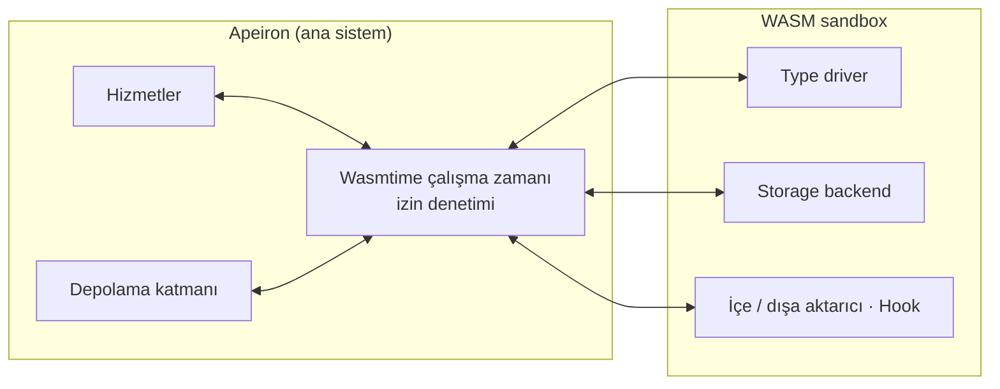

> **English:** [ARCHITECTURE.md](ARCHITECTURE.md)

# Apeiron Mimarisi

Bu belge Apeiron'un nasıl kurulduğunu anlatır: katmanlar, nesne modeli, bir snapshot alınırken, geri yüklenirken ya da senkronlanırken verinin izlediği yol, eklentilerin nereye bağlandığı ve güvenliğin tasarıma nasıl yerleştiği. Arkasındaki hedefler [VISION.tr.md](VISION.tr.md), diskteki formatın tam tanımı [FORMAT.tr.md](FORMAT.tr.md) içindedir.

Her bölüm kendi durumunu belirtir. Sistemin büyük kısmı **Planlandı** durumundadır; yalnızca `apeiron-core` içindeki depolama motoru yazıldı.

## 1. Genel bakış

Temel tasarım fikirleri:

- **Tek nesne grafiği, çok politika.** Sürümleme, yedek, arşiv ve senkron aynı chunk, blob, tree, snapshot ve ref'leri okuyup yazar. Her biri için ayrı motor yoktur.
- **Katı katmanlama.** Her katman yalnızca hemen altındakini kullanır. Çekirdek hiçbir eklentiyi ve arayüzü tanımaz.
- **Değişmez, içerik adresli nesneler.** Bir nesnenin adı özetidir (hash) ve nesne hiç değiştirilmez. Her yazma "yaz → `fsync` → ref'i atomik güncelle" sırasını izler.
- **Çekirdek senkron çalışır.** Tokio yalnızca ağ, senkron ve arka plan hizmeti katmanlarında kullanılır; çekirdek, gömmesi ve test etmesi kolay olsun diye sade, bloklayan kod olarak kalır.
- **Gizli iç kapı yok.** CLI ve tüm arayüzler, dış geliştiricilerin kullandığı aynı herkese açık API'yi kullanır.

## 2. Katmanlar ve crate'ler

| Katman | Sorumluluk | Crate | Durum |
| --- | --- | --- | --- |
| Arayüzler | CLI, arka plan hizmeti, masaüstü, web, mobil | — | Planlandı |
| Herkese açık API | Kararlı Rust API; diğer diller için C ABI; üstünde SDK'lar | — | Planlandı |
| Hizmetler | Sürümleme, arşiv, yedek, senkron, arama, politika | — | Planlandı |
| Çekirdek | Nesne modeli, depolama motoru, bütünlük, şifreleme, işlem günlüğü | `apeiron-core` | Devam ediyor |
| Depolama hedefleri | Yerel disk, harici disk, ağ depolaması, uzak hedefler | — | Planlandı |
| Eklentiler | Type driver'lar, storage backend'ler, içe/dışa aktarıcılar, hook'lar | — | Planlandı |

Her crate için geçerli kurallar:

- Her katman `crates/` altında ayrı bir crate'tir.
- `unsafe` yalnızca FFI (C ABI) crate'inde serbesttir; diğer her crate'te `#![forbid(unsafe_code)]` vardır.
- Kütüphane crate'leri tipli hatalar (`thiserror`) kullanır, `unwrap`/`expect` çağırmaz.

`apeiron-core` bugün şunları içeriyor:

| Modül | İçerik | Durum |
| --- | --- | --- |
| `id` | Nesne kimlikleri, nesne türleri, anahtarlı BLAKE3 | Tamamlandı |
| `chunker` | FastCDC chunk bölme ayarları ve akışlı bölücü | Tamamlandı |
| `pack` | Paket dosyası yazıcı ve okuyucu | Tamamlandı |
| `index` | İndeks dosyası yazıcı ve okuyucu | Tamamlandı |
| `refs` | Ref dosyaları, karşılaştır-ve-değiştir güncellemeleri, reflog'lar | Tamamlandı |
| `config` | Deponun `config` dosyası | Tamamlandı |
| `repo` | Depo açma/oluşturma, nesne yazma ve okuma | Tamamlandı |
| Blob, tree, snapshot kodlaması | Kanonik CBOR (FORMAT.tr.md §6) | Planlandı |
| Şifreleme, işlem günlüğü | — | Planlandı |

## 3. Nesne modeli

Ref bir snapshot'a ad verir; snapshot bir kök tree'yi ve ebeveyn snapshot'larını gösterir; tree dosyaları ve alt dizinleri listeler; blob bir dosyanın chunk'larını listeler. Chunk'lar içerik adresli olduğu için içeriği ortak olan iki dosya (ya da bir dosyanın iki sürümü) aynı chunk'ları paylaşır; diyagramdaki `C2` yalnızca bir kez saklanır.

| Kavram | Ne olduğu | Durum |
| --- | --- | --- |
| Chunk | Dosyanın içerik-tanımlı, yaklaşık 1 MiB'lık parçası; özetiyle adreslenir | Tamamlandı |
| Blob | Bir dosyanın sıralı chunk listesi | Tamamlandı |
| Tree | Bir dizin: adlar, türler, izinler, zamanlar, öznitelikler | Tamamlandı |
| Snapshot | Bir veri kümesinin belirli andaki durumu; ebeveynleri, yazarı ve açıklamasıyla | Tamamlandı |
| Ref | Bir snapshot'ı gösteren ad; dal, etiket ve yedek noktası aynı şeydir | Tamamlandı |
| Store | Nesnelerin saklandığı yer; her hedef için aynı arayüz | Devam ediyor (yalnızca yerel klasör) |
| Policy | Saklama, şifreleme, senkron ve doğrulama kuralları | Planlandı |
| Type driver | Türe özgü diff, birleştirme, önizleme ve indeksleme; eklenti olarak | Planlandı |

Blob, tree ve snapshot `minicbor` ile kanonik CBOR olarak kodlanır. Bunları gerçek dosyalardan oluşturan bir kod henüz yok; bu, yedek ve sürümleme hizmetlerinin işidir.

## 4. Diskte saklama

Tam spesifikasyon [FORMAT.tr.md](FORMAT.tr.md) içindedir. Kısaca:

| Bölüm | Amaç | Durum |
| --- | --- | --- |
| `config` | Format sürümü, depo kimliği, kimlik anahtarı, chunk bölme ayarları | Tamamlandı |
| `packs/` | 16–64 MiB'lık, zstd ile sıkıştırılmış paket dosyalarında toplanan nesneler | Tamamlandı |
| `index/` | Hangi nesnenin hangi pakette olduğu; yeniden üretilebilen bir önbellek | Tamamlandı |
| `refs/`, `logs/` | Ref dosyaları ve yalnızca sonuna eklenen değişiklik günlükleri | Tamamlandı |
| `tmp/` | Yazılmakta olan dosyalar; hiçbir zaman depo içeriği sayılmaz | Tamamlandı |
| `locks/`, `keys/` | Depo kilitleri (Aşama 1) ve şifreleme anahtarları (Aşama 2) | Planlandı |

## 5. Veri akışları

### 5.1 Snapshot alma

Durum: 3–6. adımlar (depolama) Tamamlandı; klasörü tarama, tree oluşturma ve hizmet katmanı Planlandı.

Bellek kullanımı sınırlı kalır: dosya akış olarak işlenir, aynı anda en fazla bir chunk (`max_size`) bellekte tutulur ve değişmeyen chunk'lar kimliklerinden tanınıp yeniden yazılmaz.

### 5.2 Geri yükleme

Durum: Planlandı (nesneleri okuma ve doğrulama Tamamlandı).

Doğrulamadan geçemeyen bir chunk hedefe hiçbir zaman yazılmaz; hata raporlanır. Başka bir doğrulanmış kopyadan onarım Aşama 1'de planlandı.

### 5.3 Senkronlama

Durum: Planlandı (Aşama 2). Aktarım protokolü henüz tasarlanmadı; aşağıdaki akış [VISION.tr.md](VISION.tr.md) belgesindeki hedeflenen ilkeyi gösterir.

Senkron yedek değildir: her cihaz kendi geçmişini ve reflog'larını tutar, bu yüzden senkronla yayılan bir silme ya da bozulma her cihazda yine geri alınabilir. Çakışan bir ref güncellemesi reddedilir, sessizce üzerine yazılmaz.

## 6. Eklenti sınırı

Durum: Planlandı (Aşama 3).

- Eklentiler, Wasmtime'ın çalıştırdığı WebAssembly bileşenleridir. Yalnızca bildirdikleri ve kullanıcının onayladığı yetenekleri görürler.
- Type driver'lar ve içe/dışa aktarıcılar hizmet katmanına, storage backend'ler depolama katmanına bağlanır. Çekirdek hiçbir zaman eklenti çağırmaz.
- Eklenti API'si ayrı sürümlenir; uyumsuz eklenti yüklenmez.
- Çöken ya da zaman aşımına uğrayan eklenti yalıtılır ve yaptığı işlem geri alınır.
- Hiçbir eklenti kurulu olmadan da her şey çalışır.

## 7. Güvenlik modeli

| Alan | Kural | Durum |
| --- | --- | --- |
| Bütünlük | Okunan her nesne kimliğiyle doğrulanır; bozulma tipli bir hata döndürür | Tamamlandı |
| Bütünlük | Paket ve indeks dosyalarının adı düz BLAKE3 özetidir; anahtarı bilmeyen de denetleyebilir | Tamamlandı |
| Bütünlük | Ref dosyaları ve reflog satırları sağlama özeti taşır | Tamamlandı |
| Gizlilik | Nesne kimlikleri anahtarlı BLAKE3'tür; uzak hedef bilinen bir dosyanın saklanıp saklanmadığını sınayamaz | Tamamlandı |
| Kesinti güvenliği | Yaz → `fsync` → yeniden adlandır → klasör `fsync`; ref'ler karşılaştır-ve-değiştir ile güncellenir | Tamamlandı (Windows'ta write-through Planlandı) |
| Şifreleme | İstemci tarafı şifreleme; uzak hedef düz metni hiç görmez; anahtarlar kullanıcıda kalır | Planlandı (Aşama 2) |
| Kimlik ve izinler | Okuma, yazma, silme, paylaşma ve yönetme izinleri ayrıdır | Planlandı (Aşama 4) |
| Denetim kaydı | Hassas işlemler kaydedilir; hassas veri hiçbir zaman kaydedilmez | Planlandı (Aşama 4) |
| Eklentiler | Bildirilmiş ve kullanıcının onayladığı izinlerle WASM sandbox | Planlandı (Aşama 3) |
| Bellek güvenliği | `unsafe` yalnızca FFI crate'inde | Uygulanıyor |
| Uzak erişim | Varsayılan olarak kapalı; açıkça yapılandırılır | Planlandı (Aşama 2) |
| Telemetri | Varsayılan olarak kapalı; veri hiçbir zaman zorunlu olarak üçüncü tarafa gönderilmez | Uygulanıyor (telemetri yok) |

Güvenlik açığı bildirme: [SECURITY.tr.md](../SECURITY.tr.md).

## 8. Eşzamanlılık ve kesinti güvenliği

Durum: Depolama motoru için Tamamlandı.

- **Yazıcılar nesnelerde çakışmaz.** Paketler rastgele geçici adlarla yazılır ve özetleriyle adlandırılır; aynı nesneyi saklayan iki yazıcı yalnızca iki geçerli kopya üretir.
- **Ref'ler karşılaştır-ve-değiştir ile güncellenir.** Yazıcı beklediği değeri söyler; ref bu arada değiştiyse güncelleme üzerine yazmak yerine çakışma hatasıyla reddedilir.
- **Kilit dosyaları tekildir.** Bir ref'in `.lock` dosyası "yalnızca yoksa oluştur" ile açılır; ikinci yazıcı "kilitli" hatası alır.
- **Nesneler ancak tamamlanınca görünür.** Bir ref yalnızca zaten saklanmış ve indekslenmiş bir snapshot'ı gösterebilir; bu yüzden var olmayan ya da yarım yazılmış bir nesneyi asla göstermez.
- **Kesintiler bilinen bir durum bırakır.** Her adımda elektrik kesilirse oluşacak beklenen durum [FORMAT.tr.md](FORMAT.tr.md) §10'da listelidir; bu durumlar Aşama 0'ın hata enjeksiyonu testleridir.
