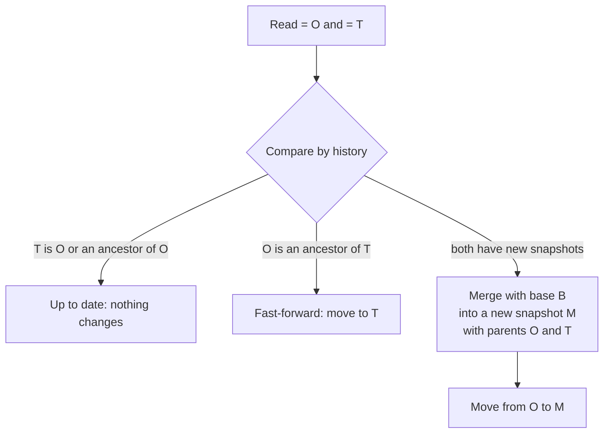

> **Türkçe:** [BRANCH.tr.md](BRANCH.tr.md)

# Branching and Merging

> **Status: Done.** This is the design of Stage 3 work item 2 ([ROADMAP.md](ROADMAP.md) §5): creating and removing branches and merging one into another. The decision behind it is ADR-022 ([DECISIONS.md](DECISIONS.md)).

A branch is a ref (FORMAT.md §9.3): a name pointing to a snapshot. Branches, tags and backup points are the same thing to Apeiron; what makes a ref a branch is only that new snapshots are added to it. Branching therefore needs a way to create a ref from any snapshot, and a merge that joins two lines of history. The merge is the same three-way merge that sync uses ([SYNC.md](SYNC.md) §4), on snapshots instead of a folder.

## 1. Commands

| Command | What it does | Status |
| --- | --- | --- |
| `apeiron ref create <name> [<snapshot>]` | Creates a ref pointing to a snapshot (default `main`); fails if the name exists | Done |
| `apeiron ref delete <name>` | Removes a ref; its reflog keeps the history (FORMAT.md §9.4), so it can be brought back until garbage collection | Done |
| `apeiron merge <from> [--into <ref>] [--message <text>] [--dry-run]` | Merges the snapshot `<from>` names into the ref `<into>` (default `main`); exit code 3 when there are conflicts | Done |

A branch is worked on as any folder is: `apeiron restore feature ~/feature` writes it into a folder, `apeiron backup ~/feature --ref feature` records the changes, and `apeiron merge feature` joins them into `main`. `apeiron diff main feature` shows what a merge would bring.

## 2. A merge

1. Read the snapshot O that `<into>` points to and the snapshot T that `<from>` names (a ref, an id or `main~2`, API.md §8.4).
2. If T is O or one of its ancestors, there is nothing to do. If O is an ancestor of T, the ref simply moves to T (fast-forward); no new snapshot is made.
3. Otherwise find the last common snapshot B (the nearest one from T that O also reaches; none when the histories never met) and merge path by path as in SYNC.md §4, with O as "here" and T as "there". Two versions of a file that both sides changed differently are both kept: O's at its path and T's as `name (conflict <from>).ext`, where `<from>` is the name given, with `/` replaced by `-`.
4. Store M with parents O and T, the time of the merge, the author and host given, and the message given or `merge <from> into <into>`, followed by one line per conflict. Move `<into>` from O to M with compare-and-swap: if another program moved it meanwhile, the merge fails with a conflict and changes nothing.

`--dry-run` stops before step 4 and reports the same result. The result lists the files the merge changes in `<into>` and every conflict.

## 3. What a merge compares

A file counts as changed when its kind, content or permission bits changed; times and owners alone do not, as in sync. A folder is compared by what it holds. A merge never looks inside a file: two changes to different lines of the same text file are a conflict. Merging the content of text and other file types is the task of type drivers, which come with the plugin system (VISION.md); the text diff plugin of Stage 3 is the first.

## 4. Not part of this work item

| Item | Where |
| --- | --- |
| Merging inside a file, line by line | The text diff plugin, Stage 3 |
| Rebase and cherry-pick | Later; a merge keeps both lines of history, which loses nothing |
| A working folder that follows a branch (`checkout` or `switch`) | Later; `restore` and `backup` cover it, and sync shows how a folder is changed safely |
| A tool to resolve conflicts | The desktop interface (Stage 4); conflict copies are plain files until then |

## 5. Crates

| Crate | Role | Status |
| --- | --- | --- |
| `apeiron-services` | The merge, shared by sync and `merge` | Done |
| `apeiron` | `create_ref` and `merge` (API.md §8.3) | Done |
| `apeiron-cli` | `apeiron ref` and `apeiron merge` | Done |
