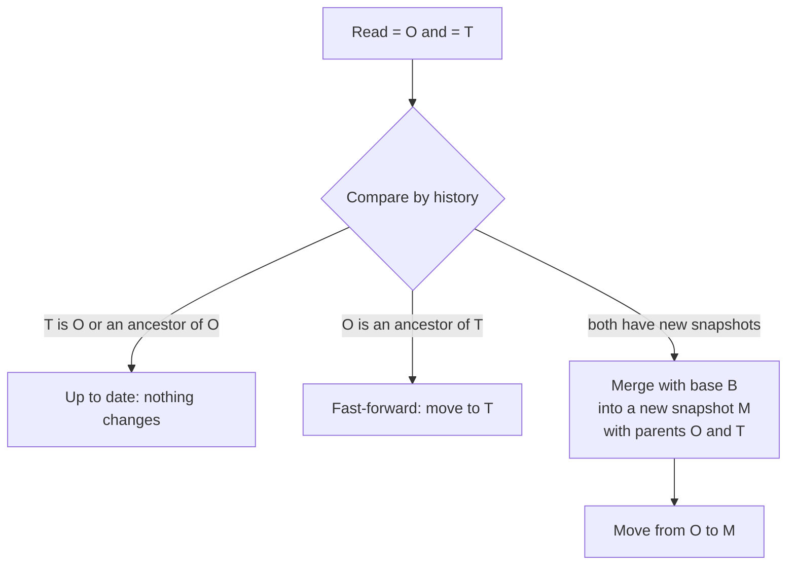

> **Türkçe:** [BRANCH.tr.md](BRANCH.tr.md)

# Branching and Merging

> **Status: Done.** This is the design of Stage 3 work item 2 ([ROADMAP.md](ROADMAP.md) §5): creating and removing branches and merging one into another. The decision behind it is ADR-022 ([DECISIONS.md](DECISIONS.md)).

A branch is a ref (FORMAT.md §9.3): a name pointing to a snapshot. Branches, tags and backup points are the same thing to Apeiron; what makes a ref a branch is only that new snapshots are added to it. Branching therefore needs a way to create a ref from any snapshot, and a merge that joins two lines of history. The merge is the same three-way merge that sync uses ([SYNC.md](SYNC.md) §4), on snapshots instead of a folder.

## 1. Commands

| Command | What it does | Status |
| --- | --- | --- |
| `apeiron ref create <name> [<snapshot>]` | Creates a ref pointing to a snapshot (default `main`); fails if the name exists | Done |
| `apeiron ref delete <name>` | Removes a ref; its reflog keeps the history (FORMAT.md §9.4), so it can be brought back until garbage collection | Done |
| `apeiron merge <from> [--into <ref>] [--message <text>] [--dry-run]` | Merges the snapshot `<from>` names into the ref `<into>` (default `main`); exit code 3 when there are conflicts | Done |
| `apeiron cherry-pick <snapshot> [--into <ref>] [--message <text>] [--dry-run]` | Copies the changes one snapshot made into the ref `<into>` (default `main`) as a new snapshot there (section 4); exit code 3 when there are conflicts | Done |
| `apeiron rebase <branch> [--onto <snapshot>] [--dry-run]` | Copies the snapshots of `<branch>` that `<onto>` (default `main`) lacks on top of it and moves `<branch>` there (section 5); exit code 3 when there are conflicts | Done |
| `apeiron switch <snapshot> <folder> [--dry-run]` | Makes a working folder hold a snapshot, usually a branch, recording what it held first (section 6); exit code 3 when files changed during the switch | Done |

A branch is worked on as any folder is: `apeiron switch feature ~/work` writes it into a folder, `apeiron backup ~/feature --ref feature` records the changes, and `apeiron merge feature` joins them into `main`. `apeiron diff main feature` shows what a merge would bring.

## 2. A merge

1. Read the snapshot O that `<into>` points to and the snapshot T that `<from>` names (a ref, an id or `main~2`, API.md §8.4).
2. If T is O or one of its ancestors, there is nothing to do. If O is an ancestor of T, the ref simply moves to T (fast-forward); no new snapshot is made.
3. Otherwise find the last common snapshot B (the nearest one from T that O also reaches; none when the histories never met) and merge path by path as in SYNC.md §4, with O as "here" and T as "there". Two versions of a file that both sides changed differently are both kept: O's at its path and T's as `name (conflict <from>).ext`, where `<from>` is the name given, with `/` replaced by `-`.
4. Store M with parents O and T, the time of the merge, the author and host given, and the message given or `merge <from> into <into>`, followed by one line per conflict. Move `<into>` from O to M with compare-and-swap: if another program moved it meanwhile, the merge fails with a conflict and changes nothing.

`--dry-run` stops before step 4 and reports the same result. The result lists the files the merge changes in `<into>` and every conflict.

## 3. What a merge compares

A file counts as changed when its kind, content or permission bits changed; times and owners alone do not, as in sync. A folder is compared by what it holds. A merge never looks inside a file: two changes to different lines of the same text file are a conflict. Merging the content of text and other file types is the task of type drivers, which come with the plugin system (VISION.md); the text diff plugin of Stage 3 is the first.

## 4. Cherry-pick

A cherry-pick brings one fix from a branch without the rest of the branch. For the snapshot P that `<snapshot>` names:

1. Take P's first parent as the base B; a snapshot without parents has an empty base, so all its files are brought.
2. Merge path by path as in section 2 step 3, with the snapshot O that `<into>` points to as "here" and P as "there". Only what P changed from B differs from the base, so only that comes over; a file both changed differently is kept twice, P's version as `name (conflict <snapshot>).ext`.
3. If the result equals O, the ref already holds the changes and nothing is written (`up_to_date`).
4. Otherwise store a snapshot with the single parent O and the message given or `cherry-pick <snapshot> into <into>` followed by P's message, and move `<into>` with compare-and-swap as a merge does (`picked`).

Unlike a merge, the new snapshot does not have P as a parent: the history of `<into>` stays one line, and a later merge of the branch compares the files again, finds the fix already there and does not count it twice.

## 5. Rebase

A rebase makes a branch start from the newest snapshot of another, as if its work had been done after it; a later merge into `main` is then a fast-forward and the history stays one line.

1. If `<onto>` is already in the history of `<branch>`, nothing changes; if `<branch>` is in the history of `<onto>`, `<branch>` simply moves to `<onto>`.
2. Otherwise take the snapshots of `<branch>` along first parents, newest first, until one that `<onto>` also has; these are the branch's own.
3. Copy them oldest first, each as a cherry-pick (section 4) onto the copy before it, starting at `<onto>`, but keeping each one's time, author, host and message. A file both sides changed differently is kept twice, the branch's version as `name (conflict <branch>).ext`, and the conflict is added to that copy's message. A snapshot whose changes are already there is left out.
4. Move `<branch>` from its old snapshot to the last copy with compare-and-swap. The old snapshots are not deleted: the reflog of `<branch>` still names them until garbage collection (FORMAT.md §9.4). A ref kept by a retention rule only moves forward (ARCHIVE.md), so it cannot be rebased.

## 6. A working folder

`apeiron switch <snapshot> <folder>` makes one folder hold one branch after another, as `git switch` does. Apeiron remembers what the folder holds with the local ref `folder/switch/<folder name>` (the name as in SYNC.md §2), the same kind of ref sync keeps for its folders (SYNC.md §3). It is never pushed.

1. Record the folder as a tree F, as a backup does, without moving any ref yet. A missing folder counts as empty.
2. If the folder has no ref yet, it must be empty or hold the same files as a ref, for example after `restore`; anything else fails and changes nothing, so a folder of unrelated files is never replaced by mistake.
3. If F differs from the snapshot the folder ref points to in more than times, store F as a snapshot with that one as parent and the message `switch: the folder before switching to <snapshot>`, and move the folder ref to it. Work not backed up is thus never lost: the result names this snapshot, and `apeiron restore` brings it back.
4. Change the folder from F to the snapshot as sync applies a snapshot (SYNC.md §5): only what differs is written or removed, each file through a temporary file and one rename, and a file changed while the switch runs is left alone with the snapshot's version beside it as `name (conflict <snapshot>).ext`.
5. Move the folder ref to the snapshot.

The switch records the folder but does not back it up into a branch: changes are kept in a branch with `apeiron backup <folder> --ref <branch>` as before. `--dry-run` stops after step 2 and lists the changes step 4 would make. Two folders with the same last name share one folder ref; that costs only an extra recorded snapshot, never a file.

## 7. Not part of this work item

| Item | Where |
| --- | --- |
| Merging inside a file, line by line | The text diff plugin, Stage 3 |
| A tool to resolve conflicts | The desktop interface (Stage 4); conflict copies are plain files until then |

## 8. Crates

| Crate | Role | Status |
| --- | --- | --- |
| `apeiron-services` | The merge, shared by sync, `merge`, `cherry_pick` and `rebase`; `switch` | Done |
| `apeiron` | `create_ref`, `merge`, `cherry_pick`, `rebase` and `switch` (API.md §8.3) | Done |
| `apeiron-cli` | `apeiron ref`, `apeiron merge`, `apeiron cherry-pick`, `apeiron rebase` and `apeiron switch` | Done |
