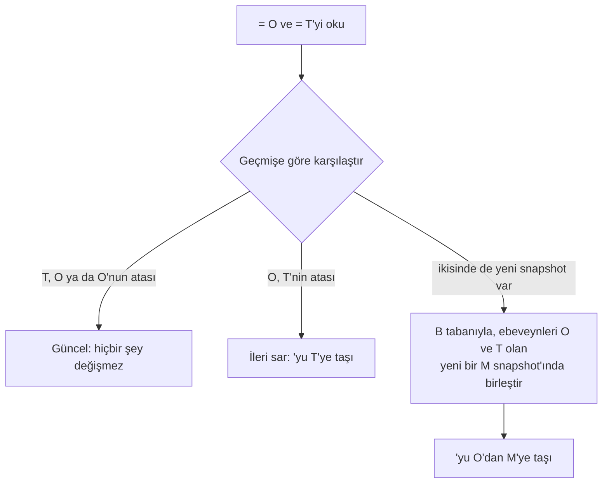

> **English:** [BRANCH.md](BRANCH.md)

# Dallanma ve Birleştirme

> **Durum: Tamamlandı.** Aşama 3'ün 2. işinin tasarımıdır ([ROADMAP.tr.md](ROADMAP.tr.md) §5): dal oluşturmak, silmek ve birini ötekine birleştirmek. Arkasındaki karar ADR-022'dir ([DECISIONS.tr.md](DECISIONS.tr.md)).

Bir dal bir ref'tir (FORMAT.tr.md §9.3): bir snapshot'a işaret eden bir ad. Apeiron için dallar, etiketler ve yedek noktaları aynı şeydir; bir ref'i dal yapan tek şey ona yeni snapshot'ların eklenmesidir. Bu yüzden dallanma için, herhangi bir snapshot'tan ref oluşturmanın bir yolu ve iki geçmiş çizgisini birleştiren bir birleştirme gerekir. Birleştirme, senkronun kullandığı üç yönlü birleştirmenin aynısıdır ([SYNC.tr.md](SYNC.tr.md) §4); klasör yerine snapshot'lar üzerinde çalışır.

## 1. Komutlar

| Komut | Ne yapar | Durum |
| --- | --- | --- |
| `apeiron ref create <name> [<snapshot>]` | Bir snapshot'a (varsayılan `main`) işaret eden bir ref oluşturur; ad varsa başarısız olur | Tamamlandı |
| `apeiron ref delete <name>` | Bir ref'i siler; reflog'u geçmişi tutar (FORMAT.tr.md §9.4), böylece çöp toplamaya kadar geri getirilebilir | Tamamlandı |
| `apeiron merge <from> [--into <ref>] [--message <text>] [--dry-run]` | `<from>`'un adlandırdığı snapshot'ı `<into>` ref'ine (varsayılan `main`) birleştirir; çatışma varsa çıkış kodu 3'tür | Tamamlandı |

Bir dal üzerinde her klasörde olduğu gibi çalışılır: `apeiron restore feature ~/feature` onu bir klasöre yazar, `apeiron backup ~/feature --ref feature` değişiklikleri kaydeder ve `apeiron merge feature` onları `main`'e birleştirir. `apeiron diff main feature`, bir birleştirmenin ne getireceğini gösterir.

## 2. Bir birleştirme

1. `<into>`'nun işaret ettiği O snapshot'ını ve `<from>`'un adlandırdığı T snapshot'ını oku (bir ref, bir kimlik ya da `main~2`, API.tr.md §8.4).
2. T, O ya da onun atalarından biriyse yapılacak bir şey yoktur. O, T'nin atasıysa ref yalnızca T'ye taşınır (ileri sarma); yeni snapshot yapılmaz.
3. Aksi hâlde son ortak snapshot B'yi bul (T'den en yakın olup O'nun da ulaştığı; geçmişler hiç buluşmadıysa yoktur) ve SYNC.tr.md §4'teki gibi, O "burası" ve T "orası" olmak üzere yol yol birleştir. İki tarafın da farklı değiştirdiği bir dosyanın iki sürümü de tutulur: O'nunki yolunda, T'ninki `name (conflict <from>).ext` olarak; burada `<from>` verilen addır ve `/` yerine `-` yazılır.
4. M'yi; ebeveynleri O ve T, birleştirmenin zamanı, verilen yazar ve sunucu adı ve verilen mesaj ya da `merge <from> into <into>` ve ardından her çatışma için bir satır ile sakla. `<into>`'yu karşılaştır ve değiştir ile O'dan M'ye taşı: bu arada başka bir program onu taşıdıysa birleştirme bir çatışmayla başarısız olur ve hiçbir şeyi değiştirmez.

`--dry-run` 4. adımdan önce durur ve aynı sonucu raporlar. Sonuç, birleştirmenin `<into>`'da değiştirdiği dosyaları ve her çatışmayı listeler.

## 3. Bir birleştirme neyi karşılaştırır

Bir dosyanın türü, içeriği ya da izin bitleri değiştiyse dosya değişmiş sayılır; senkrondaki gibi yalnızca zamanlar ve sahipler sayılmaz. Bir klasör tuttuklarıyla karşılaştırılır. Bir birleştirme asla bir dosyanın içine bakmaz: aynı metin dosyasının farklı satırlarındaki iki değişiklik bir çatışmadır. Metnin ve diğer dosya türlerinin içeriğini birleştirmek, eklenti sistemiyle gelen tür sürücülerinin işidir (VISION.tr.md); Aşama 3'ün metin diff eklentisi ilkidir.

## 4. Bu işin parçası olmayanlar

| Konu | Nerede |
| --- | --- |
| Bir dosyanın içinde, satır satır birleştirme | Metin diff eklentisi, Aşama 3 |
| Rebase ve cherry-pick | Daha sonra; bir birleştirme iki geçmiş çizgisini de tutar ve hiçbir şey kaybetmez |
| Bir dalı izleyen çalışma klasörü (`checkout` ya da `switch`) | Daha sonra; `restore` ve `backup` bunu karşılar ve senkron bir klasörün güvenle nasıl değiştirildiğini gösterir |
| Çatışmaları çözmek için bir araç | Masaüstü arayüzü (Aşama 4); o zamana kadar çatışma kopyaları düz dosyalardır |

## 5. Crate'ler

| Crate | Görev | Durum |
| --- | --- | --- |
| `apeiron-services` | Senkron ve `merge` tarafından paylaşılan birleştirme | Tamamlandı |
| `apeiron` | `create_ref` ve `merge` (API.tr.md §8.3) | Tamamlandı |
| `apeiron-cli` | `apeiron ref` ve `apeiron merge` | Tamamlandı |
