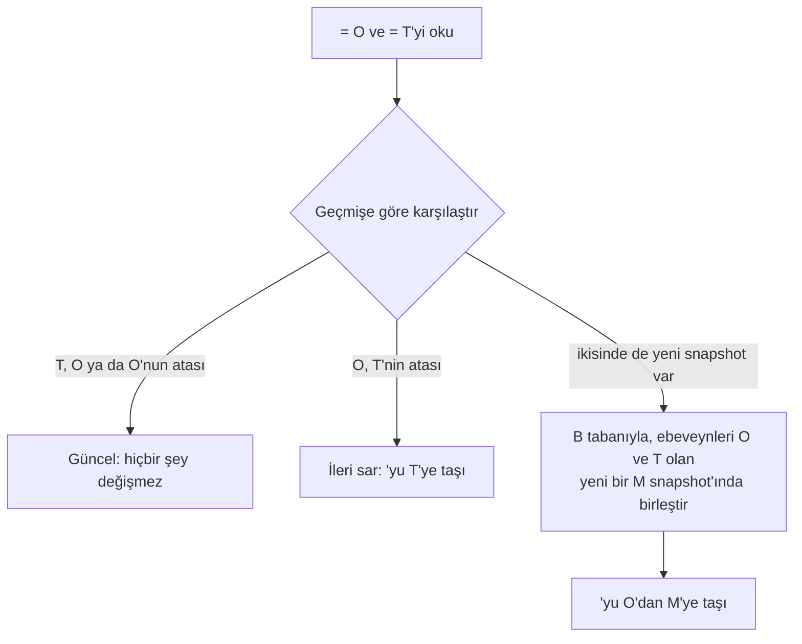

> **English:** [BRANCH.md](BRANCH.md)

# Dallanma ve Birleştirme

> **Durum: Tamamlandı.** Aşama 3'ün 2. işinin tasarımıdır ([ROADMAP.tr.md](ROADMAP.tr.md) §5): dal oluşturmak, silmek ve birini ötekine birleştirmek. Arkasındaki karar ADR-022'dir ([DECISIONS.tr.md](DECISIONS.tr.md)).

Bir dal bir ref'tir (FORMAT.tr.md §9.3): bir snapshot'a işaret eden bir ad. Apeiron için dallar, etiketler ve yedek noktaları aynı şeydir; bir ref'i dal yapan tek şey ona yeni snapshot'ların eklenmesidir. Bu yüzden dallanma için, herhangi bir snapshot'tan ref oluşturmanın bir yolu ve iki geçmiş çizgisini birleştiren bir birleştirme gerekir. Birleştirme, senkronun kullandığı üç yönlü birleştirmenin aynısıdır ([SYNC.tr.md](SYNC.tr.md) §4); klasör yerine snapshot'lar üzerinde çalışır.

## 1. Komutlar

| Komut | Ne yapar | Durum |
| --- | --- | --- |
| `apeiron ref create <name> [<snapshot>]` | Bir snapshot'a (varsayılan `main`) işaret eden bir ref oluşturur; ad varsa başarısız olur | Tamamlandı |
| `apeiron ref delete <name>` | Bir ref'i siler; reflog'u geçmişi tutar (FORMAT.tr.md §9.4), böylece çöp toplamaya kadar geri getirilebilir | Tamamlandı |
| `apeiron merge <from> [--into <ref>] [--message <text>] [--dry-run]` | `<from>`'un adlandırdığı snapshot'ı `<into>` ref'ine (varsayılan `main`) birleştirir; çatışma varsa çıkış kodu 3'tür | Tamamlandı |
| `apeiron cherry-pick <snapshot> [--into <ref>] [--message <text>] [--dry-run]` | Bir snapshot'ın yaptığı değişiklikleri `<into>` ref'ine (varsayılan `main`) orada yeni bir snapshot olarak kopyalar (bölüm 4); çatışma varsa çıkış kodu 3'tür | Tamamlandı |
| `apeiron rebase <branch> [--onto <snapshot>] [--dry-run]` | `<branch>`'in, `<onto>`'da (varsayılan `main`) olmayan snapshot'larını onun üstüne kopyalar ve `<branch>`'i oraya taşır (bölüm 5); çatışma varsa çıkış kodu 3'tür | Tamamlandı |

Bir dal üzerinde her klasörde olduğu gibi çalışılır: `apeiron restore feature ~/feature` onu bir klasöre yazar, `apeiron backup ~/feature --ref feature` değişiklikleri kaydeder ve `apeiron merge feature` onları `main`'e birleştirir. `apeiron diff main feature`, bir birleştirmenin ne getireceğini gösterir.

## 2. Bir birleştirme

1. `<into>`'nun işaret ettiği O snapshot'ını ve `<from>`'un adlandırdığı T snapshot'ını oku (bir ref, bir kimlik ya da `main~2`, API.tr.md §8.4).
2. T, O ya da onun atalarından biriyse yapılacak bir şey yoktur. O, T'nin atasıysa ref yalnızca T'ye taşınır (ileri sarma); yeni snapshot yapılmaz.
3. Aksi hâlde son ortak snapshot B'yi bul (T'den en yakın olup O'nun da ulaştığı; geçmişler hiç buluşmadıysa yoktur) ve SYNC.tr.md §4'teki gibi, O "burası" ve T "orası" olmak üzere yol yol birleştir. İki tarafın da farklı değiştirdiği bir dosyanın iki sürümü de tutulur: O'nunki yolunda, T'ninki `name (conflict <from>).ext` olarak; burada `<from>` verilen addır ve `/` yerine `-` yazılır.
4. M'yi; ebeveynleri O ve T, birleştirmenin zamanı, verilen yazar ve sunucu adı ve verilen mesaj ya da `merge <from> into <into>` ve ardından her çatışma için bir satır ile sakla. `<into>`'yu karşılaştır ve değiştir ile O'dan M'ye taşı: bu arada başka bir program onu taşıdıysa birleştirme bir çatışmayla başarısız olur ve hiçbir şeyi değiştirmez.

`--dry-run` 4. adımdan önce durur ve aynı sonucu raporlar. Sonuç, birleştirmenin `<into>`'da değiştirdiği dosyaları ve her çatışmayı listeler.

## 3. Bir birleştirme neyi karşılaştırır

Bir dosyanın türü, içeriği ya da izin bitleri değiştiyse dosya değişmiş sayılır; senkrondaki gibi yalnızca zamanlar ve sahipler sayılmaz. Bir klasör tuttuklarıyla karşılaştırılır. Bir birleştirme asla bir dosyanın içine bakmaz: aynı metin dosyasının farklı satırlarındaki iki değişiklik bir çatışmadır. Metnin ve diğer dosya türlerinin içeriğini birleştirmek, eklenti sistemiyle gelen tür sürücülerinin işidir (VISION.tr.md); Aşama 3'ün metin diff eklentisi ilkidir.

## 4. Cherry-pick

Bir cherry-pick, bir daldan dalın geri kalanı olmadan tek bir düzeltmeyi getirir. `<snapshot>`'ın adlandırdığı P snapshot'ı için:

1. P'nin ilk ebeveynini taban B olarak al; ebeveyni olmayan bir snapshot'ın tabanı boştur, bu yüzden bütün dosyaları gelir.
2. Bölüm 2 adım 3'teki gibi yol yol birleştir; `<into>`'nun gösterdiği O snapshot'ı "burası", P "orası"dır. Tabandan yalnızca P'nin B'ye göre değiştirdikleri farklıdır, bu yüzden yalnızca onlar gelir; ikisinin de farklı değiştirdiği bir dosya iki kez tutulur, P'nin sürümü `ad (conflict <snapshot>).uzantı` olarak.
3. Sonuç O'ya eşitse ref değişiklikleri zaten tutar ve hiçbir şey yazılmaz (`up_to_date`).
4. Aksi hâlde tek ebeveyni O olan, verilen mesajı ya da ardından P'nin mesajı gelen `cherry-pick <snapshot> into <into>` mesajını taşıyan bir snapshot sakla ve `<into>`'yu bir birleştirmenin yaptığı gibi karşılaştır-ve-değiştir ile taşı (`picked`).

Bir birleştirmenin aksine yeni snapshot'ın ebeveynlerinden biri P değildir: `<into>`'nun geçmişi tek çizgi kalır; dalın sonraki bir birleştirmesi dosyaları yeniden karşılaştırır, düzeltmeyi zaten orada bulur ve onu iki kez saymaz.

## 5. Rebase

Bir rebase, bir dalı başka bir dalın en yeni snapshot'ından başlatır; sanki dalın işi ondan sonra yapılmış gibi. Böylece `main`'e sonraki bir birleştirme ileri sarmadır ve geçmiş tek çizgi kalır.

1. `<onto>` zaten `<branch>`'in geçmişindeyse hiçbir şey değişmez; `<branch>` `<onto>`'nun geçmişindeyse `<branch>` doğrudan `<onto>`'ya taşınır.
2. Aksi hâlde `<branch>`'in snapshot'larını ilk ebeveynler boyunca, en yeniden başlayarak, `<onto>`'nun da sahip olduğu birine kadar al; bunlar dalın kendi snapshot'larıdır.
3. Onları en eskiden başlayarak kopyala; her biri bir öncekinin kopyasının üstüne, `<onto>`'dan başlayarak bir cherry-pick (bölüm 4) gibi yapılır, ama her birinin zamanı, yazarı, makinesi ve mesajı korunur. İki tarafın da farklı değiştirdiği bir dosya iki kez tutulur, dalın sürümü `ad (conflict <branch>).uzantı` olarak; çatışma o kopyanın mesajına eklenir. Değişiklikleri zaten orada olan bir snapshot atlanır.
4. `<branch>`'i eski snapshot'ından son kopyaya karşılaştır-ve-değiştir ile taşı. Eski snapshot'lar silinmez: `<branch>`'in reflog'u çöp toplamaya kadar onları adlandırmaya devam eder (FORMAT.tr.md §9.4). Bir saklama kuralının tuttuğu ref yalnızca ileri gider (ARCHIVE.tr.md), bu yüzden rebase edilemez.

## 6. Bu işin parçası olmayanlar

| Konu | Nerede |
| --- | --- |
| Bir dosyanın içinde, satır satır birleştirme | Metin diff eklentisi, Aşama 3 |
| Bir dalı izleyen çalışma klasörü (`checkout` ya da `switch`) | Daha sonra; `restore` ve `backup` bunu karşılar ve senkron bir klasörün güvenle nasıl değiştirildiğini gösterir |
| Çatışmaları çözmek için bir araç | Masaüstü arayüzü (Aşama 4); o zamana kadar çatışma kopyaları düz dosyalardır |

## 7. Crate'ler

| Crate | Görev | Durum |
| --- | --- | --- |
| `apeiron-services` | Senkron, `merge`, `cherry_pick` ve `rebase` tarafından paylaşılan birleştirme | Tamamlandı |
| `apeiron` | `create_ref`, `merge`, `cherry_pick` ve `rebase` (API.tr.md §8.3) | Tamamlandı |
| `apeiron-cli` | `apeiron ref`, `apeiron merge`, `apeiron cherry-pick` ve `apeiron rebase` | Tamamlandı |
