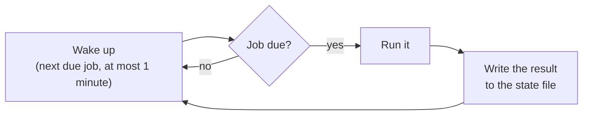

> **Türkçe:** [DAEMON.tr.md](DAEMON.tr.md)

# Apeiron Background Service

> **Status: Done.** This is the design of Stage 2 work item 3 ([ROADMAP.md](ROADMAP.md) §4): the background service, scheduled jobs and the restore test. The decision behind it is ADR-019 ([DECISIONS.md](DECISIONS.md)).

The background service (daemon) runs backups and checks on a schedule, without the user. Like the CLI it uses only the public API ([API.md](API.md)).

## 1. What it does

| Need | How | Status |
| --- | --- | --- |
| Back up without thinking about it | Jobs run on a schedule from a jobs file (section 3) | Done |
| A laptop that was off or asleep | A missed job runs once at the next chance (section 4) | Done |
| Copies elsewhere | A backup job can push to remotes after it succeeds | Done |
| Knowing that backups work | Scheduled `verify` and a restore test (section 5) | Done |
| Knowing when something failed | `apeiron daemon status` and a log (section 6) | Done |

## 2. Commands

| Command | What it does | Status |
| --- | --- | --- |
| `apeiron daemon run` | Runs until stopped, starting each job when it is due | Done |
| `apeiron daemon once` | Runs every job that is due now, then exits; exit code 4 if one of them failed | Done |
| `apeiron daemon status` | Shows each job's last run, its result and the next run; exit code 4 if a job's last run failed | Done |

All three take `--jobs <file>` and `--state-dir <folder>` to use other files than the usual ones (sections 3 and 6). `apeiron restore-test [<snapshot>] [--sample-mb <n>]` runs the restore test of section 5 by hand.

The operating system starts `apeiron daemon run` at login: a systemd user unit on Linux, a launchd agent on macOS and a Task Scheduler task on Windows. The user guide gives the file for each ([GUIDE.md](GUIDE.md) §8); no administrator rights are needed. Only one daemon runs per user; a second one stops with a "locked" error.

## 3. The jobs file

The file is `jobs.toml` in the user's configuration folder: `~/.config/apeiron` on Linux, `~/Library/Application Support/apeiron` on macOS and `%APPDATA%\apeiron` on Windows. `--jobs <file>` uses another file.

```toml
[job.documents]
repo = "/run/media/user/disk/apeiron"
password_file = "~/.config/apeiron/password"   # only for an encrypted repository
do = "backup"
folder = "~/Documents"
ref = "backup/documents"
every = "day"
at = "02:30"
push = ["nas"]                                 # remotes to push to afterwards

[job.check]
repo = "/run/media/user/disk/apeiron"
password_file = "~/.config/apeiron/password"
do = "verify"
every = "week"

[job.restore-test]
repo = "/run/media/user/disk/apeiron"
password_file = "~/.config/apeiron/password"
do = "restore-test"
ref = "backup/documents"
every = "week"
```

| Key | Meaning |
| --- | --- |
| `repo` | The repository the job works on; a folder remote can be named here directly to test that copy |
| `password_file` | The first line is the password or recovery key of an encrypted repository |
| `do` | `backup`, `push`, `verify`, `restore-test`, `gc` or `sync` ([SYNC.md](SYNC.md)) |
| `folder`, `ref`, `message` | For `backup`: what to store and which ref to move; for `sync`: the folder and the ref, by default `sync/<folder name>` |
| `remote`, `mode` | For `sync`: the remote, and `two-way` (default), `send` or `receive` |
| `push` | For `backup`: remotes to push the ref to after a successful backup; for `push`: the remotes |
| `every` | `hour`, `day`, `week`, or a number of minutes, hours or days: `15m`, `6h`, `2d` |
| `at` | For `day` and `week`: the earliest local time of day, `HH:MM` |
| `sample_mb` | For `restore-test`: how much to restore, default 100 |

`~` at the start of a path is the home folder. A job name follows the ref name rules without `/`. An invalid file stops `daemon run` and `daemon once` with an error that names the line; the daemon reads the file again when it changes and keeps the old jobs if the new file is invalid.

## 4. When a job runs



- A job is due when `every` has passed since its last start. With `at`, it waits until that time of day on the day it becomes due.
- A run that was missed because the computer was off or asleep is made once at the next chance, not once for every missed period.
- Jobs run one at a time, in the order of their names. A job that is still running when another becomes due is not interrupted.
- A job that fails is tried again after one hour, until it succeeds or its next regular run comes. A job that meets a "locked" repository (for example during garbage collection run by hand) is tried again after 10 minutes.
- Stopping the daemon cancels the running job; the repository stays in its previous state (CLI.md §1).

## 5. Restore test

A backup is proven only by restoring it (VISION.md). The restore test does this without touching the user's files:

1. Take the snapshot the ref points to.
2. Choose files from it at random until `sample_mb` is reached; at least one file.
3. Restore them into a new temporary folder, which reads every chunk and checks its hash.
4. Split each restored file into chunks again and check that the chunk ids and the size equal those in the snapshot. This catches errors in the restore path itself, not only damaged data.
5. Delete the temporary folder and record the result: files and bytes checked, or what was wrong.

## 6. State and log

| File | Folder | Content |
| --- | --- | --- |
| `state.json` | `~/.local/state/apeiron` on Linux, the configuration folder on macOS, `%LOCALAPPDATA%\apeiron` on Windows | Per job: last start and end, result (`ok`, `warnings`, `failed` or `locked`) and message; `status` works out the next run from it. Replaced atomically after every run |
| `daemon.log` | The same folder | One line per job run and per error; at 1 MiB it is renamed to `daemon.log.1` and a new one starts |

## 7. Not part of this work item

| Item | Where |
| --- | --- |
| Operating the daemon from another device (remote API) | The desktop and web interfaces (Stage 4) |
| Backup triggered by file changes | Later; the schedule covers Stage 2 |
| CPU, disk and network limits for jobs | Later; jobs run one at a time |
| Desktop notifications on failure | With the desktop interface (Stage 4) |

## 8. Crates and libraries

| Crate | Role | Status |
| --- | --- | --- |
| `apeiron-daemon` | Jobs file, schedule, state, restore test and the run loop; uses only the public `apeiron` crate | Done |
| `apeiron-cli` | The `apeiron daemon` commands | Done |

| Need | Proposed library | Reason |
| --- | --- | --- |
| Local time of day and time zones | `jiff` | Correct across daylight saving changes on Linux, macOS and Windows; pure Rust |
| Configuration and state folders | `dirs` | Small; knows the right folder on each system |
| Jobs file and state | `toml`, `serde_json` | Already used |

The daemon needs no Tokio: one thread sleeps until the next job is due and wakes at least every minute to notice a changed jobs file or a clock that jumped.
