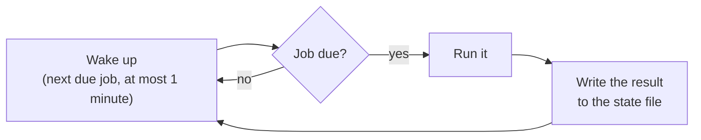

> **Türkçe:** [DAEMON.tr.md](DAEMON.tr.md)

# Apeiron Background Service

> **Status: Done.** This is the design of Stage 2 work item 3 ([ROADMAP.md](ROADMAP.md) §4): the background service, scheduled jobs and the restore test. The decision behind it is ADR-019 ([DECISIONS.md](DECISIONS.md)).

The background service (daemon) runs backups and checks on a schedule, without the user. Like the CLI it uses only the public API ([API.md](API.md)).

## 1. What it does

| Need | How | Status |
| --- | --- | --- |
| Back up without thinking about it | Jobs run on a schedule from a jobs file (section 3) | Done |
| A laptop that was off or asleep | A missed job runs once at the next chance (section 4) | Done |
| Copies elsewhere | A backup job can push to remotes after it succeeds | Done |
| Knowing that backups work | Scheduled `verify` and a restore test (section 5) | Done |
| Knowing when something failed | `apeiron daemon status` and a log (section 6) | Done |

## 2. Commands

| Command | What it does | Status |
| --- | --- | --- |
| `apeiron daemon run` | Runs until stopped, starting each job when it is due | Done |
| `apeiron daemon once` | Runs every job that is due now, then exits; exit code 4 if one of them failed | Done |
| `apeiron daemon status` | Shows each job's last run, its result and the next run; exit code 4 if a job's last run failed | Done |

All three take `--jobs <file>` and `--state-dir <folder>` to use other files than the usual ones (sections 3 and 6). `apeiron restore-test [<snapshot>] [--sample-mb <n>]` runs the restore test of section 5 by hand.

`run` and `once` run the jobs at low priority, so that a backup gives way to what the user is doing: the CPU priority of a `nice` value of 10 and the lowest disk priority of the normal class on Linux, low CPU priority and throttled disk access on macOS, and background mode on Windows. `--priority normal` runs them as fast as other programs. Network speed is limited per job with `rate_kb` (section 3).

`daemon run` shows a desktop notification when a job fails after a run that did not, so a job retried every hour tells it once: with `notify-send` on Linux, `osascript` on macOS and a PowerShell balloon on Windows. The job's name and message are passed as arguments, never inside a script. A computer without the tool, such as a server, shows nothing; the log and `daemon status` still say what happened. `--no-notify` turns it off.

The operating system starts `apeiron daemon run` at login: a systemd user unit on Linux, a launchd agent on macOS and a Task Scheduler task on Windows. The user guide gives the file for each ([GUIDE.md](GUIDE.md) §8); no administrator rights are needed. Only one daemon runs per user; a second one stops with a "locked" error.

## 3. The jobs file

The file is `jobs.toml` in the user's configuration folder: `~/.config/apeiron` on Linux, `~/Library/Application Support/apeiron` on macOS and `%APPDATA%\apeiron` on Windows. `--jobs <file>` uses another file.

```toml
[job.documents]
repo = "/run/media/user/disk/apeiron"
password_file = "~/.config/apeiron/password"   # only for an encrypted repository
do = "backup"
folder = "~/Documents"
ref = "backup/documents"
every = "day"
at = "02:30"
push = ["nas"]                                 # remotes to push to afterwards

[job.check]
repo = "/run/media/user/disk/apeiron"
password_file = "~/.config/apeiron/password"
do = "verify"
every = "week"

[job.restore-test]
repo = "/run/media/user/disk/apeiron"
password_file = "~/.config/apeiron/password"
do = "restore-test"
ref = "backup/documents"
every = "week"
```

| Key | Meaning |
| --- | --- |
| `repo` | The repository the job works on; a folder remote can be named here directly to test that copy |
| `password_file` | The first line is the password or recovery key of an encrypted repository |
| `do` | `backup`, `push`, `pull`, `verify`, `restore-test`, `gc` or `sync` ([SYNC.md](SYNC.md)) |
| `folder`, `ref`, `message` | For `backup`: what to store and which ref to move; for `sync`: the folder and the ref, by default `sync/<folder name>` |
| `remote`, `mode` | For `sync`: the remote, and `two-way` (default), `send` or `receive`; for `pull`: the remote |
| `ref = "*"` | For `push` and `pull`: every ref, to keep a replica or a standby ([REPLICATION.md](REPLICATION.md) §3) |
| `push` | For `backup`: remotes to push the ref to after a successful backup; for `push`: the remotes |
| `every` | `hour`, `day`, `week`, or a number of minutes, hours or days: `15m`, `6h`, `2d` |
| `at` | For `day` and `week`: the earliest local time of day, `HH:MM` |
| `sample_mb` | For `restore-test`: how much to restore, default 100 |
| `on_change` | For `backup` and `sync`: also run after a change to the folder, once it has been quiet this long: a number with `s`, `m` or `h`, from `5s` to `24h` (section 4) |
| `rate_kb` | For `backup`, `push`, `pull` and `sync`: the most kibibytes per second moved to or from remotes, on average ([SYNC.md](SYNC.md) §2); no limit by default |

`~` at the start of a path is the home folder. A job name follows the ref name rules without `/`. An invalid file stops `daemon run` and `daemon once` with an error that names the line; the daemon reads the file again when it changes and keeps the old jobs if the new file is invalid. The Schedule page of the desktop interface shows the jobs and edits this file, and saves only a valid one (DESKTOP.md §2).

### 3.1 Jobs of a tenant

Each tenant of a web server (TENANTS.md) can have jobs of its own, which reach only its repository and its folders. They are in `<configuration folder>/tenants/<name>/jobs.toml`, with their state and log in `<state folder>/tenants/<name>/daemon`, and `apeiron daemon run --tenant <name>` runs them; `once` and `status` take `--tenant` too. Whoever runs the server starts one such daemon per tenant, for example with a systemd unit `apeiron-daemon@.service` whose instance name is the tenant's.

A tenant's jobs file has no `repo` and no `password_file`: every job works on the tenant's repository, opened with the tenant's `password_file` (TENANTS.md §2). The `folder` of a `backup` or `sync` job must be a full path inside one of the tenant's `folders`, without `..`; other jobs are as in section 3, and `sync` keeps a tenant's folder in step with a remote of its repository. A file that breaks these rules is refused as invalid.

An `admin` of the tenant edits its jobs file on the Schedule page of the web interface, which shows each job's last and next run as on the desktop and saves only a valid file. Each save is recorded as `schedule_save` in the tenant's audit log (AUDIT.md §1), with the names of the jobs.

## 4. When a job runs



- A job is due when `every` has passed since its last start. With `at`, it waits until that time of day on the day it becomes due.
- A `backup` or `sync` job with `on_change` also runs when its folder changes: once a change is followed by that long without another one, so a burst of saves gives one run. Changes inside the repository, when it lies in the folder, do not count. Only `daemon run` watches folders, from when it starts; a folder that cannot be watched is noted in the log and the job keeps its schedule. Linux limits how many folders one user can watch (`fs.inotify.max_user_watches`); a very large tree may need a higher limit.
- A run that was missed because the computer was off or asleep is made once at the next chance, not once for every missed period.
- Jobs run one at a time, in the order of their names. A job that is still running when another becomes due is not interrupted.
- A job that fails is tried again after one hour, until it succeeds or its next regular run comes. A job that meets a "locked" repository (for example during garbage collection run by hand) is tried again after 10 minutes.
- Stopping the daemon cancels the running job; the repository stays in its previous state (CLI.md §1).

## 5. Restore test

A backup is proven only by restoring it (VISION.md). The restore test does this without touching the user's files:

1. Take the snapshot the ref points to.
2. Choose files from it at random until `sample_mb` is reached; at least one file.
3. Restore them into a new temporary folder, which reads every chunk and checks its hash.
4. Split each restored file into chunks again and check that the chunk ids and the size equal those in the snapshot. This catches errors in the restore path itself, not only damaged data.
5. Delete the temporary folder and record the result: files and bytes checked, or what was wrong.

## 6. State and log

| File | Folder | Content |
| --- | --- | --- |
| `state.json` | `~/.local/state/apeiron` on Linux, the configuration folder on macOS, `%LOCALAPPDATA%\apeiron` on Windows | Per job: last start and end, result (`ok`, `warnings`, `failed` or `locked`) and message; `status` works out the next run from it. Replaced atomically after every run |
| `daemon.log` | The same folder | One line per job run and per error; at 1 MiB it is renamed to `daemon.log.1` and a new one starts |

## 7. Not part of this work item

| Item | Where |
| --- | --- |
| Operating the daemon from another device (remote API) | The desktop and web interfaces (Stage 4) |

## 8. Crates and libraries

| Crate | Role | Status |
| --- | --- | --- |
| `apeiron-daemon` | Jobs file, schedule, state, restore test, the run loop and watching folders; uses the public `apeiron` crate, and `apeiron-sys` to lower its priority | Done |
| `apeiron-cli` | The `apeiron daemon` commands | Done |

| Need | Proposed library | Reason |
| --- | --- | --- |
| Local time of day and time zones | `jiff` | Correct across daylight saving changes on Linux, macOS and Windows; pure Rust |
| Configuration and state folders | `dirs` | Small; knows the right folder on each system |
| Jobs file and state | `toml`, `serde_json` | Already used |
| Watching folders for `on_change` | `notify` | The common Rust watcher: inotify on Linux, FSEvents on macOS, ReadDirectoryChangesW on Windows; it runs its own thread and needs no Tokio |

The daemon needs no Tokio: one thread sleeps until the next job is due and wakes at least every minute to notice a changed jobs file or a clock that jumped.
