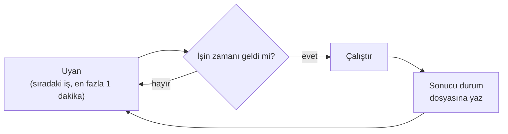

> **English:** [DAEMON.md](DAEMON.md)

# Apeiron Arka Plan Hizmeti

> **Durum: Tamamlandı.** Aşama 2'nin 3. işinin tasarımıdır ([ROADMAP.tr.md](ROADMAP.tr.md) §4): arka plan hizmeti, zamanlanmış işler ve geri yükleme testi. Arkasındaki karar ADR-019'dur ([DECISIONS.tr.md](DECISIONS.tr.md)).

Arka plan hizmeti (daemon), yedekleri ve denetimleri kullanıcı olmadan, bir zamanlamaya göre çalıştırır. CLI gibi yalnızca herkese açık API'yi kullanır ([API.tr.md](API.tr.md)).

## 1. Ne yapar

| İhtiyaç | Nasıl | Durum |
| --- | --- | --- |
| Düşünmeden yedeklemek | İşler bir iş dosyasından, bir zamanlamaya göre çalışır (bölüm 3) | Tamamlandı |
| Kapalı ya da uykudaki bir dizüstü | Kaçırılan bir iş, ilk fırsatta bir kez çalışır (bölüm 4) | Tamamlandı |
| Başka yerlerde kopyalar | Bir yedek işi, başarılı olduktan sonra uzak depolara push edebilir | Tamamlandı |
| Yedeklerin çalıştığını bilmek | Zamanlanmış `verify` ve geri yükleme testi (bölüm 5) | Tamamlandı |
| Bir şeyin başarısız olduğunu bilmek | `apeiron daemon status` ve bir kayıt dosyası (bölüm 6) | Tamamlandı |

## 2. Komutlar

| Komut | Ne yapar | Durum |
| --- | --- | --- |
| `apeiron daemon run` | Durdurulana kadar çalışır; her işi zamanı geldiğinde başlatır | Tamamlandı |
| `apeiron daemon once` | Zamanı gelmiş her işi çalıştırır, sonra çıkar; biri başarısız olduysa çıkış kodu 4'tür | Tamamlandı |
| `apeiron daemon status` | Her işin son çalışmasını, sonucunu ve bir sonraki çalışmasını gösterir; bir işin son çalışması başarısızsa çıkış kodu 4'tür | Tamamlandı |

Üçü de, olağan dosyalar yerine başkalarını kullanmak için `--jobs <file>` ve `--state-dir <folder>` alır (bölüm 3 ve 6). `apeiron restore-test [<snapshot>] [--sample-mb <n>]`, bölüm 5'teki geri yükleme testini elle çalıştırır.

`apeiron daemon run` komutunu oturum açılınca işletim sistemi başlatır: Linux'ta bir systemd kullanıcı birimi, macOS'ta bir launchd ajanı, Windows'ta bir Görev Zamanlayıcı görevi. Kullanım rehberi her biri için dosyayı verir ([GUIDE.tr.md](GUIDE.tr.md) §8); yönetici yetkisi gerekmez. Her kullanıcı için yalnızca bir daemon çalışır; ikincisi "kilitli" hatasıyla durur.

## 3. İş dosyası

Dosya, kullanıcının yapılandırma klasöründeki `jobs.toml`'dur: Linux'ta `~/.config/apeiron`, macOS'ta `~/Library/Application Support/apeiron`, Windows'ta `%APPDATA%\apeiron`. `--jobs <file>` başka bir dosya kullanır.

```toml
[job.documents]
repo = "/run/media/user/disk/apeiron"
password_file = "~/.config/apeiron/password"   # yalnızca şifreli bir depo için
do = "backup"
folder = "~/Documents"
ref = "backup/documents"
every = "day"
at = "02:30"
push = ["nas"]                                 # ardından push edilecek uzak depolar

[job.check]
repo = "/run/media/user/disk/apeiron"
password_file = "~/.config/apeiron/password"
do = "verify"
every = "week"

[job.restore-test]
repo = "/run/media/user/disk/apeiron"
password_file = "~/.config/apeiron/password"
do = "restore-test"
ref = "backup/documents"
every = "week"
```

| Anahtar | Anlamı |
| --- | --- |
| `repo` | İşin çalıştığı depo; bir klasör uzak deposu, o kopyayı test etmek için doğrudan burada yazılabilir |
| `password_file` | İlk satırı, şifreli bir deponun parolası ya da kurtarma anahtarıdır |
| `do` | `backup`, `push`, `verify`, `restore-test` ya da `gc` |
| `folder`, `ref`, `message` | `backup` için: neyin saklanacağı ve hangi ref'in taşınacağı |
| `push` | `backup` için: başarılı bir yedekten sonra ref'in push edileceği uzak depolar; `push` için: uzak depolar |
| `every` | `hour`, `day`, `week` ya da saat veya gün sayısı: `6h`, `2d` |
| `at` | `day` ve `week` için: günün en erken yerel saati, `HH:MM` |
| `sample_mb` | `restore-test` için: ne kadarının geri yükleneceği, varsayılan 100 |

Bir yolun başındaki `~` ev klasörüdür. Bir iş adı, `/` içermeyen ref adı kurallarına uyar. Geçersiz bir dosya, `daemon run` ve `daemon once` komutlarını satırı belirten bir hatayla durdurur; daemon dosya değişince onu yeniden okur ve yeni dosya geçersizse eski işleri korur.

## 4. Bir iş ne zaman çalışır



- Bir işin zamanı, son başlangıcından bu yana `every` kadar süre geçince gelir. `at` varsa, zamanının geldiği gün o saate kadar bekler.
- Bilgisayar kapalı ya da uykudayken kaçırılan bir çalışma, kaçırılan her dönem için değil, ilk fırsatta bir kez yapılır.
- İşler adlarının sırasıyla, birer birer çalışır. Başka bir işin zamanı geldiğinde hâlâ çalışan bir iş yarıda kesilmez.
- Başarısız olan bir iş, başarılı olana ya da sıradaki düzenli çalışması gelene kadar bir saat sonra yeniden denenir. "Kilitli" bir depoya rastlayan bir iş (örneğin elle çalıştırılan çöp toplama sırasında) 10 dakika sonra yeniden denenir.
- Daemon'u durdurmak, çalışan işi iptal eder; depo önceki durumunda kalır (CLI.tr.md §1).

## 5. Geri yükleme testi

Bir yedek ancak geri yüklenerek kanıtlanır (VISION.tr.md). Geri yükleme testi bunu kullanıcının dosyalarına dokunmadan yapar:

1. Ref'in gösterdiği snapshot'ı al.
2. İçinden `sample_mb` dolana kadar rastgele dosyalar seç; en az bir dosya.
3. Onları yeni bir geçici klasöre geri yükle; bu, her chunk'ı okur ve özetini denetler.
4. Geri yüklenen her dosyayı yeniden chunk'lara böl ve chunk kimliklerinin ve boyutun snapshot'takilerle aynı olduğunu denetle. Bu, yalnızca bozuk veriyi değil, geri yükleme yolunun kendisindeki hataları da yakalar.
5. Geçici klasörü sil ve sonucu kaydet: denetlenen dosyalar ve baytlar ya da neyin yanlış olduğu.

## 6. Durum ve kayıt

| Dosya | Klasör | İçerik |
| --- | --- | --- |
| `state.json` | Linux'ta `~/.local/state/apeiron`, macOS'ta yapılandırma klasörü, Windows'ta `%LOCALAPPDATA%\apeiron` | Her iş için: son başlangıç ve bitiş, sonuç (`ok`, `warnings`, `failed` ya da `locked`) ve mesaj; `status` sonraki çalışmayı bundan hesaplar. Her çalışmadan sonra atomik olarak değiştirilir |
| `daemon.log` | Aynı klasör | Her iş çalışması ve her hata için bir satır; 1 MiB'a ulaşınca `daemon.log.1` olarak yeniden adlandırılır ve yenisi başlar |

## 7. Bu işin parçası olmayanlar

| Konu | Nerede |
| --- | --- |
| Daemon'u başka bir cihazdan yönetmek (uzak API) | Masaüstü ve web arayüzleri (Aşama 4) |
| Dosya değişikliğiyle tetiklenen yedek | Daha sonra; Aşama 2 için zamanlama yeterlidir |
| İşler için işlemci, disk ve ağ sınırları | Daha sonra; işler birer birer çalışır |
| Başarısızlıkta masaüstü bildirimi | Masaüstü arayüzüyle (Aşama 4) |

## 8. Crate'ler ve kütüphaneler

| Crate | Görev | Durum |
| --- | --- | --- |
| `apeiron-daemon` | İş dosyası, zamanlama, durum, geri yükleme testi ve çalışma döngüsü; yalnızca herkese açık `apeiron` crate'ini kullanır | Tamamlandı |
| `apeiron-cli` | `apeiron daemon` komutları | Tamamlandı |

| İhtiyaç | Önerilen kütüphane | Gerekçe |
| --- | --- | --- |
| Günün yerel saati ve saat dilimleri | `jiff` | Linux, macOS ve Windows'ta yaz saati geçişlerinde doğru; saf Rust |
| Yapılandırma ve durum klasörleri | `dirs` | Küçük; her sistemde doğru klasörü bilir |
| İş dosyası ve durum | `toml`, `serde_json` | Zaten kullanılıyor |

Daemon'un Tokio'ya ihtiyacı yoktur: tek bir iş parçacığı sıradaki işin zamanına kadar uyur ve değişen bir iş dosyasını ya da ileri geri atlayan bir saati fark etmek için en az dakikada bir uyanır.
