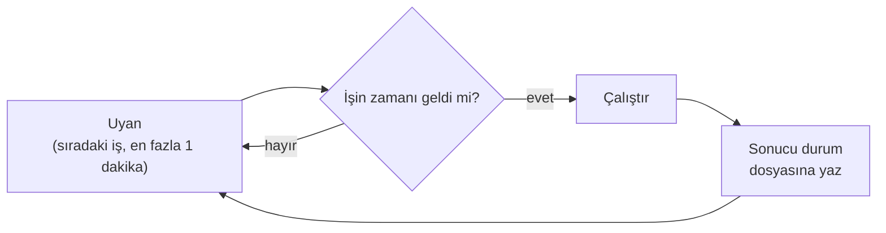

> **English:** [DAEMON.md](DAEMON.md)

# Apeiron Arka Plan Hizmeti

> **Durum: Tamamlandı.** Aşama 2'nin 3. işinin tasarımıdır ([ROADMAP.tr.md](ROADMAP.tr.md) §4): arka plan hizmeti, zamanlanmış işler ve geri yükleme testi. Arkasındaki karar ADR-019'dur ([DECISIONS.tr.md](DECISIONS.tr.md)).

Arka plan hizmeti (daemon), yedekleri ve denetimleri kullanıcı olmadan, bir zamanlamaya göre çalıştırır. CLI gibi yalnızca herkese açık API'yi kullanır ([API.tr.md](API.tr.md)).

## 1. Ne yapar

| İhtiyaç | Nasıl | Durum |
| --- | --- | --- |
| Düşünmeden yedeklemek | İşler bir iş dosyasından, bir zamanlamaya göre çalışır (bölüm 3) | Tamamlandı |
| Kapalı ya da uykudaki bir dizüstü | Kaçırılan bir iş, ilk fırsatta bir kez çalışır (bölüm 4) | Tamamlandı |
| Başka yerlerde kopyalar | Bir yedek işi, başarılı olduktan sonra uzak depolara push edebilir | Tamamlandı |
| Yedeklerin çalıştığını bilmek | Zamanlanmış `verify` ve geri yükleme testi (bölüm 5) | Tamamlandı |
| Bir şeyin başarısız olduğunu bilmek | `apeiron daemon status` ve bir kayıt dosyası (bölüm 6) | Tamamlandı |

## 2. Komutlar

| Komut | Ne yapar | Durum |
| --- | --- | --- |
| `apeiron daemon run` | Durdurulana kadar çalışır; her işi zamanı geldiğinde başlatır | Tamamlandı |
| `apeiron daemon once` | Zamanı gelmiş her işi çalıştırır, sonra çıkar; biri başarısız olduysa çıkış kodu 4'tür | Tamamlandı |
| `apeiron daemon status` | Her işin son çalışmasını, sonucunu ve bir sonraki çalışmasını gösterir; bir işin son çalışması başarısızsa çıkış kodu 4'tür | Tamamlandı |

Üçü de, olağan dosyalar yerine başkalarını kullanmak için `--jobs <file>` ve `--state-dir <folder>` alır (bölüm 3 ve 6). `apeiron restore-test [<snapshot>] [--sample-mb <n>]`, bölüm 5'teki geri yükleme testini elle çalıştırır.

`run` ve `once` işleri düşük öncelikle çalıştırır; böylece bir yedek kullanıcının yaptığı işe yol verir: Linux'ta 10 `nice` değerinin işlemci önceliği ve olağan sınıfın en düşük disk önceliği, macOS'ta düşük işlemci önceliği ve kısılmış disk erişimi, Windows'ta arka plan kipi. `--priority normal` onları diğer programlar kadar hızlı çalıştırır. Ağ hızı her iş için `rate_kb` ile sınırlanır (bölüm 3).

`daemon run`, başarısız olmayan bir çalışmanın ardından başarısız olan bir iş için masaüstü bildirimi gösterir; böylece saatte bir yeniden denenen bir iş bunu bir kez söyler: Linux'ta `notify-send`, macOS'ta `osascript`, Windows'ta bir PowerShell balonu ile. İşin adı ve iletisi bir betiğin içine değil, argüman olarak verilir. Aracı olmayan bir bilgisayar, örneğin bir sunucu, hiçbir şey göstermez; günlük ve `daemon status` yine ne olduğunu söyler. `--no-notify` bunu kapatır.

`apeiron daemon run` komutunu oturum açılınca işletim sistemi başlatır: Linux'ta bir systemd kullanıcı birimi, macOS'ta bir launchd ajanı, Windows'ta bir Görev Zamanlayıcı görevi. Kullanım rehberi her biri için dosyayı verir ([GUIDE.tr.md](GUIDE.tr.md) §8); yönetici yetkisi gerekmez. Her kullanıcı için yalnızca bir daemon çalışır; ikincisi "kilitli" hatasıyla durur.

## 3. İş dosyası

Dosya, kullanıcının yapılandırma klasöründeki `jobs.toml`'dur: Linux'ta `~/.config/apeiron`, macOS'ta `~/Library/Application Support/apeiron`, Windows'ta `%APPDATA%\apeiron`. `--jobs <file>` başka bir dosya kullanır.

```toml
[job.documents]
repo = "/run/media/user/disk/apeiron"
password_file = "~/.config/apeiron/password"   # yalnızca şifreli bir depo için
do = "backup"
folder = "~/Documents"
ref = "backup/documents"
every = "day"
at = "02:30"
push = ["nas"]                                 # ardından push edilecek uzak depolar

[job.check]
repo = "/run/media/user/disk/apeiron"
password_file = "~/.config/apeiron/password"
do = "verify"
every = "week"

[job.restore-test]
repo = "/run/media/user/disk/apeiron"
password_file = "~/.config/apeiron/password"
do = "restore-test"
ref = "backup/documents"
every = "week"
```

| Anahtar | Anlamı |
| --- | --- |
| `repo` | İşin çalıştığı depo; bir klasör uzak deposu, o kopyayı test etmek için doğrudan burada yazılabilir |
| `password_file` | İlk satırı, şifreli bir deponun parolası ya da kurtarma anahtarıdır |
| `do` | `backup`, `push`, `pull`, `verify`, `restore-test`, `gc`, `prune` ([FORMAT.tr.md](FORMAT.tr.md) §13.4), `repair` ([FORMAT.tr.md](FORMAT.tr.md) §8.3) ya da `sync` ([SYNC.tr.md](SYNC.tr.md)) |
| `folder`, `ref`, `message` | `backup` için: neyin saklanacağı ve hangi ref'in taşınacağı; `sync` için: klasör ve ref, varsayılan `sync/<klasör adı>` |
| `remote`, `mode` | `sync` için: uzak depo ve `two-way` (varsayılan), `send` ya da `receive`; `pull` ve `repair` için: uzak depo |
| `ref = "*"` | `push` ve `pull` için: bir replikayı ya da yedek sunucuyu güncel tutmak için her ref ([REPLICATION.tr.md](REPLICATION.tr.md) §3) |
| `push` | `backup` için: başarılı bir yedekten sonra ref'in push edileceği uzak depolar; `push` için: uzak depolar |
| `keep_last`, `keep_daily`, `keep_weekly`, `keep_monthly`, `keep_yearly` | `prune` için: `ref`'ten tutulacaklar; `push` izleyecek uzak depoları adlandırır |
| `exclude` | `backup` ve `sync` için: dışarıda bırakılacak kalıpların listesi ([CLI.tr.md](CLI.tr.md) §4.1, [SYNC.tr.md](SYNC.tr.md) §5.1) |
| `every` | `hour`, `day`, `week` ya da dakika, saat veya gün sayısı: `15m`, `6h`, `2d` |
| `at` | `day` ve `week` için: günün en erken yerel saati, `HH:MM` |
| `sample_mb` | `restore-test` için: ne kadarının geri yükleneceği, varsayılan 100 |
| `on_change` | `backup` ve `sync` için: klasördeki bir değişiklikten sonra, klasör bu kadar süre sessiz kalınca da çalış: `s`, `m` ya da `h` ile bir sayı, `5s` ile `24h` arası (bölüm 4) |
| `rate_kb` | `backup`, `push`, `pull`, `repair` ve `sync` için: uzak depolara giden ya da onlardan gelen, saniyede ortalama en çok kibibayt ([SYNC.tr.md](SYNC.tr.md) §2); varsayılan olarak sınır yoktur |

Bir yolun başındaki `~` ev klasörüdür. Bir iş adı, `/` içermeyen ref adı kurallarına uyar. Geçersiz bir dosya, `daemon run` ve `daemon once` komutlarını satırı belirten bir hatayla durdurur; daemon dosya değişince onu yeniden okur ve yeni dosya geçersizse eski işleri korur. Masaüstü arayüzünün Zamanlama sayfası işleri gösterir ve bu dosyayı düzenler; yalnızca geçerli bir dosyayı kaydeder (DESKTOP.tr.md §2).

### 3.1 Bir kiracının işleri

Bir web sunucusunun her kiracısının (TENANTS.tr.md) yalnızca kendi deposuna ve klasörlerine ulaşan kendi işleri olabilir. Bunlar `<yapılandırma klasörü>/tenants/<ad>/jobs.toml` içindedir, durumları ve kayıtları `<durum klasörü>/tenants/<ad>/daemon` içinde tutulur ve `apeiron daemon run --tenant <ad>` onları çalıştırır; `once` ve `status` da `--tenant` alır. Sunucuyu çalıştıran kişi her kiracı için böyle bir daemon başlatır, örneğin örnek adı kiracının adı olan bir `apeiron-daemon@.service` systemd birimiyle.

Bir kiracının iş dosyasında `repo` ve `password_file` yoktur: her iş kiracının deposunda, kiracının `password_file`'ıyla açılarak çalışır (TENANTS.tr.md §2). Bir `backup` ya da `sync` işinin `folder`'ı, kiracının `folders`'ından birinin içinde, `..` içermeyen tam bir yol olmalıdır; diğer işler bölüm 3'teki gibidir ve `sync`, bir kiracı klasörünü deposunun bir uzak deposuyla eşit tutar. Bu kurallara uymayan bir dosya geçersiz sayılıp reddedilir.

Kiracının bir `admin`'i iş dosyasını web arayüzünün Zamanlama sayfasında düzenler; sayfa, masaüstündeki gibi her işin son ve sonraki çalışmasını gösterir ve yalnızca geçerli bir dosyayı kaydeder. Her kayıt, işlerin adlarıyla birlikte kiracının denetim kaydına `schedule_save` olarak yazılır (AUDIT.tr.md §1).

## 4. Bir iş ne zaman çalışır



- Bir işin zamanı, son başlangıcından bu yana `every` kadar süre geçince gelir. `at` varsa, zamanının geldiği gün o saate kadar bekler.
- `on_change` içeren bir `backup` ya da `sync` işi, klasörü değişince de çalışır: bir değişikliğin ardından o kadar süre başka değişiklik olmayınca; böylece art arda kaydetmeler tek bir çalışma doğurur. Depo klasörün içindeyse depodaki değişiklikler sayılmaz. Klasörleri yalnızca `daemon run` izler, başladığı andan itibaren; izlenemeyen bir klasör günlüğe yazılır ve iş zamanlamasıyla sürer. Linux bir kullanıcının izleyebileceği klasör sayısını sınırlar (`fs.inotify.max_user_watches`); çok büyük bir ağaç daha yüksek bir sınır isteyebilir.
- Bilgisayar kapalı ya da uykudayken kaçırılan bir çalışma, kaçırılan her dönem için değil, ilk fırsatta bir kez yapılır.
- İşler adlarının sırasıyla, birer birer çalışır. Başka bir işin zamanı geldiğinde hâlâ çalışan bir iş yarıda kesilmez.
- Başarısız olan bir iş, başarılı olana ya da sıradaki düzenli çalışması gelene kadar bir saat sonra yeniden denenir. "Kilitli" bir depoya rastlayan bir iş (örneğin elle çalıştırılan çöp toplama sırasında) 10 dakika sonra yeniden denenir.
- Daemon'u durdurmak, çalışan işi iptal eder; depo önceki durumunda kalır (CLI.tr.md §1).

## 5. Geri yükleme testi

Bir yedek ancak geri yüklenerek kanıtlanır (VISION.tr.md). Geri yükleme testi bunu kullanıcının dosyalarına dokunmadan yapar:

1. Ref'in gösterdiği snapshot'ı al.
2. İçinden `sample_mb` dolana kadar rastgele dosyalar seç; en az bir dosya.
3. Onları yeni bir geçici klasöre geri yükle; bu, her chunk'ı okur ve özetini denetler.
4. Geri yüklenen her dosyayı yeniden chunk'lara böl ve chunk kimliklerinin ve boyutun snapshot'takilerle aynı olduğunu denetle. Bu, yalnızca bozuk veriyi değil, geri yükleme yolunun kendisindeki hataları da yakalar.
5. Geçici klasörü sil ve sonucu kaydet: denetlenen dosyalar ve baytlar ya da neyin yanlış olduğu.

## 6. Durum ve kayıt

| Dosya | Klasör | İçerik |
| --- | --- | --- |
| `state.json` | Linux'ta `~/.local/state/apeiron`, macOS'ta yapılandırma klasörü, Windows'ta `%LOCALAPPDATA%\apeiron` | Her iş için: son başlangıç ve bitiş, sonuç (`ok`, `warnings`, `failed` ya da `locked`) ve mesaj; `status` sonraki çalışmayı bundan hesaplar. Her çalışmadan sonra atomik olarak değiştirilir |
| `daemon.log` | Aynı klasör | Her iş çalışması ve her hata için bir satır; 1 MiB'a ulaşınca `daemon.log.1` olarak yeniden adlandırılır ve yenisi başlar |

## 7. Bu işin parçası olmayanlar

| Konu | Nerede |
| --- | --- |
| Daemon'u başka bir cihazdan yönetmek (uzak API) | Yazılmadı; yalnızca bir kiracının işleri Zamanlama sayfasındadır (bölüm 3.1); zamanlanmadı ([ROADMAP.tr.md](ROADMAP.tr.md) §8) |

## 8. Crate'ler ve kütüphaneler

| Crate | Görev | Durum |
| --- | --- | --- |
| `apeiron-daemon` | İş dosyası, zamanlama, durum, geri yükleme testi, çalışma döngüsü ve klasör izleme; herkese açık `apeiron` crate'ini, önceliğini düşürmek için de `apeiron-sys`'i kullanır | Tamamlandı |
| `apeiron-cli` | `apeiron daemon` komutları | Tamamlandı |

| İhtiyaç | Önerilen kütüphane | Gerekçe |
| --- | --- | --- |
| Günün yerel saati ve saat dilimleri | `jiff` | Linux, macOS ve Windows'ta yaz saati geçişlerinde doğru; saf Rust |
| Yapılandırma ve durum klasörleri | `dirs` | Küçük; her sistemde doğru klasörü bilir |
| İş dosyası ve durum | `toml`, `serde_json` | Zaten kullanılıyor |
| `on_change` için klasör izleme | `notify` | Rust'ın yaygın izleyicisi: Linux'ta inotify, macOS'ta FSEvents, Windows'ta ReadDirectoryChangesW; kendi iş parçacığında çalışır, Tokio gerektirmez |

Daemon'un Tokio'ya ihtiyacı yoktur: tek bir iş parçacığı sıradaki işin zamanına kadar uyur ve değişen bir iş dosyasını ya da ileri geri atlayan bir saati fark etmek için en az dakikada bir uyanır.
