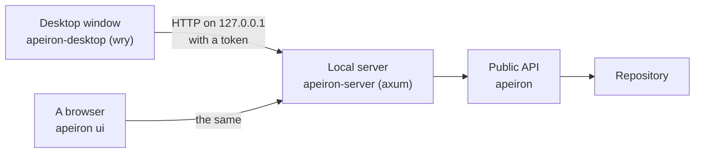

> **Türkçe:** [DESKTOP.tr.md](DESKTOP.tr.md)

# Desktop Interface

> **Status: In progress.** This is the design of Stage 4 work item 1 ([ROADMAP.md](ROADMAP.md) §6): a window in which a user who has never seen a command line backs up, looks at and restores folders. The decision behind it is ADR-026 ([DECISIONS.md](DECISIONS.md)).

Stage 4 ends when a non-technical user can back up and restore without the CLI. The desktop interface is that path; the web interface (work item 2) reuses its pages.

## 1. How it is built

| Part | What it is | Status |
| --- | --- | --- |
| Pages | One set of HTML, CSS and JavaScript files without a build step, compiled into the program | Done |
| Local server | `apeiron-server`: serves the pages and a JSON API over HTTP, only on `127.0.0.1`, to holders of a token | Done |
| Desktop app | `apeiron-desktop`: starts the server inside itself and shows the pages in a window of the operating system's web view | In progress |
| `apeiron ui` | Starts the server and opens the pages in the default browser; for systems without the desktop app | Done |

The pages call only the JSON API, and the JSON API calls only the public API (ARCHITECTURE.md §1); there is no other way into a repository.

## 2. What the user can do

| Screen | What it does | Status |
| --- | --- | --- |
| Start | Opens a repository (with its password if encrypted) or creates one, choosing folders with a folder browser; remembers the last one | Done |
| Overview | The backups: each ref with the folder it came from and when it was last taken; buttons for its versions and to back it up again | Done |
| Back up | Chooses a folder and backs it up as `backup/<folder name>`, or into the ref of an earlier backup of the same folder; the folder is kept in the snapshot's `meta` as `source`; shows progress and can be cancelled | Done |
| History | The snapshots of a backup, newest first, with time and note; buttons to look inside, compare and restore | Done |
| Browse | The folders and files inside a snapshot | Done |
| Restore | A whole snapshot or one file or folder in it, into a new or empty folder; progress and result | Done |
| Compare | What changed between a snapshot and the one before it, with the changed lines of text files when the text plugin is installed (TEXT.md) | Done |
| Verify | Checks the whole repository and says in plain words whether it is healthy | Done |

Words follow the user, not the format: a ref is shown as a backup, a snapshot as a version, and ids appear only in a details line.

The pages are in English and Turkish, chosen by the system language; every text is in one dictionary per language.

## 3. The JSON API

The JSON API is the C ABI (SDK.md §2) over HTTP: the same operations by name and the same request and result values.

| Request | What it does |
| --- | --- |
| `POST /api/open` `{"path", "password"}` | Opens a repository for this server; a missing password for an encrypted one is the error `key` |
| `POST /api/init` `{"path", "password"}` | Creates a repository, encrypted when a password is given; the result holds the recovery key once |
| `POST /api/call/<operation>` | A short operation on the open repository; the body is the request |
| `POST /api/start/<operation>` | Starts a long operation; the result is `{"job": <id>}` |
| `GET /api/jobs/<id>` | `{"progress", "done"}`, and when done `"result"` or `"error"`; a finished job is forgotten once its result is read |
| `POST /api/jobs/<id>/cancel` | Asks the job to stop |
| `GET /api/folders?path=<path>` | The folders inside a folder of this computer, for choosing one; the home folder when no path is given |
| `GET /api/state` | The open repository, if any, and the last repository used |

An error is the error value of API.md §8.6 with status 400 for `invalid_input`, `ambiguous` and `unsupported`, 404 for `not_found`, 409 for `conflict`, `already_exists` and `locked`, 401 for `key`, and 500 otherwise. A missing or wrong token is status 401 with the kind `invalid_input`, so the pages do not take it for a wrong password.

## 4. Security

| Rule | Why |
| --- | --- |
| The server listens only on `127.0.0.1`, on a free port chosen at start | Nothing on the network reaches it |
| Every request needs a random 256-bit token, made at start and given to the pages in the address fragment, never in a file | Other users and programs on the computer cannot call it |
| The `Host` header must be `127.0.0.1:<port>`, and a request with an `Origin` header must come from that origin | A web page in the user's browser cannot call it, directly or by DNS rebinding |
| The pages load nothing from the internet | They work offline and leak nothing |
| The password is sent once to open the repository and kept only inside the API's handle | It is never stored by the interface |

## 5. Not part of this work item

| Item | Where |
| --- | --- |
| Resolving conflict copies, sync and plugin settings in the window | Later work in this stage |
| Changing the background service's jobs | Later; `jobs.toml` (DAEMON.md) until then |
| Reaching the server from other computers, users and logins | Web interface and users and permissions, work items 2 and 3 |
| Installers and app icons for each system | With the first release |

## 6. Crates

| Crate | Role | Status |
| --- | --- | --- |
| `apeiron` | Operations by name with JSON values, shared by the C ABI and the server | Done |
| `apeiron-server` | The local server and the pages | Done |
| `apeiron-desktop` | The window | In progress |
| `apeiron-cli` | `apeiron ui` | Done |
