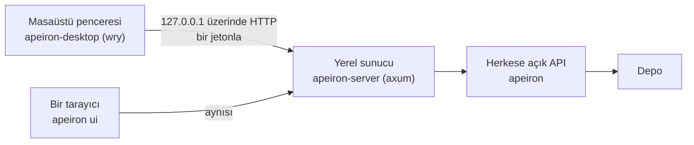

> **English:** [DESKTOP.md](DESKTOP.md)

# Masaüstü Arayüzü

> **Durum: Tamamlandı.** Aşama 4'ün 1. işinin tasarımıdır ([ROADMAP.tr.md](ROADMAP.tr.md) §6): komut satırı hiç görmemiş bir kullanıcının klasörleri yedeklediği, onlara baktığı ve geri yüklediği bir pencere. Arkasındaki karar ADR-026'dır ([DECISIONS.tr.md](DECISIONS.tr.md)).

Aşama 4, teknik olmayan bir kullanıcı CLI'sız yedek alıp geri yükleyebildiğinde biter. Masaüstü arayüzü bu yoldur; web arayüzü (2. iş) onun sayfalarını yeniden kullanır.

## 1. Nasıl kurulur

| Parça | Nedir | Durum |
| --- | --- | --- |
| Sayfalar | Derleme adımı olmayan, programın içine gömülen tek bir HTML, CSS ve JavaScript dosyaları takımı | Tamamlandı |
| Yerel sunucu | `apeiron-server`: sayfaları ve HTTP üzerinden bir JSON API'yi yalnızca `127.0.0.1` üzerinde, bir jetona sahip olanlara sunar | Tamamlandı |
| Masaüstü uygulaması | `apeiron-desktop`: sunucuyu kendi içinde başlatır ve sayfaları işletim sisteminin web görünümünün bir penceresinde gösterir | Tamamlandı |
| `apeiron ui` | Sunucuyu başlatır ve sayfaları varsayılan tarayıcıda açar; masaüstü uygulaması olmayan sistemler için | Tamamlandı |

Sayfalar yalnızca JSON API'yi, JSON API de yalnızca herkese açık API'yi çağırır (ARCHITECTURE.tr.md §1); bir depoya başka bir yol yoktur.

## 2. Kullanıcının yapabildikleri

| Ekran | Ne yapar | Durum |
| --- | --- | --- |
| Başlangıç | Bir depoyu (şifreliyse parolasıyla) açar ya da oluşturur; klasörler bir klasör seçiciyle seçilir; sonuncusunu hatırlar | Tamamlandı |
| Genel bakış | Yedekler: her ref, geldiği klasör ve en son ne zaman alındığıyla; sürümleri ve yeniden yedeklemek için düğmeler | Tamamlandı |
| Yedekle | Bir klasör seçer ve onu `backup/<klasör adı>` olarak ya da aynı klasörün önceki bir yedeğinin ref'ine yedekler; klasör, snapshot'ın `meta` alanında `source` olarak tutulur; ilerlemeyi gösterir ve iptal edilebilir | Tamamlandı |
| Geçmiş | Bir yedeğin snapshot'ları, en yeniden başlayarak, zaman ve notla; içine bakmak, karşılaştırmak ve geri yüklemek için düğmeler | Tamamlandı |
| Göz at | Bir snapshot'ın içindeki klasörler ve dosyalar | Tamamlandı |
| Geri yükle | Bir snapshot'ın tamamını ya da içindeki bir dosyayı veya klasörü yeni ya da boş bir klasöre; ilerleme ve sonuç | Tamamlandı |
| Karşılaştır | Bir snapshot ile bir öncekinin arasında ne değiştiği; metin eklentisi kuruluysa metin dosyalarının değişen satırlarıyla (TEXT.tr.md) | Tamamlandı |
| Denetle | Tüm depoyu denetler ve sağlam olup olmadığını sade sözcüklerle söyler | Tamamlandı |
| Senkron | Uzak depoları listeler, ekler ve kaldırır; bir klasörün onlardan biriyle bir senkron turunu iki yönlü ya da tek yönlü çalıştırır ya da yalnızca neyin değişeceğini gösterir (SYNC.tr.md); yapılan değişiklikleri ve her çatışmayı çatışma kopyasıyla listeler; klasördeki çatışma kopyalarını bulur ve her birinin iki sürümünden birini tek düğmeyle tutar (SYNC.tr.md §4) | Tamamlandı |
| Eklentiler | Kurulu eklentileri işledikleri dosyalarla listeler, bir `.wasm` dosyasından eklenti kurar ve kaldırır; `apeiron plugin` gibi (PLUGIN.tr.md §1) | Tamamlandı |

Sözcükler formatı değil kullanıcıyı izler: bir ref yedek, bir snapshot sürüm olarak gösterilir; kimlikler yalnızca bir ayrıntı satırında görünür.

Sayfalar İngilizce ve Türkçedir; dil sistemin diline göre seçilir; her metin dil başına tek bir sözlüktedir.

## 3. JSON API

JSON API, HTTP üzerindeki C ABI'dir (SDK.tr.md §2): adlarıyla aynı işlemler ve aynı istek ve sonuç değerleri.

| İstek | Ne yapar |
| --- | --- |
| `POST /api/open` `{"path", "password"}` | Bu sunucu için bir depo açar; şifreli bir depo için eksik parola `key` hatasıdır |
| `POST /api/init` `{"path", "password"}` | Bir depo oluşturur, parola verilirse şifreli; sonuç kurtarma anahtarını bir kez içerir |
| `POST /api/call/<operation>` | Açık depoda kısa bir işlem; gövde istektir |
| `POST /api/start/<operation>` | Uzun bir işlem başlatır; sonuç `{"job": <id>}`'dir |
| `GET /api/jobs/<id>` | `{"progress", "done"}`, bittiğinde ayrıca `"result"` ya da `"error"`; biten bir iş sonucu okununca unutulur |
| `POST /api/jobs/<id>/cancel` | İşin durmasını ister |
| `GET /api/folders?path=<path>` | Bir tanesini seçmek için bu bilgisayardaki bir klasörün içindeki klasörler; yol verilmezse ev klasörü |
| `GET /api/state` | Varsa açık depo ve son kullanılan depo |

Bir hata, API.tr.md §8.6'daki hata değeridir; durum kodu `invalid_input`, `ambiguous` ve `unsupported` için 400, `not_found` için 404, `conflict`, `already_exists` ve `locked` için 409, `key` için 401, diğerleri için 500'dür. Eksik ya da yanlış bir jeton, sayfalar onu yanlış parola sanmasın diye `invalid_input` türüyle 401'dir.

## 4. Güvenlik

| Kural | Neden |
| --- | --- |
| Sunucu yalnızca `127.0.0.1` üzerinde, başlarken seçilen boş bir bağlantı noktasında dinler | Ağdaki hiçbir şey ona ulaşamaz |
| Her istek, başlarken üretilen ve sayfalara adresin parça (fragment) kısmında verilen, asla bir dosyaya yazılmayan rastgele 256 bitlik bir jeton ister | Bilgisayardaki diğer kullanıcılar ve programlar onu çağıramaz |
| `Host` başlığı `127.0.0.1:<port>` olmalı ve `Origin` başlığı olan bir istek o kaynaktan gelmeli | Kullanıcının tarayıcısındaki bir web sayfası onu doğrudan ya da DNS yeniden bağlama (DNS rebinding) ile çağıramaz |
| Sayfalar internetten hiçbir şey yüklemez | Çevrimdışı çalışırlar ve hiçbir şey sızdırmazlar |
| Parola depoyu açmak için bir kez gönderilir ve yalnızca API'nin tutamacında tutulur | Arayüz onu asla saklamaz |

## 5. Bu işin parçası olmayanlar

| Konu | Nerede |
| --- | --- |
| Arka plan hizmetinin işlerini değiştirmek | Daha sonra; o zamana kadar `jobs.toml` (DAEMON.tr.md) |
| Sunucuya başka bilgisayarlardan ulaşmak, kullanıcılar ve oturum açma | Web arayüzü ([WEB.tr.md](WEB.tr.md)) ve kullanıcılar ve izinler, 2. ve 3. işler |
| Her sistem için kurulum programları ve uygulama simgeleri | İlk sürümle |

## 6. Crate'ler

| Crate | Görev | Durum |
| --- | --- | --- |
| `apeiron` | C ABI ve sunucunun paylaştığı, JSON değerlerle adlarıyla işlemler | Tamamlandı |
| `apeiron-server` | Yerel sunucu ve sayfalar | Tamamlandı |
| `apeiron-desktop` | Pencere | Tamamlandı |
| `apeiron-cli` | `apeiron ui` | Tamamlandı |
