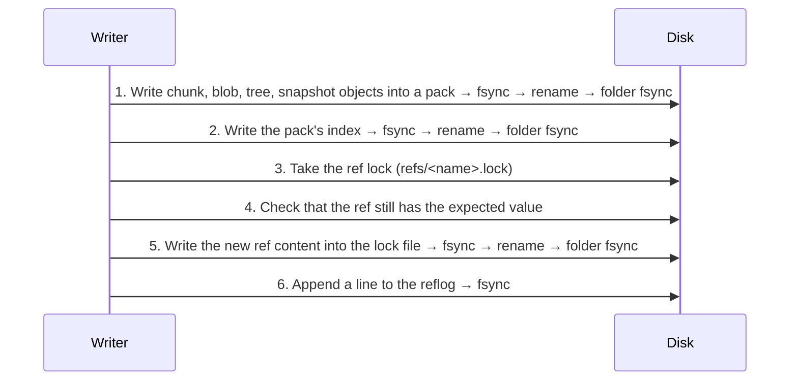

> **Türkçe:** [FORMAT.tr.md](FORMAT.tr.md)

# Apeiron Storage Format — Version 1

This document defines how an Apeiron repository is laid out on disk. The goal is that an independent program can read a repository using only this document, without Apeiron installed (VISION, principle 3).

**Status:** Approved (2026-10-27). Every change that affects the format is made in this document first.

Implementation status (`apeiron-core`):

| Section | Topic | Status |
| --- | --- | --- |
| 2–5 | Disk layout, `config`, object id, object types | Done |
| 6 | Canonical CBOR for blob, tree and snapshot | Planned |
| 7 | Chunking (FastCDC) | Done |
| 8 | Pack and index files | Done |
| 9 | Durable writes, refs and reflogs | Done (`MOVEFILE_WRITE_THROUGH` on Windows Planned) |
| 10 | Power-failure tests | In progress |

## Plain summary

- Every file is split by its content into pieces (chunks) of about 1 MiB. The same piece is never stored twice.
- Each piece is named by a 32-byte fingerprint computed from its content (BLAKE3). If even one bit of the content is damaged, the fingerprint no longer matches and the damage is noticed immediately.
- Pieces are not stored as separate files but grouped into "pack" files of tens of MiB. This avoids crowds of small files and reduces the number of requests to remote targets.
- The directory listing (tree), a file's piece list (blob) and the "state at this moment" record (snapshot) are stored the same way.
- A name (ref, e.g. `backup/home`) is just a small file pointing at a snapshot. New data is first written to disk completely; this small file is replaced in a single step at the very end. If power fails in between, either the old state or the new state is visible, never a half state.

## 1. General rules

1. All multi-byte integers are written **little-endian**.
2. Object identifiers (IDs) are 32 bytes. In text they are written as 64 **lowercase hexadecimal** (hex) characters.
3. Objects are immutable. Once written, an object's content is never changed; it can only be removed later by garbage collection (Stage 1).
4. A reader that meets a format version it does not know refuses to open the repository. It does not guess.
5. Data that fails verification is never handed to the caller; a typed corruption error is returned.

## 2. Disk layout

```text
<repo>/
├── config                 # Repository settings (TOML), section 3
├── packs/
│   └── 3f/
│       └── 3f9a…e1.pack   # Pack files; subfolder by the first 2 hex characters
├── index/
│   └── 7c2b…04.idx        # Pack indexes; there can be more than one
├── refs/
│   └── backup/home        # Ref files; a "/" in the name becomes a subfolder
├── logs/
│   └── backup/home        # Change log of each ref (reflog)
├── locks/                 # Repository-level locks (to be defined in Stage 1, reserved)
├── keys/                  # Encryption keys (to be defined in Stage 2, reserved)
└── tmp/                   # Temporary files being written
```

- Every file outside `tmp/` is either completely written and flushed to disk, or does not exist at all (section 9).
- Files in `tmp/` are never repository content. Temporary files older than one hour may be deleted.
- A reader ignores top-level folders it does not know; a writer does not touch them.

## 3. The `config` file

Written once when the repository is created. It is TOML, so it can be read with a text editor.

```toml
format = "apeiron-repository"
version = 1
id = "5d1c0b9e2f4a47c8a1e3b6d9f0a2c4e7"      # 16 random bytes, hex
created = 2026-10-27T12:00:00Z

[hash]
algorithm = "blake3-keyed"
id_key = "…64 hex characters…"             # 32 random bytes, section 4

[chunker]
algorithm = "fastcdc-2020"
min_size = 262144                           # 256 KiB
avg_size = 1048576                          # 1 MiB
max_size = 4194304                          # 4 MiB

[encryption]
mode = "none"                               # The only value in version 1; extended in Stage 2
```

- `version` is the major version of the format. A reader refuses versions it does not know.
- If `config` must change (e.g. chunker settings), the durable write rule of section 9.1 applies.
- If `id_key` is damaged, every object verification fails; the corruption is never silent.

## 4. Object identity (BLAKE3 addressing)

The identifier of every object is computed as:

```text
ID = BLAKE3_keyed(id_key, type_byte ‖ content)
```

- `BLAKE3_keyed`: the keyed hash mode of BLAKE3, 32-byte output. The key is `id_key` from `config`.
- `type_byte`: a single byte (section 5). The same bytes stored as a different type get a different identifier.
- `content`: the **uncompressed, unencrypted** form of the object. Raw data for a chunk; the canonical encoding of section 6 for the others.

**Why keyed:** In Stage 2 the remote target will store encrypted data. If identifiers were plain BLAKE3, the remote side could answer "is this known file in this repository?" by looking at the identifiers. A keyed identifier prevents this. The cost: there is no deduplication between two repositories with different `id_key`s. Copies of the same repository (sync, backup target) share the same key.

The **names** of pack and index files, however, are given by an unkeyed, plain `BLAKE3(all bytes of the file)`. This way even a remote server that does not know the key can verify that the files are intact.

## 5. Object types

| Type byte | Type | Content | Section |
| --- | --- | --- | --- |
| `0x01` | chunk | A raw piece of file data | 7 |
| `0x02` | blob | The chunk list of one file | 6.2 |
| `0x03` | tree | The entries of one directory | 6.3 |
| `0x04` | snapshot | The state of a data set at a given moment | 6.4 |

Other values are reserved. A reader rejects types it does not know.

## 6. Encoding of structured objects

### 6.1 Canonical CBOR

Blob, tree and snapshot are encoded with **CBOR** (RFC 8949). The same object must always turn into the same bytes; otherwise its identifier changes. The following rules are therefore mandatory (RFC 8949 §4.2.1 "core deterministic encoding"):

1. Integers are written in their shortest form.
2. All arrays and maps are written with definite length.
3. Map keys are integers, sorted in ascending order.
4. Floating-point numbers, tags, `undefined` and `null` are not used.
5. An optional field that is absent is not written at all, key included.
6. A version 1 reader that sees an unknown key rejects the object.

A reader that re-encodes a decoded object and does not get the same bytes treats the object as corrupt.

In the tables below `id` = 32-byte byte string (CBOR bstr), `bytes` = byte string, `text` = UTF-8 text, `uint`/`int` = integer, `time` = `[seconds: int, nanoseconds: uint]` (Unix time, UTC).

### 6.2 Blob

The content of one file. Chunks are listed in file order.

| Key | Name | Type | Required | Description |
| --- | --- | --- | --- | --- |
| 0 | size | uint | yes | Total size of the file (bytes) |
| 1 | chunks | `[[id, uint], …]` | yes | Identifier and raw size of each chunk |

- The sum of chunk sizes must equal `size`; otherwise the blob is corrupt.
- No blob is written for an empty file (see tree, `content`).
- A 10 GB file means about 10,000 chunks and a ~400 KB blob. In version 1 blobs have a single level; a multi-level blob for very large files may be added later as a separate type.

### 6.3 Tree

A directory. The entries form an array sorted in ascending order of their `name` bytes; the same name cannot appear twice.

| Key | Name | Type | Required | Description |
| --- | --- | --- | --- | --- |
| 0 | entries | `[entry, …]` | yes | Directory entries |

Each **entry** is a CBOR map:

| Key | Name | Type | Required | Description |
| --- | --- | --- | --- | --- |
| 0 | name | bytes | yes | File name. Cannot be empty, cannot contain `/` or a zero byte, cannot be `.` or `..` |
| 1 | kind | uint | yes | `0` file, `1` directory, `2` symbolic link |
| 2 | size | uint | for files | File size |
| 3 | content | id | see description | File: blob id (absent if size is 0). Directory: tree id. Link: absent |
| 4 | target | bytes | for links | Target of the symbolic link |
| 5 | mode | uint | no | Unix permission bits (lowest 12 bits) |
| 6 | mtime | time | no | Last modification time |
| 7 | uid | uint | no | Unix user id |
| 8 | gid | uint | no | Unix group id |
| 9 | xattrs | `[[bytes, bytes], …]` | no | Extended attributes (name, value); sorted by name |

- Names are stored as bytes because Linux file names do not have to be valid UTF-8. On Windows names are encoded as WTF-8. No Unicode normalisation (macOS) is applied; a name is stored exactly as it was read.
- Version 1 does not store hard links, device files or Windows ACLs. When encountered they are skipped and reported to the user.

### 6.4 Snapshot

| Key | Name | Type | Required | Description |
| --- | --- | --- | --- | --- |
| 0 | tree | id | yes | Tree id of the root directory |
| 1 | parents | `[id, …]` | yes | Parent snapshots (empty array for the first snapshot) |
| 2 | time | time | yes | The moment the snapshot was taken |
| 3 | author | text | no | Who took it (e.g. `Name <e-mail>`) |
| 4 | host | text | no | Which device it was taken on |
| 5 | message | text | no | Description |
| 6 | meta | `[[text, text], …]` | no | Free key-value pairs used by services; sorted by key, no duplicates |

The core gives no meaning to the content of `meta`. For example, the backup service may write a key such as `source-path`.

## 7. Chunking (FastCDC)

- Algorithm: **FastCDC, the version from the 2020 paper** (Xia et al., "The Design of Fast Content-Defined Chunking for Data Deduplication Based Storage Systems"), normalisation level 1, the standard gear table from the paper.
- Default: `min_size` 256 KiB, `avg_size` 1 MiB, `max_size` 4 MiB.
- Configurable range: `avg_size` a power of two between 64 KiB and 4 MiB; `min_size = avg_size / 4`, `max_size = avg_size × 4`.
- The last chunk of a file may be smaller than `min_size`. A file smaller than `min_size` is a single chunk.

**Important:** Chunking settings are used only **when writing**. A reader does not need to know them; the blob already contains the chunk list. If the settings change, old data stays readable; only deduplication between old and new data decreases.

## 8. Pack and index files

### 8.1 Pack file (`packs/xx/<name>.pack`)

A pack is a single file that stores many objects. The recommended size is 16–64 MiB (a writer preference, not a format rule).

```text
┌──────────────────────────────┐
│ Header (16 bytes)            │
├──────────────────────────────┤
│ Object data 1                │
│ Object data 2                │
│ …                            │
├──────────────────────────────┤
│ Entry table (n × 52 bytes)   │
├──────────────────────────────┤
│ Footer (12 bytes)            │
└──────────────────────────────┘
```

**Header:**

| Offset | Size | Field | Value |
| --- | --- | --- | --- |
| 0 | 8 | magic | ASCII `APRNPACK` |
| 8 | 2 | version | `1` |
| 10 | 2 | flags | `0` (reserved for the encryption flag in Stage 2) |
| 12 | 4 | reserved | `0` |

**Entry table:** One entry per object, in the order the objects appear in the file.

| Offset | Size | Field | Description |
| --- | --- | --- | --- |
| 0 | 32 | id | Object identifier |
| 32 | 1 | type | Type byte (section 5) |
| 33 | 1 | compression | `0` none, `1` zstd |
| 34 | 2 | flags | `0` (reserved) |
| 36 | 8 | offset | Position of the object data from the start of the file |
| 44 | 4 | stored_len | Size on disk (compressed) |
| 48 | 4 | raw_len | Uncompressed size |

**Footer:**

| Offset | Size | Field | Description |
| --- | --- | --- | --- |
| 0 | 4 | entry_count | Number of entries |
| 4 | 8 | magic | ASCII `APRNPEND` |

Rules:

1. File name = `BLAKE3(all bytes of the file)`, hex. If the name does not match, the pack is corrupt.
2. Object data lies back to back, without gaps or overlaps; the first starts right after the header.
3. A writer uses `compression = 0` when compression does not make the data smaller.
4. The same object may appear more than once in different packs (e.g. two concurrent writers). Every copy is valid.
5. When reading: the data is decompressed, `raw_len` is checked, and the identifier is recomputed per section 4 and compared with `id`.

### 8.2 Index file (`index/<name>.idx`)

An index answers "which object is in which pack, and where" without opening packs one by one. **An index is a cache:** even if every index is deleted, they can be rebuilt from the entry tables of the packs.

| Part | Size | Content |
| --- | --- | --- |
| Header | 16 | magic ASCII `APRNINDX`, version `1` (u16), flags `0` (u16), pack_count (u32) |
| Pack list | pack_count × 32 | Names of the packs this index covers |
| Entry count | 8 | entry_count (u64) |
| Entries | entry_count × 56 | `id` (32), `pack_no` (u32, position in the pack list), then the `type`…`raw_len` fields from the pack entry table (20 bytes) |

- Entries are sorted by `id` in ascending order.
- File name = `BLAKE3(all bytes of the file)`, hex.
- A reader merges all index files. If a pack is in no index (an interrupted write), the reader may read its entry table directly.

## 9. Writing and atomic update rules

### 9.1 Writing a file durably

Every persistent file of section 2 is written with these steps:

1. A new, randomly named file is created in `tmp/` and the content is written.
2. The file is flushed to disk (`fsync`).
3. The file is moved to its final name (`rename`). If the target folder does not exist, it is created first and its parent folder is flushed.
4. The target folder is flushed to disk (`fsync` on the folder).

Platform notes: on macOS `fsync` is not enough; `F_FULLFSYNC` is used. On Windows `FlushFileBuffers` and `MoveFileExW(MOVEFILE_REPLACE_EXISTING | MOVEFILE_WRITE_THROUGH)` are used.

For content-addressed files (pack, index), if the target already exists the new file is discarded; the content is the same.

### 9.2 Order of saving a snapshot



Core rule: **A ref is never updated before the snapshot it points to, and every object reachable from it, has been flushed to disk.**

### 9.3 Ref file

A ref is a name given to a snapshot. At the core level there is no difference between a branch, a tag and a backup point.

**Name rules:**

1. Consists of one or more parts separated by `/` (e.g. `backup/home`, `tag/v1`).
2. Each part contains only `a-z`, `0-9`, `.`, `_`, `-`; does not start with `.`; does not end with `.lock`.
3. Total length is at most 200 bytes.
4. A name cannot be the folder of another name (`backup` and `backup/home` cannot coexist). This rule also applies to a deleted ref as long as its reflog exists, so its history is not lost.

Using only lowercase letters prevents two names from colliding on case-insensitive file systems (Windows, macOS). Free-form names shown to users are kept in the service layer.

**Content** (UTF-8 text, three lines, each ending in `\n`):

```text
apeiron-ref 1
target <64 hex: snapshot id>
check <64 hex: plain BLAKE3 of the first two lines>
```

`check` is computed over the bytes of the first two lines, line endings (`\n`) included.

If `check` does not match, the ref is corrupt; the reader suggests the last valid value from the reflog and does not fix it on its own.

**Update (compare and swap):**

1. `refs/<name>.lock` is opened with "create only if absent" (`O_CREAT | O_EXCL`). If it already exists, the update stops with a "locked" error.
2. The current value of the ref is read. If it is not the value the caller expects, the lock is deleted and a "conflict" error is returned. This way two processes can never silently overwrite each other's update.
3. The new content is written into the lock file and `fsync`ed.
4. The lock file is moved over `refs/<name>` (`rename`) and the folder is `fsync`ed.

A lock file holds no information about its owner. If more than **10 minutes** have passed since it was created, it is considered stale and is removed only by an explicit user command (e.g. `apeiron repair`).

Deleting a ref: the ref file is moved under `tmp/` with `rename`, the folder is `fsync`ed and a delete line is appended to the reflog. Snapshots are not deleted; they can be brought back through the reflog (VISION, principle 5).

### 9.4 Reflog (`logs/<name>`)

Every ref change is appended as a line to the end of this file **after** the ref is updated, and the file is `fsync`ed:

```text
<old hex | 64 zeros> <new hex | 64 zeros> <unix seconds> <op: create|update|delete|repair> <check>
```

Fields are separated by a single space and the line ends with `\n`. `check` is the first 16 hex characters of the plain BLAKE3 hash of the part of the line before the `check` field (excluding the space in between).

- If the last line of the file is invalid (does not end with `\n` or `check` does not match), it is treated as a power-failure leftover and ignored. Before appending a new line, the writer cuts this leftover off the file (truncate).
- An invalid line other than the last one is corruption and is reported as an error.
- If the ref value differs from the last `new` value in the reflog (the ref was updated but the line could not be written), a `repair` line is appended right before the next update of that ref (or by an explicit repair command). No information is lost, because the old value is already recorded in the previous line.
- The reflog is also used to decide which snapshots garbage collection (Stage 1) treats as live.

## 10. Interruption and corruption cases

The table below lists the expected results of the Stage 0 power-failure tests. Each row becomes a separate fault-injection test.

| Moment of interruption | State visible in the repository | Recovery |
| --- | --- | --- |
| While the pack is being written in `tmp/` | No change | The temporary file is cleaned up |
| Pack moved, index not written | Ref points to the old snapshot | The orphan pack is indexed or removed by garbage collection |
| Index written, ref not updated | Ref points to the old snapshot | None; the new objects are a harmless surplus |
| Ref lock taken, not moved | Ref points to the old snapshot | The stale lock is removed with `repair` |
| Ref moved, reflog not written | Ref points to the new snapshot | A `repair` line is appended on the next update |
| Disk full (at any step) | No change | The error is reported, the temporary file is deleted |
| Bit corruption inside a pack | Reading gives a "corruption" error | Repair from another copy (Stage 1) |

In no row may the state "a ref points to a missing or half-written object" arise.

## 11. Verification summary

| What | How | Key needed |
| --- | --- | --- |
| Object | The identifier is recomputed (section 4) | Yes |
| Structured object | Canonical re-encoding gives the same bytes (6.1) | Yes |
| Blob | Sum of chunk sizes = `size` | Yes |
| Pack / index file | File name = plain BLAKE3 | No |
| Ref | `check` line | No |
| Reflog line | `check` field | No |

## 12. Left for later versions

- Encryption (`keys/`, pack `flags`, `encryption.mode`): Stage 2.
- Garbage collection, repository locks (`locks/`), pack merging: Stage 1.
- Multi-level blobs, hard links, Windows ACLs, device files.
- Format upgrade tool: automatic and reversible migration when the format version changes.
