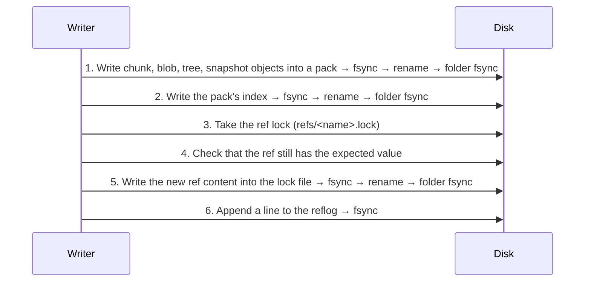

> **Türkçe:** [FORMAT.tr.md](FORMAT.tr.md)

# Apeiron Storage Format — Version 1

This document defines how an Apeiron repository is laid out on disk. The goal is that an independent program can read a repository using only this document, without Apeiron installed (VISION, principle 3).

**Status:** Approved (2026-10-27). Every change that affects the format is made in this document first.

Implementation status (`apeiron-core`):

| Section | Topic | Status |
| --- | --- | --- |
| 2–5 | Disk layout, `config`, object id, object types | Done |
| 6 | Canonical CBOR for blob, tree and snapshot | Done |
| 7 | Chunking (FastCDC) | Done |
| 8 | Pack and index files | Done |
| 9 | Durable writes, refs and reflogs | Done |
| 10 | Power-failure tests | Done |
| 12 | Repository lock | Done |
| 13 | Garbage collection | Done |
| 14 | Encryption | Done |
| 15 | Remote repositories, push and pull: folders, SFTP and S3 | Done |
| 15.6 | Clone | Done |

## Plain summary

- Every file is split by its content into pieces (chunks) of about 1 MiB. The same piece is never stored twice.
- Each piece is named by a 32-byte fingerprint computed from its content (BLAKE3). If even one bit of the content is damaged, the fingerprint no longer matches and the damage is noticed immediately.
- Pieces are not stored as separate files but grouped into "pack" files of tens of MiB. This avoids crowds of small files and reduces the number of requests to remote targets.
- The directory listing (tree), a file's piece list (blob) and the "state at this moment" record (snapshot) are stored the same way.
- A name (ref, e.g. `backup/home`) is just a small file pointing at a snapshot. New data is first written to disk completely; this small file is replaced in a single step at the very end. If power fails in between, either the old state or the new state is visible, never a half state.

## 1. General rules

1. All multi-byte integers are written **little-endian**.
2. Object identifiers (IDs) are 32 bytes. In text they are written as 64 **lowercase hexadecimal** (hex) characters.
3. Objects are immutable. Once written, an object's content is never changed; it can only be removed later by garbage collection (Stage 1).
4. A reader that meets a format version it does not know refuses to open the repository. It does not guess.
5. Data that fails verification is never handed to the caller; a typed corruption error is returned.

## 2. Disk layout

```text
<repo>/
├── config                 # Repository settings (TOML), section 3
├── packs/
│   └── 3f/
│       └── 3f9a…e1.pack   # Pack files; subfolder by the first 2 hex characters
├── index/
│   └── 7c2b…04.idx        # Pack indexes; there can be more than one
├── refs/
│   └── backup/home        # Ref files; a "/" in the name becomes a subfolder
├── logs/
│   └── backup/home        # Change log of each ref (reflog)
├── locks/                 # Repository lock, section 12
├── keys/                  # Key files of an encrypted repository, section 14
├── remotes                # Remote repositories of this copy (TOML), section 15.1
└── tmp/                   # Temporary files being written
```

- Every file outside `tmp/` is either completely written and flushed to disk, or does not exist at all (section 9).
- Files in `tmp/` are never repository content. Temporary files older than one hour may be deleted.
- A reader ignores top-level folders it does not know; a writer does not touch them.

## 3. The `config` file

Written once when the repository is created. It is TOML, so it can be read with a text editor.

```toml
format = "apeiron-repository"
version = 1
id = "5d1c0b9e2f4a47c8a1e3b6d9f0a2c4e7"      # 16 random bytes, hex
created = 2026-10-27T12:00:00Z

[hash]
algorithm = "blake3-keyed"
id_key = "…64 hex characters…"             # 32 random bytes, section 4

[chunker]
algorithm = "fastcdc-2020"
min_size = 262144                           # 256 KiB
avg_size = 1048576                          # 1 MiB
max_size = 4194304                          # 4 MiB

[encryption]
mode = "none"                               # or "xchacha20-poly1305", section 14
```

- `version` is the major version of the format. A reader refuses versions it does not know.
- If `config` must change (e.g. chunker settings), the durable write rule of section 9.1 applies.
- If `id_key` is damaged, every object verification fails; the corruption is never silent.

## 4. Object identity (BLAKE3 addressing)

The identifier of every object is computed as:

```text
ID = BLAKE3_keyed(id_key, type_byte ‖ content)
```

- `BLAKE3_keyed`: the keyed hash mode of BLAKE3, 32-byte output. The key is `id_key` from `config`.
- `type_byte`: a single byte (section 5). The same bytes stored as a different type get a different identifier.
- `content`: the **uncompressed, unencrypted** form of the object. Raw data for a chunk; the canonical encoding of section 6 for the others.

**Why keyed:** In Stage 2 the remote target will store encrypted data. If identifiers were plain BLAKE3, the remote side could answer "is this known file in this repository?" by looking at the identifiers. A keyed identifier prevents this. The cost: there is no deduplication between two repositories with different `id_key`s. Copies of the same repository (sync, backup target) share the same key.

The **names** of pack and index files, however, are given by an unkeyed, plain `BLAKE3(all bytes of the file)`. This way even a remote server that does not know the key can verify that the files are intact.

## 5. Object types

| Type byte | Type | Content | Section |
| --- | --- | --- | --- |
| `0x01` | chunk | A raw piece of file data | 7 |
| `0x02` | blob | The chunk list of one file | 6.2 |
| `0x03` | tree | The entries of one directory | 6.3 |
| `0x04` | snapshot | The state of a data set at a given moment | 6.4 |

Other values are reserved. A reader rejects types it does not know.

## 6. Encoding of structured objects

### 6.1 Canonical CBOR

Blob, tree and snapshot are encoded with **CBOR** (RFC 8949). The same object must always turn into the same bytes; otherwise its identifier changes. The following rules are therefore mandatory (RFC 8949 §4.2.1 "core deterministic encoding"):

1. Integers are written in their shortest form.
2. All arrays and maps are written with definite length.
3. Map keys are integers, sorted in ascending order.
4. Floating-point numbers, tags, `undefined` and `null` are not used.
5. An optional field that is absent is not written at all, key included.
6. A version 1 reader that sees an unknown key rejects the object.

A reader that re-encodes a decoded object and does not get the same bytes treats the object as corrupt.

In the tables below `id` = 32-byte byte string (CBOR bstr), `bytes` = byte string, `text` = UTF-8 text, `uint`/`int` = integer, `time` = `[seconds: int, nanoseconds: uint]` (Unix time, UTC).

### 6.2 Blob

The content of one file. Chunks are listed in file order.

| Key | Name | Type | Required | Description |
| --- | --- | --- | --- | --- |
| 0 | size | uint | yes | Total size of the file (bytes) |
| 1 | chunks | `[[id, uint], …]` | yes | Identifier and raw size of each chunk |

- The sum of chunk sizes must equal `size`; otherwise the blob is corrupt.
- No blob is written for an empty file (see tree, `content`).
- A 10 GB file means about 10,000 chunks and a ~400 KB blob. In version 1 blobs have a single level; a multi-level blob for very large files may be added later as a separate type.

### 6.3 Tree

A directory. The entries form an array sorted in ascending order of their `name` bytes; the same name cannot appear twice.

| Key | Name | Type | Required | Description |
| --- | --- | --- | --- | --- |
| 0 | entries | `[entry, …]` | yes | Directory entries |

Each **entry** is a CBOR map:

| Key | Name | Type | Required | Description |
| --- | --- | --- | --- | --- |
| 0 | name | bytes | yes | File name. Cannot be empty, cannot contain `/` or a zero byte, cannot be `.` or `..` |
| 1 | kind | uint | yes | `0` file, `1` directory, `2` symbolic link |
| 2 | size | uint | for files | File size |
| 3 | content | id | see description | File: blob id (absent if size is 0). Directory: tree id. Link: absent |
| 4 | target | bytes | for links | Target of the symbolic link |
| 5 | mode | uint | no | Unix permission bits (lowest 12 bits) |
| 6 | mtime | time | no | Last modification time |
| 7 | uid | uint | no | Unix user id |
| 8 | gid | uint | no | Unix group id |
| 9 | xattrs | `[[bytes, bytes], …]` | no | Extended attributes (name, value); sorted by name |

- Names are stored as bytes because Linux file names do not have to be valid UTF-8. On Windows names are encoded as WTF-8. No Unicode normalisation (macOS) is applied; a name is stored exactly as it was read.
- Version 1 does not store hard links, device files or Windows ACLs. Hard-linked files are stored as separate files (their content is stored only once); the link between them is not kept. Device files are skipped and reported to the user.

### 6.4 Snapshot

| Key | Name | Type | Required | Description |
| --- | --- | --- | --- | --- |
| 0 | tree | id | yes | Tree id of the root directory |
| 1 | parents | `[id, …]` | yes | Parent snapshots (empty array for the first snapshot) |
| 2 | time | time | yes | The moment the snapshot was taken |
| 3 | author | text | no | Who took it (e.g. `Name <e-mail>`) |
| 4 | host | text | no | Which device it was taken on |
| 5 | message | text | no | Description |
| 6 | meta | `[[text, text], …]` | no | Free key-value pairs used by services; sorted by key, no duplicates |

The core gives no meaning to the content of `meta`. For example, the backup service may write a key such as `source-path`.

## 7. Chunking (FastCDC)

- Algorithm: **FastCDC, the version from the 2020 paper** (Xia et al., "The Design of Fast Content-Defined Chunking for Data Deduplication Based Storage Systems"), normalisation level 1, the standard gear table from the paper.
- Default: `min_size` 256 KiB, `avg_size` 1 MiB, `max_size` 4 MiB.
- Configurable range: `avg_size` a power of two between 64 KiB and 4 MiB; `min_size = avg_size / 4`, `max_size = avg_size × 4`.
- The last chunk of a file may be smaller than `min_size`. A file smaller than `min_size` is a single chunk.

**Important:** Chunking settings are used only **when writing**. A reader does not need to know them; the blob already contains the chunk list. If the settings change, old data stays readable; only deduplication between old and new data decreases.

## 8. Pack and index files

### 8.1 Pack file (`packs/xx/<name>.pack`)

A pack is a single file that stores many objects. The recommended size is 16–64 MiB (a writer preference, not a format rule).

```text
┌──────────────────────────────┐
│ Header (16 bytes)            │
├──────────────────────────────┤
│ Object data 1                │
│ Object data 2                │
│ …                            │
├──────────────────────────────┤
│ Entry table (n × 52 bytes)   │
├──────────────────────────────┤
│ Footer (12 bytes)            │
└──────────────────────────────┘
```

**Header:**

| Offset | Size | Field | Value |
| --- | --- | --- | --- |
| 0 | 8 | magic | ASCII `APRNPACK` |
| 8 | 2 | version | `1` |
| 10 | 2 | flags | Bit 0: encrypted (section 14); all other bits `0` |
| 12 | 4 | reserved | `0` |

**Entry table:** One entry per object, in the order the objects appear in the file.

| Offset | Size | Field | Description |
| --- | --- | --- | --- |
| 0 | 32 | id | Object identifier |
| 32 | 1 | type | Type byte (section 5) |
| 33 | 1 | compression | `0` none, `1` zstd |
| 34 | 2 | flags | `0` (reserved) |
| 36 | 8 | offset | Position of the object data from the start of the file |
| 44 | 4 | stored_len | Size on disk (compressed) |
| 48 | 4 | raw_len | Uncompressed size |

**Footer:**

| Offset | Size | Field | Description |
| --- | --- | --- | --- |
| 0 | 4 | entry_count | Number of entries |
| 4 | 8 | magic | ASCII `APRNPEND` |

Rules:

1. File name = `BLAKE3(all bytes of the file)`, hex. If the name does not match, the pack is corrupt.
2. Object data lies back to back, without gaps or overlaps; the first starts right after the header.
3. A writer uses `compression = 0` when compression does not make the data smaller.
4. The same object may appear more than once in different packs (e.g. two concurrent writers). Every copy is valid.
5. When reading: the data is decompressed, `raw_len` is checked, and the identifier is recomputed per section 4 and compared with `id`.

### 8.2 Index file (`index/<name>.idx`)

An index answers "which object is in which pack, and where" without opening packs one by one. **An index is a cache:** even if every index is deleted, they can be rebuilt from the entry tables of the packs.

| Part | Size | Content |
| --- | --- | --- |
| Header | 16 | magic ASCII `APRNINDX`, version `1` (u16), flags `0` (u16), pack_count (u32) |
| Pack list | pack_count × 32 | Names of the packs this index covers |
| Entry count | 8 | entry_count (u64) |
| Entries | entry_count × 56 | `id` (32), `pack_no` (u32, position in the pack list), then the `type`…`raw_len` fields from the pack entry table (20 bytes) |

- Entries are sorted by `id` in ascending order.
- File name = `BLAKE3(all bytes of the file)`, hex.
- A reader merges all index files. If a pack is in no index (an interrupted write), the reader may read its entry table directly.
- An index file that fails verification (its name does not match its bytes, or its structure is invalid) does not stop the repository from opening. The reader ignores it, reads the packs it covered as packs without an index, and reports the damaged file. A pack without an index whose name does not match its bytes is reported and skipped; its objects are unavailable until it is repaired from another copy.
- The repair command writes one new index for every pack without a healthy index and then deletes the damaged index files. It never deletes a pack.

## 9. Writing and atomic update rules

### 9.1 Writing a file durably

Every persistent file of section 2 is written with these steps:

1. A new, randomly named file is created in `tmp/` and the content is written.
2. The file is flushed to disk (`fsync`).
3. The file is moved to its final name (`rename`). If the target folder does not exist, it is created first and its parent folder is flushed.
4. The target folder is flushed to disk (`fsync` on the folder).

Platform notes: on macOS `fsync` is not enough; `F_FULLFSYNC` is used. On Windows `FlushFileBuffers` and `MoveFileExW(MOVEFILE_REPLACE_EXISTING | MOVEFILE_WRITE_THROUGH)` are used.

For content-addressed files (pack, index), if the target already exists the new file is discarded; the content is the same.

### 9.2 Order of saving a snapshot



Core rule: **A ref is never updated before the snapshot it points to, and every object reachable from it, has been flushed to disk.**

### 9.3 Ref file

A ref is a name given to a snapshot. At the core level there is no difference between a branch, a tag and a backup point.

**Name rules:**

1. Consists of one or more parts separated by `/` (e.g. `backup/home`, `tag/v1`).
2. Each part contains only `a-z`, `0-9`, `.`, `_`, `-`; does not start with `.`; does not end with `.lock`.
3. Total length is at most 200 bytes.
4. A name cannot be the folder of another name (`backup` and `backup/home` cannot coexist). This rule also applies to a deleted ref as long as its reflog exists, so its history is not lost.

Using only lowercase letters prevents two names from colliding on case-insensitive file systems (Windows, macOS). Free-form names shown to users are kept in the service layer.

**Content** (UTF-8 text, three lines, each ending in `\n`):

```text
apeiron-ref 1
target <64 hex: snapshot id>
check <64 hex: plain BLAKE3 of the first two lines>
```

`check` is computed over the bytes of the first two lines, line endings (`\n`) included.

If `check` does not match, the ref is corrupt; the reader suggests the last valid value from the reflog and does not fix it on its own.

**Update (compare and swap):**

1. `refs/<name>.lock` is opened with "create only if absent" (`O_CREAT | O_EXCL`). If it already exists, the update stops with a "locked" error.
2. The current value of the ref is read. If it is not the value the caller expects, the lock is deleted and a "conflict" error is returned. This way two processes can never silently overwrite each other's update.
3. The new content is written into the lock file and `fsync`ed.
4. The lock file is moved over `refs/<name>` (`rename`) and the folder is `fsync`ed.

A lock file holds no information about its owner. If more than **10 minutes** have passed since it was created, it is considered stale and is removed only by an explicit user command (e.g. `apeiron repair`).

Deleting a ref: the ref file is moved under `tmp/` with `rename`, the folder is `fsync`ed and a delete line is appended to the reflog. Snapshots are not deleted; they can be brought back through the reflog (VISION, principle 5).

### 9.4 Reflog (`logs/<name>`)

Every ref change is appended as a line to the end of this file **after** the ref is updated, and the file is `fsync`ed:

```text
<old hex | 64 zeros> <new hex | 64 zeros> <unix seconds> <op: create|update|delete|repair> <check>
```

Fields are separated by a single space and the line ends with `\n`. `check` is the first 16 hex characters of the plain BLAKE3 hash of the part of the line before the `check` field (excluding the space in between).

- If the last line of the file is invalid (does not end with `\n` or `check` does not match), it is treated as a power-failure leftover and ignored. Before appending a new line, the writer cuts this leftover off the file (truncate).
- An invalid line other than the last one is corruption and is reported as an error.
- If the ref value differs from the last `new` value in the reflog (the ref was updated but the line could not be written), a `repair` line is appended right before the next update of that ref (or by an explicit repair command). No information is lost, because the old value is already recorded in the previous line.
- The reflog is also used to decide which snapshots garbage collection treats as live (section 13.1).

## 10. Interruption and corruption cases

The table below lists the expected results of the Stage 0 power-failure tests. Each row becomes a separate fault-injection test.

| Moment of interruption | State visible in the repository | Recovery |
| --- | --- | --- |
| While the pack is being written in `tmp/` | No change | The temporary file is cleaned up |
| Pack moved, index not written | Ref points to the old snapshot | The orphan pack is indexed or removed by garbage collection |
| Index written, ref not updated | Ref points to the old snapshot | None; the new objects are a harmless surplus |
| Ref lock taken, not moved | Ref points to the old snapshot | The stale lock is removed with `repair` |
| Ref moved, reflog not written | Ref points to the new snapshot | A `repair` line is appended on the next update |
| Disk full (at any step) | No change; if the error comes after the ref was moved, as in the row above | The error is reported, the temporary file is deleted |
| Bit corruption inside a pack | Reading gives a "corruption" error | Repair from another copy (Stage 1) |
| Bit corruption inside an index file | The repository opens; the damaged index is reported and its packs are read directly | `repair` writes a new index and deletes the damaged one |

In no row may the state "a ref points to a missing or half-written object" arise.

The tests interrupt a full write (new chunks, snapshot, ref update) once at every change to the disk and check each resulting state against this table.

## 11. Verification summary

| What | How | Key needed |
| --- | --- | --- |
| Object | The identifier is recomputed (section 4) | Yes |
| Structured object | Canonical re-encoding gives the same bytes (6.1) | Yes |
| Blob | Sum of chunk sizes = `size` | Yes |
| Pack / index file | File name = plain BLAKE3 | No |
| Ref | `check` line | No |
| Reflog line | `check` field | No |

## 12. Repository lock

Garbage collection deletes packs. It must never run while another program reads or writes the repository: a backup could otherwise reuse an object that is being deleted and end up with a snapshot that points to a missing object.

1. The lock is the empty file `locks/repository`. It is created if it does not exist and is never deleted.
2. The lock is an operating system file lock (`flock` on Linux and macOS, `LockFileEx` on Windows), not the presence of the file. The system releases it when the program ends, even after a crash or power failure, so a stale lock cannot remain.
3. Every operation that reads or writes objects or refs takes the lock **shared**; any number of programs can hold it shared at once. Garbage collection and removing a key (section 14.2) take it **exclusive**.
4. A writer loads the index files **after** taking the lock and keeps the lock until its ref update is finished. Index contents remembered from before the lock was taken must not be used to skip writing an object.
5. If the lock cannot be taken at once, the operation stops with a "locked" error; it does not wait.
6. File locks are not reliable on some network file systems (for example older NFS). A repository on such a file system must not be used by more than one program at a time.

The ref lock files of section 9.3 stay as they are; they serialise updates of one ref, while this lock separates garbage collection from everything else.

## 13. Garbage collection

Garbage collection removes objects that no ref and no recent reflog entry can reach, and rewrites packs that are partly dead.

### 13.1 Live objects

1. The roots are the target of every ref and every snapshot id (`old` and `new`) in reflog lines younger than the **keep period** (default 90 days; 0 means refs only). Older reflog lines stay in the files but no longer protect anything.
2. Every object reachable from a root is live: a snapshot's tree and parents, a tree's blobs and subtrees, a blob's chunks.
3. If a reachable object is missing or damaged, garbage collection stops without deleting anything.

### 13.2 Steps

1. Take the repository lock exclusive (section 12) and load all index files.
2. Mark the live objects (13.1).
3. For every pack: if all of its objects are live, keep it; if none is live, mark it for deletion; otherwise copy its live objects into new packs (section 8.1, the stored bytes are copied unchanged) and mark the old pack for deletion.
4. Write the new packs durably (section 9.1).
5. Write one new index file that covers every kept and every new pack, durably.
6. Delete all other index files, then flush the `index/` folder.
7. Delete the packs marked for deletion, then flush their folders.
8. Delete temporary files in `tmp/`.

A dry run performs steps 1–3 and reports what would be removed without changing anything.

### 13.3 Interruptions

| Moment of interruption | State visible in the repository | Recovery |
| --- | --- | --- |
| Before step 5 ends | Old packs and indexes unchanged; new packs not indexed | The new packs are found as unindexed packs and hold only copies; the next run removes them |
| After step 5, before step 7 ends | Every live object is covered by the new index; some dead packs remain | Remaining dead packs are found as unindexed packs; the next run removes them |

In no case does a ref point to a missing object: an object is deleted only after a durable index covers another copy of it, or after it was found dead.

## 14. Encryption

An encrypted repository can be stored on a disk or a server that is not trusted: without a key, the content of files, their names and the folder structure cannot be read. Encryption is chosen when the repository is created and cannot be switched on or off later; to encrypt existing data, it is copied into a new encrypted repository.

### 14.1 Keys

| Key | Size | Use |
| --- | --- | --- |
| `id_key` | 32 bytes, random | Object identifiers (section 4); in an encrypted repository it is not written into `config` |
| `data_key` | 32 bytes, random | Encrypting object data, pack tables and index files |
| Key-encryption key | 32 bytes | Derived from a password or a recovery key; it only opens a key file |

`id_key` and `data_key` are created once, when the repository is created. They never leave a key file unencrypted and they never change, so every copy of the repository (section 4) keeps working with every key file.

### 14.2 Key files (`keys/<name>.key`)

A key file holds `id_key ‖ data_key` (64 bytes) sealed with a key-encryption key. A repository has one key file per password and one per recovery key; any one of them opens the repository.

```toml
format = "apeiron-key"
version = 1
kind = "password"                           # or "recovery"
created = 2026-10-28T12:00:00Z

[kdf]
algorithm = "argon2id"                      # "blake3-derive" for kind = "recovery"
memory_kib = 65536                          # 64 MiB
iterations = 3
parallelism = 1
salt = "…32 hex characters…"                # 16 random bytes

[sealed]
keys = "…hex…"                              # sealed box (14.3) of id_key ‖ data_key
```

- **Password:** the key-encryption key is `Argon2id(password, salt)` with the stored parameters. The defaults fit a Raspberry Pi 4; a writer may choose stronger ones.
- **Recovery key:** 32 random bytes shown once to the user as 52 base32 characters (RFC 4648, no padding) in groups of four joined by `-`. Being random, it needs no slow derivation: the key-encryption key is `BLAKE3_derive_key("apeiron 2026 recovery key", recovery key)`, and `[kdf]` holds only `algorithm`. A reader accepts the key in any letter case and ignores spaces and dashes.
- `<name>` is 32 random hex characters. A reader ignores key files it cannot parse and refuses Argon2id parameters above 4 GiB of memory, 64 iterations or 64 lanes, so that a planted key file cannot exhaust its memory or time.
- The additional data of the sealed box is `"apeiron-key 1" ‖ repository id` (the 16 bytes of `id` in `config`), so a key file cannot be moved into another repository.
- To open the repository, a reader tries the key files one by one; a wrong password fails the authentication tag and is reported as "wrong password", never as corruption.
- Adding or changing a password writes a new key file durably (section 9.1) before an old one is deleted. If every password and recovery key is lost, the data cannot be recovered by anyone.
- `<name>` is also the key's id, which the user gives to remove a key. Removing one deletes its file and syncs `keys/`, holding the repository lock exclusive (section 12) so that two programs cannot each remove the other's last key. A writer never removes the last key file it can parse.

### 14.3 Sealed box

Every encrypted piece of data is a sealed box of XChaCha20-Poly1305:

```text
nonce (24 bytes, random) ‖ ciphertext ‖ tag (16 bytes)
```

A 24-byte random nonce can be chosen without coordination between writers; repeating one by chance is not a practical risk. A box that fails authentication is corruption (or, for a key file, a wrong key).

### 14.4 What is encrypted

| Data | Form in an encrypted repository | Additional data |
| --- | --- | --- |
| Object data in a pack | The stored bytes (after compression) are a sealed box; `stored_len` includes its 40 extra bytes | `id ‖ type byte` of the object, so objects cannot be swapped |
| Pack entry table | Header flag bit 0 set; the table is one sealed box between the object data and the footer, of length `entry_count × 52 + 40` | The 16 header bytes |
| Index file | Header flags `1`; everything after the 16-byte header is one sealed box | The 16 header bytes |
| `config` | Plain; `[hash].id_key` is absent and `encryption.mode = "xchacha20-poly1305"` | — |
| Refs and reflogs | Plain | — |

Reading an object: open the sealed box → decompress → check `raw_len` → recompute the identifier (section 4). A pack or index whose encryption flag does not match `encryption.mode` is corrupt: an encrypted repository never serves plain data and the other way round. Pack and index file names stay the plain BLAKE3 of the file bytes, so a server without keys can still check that the files are intact.

### 14.5 What a reader without a key can see

| Visible | Not visible |
| --- | --- |
| Number and size of packs and index files, and when they change | Content of files, their names, sizes, times and the folder structure |
| Number of objects per pack (`entry_count`) | Which objects are files, folders or snapshots |
| Ref names (for example `backup/documents`), the snapshot ids they point to and the times they changed | What a snapshot contains; ids are keyed (section 4) and reveal nothing |

Ref names are visible by design so that a remote server can update refs safely; a user who wants to hide them chooses neutral names.

## 15. Remote repositories

A remote is another copy of the same repository: same `config`, same `keys/`, same object ids. Push copies the objects a ref needs to the remote and moves the remote ref; pull does the same the other way. A remote copy is a complete repository, so a backup can be restored from it directly.

### 15.1 The `remotes` file

```toml
[remote.disk]
url = "/run/media/user/disk/apeiron"                  # a folder

[remote.server]
url = "sftp://user@nas.local:22/srv/apeiron"         # SFTP

[remote.cloud]
url = "s3://bucket/apeiron?endpoint=https://s3.example.com&region=eu-1"   # S3-compatible
```

- The file is local to one copy; it is never pushed. Names follow the ref name rules of section 9.3, without `/`.
- It holds no secrets. SFTP uses the user's SSH keys and agent and checks the server against `~/.ssh/known_hosts`; an unknown server is refused. S3 reads `AWS_ACCESS_KEY_ID` and `AWS_SECRET_ACCESS_KEY`.
- Only an encrypted repository (section 14) can be pushed to an SFTP or S3 remote. A folder remote, such as an external disk, may hold a repository that is not encrypted.

### 15.2 Store operations

Every remote kind offers the same small set of operations on paths of the layout in section 2:

| Operation | Folder and SFTP | S3 |
| --- | --- | --- |
| Read a file, or a byte range of it | Read | `GET` with `Range` |
| List a folder | Read the folder | `LIST` with a prefix |
| Write a new file atomically | Write into `tmp/`, flush, rename (section 9.1) | `PUT` with `If-None-Match: *` |
| Replace a ref (compare and swap) | Lock file as in section 9.3 | `PUT` with `If-Match: <etag read before>` |
| List the refs | Read the `refs/` folders | `LIST` with the prefix `refs/` |
| Delete a file | Delete | `DELETE` |
| Create the folders of a new copy | Create the folders of section 2 | Nothing; S3 has no folders |

A file is either completely there or not there at all. A remote that cannot do a conditional `PUT` is refused, because without it two writers could overwrite each other's ref. A folder that already holds a repository is also locked shared while it is used (section 12), so that garbage collection run on it directly waits. SFTP needs the OpenSSH extension `posix-rename@openssh.com` to replace a ref and syncs files with `fsync@openssh.com` when the server offers it; a ref lock older than 10 minutes (section 9.3) is removed by the next push.

### 15.3 Push

1. Take the local repository lock shared (section 12). Read the remote `config`. If there is none, the remote is new: create its folders, write `keys/` and then `config`. A new remote must be empty apart from the folders of section 2; any other content stops the push. If its `id` differs from the local one, stop: it is another repository.
2. Make the remote `keys/` equal to the local one: write missing key files first, then delete the ones removed locally.
3. Read the remote index files; together they give the set of objects the remote has.
4. Read the remote ref. If it points to a snapshot that is not the local ref's snapshot or one of its ancestors, stop with a conflict: the remote has history this copy does not, and must be pulled first.
5. Walk the objects reachable from the local ref. An object the remote already has is not entered, because everything reachable from it is there too (15.5).
6. Copy the missing objects as stored bytes, without decrypting them, into new packs; write each pack, then its index, to the remote.
7. Replace the remote ref, expecting the value read in step 4. A folder remote keeps a reflog like any repository; SFTP and S3 remotes keep none, and there the history of a ref is its chain of parent snapshots.

### 15.4 Pull

Pull runs the steps of push in the other direction, with the local repository as the target:

1. Check that the remote `config` has the local `id`. Read the remote index files and the remote ref.
2. Walk the objects reachable from the remote ref, reading tree and snapshot objects from the remote; objects the local repository has are not entered. Adjacent byte ranges of one pack are read together.
3. Write the missing objects into new local packs and their index (section 9.2).
4. Move the local ref with compare and swap and a reflog line, but only forward. If the remote snapshot is an ancestor of the local one, nothing is done; if neither is an ancestor of the other, stop with a conflict. Keys are never pulled.

### 15.5 Rules and interruptions

- Closure: if a copy has an object, it has every object reachable from it. Push and pull write objects before the index that lists them and the index before the ref, so an interruption leaves only unlisted packs, which the next push or pull covers.
- A remote ref is replaced only after every object it reaches is written on the remote, as in section 9.2.
- Two programs pushing the same ref at once: the conditional replace lets one win; the other stops with a conflict and changes nothing.
- An interrupted push or pull is simply run again; it copies the objects that are still not listed. Packs the interruption left without an index take up space until garbage collection of that copy removes them.
- Garbage collection of a remote copy and two-way sync are left for later work items ([ROADMAP.md](ROADMAP.md) §4).

### 15.6 Clone

Clone makes a new local repository from a remote, for a second device ([SYNC.md](SYNC.md) §6):

1. Read the remote `config`; there must be one. The local folder must not exist or be empty.
2. Create the folders of section 2, copy every key file of the remote `keys/` and check that the given password or recovery key opens one of them (section 14.2); a wrong password stops here and removes the new folder.
3. Write the copied `config` last (section 9.2): from then on the folder is a repository.
4. Pull every ref of the remote (section 15.4) and add the remote to the `remotes` file as `origin` (section 15.1).

A clone of an unencrypted remote copies no keys. Clone is the only operation that copies keys from a remote; pull never does. An interrupted clone leaves a folder without `config`, which is deleted and cloned again; one interrupted while pulling is a repository whose refs are pulled again.

### 15.7 Every ref

Pushing or pulling every ref keeps a replica ([REPLICATION.md](REPLICATION.md)). It is the steps of push or pull for each ref in turn, sorted by name, with two differences:

1. The remote `config` is checked, and its index files read, once for all refs. On a push, the objects written for one ref are added to that set, so a later ref does not copy them again.
2. A ref refused because the other side has snapshots this copy does not (15.3 step 4, 15.4 step 4) is reported with the ref and the next ref is copied. Any other error stops them all, as for one ref.

Push sends the local refs; pull takes the refs the remote lists. Neither deletes a ref the other side has. Every rule of 15.5 holds for each ref, so an interruption leaves each ref either where it was or where it was copied to.

## 16. Left for later versions

- Multi-level blobs, hard links, Windows ACLs, device files.
- Format upgrade tool: automatic and reversible migration when the format version changes.
