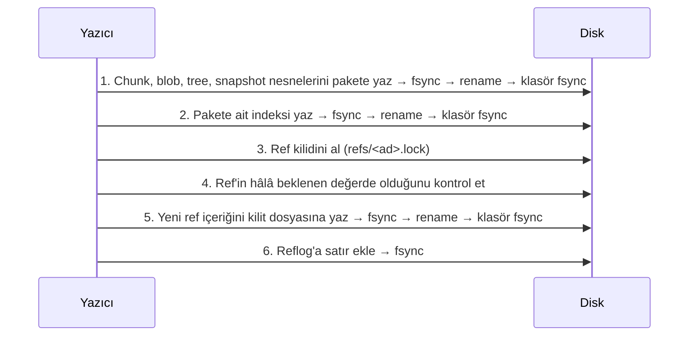

> **English:** [FORMAT.md](FORMAT.md)

# Apeiron Depolama Formatı — Sürüm 1

Bu belge, bir Apeiron deposunun diskte nasıl durduğunu tanımlar. Amaç, Apeiron kurulu olmadan da bu belgeye bakarak depoyu okuyan bağımsız bir program yazılabilmesidir (VISION, ilke 3).

**Durum:** Onaylandı (2026-10-27). Formatı etkileyen her değişiklik önce bu belgede yapılır.

Uygulama durumu (`apeiron-core`):

| Bölüm | Konu | Durum |
| --- | --- | --- |
| 2–5 | Disk düzeni, `config`, nesne kimliği, nesne türleri | Tamamlandı |
| 6 | Blob, tree ve snapshot için kanonik CBOR | Tamamlandı |
| 7 | Chunk bölme (FastCDC) | Tamamlandı |
| 8 | Paket ve indeks dosyaları | Tamamlandı |
| 9 | Kalıcı yazma, ref ve reflog | Tamamlandı |
| 10 | Güç kesintisi testleri | Tamamlandı |

## Sade anlatım

- Her dosya içeriğine göre yaklaşık 1 MiB'lık parçalara (chunk) bölünür. Aynı parça iki kez saklanmaz.
- Her parçanın adı, içeriğinden hesaplanan 32 baytlık bir parmak izidir (BLAKE3). İçerik bir bit bile bozulursa parmak izi tutmaz ve bozulma hemen fark edilir.
- Parçalar tek tek dosya olarak değil, onlarca MiB'lık "paket" dosyalarında toplu saklanır. Böylece küçük dosya kalabalığı ve uzak hedeflerde istek sayısı azalır.
- Dosya listesi (tree), dosyanın parça listesi (blob) ve "şu andaki durum" kaydı (snapshot) da aynı yolla saklanır.
- Bir isim (ref, ör. `backup/home`) yalnızca bir snapshot'ı gösteren küçük bir dosyadır. Yeni veri önce tamamen diske yazılır, en son bu küçük dosya tek hamlede değiştirilir. Elektrik bu sırada kesilirse ya eski durum ya yeni durum görünür, yarım durum görünmez.

## 1. Genel kurallar

1. Tüm çok baytlı tamsayılar **little-endian** yazılır.
2. Nesne kimlikleri (ID) 32 bayttır. Metin içinde 64 karakterlik **küçük harf onaltılık** (hex) olarak yazılır.
3. Nesneler değişmezdir. Bir nesne yazıldıktan sonra içeriği hiçbir zaman değiştirilmez; yalnızca ileride çöp toplama (Aşama 1) ile silinebilir.
4. Okuyucu, tanımadığı bir format sürümüyle karşılaşırsa depoyu açmayı reddeder. Tahmin yürütmez.
5. Doğrulamadan geçmeyen veri hiçbir zaman çağırana verilmez; tipli bir bozulma hatası döner.

## 2. Disk düzeni

```text
<depo>/
├── config                 # Depo ayarları (TOML), bölüm 3
├── packs/
│   └── 3f/
│       └── 3f9a…e1.pack   # Paket dosyaları; ilk 2 hex karaktere göre alt klasör
├── index/
│   └── 7c2b…04.idx        # Paket indeksleri; birden fazla olabilir
├── refs/
│   └── backup/home        # Ref dosyaları; ad içindeki "/" alt klasör olur
├── logs/
│   └── backup/home        # Her ref'in değişiklik günlüğü (reflog)
├── locks/                 # Depo düzeyi kilitler (Aşama 1'de tanımlanacak, ayrılmış)
├── keys/                  # Şifreleme anahtarları (Aşama 2'de tanımlanacak, ayrılmış)
└── tmp/                   # Yazılmakta olan geçici dosyalar
```

- `tmp/` dışındaki her dosya, ya tamamen yazılmış ve diske sabitlenmiştir ya da hiç yoktur (bölüm 9).
- `tmp/` içindeki dosyalar hiçbir zaman depo içeriği sayılmaz. Bir saatten eski geçici dosyalar silinebilir.
- Okuyucu tanımadığı üst düzey klasörleri yok sayar; yazıcı onlara dokunmaz.

## 3. `config` dosyası

Depo oluşturulurken bir kez yazılır. TOML biçimindedir, böylece bir metin düzenleyiciyle okunabilir.

```toml
format = "apeiron-repository"
version = 1
id = "5d1c0b9e2f4a47c8a1e3b6d9f0a2c4e7"      # 16 rastgele bayt, hex
created = 2026-10-27T12:00:00Z

[hash]
algorithm = "blake3-keyed"
id_key = "…64 hex karakter…"               # 32 rastgele bayt, bölüm 4

[chunker]
algorithm = "fastcdc-2020"
min_size = 262144                           # 256 KiB
avg_size = 1048576                          # 1 MiB
max_size = 4194304                          # 4 MiB

[encryption]
mode = "none"                               # Sürüm 1'de tek değer; Aşama 2'de genişler
```

- `version` formatın ana sürümüdür. Okuyucu bilmediği sürümü reddeder.
- `config` değiştirilecekse (ör. chunker ayarı) bölüm 9.1'deki kalıcı yazma kuralı uygulanır.
- `id_key` bozulursa tüm nesne doğrulamaları başarısız olur; bozulma sessiz kalmaz.

## 4. Nesne kimliği (BLAKE3 adresleme)

Her nesnenin kimliği şöyle hesaplanır:

```text
ID = BLAKE3_keyed(id_key, tür_baytı ‖ içerik)
```

- `BLAKE3_keyed`: BLAKE3'ün anahtarlı (keyed hash) modu, 32 bayt çıktı. Anahtar, `config` içindeki `id_key`'dir.
- `tür_baytı`: tek bayt (bölüm 5). Aynı baytlar farklı türde saklanırsa farklı kimlik alır.
- `içerik`: nesnenin **sıkıştırılmamış, şifrelenmemiş** hâli. Chunk için ham veri; diğerleri için bölüm 6'daki kanonik kodlama.

**Neden anahtarlı:** Aşama 2'de uzak hedef şifreli veri saklayacak. Kimlikler düz BLAKE3 olsaydı, uzak taraf "şu bilinen dosya bu depoda var mı?" sorusunu kimliklere bakarak yanıtlayabilirdi. Anahtarlı kimlik bunu engeller. Bedeli: farklı `id_key`'e sahip iki depo arasında tekilleştirme olmaz. Aynı deponun kopyaları (senkron, yedek hedefi) aynı anahtarı paylaşır.

Paket ve indeks dosyalarının **adları** ise anahtarsız, düz `BLAKE3(dosyanın tüm baytları)` ile verilir. Böylece anahtarı bilmeyen bir uzak sunucu da dosyaların bozulmadığını doğrulayabilir.

## 5. Nesne türleri

| Tür baytı | Tür | İçerik | Bölüm |
| --- | --- | --- | --- |
| `0x01` | chunk | Dosya verisinin ham bir parçası | 7 |
| `0x02` | blob | Bir dosyanın chunk listesi | 6.2 |
| `0x03` | tree | Bir dizinin girdileri | 6.3 |
| `0x04` | snapshot | Bir veri kümesinin belirli andaki durumu | 6.4 |

Diğer değerler ayrılmıştır. Okuyucu bilmediği türü reddeder.

## 6. Yapısal nesnelerin kodlaması

### 6.1 Kanonik CBOR

Blob, tree ve snapshot **CBOR** (RFC 8949) ile kodlanır. Aynı nesnenin her zaman aynı baytlara dönüşmesi gerekir; aksi hâlde kimlik değişir. Bu yüzden şu kurallar zorunludur (RFC 8949 §4.2.1 "core deterministic encoding"):

1. Tamsayılar en kısa biçimde yazılır.
2. Tüm diziler ve haritalar belirli uzunluklu (definite length) yazılır.
3. Harita anahtarları tamsayıdır ve küçükten büyüğe sıralanır.
4. Kayan noktalı sayı, etiket (tag), `undefined` ve `null` kullanılmaz.
5. İsteğe bağlı bir alan yoksa anahtarıyla birlikte hiç yazılmaz.
6. Sürüm 1 okuyucusu bilmediği bir anahtar görürse nesneyi reddeder.

Okuyucu, çözdüğü nesneyi yeniden kodlayıp aynı baytları elde etmezse nesneyi bozuk sayar.

Aşağıdaki tablolarda `id` = 32 baytlık bayt dizisi (CBOR bstr), `bytes` = bayt dizisi, `text` = UTF-8 metin, `uint`/`int` = tamsayı, `time` = `[saniye: int, nanosaniye: uint]` (Unix zamanı, UTC).

### 6.2 Blob

Bir dosyanın içeriği. Chunk'lar dosyadaki sırasıyla listelenir.

| Anahtar | Ad | Tip | Zorunlu | Açıklama |
| --- | --- | --- | --- | --- |
| 0 | size | uint | evet | Dosyanın toplam boyutu (bayt) |
| 1 | chunks | `[[id, uint], …]` | evet | Her chunk için kimlik ve ham boyut |

- Chunk boyutlarının toplamı `size`'a eşit olmalıdır; değilse blob bozuktur.
- Boş dosyanın blob'u yazılmaz (bkz. tree, `content`).
- 10 GB'lık bir dosya yaklaşık 10.000 chunk ve ~400 KB'lık bir blob demektir. Sürüm 1'de blob tek katmanlıdır; çok büyük dosyalar için çok katmanlı blob ileride ayrı bir tür olarak eklenebilir.

### 6.3 Tree

Bir dizin. Girdiler bir dizidir ve `name` baytlarına göre küçükten büyüğe sıralanır; aynı ad iki kez bulunamaz.

| Anahtar | Ad | Tip | Zorunlu | Açıklama |
| --- | --- | --- | --- | --- |
| 0 | entries | `[girdi, …]` | evet | Dizin girdileri |

Her **girdi** bir CBOR haritasıdır:

| Anahtar | Ad | Tip | Zorunlu | Açıklama |
| --- | --- | --- | --- | --- |
| 0 | name | bytes | evet | Dosya adı. Boş olamaz, `/` veya sıfır baytı içeremez, `.` ya da `..` olamaz |
| 1 | kind | uint | evet | `0` dosya, `1` dizin, `2` sembolik bağlantı |
| 2 | size | uint | dosyada | Dosya boyutu |
| 3 | content | id | açıklamaya bakın | Dosya: blob kimliği (boyut 0 ise yok). Dizin: tree kimliği. Bağlantı: yok |
| 4 | target | bytes | bağlantıda | Sembolik bağlantının hedefi |
| 5 | mode | uint | hayır | Unix izin bitleri (en alt 12 bit) |
| 6 | mtime | time | hayır | Son değişiklik zamanı |
| 7 | uid | uint | hayır | Unix kullanıcı numarası |
| 8 | gid | uint | hayır | Unix grup numarası |
| 9 | xattrs | `[[bytes, bytes], …]` | hayır | Genişletilmiş öznitelikler (ad, değer); ada göre sıralı |

- Adlar bayt olarak saklanır, çünkü Linux dosya adları geçerli UTF-8 olmak zorunda değildir. Windows'ta adlar WTF-8 olarak kodlanır. Unicode normalleştirmesi (macOS) yapılmaz; ad nasıl okunduysa öyle saklanır.
- Sürüm 1 sabit bağlantıları (hard link), aygıt dosyalarını ve Windows ACL'lerini saklamaz. Sabit bağlantılı dosyalar ayrı dosyalar olarak saklanır (içerikleri yalnızca bir kez saklanır); aralarındaki bağ korunmaz. Aygıt dosyaları atlanır ve kullanıcıya raporlanır.

### 6.4 Snapshot

| Anahtar | Ad | Tip | Zorunlu | Açıklama |
| --- | --- | --- | --- | --- |
| 0 | tree | id | evet | Kök dizinin tree kimliği |
| 1 | parents | `[id, …]` | evet | Ebeveyn snapshot'lar (ilk snapshot'ta boş dizi) |
| 2 | time | time | evet | Snapshot'ın alındığı an |
| 3 | author | text | hayır | Kimin aldığı (ör. `Ad <e-posta>`) |
| 4 | host | text | hayır | Hangi cihazda alındığı |
| 5 | message | text | hayır | Açıklama |
| 6 | meta | `[[text, text], …]` | hayır | Hizmetlerin kullandığı serbest anahtar-değer çiftleri; anahtara göre sıralı, tekrarsız |

Çekirdek `meta` içeriğine anlam yüklemez. Örneğin yedek hizmeti `source-path` gibi bir anahtar yazabilir.

## 7. Chunk bölme (FastCDC)

- Algoritma: **FastCDC, 2020 makalesindeki sürüm** (Xia ve ark., "The Design of Fast Content-Defined Chunking for Data Deduplication Based Storage Systems"), normalleştirme düzeyi 1, makaledeki standart gear tablosu.
- Varsayılan: `min_size` 256 KiB, `avg_size` 1 MiB, `max_size` 4 MiB.
- Ayarlanabilir aralık: `avg_size` 64 KiB ile 4 MiB arasında ikinin kuvveti; `min_size = avg_size / 4`, `max_size = avg_size × 4`.
- Dosyanın son chunk'ı `min_size`'dan küçük olabilir. `min_size`'dan küçük bir dosya tek chunk'tır.

**Önemli:** Chunk bölme ayarları yalnızca **yazarken** kullanılır. Okuyucu bunları bilmek zorunda değildir; blob zaten chunk listesini içerir. Ayar değişirse eski veri okunmaya devam eder, yalnızca eski ve yeni veri arasındaki tekilleştirme azalır.

## 8. Paket ve indeks dosyaları

### 8.1 Paket dosyası (`packs/xx/<ad>.pack`)

Bir paket, birçok nesnenin saklandığı tek dosyadır. Önerilen boyut 16–64 MiB'tır (format kuralı değil, yazıcı tercihi).

```text
┌──────────────────────────────┐
│ Başlık (16 bayt)             │
├──────────────────────────────┤
│ Nesne verisi 1               │
│ Nesne verisi 2               │
│ …                            │
├──────────────────────────────┤
│ Girdi tablosu (n × 52 bayt)  │
├──────────────────────────────┤
│ Son ek (12 bayt)             │
└──────────────────────────────┘
```

**Başlık:**

| Konum | Boyut | Alan | Değer |
| --- | --- | --- | --- |
| 0 | 8 | magic | ASCII `APRNPACK` |
| 8 | 2 | version | `1` |
| 10 | 2 | flags | `0` (Aşama 2'de şifreleme bayrağı için ayrılmış) |
| 12 | 4 | reserved | `0` |

**Girdi tablosu:** Her nesne için bir girdi, nesnelerin dosyadaki sırasıyla.

| Konum | Boyut | Alan | Açıklama |
| --- | --- | --- | --- |
| 0 | 32 | id | Nesne kimliği |
| 32 | 1 | type | Tür baytı (bölüm 5) |
| 33 | 1 | compression | `0` yok, `1` zstd |
| 34 | 2 | flags | `0` (ayrılmış) |
| 36 | 8 | offset | Nesne verisinin dosya başından konumu |
| 44 | 4 | stored_len | Diskteki (sıkıştırılmış) boyut |
| 48 | 4 | raw_len | Sıkıştırılmamış boyut |

**Son ek:**

| Konum | Boyut | Alan | Açıklama |
| --- | --- | --- | --- |
| 0 | 4 | entry_count | Girdi sayısı |
| 4 | 8 | magic | ASCII `APRNPEND` |

Kurallar:

1. Dosya adı = `BLAKE3(dosyanın tüm baytları)`, hex. Ad tutmuyorsa paket bozuktur.
2. Nesne verileri arka arkaya, boşluksuz ve çakışmasız durur; ilki başlıktan hemen sonra başlar.
3. Yazıcı, sıkıştırma veriyi küçültmüyorsa `compression = 0` kullanır.
4. Aynı nesne farklı paketlerde birden fazla kez bulunabilir (ör. iki eşzamanlı yazıcı). Her kopya geçerlidir.
5. Okuma sırasında: veri açılır, `raw_len` kontrol edilir, kimlik bölüm 4'e göre yeniden hesaplanıp `id` ile karşılaştırılır.

### 8.2 İndeks dosyası (`index/<ad>.idx`)

İndeks, "hangi nesne hangi pakette, nerede" sorusunu paketleri tek tek açmadan yanıtlar. **İndeks bir önbellektir:** Tüm indeksler silinse bile paketlerin girdi tablolarından yeniden üretilebilir.

| Bölüm | Boyut | İçerik |
| --- | --- | --- |
| Başlık | 16 | magic ASCII `APRNINDX`, version `1` (u16), flags `0` (u16), pack_count (u32) |
| Paket listesi | pack_count × 32 | Bu indeksin kapsadığı paket adları |
| Girdi sayısı | 8 | entry_count (u64) |
| Girdiler | entry_count × 56 | `id` (32), `pack_no` (u32, paket listesindeki sıra), ardından paket girdi tablosundaki `type`…`raw_len` alanları (20 bayt) |

- Girdiler `id`'ye göre küçükten büyüğe sıralıdır.
- Dosya adı = `BLAKE3(dosyanın tüm baytları)`, hex.
- Okuyucu tüm indeks dosyalarını birleştirir. Bir paket hiçbir indekste yoksa (yarıda kalan yazma), okuyucu onun girdi tablosunu doğrudan okuyabilir.

## 9. Yazma ve atomik güncelleme kuralları

### 9.1 Dosyayı kalıcı yazma

Bölüm 2'deki her kalıcı dosya şu adımlarla yazılır:

1. `tmp/` içinde rastgele adlı yeni bir dosya oluşturulur ve içerik yazılır.
2. Dosya diske sabitlenir (`fsync`).
3. Dosya, son adına taşınır (`rename`). Hedef klasör yoksa önce oluşturulur ve o klasörün üst klasörü sabitlenir.
4. Hedef klasör diske sabitlenir (klasör üzerinde `fsync`).

Platform notları: macOS'ta `fsync` yetmez, `F_FULLFSYNC` kullanılır. Windows'ta `FlushFileBuffers` ve `MoveFileExW(MOVEFILE_REPLACE_EXISTING | MOVEFILE_WRITE_THROUGH)` kullanılır.

İçerik adresli dosyalarda (paket, indeks) hedef zaten varsa yeni dosya atılır; içerik aynıdır.

### 9.2 Bir snapshot'ı kaydetme sırası



Temel kural: **Bir ref, gösterdiği snapshot'ın ve ondan ulaşılan her nesnenin diske sabitlendiğinden önce güncellenmez.**

### 9.3 Ref dosyası

Ref, bir snapshot'a verilen isimdir. Dal, etiket ve yedek noktası arasında çekirdek düzeyinde fark yoktur.

**Ad kuralları:**

1. Bir veya daha fazla parçadan oluşur, parçalar `/` ile ayrılır (ör. `backup/home`, `tag/v1`).
2. Her parça yalnızca `a-z`, `0-9`, `.`, `_`, `-` içerir; `.` ile başlamaz; `.lock` ile bitmez.
3. Toplam uzunluk en fazla 200 bayttır.
4. Bir ad, başka bir adın klasörü olamaz (`backup` ve `backup/home` birlikte bulunamaz). Silinmiş bir ref'in reflog'u durduğu sürece bu kural onun için de geçerlidir; böylece geçmişi kaybolmaz.

Yalnızca küçük harf kullanılması, büyük/küçük harf ayırmayan dosya sistemlerinde (Windows, macOS) iki adın çakışmasını önler. Kullanıcıya gösterilecek serbest adlar hizmet katmanında tutulur.

**İçerik** (UTF-8 metin, üç satır, her biri `\n` ile biter):

```text
apeiron-ref 1
target <64 hex: snapshot kimliği>
check <64 hex: ilk iki satırın düz BLAKE3 özeti>
```

`check`, ilk iki satırın satır sonları (`\n`) dahil baytları üzerinden hesaplanır.

`check` tutmuyorsa ref bozuktur; okuyucu reflog'dan son geçerli değeri önerir, kendiliğinden düzeltmez.

**Güncelleme (karşılaştır ve değiştir):**

1. `refs/<ad>.lock` dosyası "yalnızca yoksa oluştur" (`O_CREAT | O_EXCL`) ile açılır. Zaten varsa güncelleme "kilitli" hatasıyla durur.
2. Ref'in şu anki değeri okunur. Çağıranın beklediği değer değilse kilit silinir ve "çakışma" hatası döner. Böylece iki işlem birbirinin güncellemesini sessizce ezemez.
3. Yeni içerik kilit dosyasına yazılır ve `fsync` edilir.
4. Kilit dosyası `refs/<ad>` üzerine taşınır (`rename`), klasör `fsync` edilir.

Kilit dosyası, sahibi hakkında bilgi içermez. Oluşturulmasının üzerinden **10 dakikadan fazla** geçmişse bayat sayılır ve yalnızca açık bir kullanıcı komutuyla (ör. `apeiron repair`) kaldırılır.

Ref silme: ref dosyası `rename` ile `tmp/` altına taşınır, klasör `fsync` edilir, reflog'a silme satırı eklenir. Snapshot'lar silinmez; reflog üzerinden geri getirilebilir (VISION, ilke 5).

### 9.4 Reflog (`logs/<ad>`)

Her ref değişikliği, ref güncellendikten **sonra** bu dosyanın sonuna bir satır olarak eklenir ve dosya `fsync` edilir:

```text
<eski hex | 64 sıfır> <yeni hex | 64 sıfır> <unix saniye> <işlem: create|update|delete|repair> <check>
```

Alanlar tek boşlukla ayrılır, satır `\n` ile biter. `check`, satırın `check` alanından önceki kısmının (aradaki son boşluk hariç) düz BLAKE3 özetinin ilk 16 hex karakteridir.

- Dosyanın son satırı geçersizse (`\n` ile bitmiyorsa veya `check` tutmuyorsa) güç kesintisi kalıntısı sayılır ve yok sayılır. Yazıcı, yeni satır eklemeden önce bu kalıntıyı dosyadan keser (truncate).
- Son satır dışındaki bir satır geçersizse bu bozulmadır ve hata olarak raporlanır.
- Ref değeri reflog'daki son `yeni` değerden farklıysa (ref güncellendi ama satır yazılamadı), o ref bir sonraki kez güncellenmeden hemen önce (veya açık bir onarım komutuyla) `repair` satırı eklenir. Eski değer zaten önceki satırda kayıtlı olduğu için bilgi kaybolmaz.
- Reflog, çöp toplamanın (Aşama 1) hangi snapshot'ları canlı sayacağını belirlemek için de kullanılır.

## 10. Kesinti ve bozulma durumları

Aşağıdaki tablo, Aşama 0'ın güç kesintisi testlerinin beklenen sonuçlarıdır. Her satır ayrı bir hata enjeksiyonu testi olur.

| Kesinti anı | Depoda görünen durum | Kurtarma |
| --- | --- | --- |
| Paket `tmp/` içinde yazılırken | Değişiklik yok | Geçici dosya temizlenir |
| Paket taşındı, indeks yazılmadı | Ref eski snapshot'ı gösterir | Sahipsiz paket indekslenir ya da çöp toplamada silinir |
| İndeks yazıldı, ref güncellenmedi | Ref eski snapshot'ı gösterir | Yok; yeni nesneler zararsız fazlalıktır |
| Ref kilidi alındı, taşınmadı | Ref eski snapshot'ı gösterir | Bayat kilit `repair` ile kaldırılır |
| Ref taşındı, reflog yazılmadı | Ref yeni snapshot'ı gösterir | Sonraki güncellemede `repair` satırı eklenir |
| Disk doldu (herhangi bir adımda) | Değişiklik yok; hata ref taşındıktan sonra gelirse bir üstteki satırdaki gibi | Hata raporlanır, geçici dosya silinir |
| Paket içinde bit bozulması | Okuma "bozulma" hatası verir | Başka bir kopyadan onarım (Aşama 1) |

Hiçbir satırda "ref, var olmayan veya yarım yazılmış bir nesneyi gösteriyor" durumu oluşmamalıdır.

Testler tam bir yazma işlemini (yeni chunk'lar, snapshot, ref güncellemesi) diskteki her değişiklikte bir kez keser ve oluşan her durumu bu tabloyla karşılaştırır.

## 11. Doğrulama özeti

| Ne | Nasıl | Anahtar gerekir mi |
| --- | --- | --- |
| Nesne | Kimlik yeniden hesaplanır (bölüm 4) | Evet |
| Yapısal nesne | Kanonik yeniden kodlama aynı baytları verir (6.1) | Evet |
| Blob | Chunk boyutları toplamı = `size` | Evet |
| Paket / indeks dosyası | Dosya adı = düz BLAKE3 | Hayır |
| Ref | `check` satırı | Hayır |
| Reflog satırı | `check` alanı | Hayır |

## 12. Sonraki sürümlere bırakılanlar

- Şifreleme (`keys/`, paket `flags`, `encryption.mode`): Aşama 2.
- Çöp toplama, depo kilitleri (`locks/`), paket birleştirme: Aşama 1.
- Çok katmanlı blob, sabit bağlantılar, Windows ACL'leri, aygıt dosyaları.
- Format yükseltme aracı: format sürümü değiştiğinde otomatik ve geri alınabilir geçiş.
