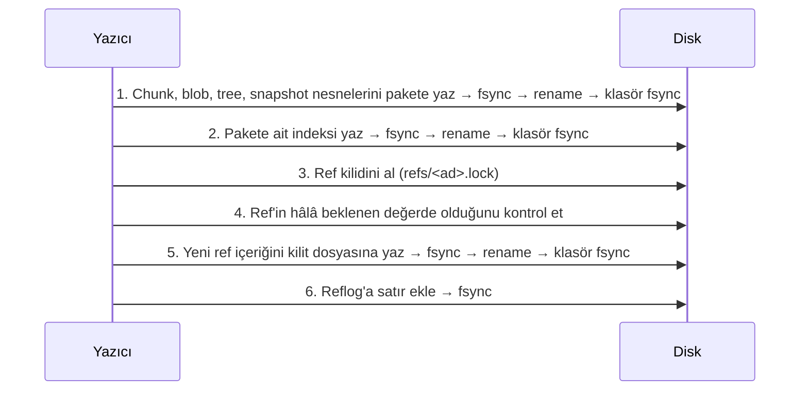

> **English:** [FORMAT.md](FORMAT.md)

# Apeiron Depolama Formatı — Sürüm 1

Bu belge, bir Apeiron deposunun diskte nasıl durduğunu tanımlar. Amaç, Apeiron kurulu olmadan da bu belgeye bakarak depoyu okuyan bağımsız bir program yazılabilmesidir (VISION, ilke 3).

**Durum:** Onaylandı (2026-10-27). Formatı etkileyen her değişiklik önce bu belgede yapılır.

Uygulama durumu (`apeiron-core`):

| Bölüm | Konu | Durum |
| --- | --- | --- |
| 2–5 | Disk düzeni, `config`, nesne kimliği, nesne türleri | Tamamlandı |
| 6 | Blob, tree ve snapshot için kanonik CBOR | Tamamlandı |
| 7 | Chunk bölme (FastCDC) | Tamamlandı |
| 8 | Paket ve indeks dosyaları | Tamamlandı |
| 9 | Kalıcı yazma, ref ve reflog | Tamamlandı |
| 10 | Güç kesintisi testleri | Tamamlandı |
| 12 | Depo kilidi | Tamamlandı |
| 13 | Çöp toplama | Tamamlandı |
| 14 | Şifreleme | Tamamlandı |
| 15 | Uzak depolar, push ve pull: klasörler, SFTP ve S3 | Tamamlandı |
| 15.6 | Klon | Tamamlandı |

## Sade anlatım

- Her dosya içeriğine göre yaklaşık 1 MiB'lık parçalara (chunk) bölünür. Aynı parça iki kez saklanmaz.
- Her parçanın adı, içeriğinden hesaplanan 32 baytlık bir parmak izidir (BLAKE3). İçerik bir bit bile bozulursa parmak izi tutmaz ve bozulma hemen fark edilir.
- Parçalar tek tek dosya olarak değil, onlarca MiB'lık "paket" dosyalarında toplu saklanır. Böylece küçük dosya kalabalığı ve uzak hedeflerde istek sayısı azalır.
- Dosya listesi (tree), dosyanın parça listesi (blob) ve "şu andaki durum" kaydı (snapshot) da aynı yolla saklanır.
- Bir isim (ref, ör. `backup/home`) yalnızca bir snapshot'ı gösteren küçük bir dosyadır. Yeni veri önce tamamen diske yazılır, en son bu küçük dosya tek hamlede değiştirilir. Elektrik bu sırada kesilirse ya eski durum ya yeni durum görünür, yarım durum görünmez.

## 1. Genel kurallar

1. Tüm çok baytlı tamsayılar **little-endian** yazılır.
2. Nesne kimlikleri (ID) 32 bayttır. Metin içinde 64 karakterlik **küçük harf onaltılık** (hex) olarak yazılır.
3. Nesneler değişmezdir. Bir nesne yazıldıktan sonra içeriği hiçbir zaman değiştirilmez; yalnızca ileride çöp toplama (Aşama 1) ile silinebilir.
4. Okuyucu, tanımadığı bir format sürümüyle karşılaşırsa depoyu açmayı reddeder. Tahmin yürütmez.
5. Doğrulamadan geçmeyen veri hiçbir zaman çağırana verilmez; tipli bir bozulma hatası döner.

## 2. Disk düzeni

```text
<depo>/
├── config                 # Depo ayarları (TOML), bölüm 3
├── packs/
│   └── 3f/
│       └── 3f9a…e1.pack   # Paket dosyaları; ilk 2 hex karaktere göre alt klasör
├── index/
│   └── 7c2b…04.idx        # Paket indeksleri; birden fazla olabilir
├── refs/
│   └── backup/home        # Ref dosyaları; ad içindeki "/" alt klasör olur
├── logs/
│   └── backup/home        # Her ref'in değişiklik günlüğü (reflog)
├── locks/                 # Depo kilidi, bölüm 12
├── keys/                  # Şifreli bir deponun anahtar dosyaları, bölüm 14
├── remotes                # Bu kopyanın uzak depoları (TOML), bölüm 15.1
├── retention/             # Saklama kuralları, bölüm 16
└── tmp/                   # Yazılmakta olan geçici dosyalar
```

- `tmp/` dışındaki her dosya, ya tamamen yazılmış ve diske sabitlenmiştir ya da hiç yoktur (bölüm 9).
- `tmp/` içindeki dosyalar hiçbir zaman depo içeriği sayılmaz. Bir saatten eski geçici dosyalar silinebilir.
- Okuyucu tanımadığı üst düzey klasörleri yok sayar; yazıcı onlara dokunmaz.

## 3. `config` dosyası

Depo oluşturulurken bir kez yazılır. TOML biçimindedir, böylece bir metin düzenleyiciyle okunabilir.

```toml
format = "apeiron-repository"
version = 1
id = "5d1c0b9e2f4a47c8a1e3b6d9f0a2c4e7"      # 16 rastgele bayt, hex
created = 2026-10-27T12:00:00Z

[hash]
algorithm = "blake3-keyed"
id_key = "…64 hex karakter…"               # 32 rastgele bayt, bölüm 4

[chunker]
algorithm = "fastcdc-2020"
min_size = 262144                           # 256 KiB
avg_size = 1048576                          # 1 MiB
max_size = 4194304                          # 4 MiB

[encryption]
mode = "none"                               # ya da "xchacha20-poly1305", bölüm 14
```

- `version` formatın ana sürümüdür. Okuyucu bilmediği sürümü reddeder.
- `config` değiştirilecekse (ör. chunker ayarı) bölüm 9.1'deki kalıcı yazma kuralı uygulanır.
- `id_key` bozulursa tüm nesne doğrulamaları başarısız olur; bozulma sessiz kalmaz.

## 4. Nesne kimliği (BLAKE3 adresleme)

Her nesnenin kimliği şöyle hesaplanır:

```text
ID = BLAKE3_keyed(id_key, tür_baytı ‖ içerik)
```

- `BLAKE3_keyed`: BLAKE3'ün anahtarlı (keyed hash) modu, 32 bayt çıktı. Anahtar, `config` içindeki `id_key`'dir.
- `tür_baytı`: tek bayt (bölüm 5). Aynı baytlar farklı türde saklanırsa farklı kimlik alır.
- `içerik`: nesnenin **sıkıştırılmamış, şifrelenmemiş** hâli. Chunk için ham veri; diğerleri için bölüm 6'daki kanonik kodlama.

**Neden anahtarlı:** Aşama 2'de uzak hedef şifreli veri saklayacak. Kimlikler düz BLAKE3 olsaydı, uzak taraf "şu bilinen dosya bu depoda var mı?" sorusunu kimliklere bakarak yanıtlayabilirdi. Anahtarlı kimlik bunu engeller. Bedeli: farklı `id_key`'e sahip iki depo arasında tekilleştirme olmaz. Aynı deponun kopyaları (senkron, yedek hedefi) aynı anahtarı paylaşır.

Paket ve indeks dosyalarının **adları** ise anahtarsız, düz `BLAKE3(dosyanın tüm baytları)` ile verilir. Böylece anahtarı bilmeyen bir uzak sunucu da dosyaların bozulmadığını doğrulayabilir.

## 5. Nesne türleri

| Tür baytı | Tür | İçerik | Bölüm |
| --- | --- | --- | --- |
| `0x01` | chunk | Dosya verisinin ham bir parçası | 7 |
| `0x02` | blob | Bir dosyanın chunk listesi | 6.2 |
| `0x03` | tree | Bir dizinin girdileri | 6.3 |
| `0x04` | snapshot | Bir veri kümesinin belirli andaki durumu | 6.4 |

Diğer değerler ayrılmıştır. Okuyucu bilmediği türü reddeder.

## 6. Yapısal nesnelerin kodlaması

### 6.1 Kanonik CBOR

Blob, tree ve snapshot **CBOR** (RFC 8949) ile kodlanır. Aynı nesnenin her zaman aynı baytlara dönüşmesi gerekir; aksi hâlde kimlik değişir. Bu yüzden şu kurallar zorunludur (RFC 8949 §4.2.1 "core deterministic encoding"):

1. Tamsayılar en kısa biçimde yazılır.
2. Tüm diziler ve haritalar belirli uzunluklu (definite length) yazılır.
3. Harita anahtarları tamsayıdır ve küçükten büyüğe sıralanır.
4. Kayan noktalı sayı, etiket (tag), `undefined` ve `null` kullanılmaz.
5. İsteğe bağlı bir alan yoksa anahtarıyla birlikte hiç yazılmaz.
6. Sürüm 1 okuyucusu bilmediği bir anahtar görürse nesneyi reddeder.

Okuyucu, çözdüğü nesneyi yeniden kodlayıp aynı baytları elde etmezse nesneyi bozuk sayar.

Aşağıdaki tablolarda `id` = 32 baytlık bayt dizisi (CBOR bstr), `bytes` = bayt dizisi, `text` = UTF-8 metin, `uint`/`int` = tamsayı, `time` = `[saniye: int, nanosaniye: uint]` (Unix zamanı, UTC).

### 6.2 Blob

Bir dosyanın içeriği. Chunk'lar dosyadaki sırasıyla listelenir.

| Anahtar | Ad | Tip | Zorunlu | Açıklama |
| --- | --- | --- | --- | --- |
| 0 | size | uint | evet | Dosyanın toplam boyutu (bayt) |
| 1 | chunks | `[[id, uint], …]` | evet | Her chunk için kimlik ve ham boyut |

- Chunk boyutlarının toplamı `size`'a eşit olmalıdır; değilse blob bozuktur.
- Boş dosyanın blob'u yazılmaz (bkz. tree, `content`).
- 10 GB'lık bir dosya yaklaşık 10.000 chunk ve ~400 KB'lık bir blob demektir. Sürüm 1'de blob tek katmanlıdır; çok büyük dosyalar için çok katmanlı blob ileride ayrı bir tür olarak eklenebilir.

### 6.3 Tree

Bir dizin. Girdiler bir dizidir ve `name` baytlarına göre küçükten büyüğe sıralanır; aynı ad iki kez bulunamaz.

| Anahtar | Ad | Tip | Zorunlu | Açıklama |
| --- | --- | --- | --- | --- |
| 0 | entries | `[girdi, …]` | evet | Dizin girdileri |

Her **girdi** bir CBOR haritasıdır:

| Anahtar | Ad | Tip | Zorunlu | Açıklama |
| --- | --- | --- | --- | --- |
| 0 | name | bytes | evet | Dosya adı. Boş olamaz, `/` veya sıfır baytı içeremez, `.` ya da `..` olamaz |
| 1 | kind | uint | evet | `0` dosya, `1` dizin, `2` sembolik bağlantı |
| 2 | size | uint | dosyada | Dosya boyutu |
| 3 | content | id | açıklamaya bakın | Dosya: blob kimliği (boyut 0 ise yok). Dizin: tree kimliği. Bağlantı: yok |
| 4 | target | bytes | bağlantıda | Sembolik bağlantının hedefi |
| 5 | mode | uint | hayır | Unix izin bitleri (en alt 12 bit) |
| 6 | mtime | time | hayır | Son değişiklik zamanı |
| 7 | uid | uint | hayır | Unix kullanıcı numarası |
| 8 | gid | uint | hayır | Unix grup numarası |
| 9 | xattrs | `[[bytes, bytes], …]` | hayır | Genişletilmiş öznitelikler (ad, değer); ada göre sıralı |

- Adlar bayt olarak saklanır, çünkü Linux dosya adları geçerli UTF-8 olmak zorunda değildir. Windows'ta adlar WTF-8 olarak kodlanır. Unicode normalleştirmesi (macOS) yapılmaz; ad nasıl okunduysa öyle saklanır.
- Sürüm 1 sabit bağlantıları (hard link), aygıt dosyalarını ve Windows ACL'lerini saklamaz. Sabit bağlantılı dosyalar ayrı dosyalar olarak saklanır (içerikleri yalnızca bir kez saklanır); aralarındaki bağ korunmaz. Aygıt dosyaları atlanır ve kullanıcıya raporlanır.

### 6.4 Snapshot

| Anahtar | Ad | Tip | Zorunlu | Açıklama |
| --- | --- | --- | --- | --- |
| 0 | tree | id | evet | Kök dizinin tree kimliği |
| 1 | parents | `[id, …]` | evet | Ebeveyn snapshot'lar (ilk snapshot'ta boş dizi) |
| 2 | time | time | evet | Snapshot'ın alındığı an |
| 3 | author | text | hayır | Kimin aldığı (ör. `Ad <e-posta>`) |
| 4 | host | text | hayır | Hangi cihazda alındığı |
| 5 | message | text | hayır | Açıklama |
| 6 | meta | `[[text, text], …]` | hayır | Hizmetlerin kullandığı serbest anahtar-değer çiftleri; anahtara göre sıralı, tekrarsız |

Çekirdek `meta` içeriğine anlam yüklemez. Örneğin yedek hizmeti `source-path` gibi bir anahtar yazabilir.

## 7. Chunk bölme (FastCDC)

- Algoritma: **FastCDC, 2020 makalesindeki sürüm** (Xia ve ark., "The Design of Fast Content-Defined Chunking for Data Deduplication Based Storage Systems"), normalleştirme düzeyi 1, makaledeki standart gear tablosu.
- Varsayılan: `min_size` 256 KiB, `avg_size` 1 MiB, `max_size` 4 MiB.
- Ayarlanabilir aralık: `avg_size` 64 KiB ile 4 MiB arasında ikinin kuvveti; `min_size = avg_size / 4`, `max_size = avg_size × 4`.
- Dosyanın son chunk'ı `min_size`'dan küçük olabilir. `min_size`'dan küçük bir dosya tek chunk'tır.

**Önemli:** Chunk bölme ayarları yalnızca **yazarken** kullanılır. Okuyucu bunları bilmek zorunda değildir; blob zaten chunk listesini içerir. Ayar değişirse eski veri okunmaya devam eder, yalnızca eski ve yeni veri arasındaki tekilleştirme azalır.

## 8. Paket ve indeks dosyaları

### 8.1 Paket dosyası (`packs/xx/<ad>.pack`)

Bir paket, birçok nesnenin saklandığı tek dosyadır. Önerilen boyut 16–64 MiB'tır (format kuralı değil, yazıcı tercihi).

```text
┌──────────────────────────────┐
│ Başlık (16 bayt)             │
├──────────────────────────────┤
│ Nesne verisi 1               │
│ Nesne verisi 2               │
│ …                            │
├──────────────────────────────┤
│ Girdi tablosu (n × 52 bayt)  │
├──────────────────────────────┤
│ Son ek (12 bayt)             │
└──────────────────────────────┘
```

**Başlık:**

| Konum | Boyut | Alan | Değer |
| --- | --- | --- | --- |
| 0 | 8 | magic | ASCII `APRNPACK` |
| 8 | 2 | version | `1` |
| 10 | 2 | flags | Bit 0: şifreli (bölüm 14); diğer tüm bitler `0` |
| 12 | 4 | reserved | `0` |

**Girdi tablosu:** Her nesne için bir girdi, nesnelerin dosyadaki sırasıyla.

| Konum | Boyut | Alan | Açıklama |
| --- | --- | --- | --- |
| 0 | 32 | id | Nesne kimliği |
| 32 | 1 | type | Tür baytı (bölüm 5) |
| 33 | 1 | compression | `0` yok, `1` zstd |
| 34 | 2 | flags | `0` (ayrılmış) |
| 36 | 8 | offset | Nesne verisinin dosya başından konumu |
| 44 | 4 | stored_len | Diskteki (sıkıştırılmış) boyut |
| 48 | 4 | raw_len | Sıkıştırılmamış boyut |

**Son ek:**

| Konum | Boyut | Alan | Açıklama |
| --- | --- | --- | --- |
| 0 | 4 | entry_count | Girdi sayısı |
| 4 | 8 | magic | ASCII `APRNPEND` |

Kurallar:

1. Dosya adı = `BLAKE3(dosyanın tüm baytları)`, hex. Ad tutmuyorsa paket bozuktur.
2. Nesne verileri arka arkaya, boşluksuz ve çakışmasız durur; ilki başlıktan hemen sonra başlar.
3. Yazıcı, sıkıştırma veriyi küçültmüyorsa `compression = 0` kullanır.
4. Aynı nesne farklı paketlerde birden fazla kez bulunabilir (ör. iki eşzamanlı yazıcı). Her kopya geçerlidir.
5. Okuma sırasında: veri açılır, `raw_len` kontrol edilir, kimlik bölüm 4'e göre yeniden hesaplanıp `id` ile karşılaştırılır.

### 8.2 İndeks dosyası (`index/<ad>.idx`)

İndeks, "hangi nesne hangi pakette, nerede" sorusunu paketleri tek tek açmadan yanıtlar. **İndeks bir önbellektir:** Tüm indeksler silinse bile paketlerin girdi tablolarından yeniden üretilebilir.

| Bölüm | Boyut | İçerik |
| --- | --- | --- |
| Başlık | 16 | magic ASCII `APRNINDX`, version `1` (u16), flags `0` (u16), pack_count (u32) |
| Paket listesi | pack_count × 32 | Bu indeksin kapsadığı paket adları |
| Girdi sayısı | 8 | entry_count (u64) |
| Girdiler | entry_count × 56 | `id` (32), `pack_no` (u32, paket listesindeki sıra), ardından paket girdi tablosundaki `type`…`raw_len` alanları (20 bayt) |

- Girdiler `id`'ye göre küçükten büyüğe sıralıdır.
- Dosya adı = `BLAKE3(dosyanın tüm baytları)`, hex.
- Okuyucu tüm indeks dosyalarını birleştirir. Bir paket hiçbir indekste yoksa (yarıda kalan yazma), okuyucu onun girdi tablosunu doğrudan okuyabilir.
- Doğrulamadan geçemeyen bir indeks dosyası (adı baytlarına uymuyor ya da yapısı geçersiz) deponun açılmasını engellemez. Okuyucu onu yok sayar, kapsadığı paketleri indekssiz paket olarak okur ve bozuk dosyayı bildirir. Adı baytlarına uymayan indekssiz bir paket bildirilir ve atlanır; nesnelerine, başka bir kopyadan onarılana kadar ulaşılamaz.
- Onarım komutu, sağlam bir indeksi olmayan her paket için tek bir yeni indeks yazar ve ardından bozuk indeks dosyalarını siler. Hiçbir zaman paket silmez.

## 9. Yazma ve atomik güncelleme kuralları

### 9.1 Dosyayı kalıcı yazma

Bölüm 2'deki her kalıcı dosya şu adımlarla yazılır:

1. `tmp/` içinde rastgele adlı yeni bir dosya oluşturulur ve içerik yazılır.
2. Dosya diske sabitlenir (`fsync`).
3. Dosya, son adına taşınır (`rename`). Hedef klasör yoksa önce oluşturulur ve o klasörün üst klasörü sabitlenir.
4. Hedef klasör diske sabitlenir (klasör üzerinde `fsync`).

Platform notları: macOS'ta `fsync` yetmez, `F_FULLFSYNC` kullanılır. Windows'ta `FlushFileBuffers` ve `MoveFileExW(MOVEFILE_REPLACE_EXISTING | MOVEFILE_WRITE_THROUGH)` kullanılır.

İçerik adresli dosyalarda (paket, indeks) hedef zaten varsa yeni dosya atılır; içerik aynıdır.

### 9.2 Bir snapshot'ı kaydetme sırası



Temel kural: **Bir ref, gösterdiği snapshot'ın ve ondan ulaşılan her nesnenin diske sabitlendiğinden önce güncellenmez.**

### 9.3 Ref dosyası

Ref, bir snapshot'a verilen isimdir. Dal, etiket ve yedek noktası arasında çekirdek düzeyinde fark yoktur.

**Ad kuralları:**

1. Bir veya daha fazla parçadan oluşur, parçalar `/` ile ayrılır (ör. `backup/home`, `tag/v1`).
2. Her parça yalnızca `a-z`, `0-9`, `.`, `_`, `-` içerir; `.` ile başlamaz; `.lock` ile bitmez.
3. Toplam uzunluk en fazla 200 bayttır.
4. Bir ad, başka bir adın klasörü olamaz (`backup` ve `backup/home` birlikte bulunamaz). Silinmiş bir ref'in reflog'u durduğu sürece bu kural onun için de geçerlidir; böylece geçmişi kaybolmaz.

Yalnızca küçük harf kullanılması, büyük/küçük harf ayırmayan dosya sistemlerinde (Windows, macOS) iki adın çakışmasını önler. Kullanıcıya gösterilecek serbest adlar hizmet katmanında tutulur.

**İçerik** (UTF-8 metin, üç satır, her biri `\n` ile biter):

```text
apeiron-ref 1
target <64 hex: snapshot kimliği>
check <64 hex: ilk iki satırın düz BLAKE3 özeti>
```

`check`, ilk iki satırın satır sonları (`\n`) dahil baytları üzerinden hesaplanır.

`check` tutmuyorsa ref bozuktur; okuyucu reflog'dan son geçerli değeri önerir, kendiliğinden düzeltmez.

**Güncelleme (karşılaştır ve değiştir):**

1. `refs/<ad>.lock` dosyası "yalnızca yoksa oluştur" (`O_CREAT | O_EXCL`) ile açılır. Zaten varsa güncelleme "kilitli" hatasıyla durur.
2. Ref'in şu anki değeri okunur. Çağıranın beklediği değer değilse kilit silinir ve "çakışma" hatası döner. Böylece iki işlem birbirinin güncellemesini sessizce ezemez.
3. Yeni içerik kilit dosyasına yazılır ve `fsync` edilir.
4. Kilit dosyası `refs/<ad>` üzerine taşınır (`rename`), klasör `fsync` edilir.

Kilit dosyası, sahibi hakkında bilgi içermez. Oluşturulmasının üzerinden **10 dakikadan fazla** geçmişse bayat sayılır ve yalnızca açık bir kullanıcı komutuyla (ör. `apeiron repair`) kaldırılır.

Ref silme: ref dosyası `rename` ile `tmp/` altına taşınır, klasör `fsync` edilir, reflog'a silme satırı eklenir. Snapshot'lar silinmez; reflog üzerinden geri getirilebilir (VISION, ilke 5).

### 9.4 Reflog (`logs/<ad>`)

Her ref değişikliği, ref güncellendikten **sonra** bu dosyanın sonuna bir satır olarak eklenir ve dosya `fsync` edilir:

```text
<eski hex | 64 sıfır> <yeni hex | 64 sıfır> <unix saniye> <işlem: create|update|delete|repair> <check>
```

Alanlar tek boşlukla ayrılır, satır `\n` ile biter. `check`, satırın `check` alanından önceki kısmının (aradaki son boşluk hariç) düz BLAKE3 özetinin ilk 16 hex karakteridir.

- Dosyanın son satırı geçersizse (`\n` ile bitmiyorsa veya `check` tutmuyorsa) güç kesintisi kalıntısı sayılır ve yok sayılır. Yazıcı, yeni satır eklemeden önce bu kalıntıyı dosyadan keser (truncate).
- Son satır dışındaki bir satır geçersizse bu bozulmadır ve hata olarak raporlanır.
- Ref değeri reflog'daki son `yeni` değerden farklıysa (ref güncellendi ama satır yazılamadı), o ref bir sonraki kez güncellenmeden hemen önce (veya açık bir onarım komutuyla) `repair` satırı eklenir. Eski değer zaten önceki satırda kayıtlı olduğu için bilgi kaybolmaz.
- Reflog, çöp toplamanın hangi snapshot'ları canlı sayacağını belirlemek için de kullanılır (bölüm 13.1).

## 10. Kesinti ve bozulma durumları

Aşağıdaki tablo, Aşama 0'ın güç kesintisi testlerinin beklenen sonuçlarıdır. Her satır ayrı bir hata enjeksiyonu testi olur.

| Kesinti anı | Depoda görünen durum | Kurtarma |
| --- | --- | --- |
| Paket `tmp/` içinde yazılırken | Değişiklik yok | Geçici dosya temizlenir |
| Paket taşındı, indeks yazılmadı | Ref eski snapshot'ı gösterir | Sahipsiz paket indekslenir ya da çöp toplamada silinir |
| İndeks yazıldı, ref güncellenmedi | Ref eski snapshot'ı gösterir | Yok; yeni nesneler zararsız fazlalıktır |
| Ref kilidi alındı, taşınmadı | Ref eski snapshot'ı gösterir | Bayat kilit `repair` ile kaldırılır |
| Ref taşındı, reflog yazılmadı | Ref yeni snapshot'ı gösterir | Sonraki güncellemede `repair` satırı eklenir |
| Disk doldu (herhangi bir adımda) | Değişiklik yok; hata ref taşındıktan sonra gelirse bir üstteki satırdaki gibi | Hata raporlanır, geçici dosya silinir |
| Paket içinde bit bozulması | Okuma "bozulma" hatası verir | Başka bir kopyadan onarım (Aşama 1) |
| İndeks dosyası içinde bit bozulması | Depo açılır; bozuk indeks bildirilir ve paketleri doğrudan okunur | `repair` yeni bir indeks yazar ve bozuk olanı siler |

Hiçbir satırda "ref, var olmayan veya yarım yazılmış bir nesneyi gösteriyor" durumu oluşmamalıdır.

Testler tam bir yazma işlemini (yeni chunk'lar, snapshot, ref güncellemesi) diskteki her değişiklikte bir kez keser ve oluşan her durumu bu tabloyla karşılaştırır.

## 11. Doğrulama özeti

| Ne | Nasıl | Anahtar gerekir mi |
| --- | --- | --- |
| Nesne | Kimlik yeniden hesaplanır (bölüm 4) | Evet |
| Yapısal nesne | Kanonik yeniden kodlama aynı baytları verir (6.1) | Evet |
| Blob | Chunk boyutları toplamı = `size` | Evet |
| Paket / indeks dosyası | Dosya adı = düz BLAKE3 | Hayır |
| Ref | `check` satırı | Hayır |
| Reflog satırı | `check` alanı | Hayır |

## 12. Depo kilidi

Çöp toplama paketleri siler. Başka bir program depoyu okurken ya da depoya yazarken asla çalışmamalıdır: aksi hâlde bir yedek, silinmekte olan bir nesneyi yeniden kullanabilir ve var olmayan bir nesneyi gösteren bir snapshot'la sonuçlanabilir.

1. Kilit, `locks/repository` adlı boş dosyadır. Yoksa oluşturulur ve hiç silinmez.
2. Kilit, dosyanın varlığı değil, işletim sisteminin dosya kilididir (Linux ve macOS'ta `flock`, Windows'ta `LockFileEx`). Sistem onu program bitince, bir çökme ya da elektrik kesintisinden sonra bile bırakır; bu yüzden bayat kilit kalamaz.
3. Nesneleri ya da ref'leri okuyan veya yazan her işlem kilidi **paylaşımlı** alır; istenen sayıda program onu aynı anda paylaşımlı tutabilir. Çöp toplama ve anahtar silme (bölüm 14.2) onu **özel** (exclusive) alır.
4. Bir yazıcı indeks dosyalarını kilidi **aldıktan sonra** yükler ve kilidi ref güncellemesi bitene kadar tutar. Kilit alınmadan önce hatırlanan indeks içeriği, bir nesneyi yazmayı atlamak için kullanılamaz.
5. Kilit hemen alınamazsa işlem "kilitli" hatasıyla durur; beklemez.
6. Dosya kilitleri bazı ağ dosya sistemlerinde (ör. eski NFS) güvenilir değildir. Böyle bir dosya sistemindeki depo aynı anda birden fazla program tarafından kullanılmamalıdır.

Bölüm 9.3'teki ref kilit dosyaları olduğu gibi kalır; onlar tek bir ref'in güncellemelerini sıraya koyar, bu kilit ise çöp toplamayı diğer her şeyden ayırır.

## 13. Çöp toplama

Çöp toplama, hiçbir ref'in ve hiçbir yeni reflog satırının ulaşamadığı nesneleri siler ve kısmen ölü paketleri yeniden yazar.

### 13.1 Canlı nesneler

1. Kökler; her ref'in hedefi ve **saklama süresinden** (varsayılan 90 gün; 0 yalnızca ref'ler demektir) daha yeni reflog satırlarındaki her snapshot kimliğidir (`old` ve `new`). Daha eski reflog satırları dosyalarda kalır ama artık hiçbir şeyi korumaz.
2. Bir kökten ulaşılabilen her nesne canlıdır: bir snapshot'ın tree'si ve ebeveynleri, bir tree'nin blob'ları ve alt tree'leri, bir blob'un chunk'ları.
3. Ulaşılabilen bir nesne eksik ya da bozuksa çöp toplama hiçbir şey silmeden durur.

### 13.2 Adımlar

1. Depo kilidini özel olarak al (bölüm 12) ve tüm indeks dosyalarını yükle.
2. Canlı nesneleri işaretle (13.1).
3. Her paket için: tüm nesneleri canlıysa koru; hiçbiri canlı değilse silinmek üzere işaretle; aksi hâlde canlı nesnelerini yeni paketlere kopyala (bölüm 8.1, saklanan baytlar değiştirilmeden kopyalanır) ve eski paketi silinmek üzere işaretle.
4. Yeni paketleri kalıcı olarak yaz (bölüm 9.1).
5. Korunan ve yeni olan her paketi kapsayan tek bir yeni indeks dosyasını kalıcı olarak yaz.
6. Diğer tüm indeks dosyalarını sil, ardından `index/` klasörünü diske sabitle.
7. Silinmek üzere işaretlenen paketleri sil, ardından klasörlerini diske sabitle.
8. `tmp/` içindeki geçici dosyaları sil.

Deneme çalıştırması (dry run) 1–3. adımları yapar ve hiçbir şeyi değiştirmeden nelerin silineceğini raporlar.

### 13.3 Kesintiler

| Kesinti anı | Depoda görünen durum | Kurtarma |
| --- | --- | --- |
| 5. adım bitmeden önce | Eski paketler ve indeksler değişmemiş; yeni paketler indekslenmemiş | Yeni paketler indekssiz paket olarak bulunur ve yalnızca kopyalar içerir; sonraki çalıştırma onları siler |
| 5. adımdan sonra, 7. adım bitmeden önce | Her canlı nesne yeni indeks tarafından kapsanır; bazı ölü paketler kalır | Kalan ölü paketler indekssiz paket olarak bulunur; sonraki çalıştırma onları siler |

Hiçbir durumda bir ref var olmayan bir nesneyi göstermez: bir nesne ancak kalıcı bir indeks onun başka bir kopyasını kapsadıktan sonra ya da ölü olduğu anlaşıldıktan sonra silinir.

## 14. Şifreleme

Şifreli bir depo güvenilmeyen bir diskte ya da sunucuda saklanabilir: anahtar olmadan dosyaların içeriği, adları ve klasör yapısı okunamaz. Şifreleme depo oluşturulurken seçilir ve sonradan açılıp kapatılamaz; var olan veriyi şifrelemek için veri yeni bir şifreli depoya kopyalanır.

### 14.1 Anahtarlar

| Anahtar | Boyut | Kullanım |
| --- | --- | --- |
| `id_key` | 32 bayt, rastgele | Nesne kimlikleri (bölüm 4); şifreli bir depoda `config`'e yazılmaz |
| `data_key` | 32 bayt, rastgele | Nesne verisini, paket tablolarını ve indeks dosyalarını şifrelemek |
| Anahtar şifreleme anahtarı | 32 bayt | Bir paroladan ya da kurtarma anahtarından türetilir; yalnızca bir anahtar dosyasını açar |

`id_key` ve `data_key` bir kez, depo oluşturulurken üretilir. Bir anahtar dosyasından hiçbir zaman şifresiz çıkmazlar ve hiç değişmezler; böylece deponun her kopyası (bölüm 4) her anahtar dosyasıyla çalışmaya devam eder.

### 14.2 Anahtar dosyaları (`keys/<name>.key`)

Bir anahtar dosyası, bir anahtar şifreleme anahtarıyla mühürlenmiş `id_key ‖ data_key`'i (64 bayt) tutar. Bir deponun her parola ve her kurtarma anahtarı için bir anahtar dosyası vardır; herhangi biri depoyu açar.

```toml
format = "apeiron-key"
version = 1
kind = "password"                           # ya da "recovery"
created = 2026-10-28T12:00:00Z

[kdf]
algorithm = "argon2id"                      # kind = "recovery" için "blake3-derive"
memory_kib = 65536                          # 64 MiB
iterations = 3
parallelism = 1
salt = "…32 hex karakter…"                  # 16 rastgele bayt

[sealed]
keys = "…hex…"                              # id_key ‖ data_key'in mühürlü kutusu (14.3)
```

- **Parola:** anahtar şifreleme anahtarı, saklanan parametrelerle `Argon2id(parola, salt)`'tır. Varsayılanlar bir Raspberry Pi 4'e uygundur; bir yazıcı daha güçlü değerler seçebilir.
- **Kurtarma anahtarı:** kullanıcıya bir kez, `-` ile birleştirilmiş dörder karakterlik gruplar hâlinde 52 base32 karakter (RFC 4648, dolgusuz) olarak gösterilen 32 rastgele bayt. Rastgele olduğu için yavaş bir türetme gerektirmez: anahtar şifreleme anahtarı `BLAKE3_derive_key("apeiron 2026 recovery key", kurtarma anahtarı)`'dır ve `[kdf]` yalnızca `algorithm`'i tutar. Okuyucu anahtarı büyük ya da küçük harfle kabul eder; boşlukları ve tireleri yok sayar.
- `<name>` 32 rastgele hex karakterdir. Okuyucu ayrıştıramadığı anahtar dosyalarını yok sayar ve 4 GiB bellek, 64 tur ya da 64 şeritten büyük Argon2id parametrelerini reddeder; böylece araya sokulmuş bir anahtar dosyası belleğini ya da zamanını tüketemez.
- Mühürlü kutunun ek verisi `"apeiron-key 1" ‖ depo kimliği`'dir (`config`'deki `id`'nin 16 baytı); böylece bir anahtar dosyası başka bir depoya taşınamaz.
- Depoyu açmak için okuyucu anahtar dosyalarını tek tek dener; yanlış bir parola doğrulama etiketinde başarısız olur ve asla bozulma olarak değil, "yanlış parola" olarak bildirilir.
- Bir parola eklemek ya da değiştirmek, eskisi silinmeden önce yeni bir anahtar dosyasını kalıcı olarak yazar (bölüm 9.1). Tüm parolalar ve kurtarma anahtarları kaybolursa veriyi hiç kimse kurtaramaz.
- `<name>` aynı zamanda anahtarın kimliğidir; kullanıcı bir anahtarı silmek için onu verir. Silme, dosyayı siler ve `keys/` klasörünü diske yazar; bunu yaparken depo kilidini özel tutar (bölüm 12), böylece iki program birbirinin son anahtarını silemez. Yazıcı, ayrıştırabildiği son anahtar dosyasını asla silmez.

### 14.3 Mühürlü kutu

Şifrelenen her veri parçası XChaCha20-Poly1305 ile mühürlenmiş bir kutudur:

```text
nonce (24 bayt, rastgele) ‖ şifreli metin ‖ etiket (16 bayt)
```

24 baytlık rastgele bir nonce, yazıcılar arasında eşgüdüm olmadan seçilebilir; birinin tesadüfen tekrarlanması pratik bir risk değildir. Doğrulamadan geçemeyen bir kutu bozulmadır (bir anahtar dosyası için ise yanlış anahtardır).

### 14.4 Neler şifrelenir

| Veri | Şifreli bir depodaki biçimi | Ek veri |
| --- | --- | --- |
| Paketteki nesne verisi | Saklanan baytlar (sıkıştırmadan sonra) mühürlü bir kutudur; `stored_len` onun 40 fazla baytını içerir | Nesnenin `id ‖ tür baytı`; böylece nesnelerin yeri değiştirilemez |
| Paket girdi tablosu | Başlıktaki bayrak bit 0 açık; tablo, nesne verisi ile alt bilgi arasında `entry_count × 52 + 40` uzunluğunda tek bir mühürlü kutudur | 16 başlık baytı |
| İndeks dosyası | Başlık bayrakları `1`; 16 baytlık başlıktan sonraki her şey tek bir mühürlü kutudur | 16 başlık baytı |
| `config` | Düz; `[hash].id_key` yoktur ve `encryption.mode = "xchacha20-poly1305"` | — |
| Ref'ler ve reflog'lar | Düz | — |

Bir nesneyi okumak: mühürlü kutuyu aç → sıkıştırmayı çöz → `raw_len`'i denetle → kimliği yeniden hesapla (bölüm 4). Şifreleme bayrağı `encryption.mode` ile uyuşmayan bir paket ya da indeks bozuktur: şifreli bir depo asla düz veri sunmaz, tersi de geçerlidir. Paket ve indeks dosyalarının adları dosya baytlarının düz BLAKE3'ü olarak kalır; böylece anahtarı olmayan bir sunucu da dosyaların sağlam olduğunu denetleyebilir.

### 14.5 Anahtarı olmayan bir okuyucunun görebildikleri

| Görünür | Görünmez |
| --- | --- |
| Paket ve indeks dosyalarının sayısı ve boyutu, ne zaman değiştikleri | Dosyaların içeriği, adları, boyutları, zamanları ve klasör yapısı |
| Paket başına nesne sayısı (`entry_count`) | Hangi nesnelerin dosya, klasör ya da snapshot olduğu |
| Ref adları (ör. `backup/documents`), gösterdikleri snapshot kimlikleri ve ne zaman değiştikleri | Bir snapshot'ın neler içerdiği; kimlikler anahtarlıdır (bölüm 4) ve hiçbir şey ele vermez |

Ref adları, bir uzak sunucunun ref'leri güvenle güncelleyebilmesi için bilerek görünür bırakılır; onları gizlemek isteyen kullanıcı nötr adlar seçer.

## 15. Uzak depolar

Uzak depo, aynı deponun başka bir kopyasıdır: aynı `config`, aynı `keys/`, aynı nesne kimlikleri. Push, bir ref'in ihtiyaç duyduğu nesneleri uzak depoya kopyalar ve uzaktaki ref'i taşır; pull aynısını ters yönde yapar. Uzak kopya eksiksiz bir depodur; bu yüzden bir yedek doğrudan ondan geri yüklenebilir.

### 15.1 `remotes` dosyası

```toml
[remote.disk]
url = "/run/media/user/disk/apeiron"                  # bir klasör

[remote.server]
url = "sftp://user@nas.local:22/srv/apeiron"         # SFTP

[remote.cloud]
url = "s3://bucket/apeiron?endpoint=https://s3.example.com&region=eu-1"   # S3 uyumlu
```

- Dosya tek bir kopyaya özeldir; asla push edilmez. Adlar bölüm 9.3'teki ref adı kurallarına uyar, `/` içermez.
- Gizli bilgi tutmaz. SFTP kullanıcının SSH anahtarlarını ve ajanını kullanır ve sunucuyu `~/.ssh/known_hosts` ile denetler; tanınmayan sunucu reddedilir. S3, `AWS_ACCESS_KEY_ID` ve `AWS_SECRET_ACCESS_KEY` değişkenlerini okur.
- SFTP ya da S3 uzak deposuna yalnızca şifreli bir depo (bölüm 14) push edilebilir. Harici disk gibi bir klasör uzak deposu şifresiz bir depo da tutabilir.

### 15.2 Depolama işlemleri

Her uzak depo türü, bölüm 2'deki düzenin yolları üzerinde aynı küçük işlem kümesini sunar:

| İşlem | Klasör ve SFTP | S3 |
| --- | --- | --- |
| Bir dosyayı ya da bir bayt aralığını okuma | Okuma | `Range` ile `GET` |
| Bir klasörü listeleme | Klasörü okuma | Önekle `LIST` |
| Yeni bir dosyayı atomik yazma | `tmp/` içine yazma, diske yazma, yeniden adlandırma (bölüm 9.1) | `If-None-Match: *` ile `PUT` |
| Bir ref'i değiştirme (karşılaştır ve değiştir) | Bölüm 9.3'teki gibi kilit dosyası | `If-Match: <önce okunan etag>` ile `PUT` |
| Ref'leri listeleme | `refs/` klasörlerini okuma | `refs/` önekiyle `LIST` |
| Bir dosyayı silme | Silme | `DELETE` |
| Yeni bir kopyanın klasörlerini oluşturma | Bölüm 2'deki klasörleri oluşturma | Hiçbir şey; S3'te klasör yoktur |

Bir dosya ya tamamen vardır ya hiç yoktur. Koşullu `PUT` yapamayan bir uzak depo reddedilir; çünkü o olmadan iki yazıcı birbirinin ref'inin üzerine yazabilir. Zaten bir depo tutan bir klasör, kullanıldığı sürece paylaşımlı olarak da kilitlenir (bölüm 12); böylece doğrudan onun üzerinde çalıştırılan çöp toplama bekler. SFTP, bir ref'i değiştirmek için OpenSSH'nin `posix-rename@openssh.com` eklentisini ister ve sunucu sunuyorsa dosyaları `fsync@openssh.com` ile diske yazdırır; 10 dakikadan eski bir ref kilidi (bölüm 9.3) bir sonraki push tarafından kaldırılır.

### 15.3 Push

1. Yerel depo kilidini paylaşımlı al (bölüm 12). Uzaktaki `config`'i oku. Yoksa uzak depo yenidir: klasörleri oluşturulur, önce `keys/`, sonra `config` yazılır. Yeni bir uzak depo, bölüm 2'deki klasörler dışında boş olmalıdır; başka bir içerik push'u durdurur. `id`'si yereldekinden farklıysa dur: bu başka bir depodur.
2. Uzaktaki `keys/`'i yereldekiyle aynı yap: önce eksik anahtar dosyalarını yaz, sonra yerelde silinmiş olanları sil.
3. Uzaktaki indeks dosyalarını oku; birlikte, uzak deponun sahip olduğu nesnelerin kümesini verirler.
4. Uzaktaki ref'i oku. Yerel ref'in snapshot'ı ya da onun atalarından biri olmayan bir snapshot'ı gösteriyorsa bir çatışmayla dur: uzak depoda bu kopyada olmayan bir geçmiş vardır ve önce pull yapılmalıdır.
5. Yerel ref'ten ulaşılabilen nesneleri dolaş. Uzak deponun zaten sahip olduğu bir nesnenin içine girilmez; çünkü ondan ulaşılabilen her şey de oradadır (15.5).
6. Eksik nesneleri saklandıkları baytlarla, şifrelerini çözmeden yeni paketlere kopyala; her paketi, sonra onun indeksini uzak depoya yaz.
7. Uzaktaki ref'i, 4. adımda okunan değeri bekleyerek değiştir. Bir klasör uzak deposu her depo gibi reflog tutar; SFTP ve S3 uzak depoları tutmaz ve orada bir ref'in geçmişi, ebeveyn snapshot'larının zinciridir.

### 15.4 Pull

Pull, push'un adımlarını ters yönde, hedef olarak yerel depoyla çalıştırır:

1. Uzaktaki `config`'in yerel `id`'yi taşıdığını denetle. Uzaktaki indeks dosyalarını ve uzaktaki ref'i oku.
2. Uzaktaki ref'ten ulaşılabilen nesneleri, tree ve snapshot nesnelerini uzak depodan okuyarak dolaş; yerel deponun sahip olduğu nesnelerin içine girilmez. Bir paketin bitişik bayt aralıkları birlikte okunur.
3. Eksik nesneleri yeni yerel paketlere ve onların indeksine yaz (bölüm 9.2).
4. Yerel ref'i karşılaştır ve değiştir ile ve bir reflog satırıyla taşı; ama yalnızca ileri. Uzaktaki snapshot yereldekinin atasıysa hiçbir şey yapılmaz; ikisi de ötekinin atası değilse bir çatışmayla dur. Anahtarlar asla pull edilmez.

### 15.5 Kurallar ve kesintiler

- Kapanış: bir kopya bir nesneye sahipse, ondan ulaşılabilen her nesneye de sahiptir. Push ve pull nesneleri, onları listeleyen indeksten önce; indeksi de ref'ten önce yazar. Böylece bir kesinti yalnızca listelenmemiş paketler bırakır ve sonraki push ya da pull bunları kapsar.
- Uzaktaki bir ref, ancak ulaştığı her nesne uzak depoya yazıldıktan sonra değiştirilir (bölüm 9.2'deki gibi).
- Aynı ref'i aynı anda push eden iki program: koşullu değiştirme birinin kazanmasını sağlar; öteki bir çatışmayla durur ve hiçbir şeyi değiştirmez.
- Yarıda kalan bir push ya da pull yeniden çalıştırılır; hâlâ listelenmemiş nesneleri kopyalar. Kesintinin indekssiz bıraktığı paketler, o kopyanın çöp toplaması onları silene kadar yer kaplar.
- Bir uzak kopyanın çöp toplaması ve çift yönlü senkron sonraki işlere bırakılmıştır ([ROADMAP.tr.md](ROADMAP.tr.md) §4).

### 15.6 Klon

Klon, ikinci bir cihaz için bir uzak depodan yeni bir yerel depo oluşturur ([SYNC.tr.md](SYNC.tr.md) §6):

1. Uzaktaki `config`'i oku; olmalıdır. Yerel klasör var olmamalı ya da boş olmalıdır.
2. Bölüm 2'deki klasörleri oluştur, uzaktaki `keys/` içindeki her anahtar dosyasını kopyala ve verilen parolanın ya da kurtarma anahtarının bunlardan birini açtığını denetle (bölüm 14.2); yanlış bir parola burada durdurur ve yeni klasörü siler.
3. Kopyalanan `config`'i en son yaz (bölüm 9.2): o andan itibaren klasör bir depodur.
4. Uzak deponun her ref'ini pull et (bölüm 15.4) ve uzak depoyu `remotes` dosyasına `origin` adıyla ekle (bölüm 15.1).

Şifresiz bir uzak deponun klonu anahtar kopyalamaz. Klon, uzak depodan anahtar kopyalayan tek işlemdir; pull asla kopyalamaz. Yarıda kalan bir klon, `config`'i olmayan bir klasör bırakır; bu klasör silinir ve yeniden klonlanır. Pull sırasında yarıda kalan bir klon ise ref'leri yeniden pull edilen bir depodur.

### 15.7 Her ref

Her ref'i push ya da pull etmek bir replikayı güncel tutar ([REPLICATION.tr.md](REPLICATION.tr.md)). Bu, ada göre sıralanmış her ref için sırayla push ya da pull adımlarıdır; iki farkla:

1. Uzaktaki `config` tüm ref'ler için bir kez denetlenir ve indeks dosyaları bir kez okunur. Push'ta bir ref için yazılan nesneler bu kümeye eklenir; böylece sonraki bir ref onları yeniden kopyalamaz.
2. Öbür tarafta bu kopyada olmayan snapshot'lar olduğu için reddedilen bir ref (15.3 adım 4, 15.4 adım 4) ref'le birlikte bildirilir ve sonraki ref kopyalanır. Başka her hata, tek bir ref'teki gibi hepsini durdurur.

Push yerel ref'leri gönderir; pull uzak deponun listelediği ref'leri alır. İkisi de öbür tarafta olan bir ref'i silmez. 15.5'teki her kural her ref için geçerlidir; böylece bir kesinti her ref'i ya olduğu yerde ya da kopyalandığı yerde bırakır.

## 16. Saklama kuralları (`retention/`)

Bir saklama kuralı, adlarıyla eşleştiği ref'leri korur: geçmişleri yalnızca büyüyebilir ve saklama süresi geçene kadar silinemezler. Kurallar ref'leri, Apeiron üzerinden değiştirilemeyen bir arşive dönüştürür ([ARCHIVE.tr.md](ARCHIVE.tr.md)).

### 16.1 Kural dosyaları

Her kural bir `retention/<id>.toml` dosyasıdır; `id`, dosyanın baytlarının düz BLAKE3 özetinin ilk 32 hex karakteridir:

```toml
refs = "archive/*"   # bir ref adı ya da ardından "*" gelen bir önek; yalnızca "*" her ref'le eşleşir
days = 3650          # 1 ile 36500 arası
added = 1793318400   # Kuralın eklendiği Unix saniyesi
```

- Bir kural dosyası bir kez yazılır (bölüm 9.1) ve Apeiron tarafından asla değiştirilmez ya da silinmez. Bir kuralı kaldırmanın ya da kısaltmanın yolu yoktur; yanına daha uzun bir kural eklenir.
- Desen, `*` bir harfle değiştirilerek bölüm 9.3'teki ref adı kurallarına uyar.
- Ayrıştırılamayan ya da adı içeriğinin özeti olmayan bir dosya bozuktur. Bir kural dosyası bozukken hiçbir ref değiştirilemez: hata dosyayı adlandırır; dosya bir kopyadan geri getirilir (bölüm 15).
- `retention/` klasörünün olmaması kural olmaması demektir.

### 16.2 Bir kural neyi korur

En az bir kuralın eşleştiği bir ref için, `D` bunların en büyük `days` değeri olmak üzere:

1. Ref'i **taşımak** yalnızca şu anki snapshot'ına ya da onu (ebeveynler üzerinden) ata olarak taşıyan birine izinlidir. Bu yüzden ref'in gösterdiği her snapshot ulaşılabilir kalır ve çöp toplama (bölüm 13) onu tutar.
2. Ref'i **silmek** yalnızca, reflog'unun en yeni satırının (bölüm 9.4) kaydettiği son değişikliğinden bu yana `D` gün geçtiğinde izinlidir. Reflog satırı olmayan bir ref silinmez.
3. Ref'i **oluşturmak** izinlidir.

Bir kural, eklendiğinde var olan ref'lere de uygulanır. Denetimler, ref'leri değiştiren her işlem tarafından ref değiştirilmeden önce yapılır.

### 16.3 Kopyalar

Push, uzak depoda olmayan kural dosyalarını anahtar dosyalarından sonra yazar (bölüm 15.3 adım 2); pull ve klon, uzak deponun bu kopyada olmayan kural dosyalarını yazar. Kural dosyaları hiçbir tarafta silinmez; böylece bir replika, geldiği kopyayla aynı ref'leri korur.

### 16.4 Sınırlar

Kurallar bu format sürümünün her Apeiron programını bağlar. Dosyaları doğrudan değiştirebilen biri ya da `retention/` klasörünü bilmeyen bir program ref'leri yine de taşıyabilir ya da silebilir. Object Lock'lu bir S3 kovası gibi değişikliği kendiliğinden reddeden bir depolama bu boşluğu kapatır (ARCHIVE.tr.md §4).

## 17. Sonraki sürümlere bırakılanlar

- Çok katmanlı blob, sabit bağlantılar, Windows ACL'leri, aygıt dosyaları.
- Format yükseltme aracı: format sürümü değiştiğinde otomatik ve geri alınabilir geçiş.
