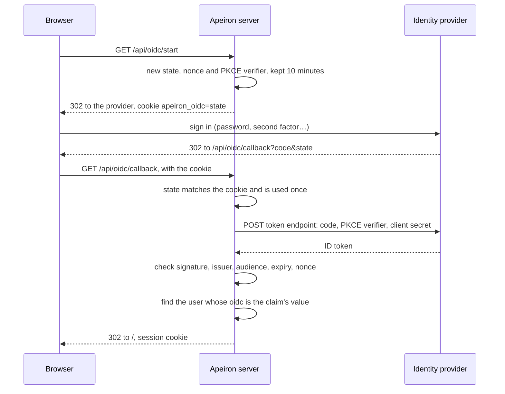

> **Türkçe:** [IDENTITY.tr.md](IDENTITY.tr.md)

# Central Identity

> **Status: Done.** This is the design of Stage 5 work item 1 ([ROADMAP.md](ROADMAP.md) §7): users of the web interface ([WEB.md](WEB.md)) sign in with the account of their organization, through an identity provider that speaks OpenID Connect, instead of a password kept by Apeiron. The decision behind it is ADR-031 ([DECISIONS.md](DECISIONS.md)).

An organization already has one place where its people sign in, such as Keycloak, Microsoft Entra ID, Google Workspace, Okta or Authentik. That place checks passwords and second factors, and turns accounts off when people leave. The backup server should use it rather than keep passwords of its own.

## 1. What changes

| Before | With an identity provider |
| --- | --- |
| Every user has a password in `web.json` | A user may have an identity at the provider instead, or both |
| Apeiron checks the password | The provider checks the person, with its own second factors and rules |
| Removing access means removing the user | Turning the account off at the provider also stops new sign-ins |

Roles, backups and folders stay in `web.json` (USERS.md §1): the provider says who someone is, Apeiron says what they may do. A user with a password, such as the first `admin`, can still sign in with it, so the server stays reachable when the provider is down.

## 2. Settings

The provider is set in `web.json` beside the users:

```json
{
  "oidc": {
    "issuer": "https://login.example.com/realms/corp",
    "client_id": "apeiron",
    "client_secret": "…",
    "address": "https://backup.example.com",
    "claim": "email"
  },
  "users": [
    {"name": "efe", "password": "$argon2id$v=19$...", "role": "admin"},
    {"name": "ayse", "role": "member", "oidc": "ayse@example.com",
     "backups": ["backup/ayse-*"], "folders": ["/home/ayse"]}
  ]
}
```

| Field | Meaning |
| --- | --- |
| `issuer` | The provider's issuer URL; its settings are read from `<issuer>/.well-known/openid-configuration` |
| `client_id`, `client_secret` | What the provider gave this server when it was registered there; the secret may be left out for a public client |
| `address` | The address browsers reach this server at; the provider sends them back to `<address>/api/oidc/callback` |
| `claim` | The claim of the ID token that names a user: `email` by default, or `sub`, `preferred_username` and the like |
| A user's `oidc` | The value of that claim for the user; no two users may have the same one |
| A user's `password` | May be left out when the user has an `oidc` identity |

The issuer and the address must use `https`, except on this computer (`localhost`, `127.0.0.1`), for trying it out. E-mail addresses are compared without regard to case; other claims exactly.

## 3. Signing in



The server accepts an ID token only when all of these hold:

| Check | Detail |
| --- | --- |
| Signature | RS256 or ES256, with a key the provider publishes at its `jwks_uri`; tokens with `none` or a shared secret are refused. Keys are read again when a token names an unknown key, at most once a minute |
| Issuer | `iss` is the provider's issuer |
| Audience | `aud` holds the client id; when it holds others too, `azp` is the client id |
| Time | `exp` has not passed, give or take one minute |
| This sign-in | `nonce` is the one sent for this sign-in, and the state came back to the browser that started it |
| E-mail | With the claim `email`, the provider has not marked it unverified (`email_verified: false`) |

The session that follows is the same as after a password (WEB.md §5); it ends when the user's identity, password or entry in `web.json` changes. An account turned off at the provider therefore keeps a session already open until the session ends or the user is removed from `web.json`. A sign-in that fails returns the browser to the sign-in screen with a message; the reason is in the audit log.

## 4. In the pages, the JSON API and the CLI

| Where | What |
| --- | --- |
| Sign-in screen | A "Sign in with your organization" button when a provider is set |
| `GET /api/session` | `"oidc": true` when signed out and a provider is set |
| `GET /api/oidc/start` | Sends the browser to the provider |
| `GET /api/oidc/callback` | Where the provider sends it back; on failure to `/#oidc_error=<kind>` |
| `apeiron web oidc set --issuer <url> --client-id <id> --address <url> [--claim <claim>] [--client-secret-file <path>]` | Sets the provider; asks for the client secret; prints the redirect address to register at the provider |
| `apeiron web oidc show`, `check`, `remove` | Shows the settings without the secret; reads the provider's settings and keys to see it answers; turns it off |
| `apeiron web user add <name> --role <role> --oidc <identity>` | Adds a user who signs in through the provider, without a password |
| `apeiron web user change <name> [--oidc <identity>] [--no-password]` | Gives a user an identity, or takes its password away |

## 5. In the audit log

| Event | Detail |
| --- | --- |
| `sign_in` | `"via": "oidc"`, the identity from the token, and on failure the reason; the user when it worked |
| `oidc_set`, `oidc_remove` | The settings, never the secret |

## 6. Not part of this work item

| Item | Where |
| --- | --- |
| LDAP and Active Directory directly | Not planned; providers such as Keycloak and Entra ID put a directory behind OpenID Connect |
| SAML | Later, if a pilot needs it |
| Creating users and roles from the provider's groups | Later; users are listed in `web.json` until then |
| Signing out at the provider too | Later |
| A second factor for password users | Later; users who need one sign in through the provider |

## 7. Crates

| Crate | Role | Status |
| --- | --- | --- |
| `apeiron-server` | Provider settings, the sign-in flow, token checks, the sign-in screen | Done |
| `apeiron-cli` | `apeiron web oidc`, `--oidc` and `--no-password` for users | Done |
