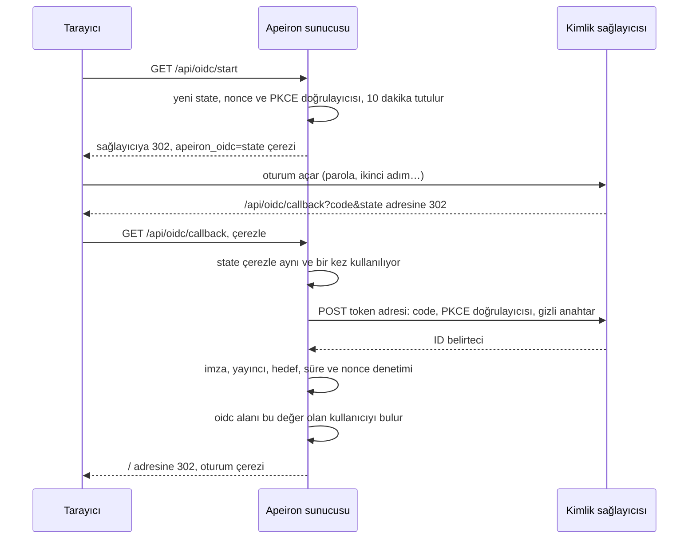

> **English:** [IDENTITY.md](IDENTITY.md)

# Merkezi Kimlik

> **Durum: Tamamlandı.** Aşama 5'in 1. işinin tasarımıdır ([ROADMAP.tr.md](ROADMAP.tr.md) §7): web arayüzünün ([WEB.tr.md](WEB.tr.md)) kullanıcıları, Apeiron'un tuttuğu bir parola yerine, OpenID Connect konuşan bir kimlik sağlayıcısı üzerinden kurumlarının hesabıyla oturum açar. Arkasındaki karar ADR-031'dir ([DECISIONS.tr.md](DECISIONS.tr.md)).

Bir kurumun, çalışanlarının oturum açtığı tek bir yeri zaten vardır: Keycloak, Microsoft Entra ID, Google Workspace, Okta ya da Authentik gibi. Bu yer parolaları ve ikinci adımları denetler, ayrılan kişilerin hesaplarını kapatır. Yedek sunucusu kendi parolalarını tutmak yerine onu kullanmalıdır.

## 1. Neler değişir

| Önce | Bir kimlik sağlayıcısıyla |
| --- | --- |
| Her kullanıcının `web.json` içinde bir parolası vardır | Bir kullanıcının bunun yerine sağlayıcıda bir kimliği olabilir, ya da ikisi birden |
| Parolayı Apeiron denetler | Kişiyi sağlayıcı, kendi ikinci adımları ve kurallarıyla denetler |
| Erişimi kaldırmak kullanıcıyı silmek demektir | Hesabı sağlayıcıda kapatmak yeni oturum açmaları da durdurur |

Roller, yedekler ve klasörler `web.json` içinde kalır (USERS.tr.md §1): sağlayıcı birinin kim olduğunu söyler, Apeiron ne yapabileceğini. İlk `admin` gibi parolası olan bir kullanıcı onunla oturum açmaya devam edebilir; böylece sağlayıcı çalışmadığında da sunucuya ulaşılabilir.

## 2. Ayarlar

Sağlayıcı, `web.json` içinde kullanıcıların yanında ayarlanır:

```json
{
  "oidc": {
    "issuer": "https://login.example.com/realms/corp",
    "client_id": "apeiron",
    "client_secret": "…",
    "address": "https://backup.example.com",
    "claim": "email"
  },
  "users": [
    {"name": "efe", "password": "$argon2id$v=19$...", "role": "admin"},
    {"name": "ayse", "role": "member", "oidc": "ayse@example.com",
     "backups": ["backup/ayse-*"], "folders": ["/home/ayse"]}
  ]
}
```

| Alan | Anlamı |
| --- | --- |
| `issuer` | Sağlayıcının yayıncı (issuer) adresi; ayarları `<issuer>/.well-known/openid-configuration` adresinden okunur |
| `client_id`, `client_secret` | Bu sunucu sağlayıcıya kaydedilirken sağlayıcının verdikleri; açık (public) bir istemci için gizli anahtar boş bırakılabilir |
| `address` | Tarayıcıların bu sunucuya ulaştığı adres; sağlayıcı onları `<address>/api/oidc/callback` adresine geri gönderir |
| `claim` | ID belirtecinin bir kullanıcıyı adlandıran alanı: varsayılan olarak `email`, ya da `sub`, `preferred_username` gibileri |
| Bir kullanıcının `oidc` alanı | O alanın kullanıcıdaki değeri; iki kullanıcının değeri aynı olamaz |
| Bir kullanıcının `password` alanı | Kullanıcının bir `oidc` kimliği varsa boş bırakılabilir |

Yayıncı ve adres `https` kullanmalıdır; denemek için bu bilgisayar (`localhost`, `127.0.0.1`) dışında. E-posta adresleri büyük-küçük harf ayrımı olmadan, diğer alanlar tam olarak karşılaştırılır.

## 3. Oturum açmak



Sunucu bir ID belirtecini yalnızca bunların hepsi doğruysa kabul eder:

| Denetim | Ayrıntı |
| --- | --- |
| İmza | RS256 ya da ES256, sağlayıcının `jwks_uri` adresinde yayımladığı bir anahtarla; `none` ya da paylaşılan bir gizli anahtarla imzalanmış belirteçler reddedilir. Bir belirteç bilinmeyen bir anahtarı adlandırdığında anahtarlar, en çok dakikada bir, yeniden okunur |
| Yayıncı | `iss`, sağlayıcının yayıncısıdır |
| Hedef | `aud` istemci kimliğini içerir; başkalarını da içeriyorsa `azp` istemci kimliğidir |
| Zaman | `exp` geçmemiştir, bir dakika artı ya da eksi |
| Bu oturum açma | `nonce` bu oturum açma için gönderilendir ve state onu başlatan tarayıcıya dönmüştür |
| E-posta | `email` alanıyla, sağlayıcı onu doğrulanmamış olarak işaretlememiştir (`email_verified: false`) |

Ardından gelen oturum, bir paroladan sonrakiyle aynıdır (WEB.tr.md §5); kullanıcının kimliği, parolası ya da `web.json` içindeki kaydı değişince biter. Bu yüzden sağlayıcıda kapatılan bir hesabın zaten açık olan oturumu, oturum bitene ya da kullanıcı `web.json` dosyasından silinene kadar sürer. Başarısız bir oturum açma, tarayıcıyı bir iletiyle oturum açma ekranına döndürür; nedeni denetim kaydındadır.

## 4. Sayfalarda, JSON API'de ve CLI'da

| Nerede | Ne |
| --- | --- |
| Oturum açma ekranı | Bir sağlayıcı ayarlıysa "Kurumunuzla oturum açın" düğmesi |
| `GET /api/session` | Oturum kapalıyken ve bir sağlayıcı ayarlıyken `"oidc": true` |
| `GET /api/oidc/start` | Tarayıcıyı sağlayıcıya gönderir |
| `GET /api/oidc/callback` | Sağlayıcının tarayıcıyı geri gönderdiği yer; başarısız olursa `/#oidc_error=<tür>` adresine |
| `apeiron web oidc set --issuer <url> --client-id <id> --address <url> [--claim <alan>] [--client-secret-file <yol>]` | Sağlayıcıyı ayarlar; gizli anahtarı sorar; sağlayıcıya kaydedilecek geri dönüş adresini yazar |
| `apeiron web oidc show`, `check`, `remove` | Ayarları gizli anahtar olmadan gösterir; sağlayıcının yanıt verdiğini görmek için ayarlarını ve anahtarlarını okur; kapatır |
| `apeiron web user add <name> --role <role> --oidc <kimlik>` | Sağlayıcı üzerinden, parolasız oturum açan bir kullanıcı ekler |
| `apeiron web user change <name> [--oidc <kimlik>] [--no-password]` | Bir kullanıcıya kimlik verir ya da parolasını kaldırır |

## 5. Denetim kaydında

| Olay | Ayrıntı |
| --- | --- |
| `sign_in` | `"via": "oidc"`, belirteçteki kimlik ve başarısız olursa nedeni; işe yaradıysa kullanıcı |
| `oidc_set`, `oidc_remove` | Ayarlar, gizli anahtar asla |

## 6. Bu işin parçası olmayanlar

| Konu | Nerede |
| --- | --- |
| Doğrudan LDAP ve Active Directory | Planlanmadı; Keycloak ve Entra ID gibi sağlayıcılar bir dizini OpenID Connect'in arkasına koyar |
| SAML | Sonra, bir pilot gerektirirse |
| Kullanıcıları ve rolleri sağlayıcının gruplarından oluşturmak | Sonra; o zamana kadar kullanıcılar `web.json` içinde listelenir |
| Sağlayıcıda da oturumu kapatmak | Sonra |
| Parola kullanıcıları için ikinci adım | Sonra; ihtiyacı olan kullanıcılar sağlayıcı üzerinden oturum açar |

## 7. Crate'ler

| Crate | Görevi | Durum |
| --- | --- | --- |
| `apeiron-server` | Sağlayıcı ayarları, oturum açma akışı, belirteç denetimleri, oturum açma ekranı | Tamamlandı |
| `apeiron-cli` | `apeiron web oidc`, kullanıcılar için `--oidc` ve `--no-password` | Tamamlandı |
