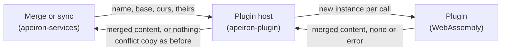

> **Türkçe:** [PLUGIN.tr.md](PLUGIN.tr.md)

# Plugins

> **Status: Done.** This is the design of Stage 3 work item 5 ([ROADMAP.md](ROADMAP.md) §5): running plugins as WebAssembly components and the first plugin type, the type driver. The decisions behind it are ADR-005 and ADR-025 ([DECISIONS.md](DECISIONS.md)).

A plugin adds knowledge of a kind of data without changing the core (VISION.md). The first plugin type is the type driver: it merges two changed versions of a file it knows, so that a merge or a sync that would make a conflict copy can join both changes instead. The text diff plugin (work item 6) is the first real type driver.

## 1. Commands

| Command | What it does | Status |
| --- | --- | --- |
| `apeiron plugin add <file.wasm>` | Checks a plugin, shows what it handles and installs it; a plugin of the same name is replaced | Done |
| `apeiron plugin list` | Lists the installed plugins with their version and the file names they handle | Done |
| `apeiron plugin remove <name>` | Removes a plugin | Done |
| `apeiron plugin share <name>`, `plugin unshare <name>`, `plugin list --shared`, `plugin add --from-repo <name>` | Puts a plugin into the repository, takes it out, lists those it carries, or installs one of them (§5) | Done |
| The Plugins page of the desktop interface (DESKTOP.md §2) | The same three in the window | Done |
| `apeiron plugin search [<text>]`, `plugin install <name>`, `plugin index <file.wasm>...` | Lists what a store offers, downloads and installs one after checking it against the store's index, or writes a store's index (§6) | Done |

Plugins are installed for the user, not for one repository, in the folder `plugins` beside the jobs file of the background service (DAEMON.md §3): `~/.config/apeiron/plugins` on Linux. The environment variable `APEIRON_PLUGINS` names another folder. Each plugin is two files there: `<name>.wasm`, the component, and `<name>.json`, what `describe` returned when it was installed.

## 2. The plugin interface

A plugin is a WebAssembly component (the component model) that exports the interface `apeiron:plugin/type-driver@0.2.0`, written in WIT in `crates/apeiron-plugin/wit/plugin.wit`:

| Function | What it returns |
| --- | --- |
| `describe()` | Name (lowercase letters, digits and `-`), version, description, the file name patterns it merges (`*.txt`, as in SEARCH.md §1), those it reads text from (`text-patterns`) and the permissions it asks for |
| `merge(base, ours, theirs)` | The merged content; `none` when the changes conflict; an error message when it cannot merge. `base` is absent when the file did not exist in the common snapshot |
| `diff(old, new)` | A difference for people to read, or `none`; used by the text diff plugin's work item |
| `extract-text(content)` | The text inside a file for search, or `none` when it holds none (SEARCH.md §3); the documents plugin in `plugins/documents` is the first to use it |

The version in the package name is the plugin API version, separate from the API of the program (VISION.md). A plugin built for another version does not match the interface and is refused when it is added.

A plugin is one of three kinds, by the interface it exports; `plugin add` tries them in this order and `plugin list` names the kind. The importer and the hook came later, in the same version 0.2, without changing the type driver, so plugins made before still fit.

| Kind | Interface | What it is for |
| --- | --- | --- |
| Type driver | `type-driver` | Merging, showing differences and reading the text of the files it knows (§4) |
| Importer | `importer` | Reading archive formats Apeiron does not know for `apeiron import` (§2.1) |
| Hook | `hook` | Looking at a backup before its ref moves, and stopping it, or telling another service after it (§2.2) |
| Storage backend | `storage` | Keeping repository copies where Apeiron cannot reach by itself (§2.3) |

### 2.1 Importers

`describe()` gives the name, version, description, the file name patterns of the archives it reads, such as `*.mbox`, and the permissions it asks for. `read(content)` returns the files inside: each a `/`-separated path and its content, or an error message.

`apeiron import <file> --ref <ref>` uses the first importer, by name, whose pattern matches the file's name when the name is not one of tar, zip and 7z and no `--format` is given (CLI.md §4.2). The archive may be at most 64 MiB, as for every plugin. Paths are cleaned as for any archive: one that climbs out with `..` is left out with a warning. The result names the plugin in `plugin`.

### 2.2 Hooks

`describe()` gives the name, version, description, the events it is called for and its permissions. `check(settings, event, ref-name, changes)` returns warnings, or a reason to stop; `settings` is the text the user gave with `apeiron plugin settings <name> <text>`, such as an address to tell, empty when none. There are two events:

| Event | When | A reason to stop |
| --- | --- | --- |
| `backup` | After the snapshot is stored, before the ref moves | Stops the backup (below) |
| `backup-done` | After the ref moved | Becomes a warning: "the plugin … failed after the backup"; the backup stands |

1. A backup stores its snapshot, then shows every hook of `backup`, in name order, each path it adds, changes or removes, with the new content of each added or changed file of at most 1 MiB, up to 64 MiB in all.
2. Warnings are added to the backup's warnings as `plugin` warnings, with the plugin's name, so the CLI ends with exit code 3.
3. A reason to stop ends the backup with the error `conflict`: "the plugin … stopped the backup: …". The ref does not move; the stored data is removed by the next garbage collection.
4. A hook that crashes or runs out of time stops the backup too: a check that cannot run is not passed. Removing the plugin lets backups through again.

Backups of the CLI, the background service and the web interface all run hooks. Sync rounds, merges, imports and pushes do not.

A hook of `backup` can, for example, keep files with passwords out of backups, or warn about large logs. A hook of `backup-done` with the permission to reach a host (§3.1) is an integration: it can tell a chat service or a monitor about each backup. Otherwise it sees only what it is given, like every plugin (§3).

### 2.3 Storage backends

A storage backend keeps repository copies where Apeiron cannot reach by itself, such as a cloud service with its own interface. `describe()` gives the name, version, description and the hosts it must reach (§3.1); its other functions are the store operations of a remote (FORMAT.md §15.2): reading a file or part of it, listing a folder, writing a new file, deleting one, and reading, listing and swapping refs. Swapping a ref must be atomic and answer `conflict` with the ref's id when it points elsewhere, so pushes from two devices cannot undo each other; that is the backend's promise, which Apeiron cannot check.

It is used as the remote `plugin://<name>/<settings>`, such as `apeiron remote add cloud 'plugin://example-cloud/bucket=photos'`: every call gets the text after the name. Only an encrypted repository can use it, as for every remote that leaves the computer. A call may take ten minutes, enough for a pack on a slow line; the other limits are those of §3.

## 3. The sandbox

| Rule | How |
| --- | --- |
| No access to anything | The plugin gets no files, no network, no environment variables and no arguments; what it writes to standard output and error is dropped. It sees only the bytes it is given |
| Only granted hosts | A hook or a storage backend may ask to reach hosts on the network; it gets them only if the user grants them when installing it (§3.1). Every other plugin, and every other host, is refused |
| Time limit | A call that runs longer than 30 seconds is stopped |
| Memory limit | A plugin can use at most 512 MiB of memory |
| Size limit | Files larger than 64 MiB are not given to a plugin |
| Fresh state | Every call runs in a new instance, so one call cannot affect the next |
| Failure is contained | A plugin that crashes, runs out of time or memory, or returns an error leaves the file as a conflict copy, as if there were no plugin, and the result reports a warning |

### 3.1 Network permissions

The only permission is `net:<host>` or `net:<host>:<port>`, such as `net:hooks.example.com`.

1. A plugin names the hosts it must reach in `describe()`. `apeiron plugin add <file> --allow net:<host>` (and `plugin install`) installs it only if every one of them is allowed on the command line, and keeps them in its description as `granted`; otherwise it says which `--allow` it needs and installs nothing. Type drivers and importers may not ask at all.
2. The plugin reaches the network through WASI HTTP. Every request is checked: its host must be granted, and it must use HTTPS, except to this computer (`localhost`, `127.0.0.1`, `[::1]`). Anything else is refused as `HTTP request denied`, which the plugin sees as an error.
3. It gets no sockets, files, variables or arguments, as before. `plugin list` and `plugin add` show what a plugin may reach.

## 4. Merging with a type driver

When both sides changed a file differently (SYNC.md §4, BRANCH.md §2), the merge looks for an installed plugin with a pattern matching the file name, in name order. If one is found and both versions are files within the size limit, it calls `merge` with the file's content in the common snapshot (if there was one), ours and theirs:

1. Merged content: the file gets that content and the attributes of our version; there is no conflict copy. The result lists the file and the plugin that merged it, and so does the merge message.
2. `none`: the changes conflict; the conflict copy is made as before.
3. An error or a failure: a warning, and the conflict copy as before.

The same plugins merge in `apeiron merge` and in sync. A device without the plugin makes a conflict copy instead; nothing is lost either way.

## 5. Plugins in a repository

A repository can carry plugins, so that every copy of it, on another computer or after a clone, can use the same ones. `apeiron plugin share <name>` puts the installed plugin's two files into the ref `apeiron/plugins`, as a new snapshot of that ref, replacing an older version of the same plugin; `unshare` takes them out. The ref travels with push, pull and clone like any other, and as every ref under `apeiron/` it is an admin's only and not listed among backups (REPLICATION.md §6.1).

Carrying is not installing: a plugin runs code, so a copy never installs one by itself. `apeiron plugin list --shared` shows what the repository carries, and `apeiron plugin add --from-repo <name>` installs one after the same checks as a file, for the user who runs it.

## 6. The plugin store

A store is an index, `plugins.json`, beside the `.wasm` files it lists. Each entry has the plugin's name, version, description and kind, its file (a name beside the index, or an address) and the file's size and SHA-256. The release workflow writes one with every release of Apeiron, listing the plugins it builds (`plugins/text`, `plugins/documents`), so `https://github.com/efe-clk/apeiron/releases/latest/download/plugins.json` is the default store. `APEIRON_PLUGIN_STORE`, or `--store`, names another: an address, or a file on disk.

1. `apeiron plugin search [<text>]` lists the plugins of the store whose name or description holds the text.
2. `apeiron plugin install <name>` downloads the file, refuses it unless its size and SHA-256 are those of the index, and then installs it with every check of `plugin add` (§1, §3). A plugin that calls itself by another name than the index is removed again.
3. `apeiron plugin index <file.wasm>...` prints an index of plugin files, each named by its file name; a company can keep its own store in a folder or on a web server.

The SHA-256 makes sure the file is the one the index lists, not that the index is honest: a store is trusted as far as the address it is read from, which is HTTPS for the default. A plugin from a store runs in the same sandbox as any other.

## 7. Not part of this work item

| Item | Where |
| --- | --- |
| Line-by-line text merge and showing a difference | The text plugin ([TEXT.md](TEXT.md)) |
| Hooks of other events than `backup` | Later, as uses for them appear |
| Git as a plugin | Not planned; ADR-049 ([DECISIONS.md](DECISIONS.md)) |

## 8. Crates

| Crate | Role | Status |
| --- | --- | --- |
| `apeiron-plugin` | The plugin host on Wasmtime: install, list, remove, merge calls, importers, hooks and the store | Done |
| `apeiron-services` | Asks a type driver before making a conflict copy; runs hooks before a backup moves its ref and importers in `import` | Done |
| `apeiron` | Plugin operations and plugins in `merge` and `sync` (API.md §8.3) | Done |
| `apeiron-cli` | `apeiron plugin` | Done |
