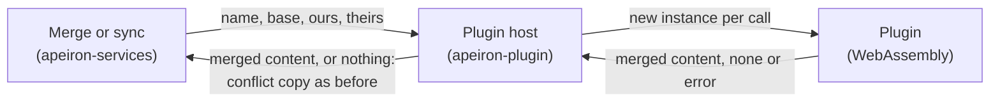

> **Türkçe:** [PLUGIN.tr.md](PLUGIN.tr.md)

# Plugins

> **Status: Done.** This is the design of Stage 3 work item 5 ([ROADMAP.md](ROADMAP.md) §5): running plugins as WebAssembly components and the first plugin type, the type driver. The decisions behind it are ADR-005 and ADR-025 ([DECISIONS.md](DECISIONS.md)).

A plugin adds knowledge of a kind of data without changing the core (VISION.md). The first plugin type is the type driver: it merges two changed versions of a file it knows, so that a merge or a sync that would make a conflict copy can join both changes instead. The text diff plugin (work item 6) is the first real type driver.

## 1. Commands

| Command | What it does | Status |
| --- | --- | --- |
| `apeiron plugin add <file.wasm>` | Checks a plugin, shows what it handles and installs it; a plugin of the same name is replaced | Done |
| `apeiron plugin list` | Lists the installed plugins with their version and the file names they handle | Done |
| `apeiron plugin remove <name>` | Removes a plugin | Done |

Plugins are installed for the user, not for one repository, in the folder `plugins` beside the jobs file of the background service (DAEMON.md §3): `~/.config/apeiron/plugins` on Linux. The environment variable `APEIRON_PLUGINS` names another folder. Each plugin is two files there: `<name>.wasm`, the component, and `<name>.json`, what `describe` returned when it was installed.

## 2. The plugin interface

A plugin is a WebAssembly component (the component model) that exports the interface `apeiron:plugin/type-driver@0.1.0`, written in WIT in `crates/apeiron-plugin/wit/plugin.wit`:

| Function | What it returns |
| --- | --- |
| `describe()` | Name (lowercase letters, digits and `-`), version, description, the file name patterns it handles (`*.txt`, as in SEARCH.md §1) and the permissions it asks for |
| `merge(base, ours, theirs)` | The merged content; `none` when the changes conflict; an error message when it cannot merge. `base` is absent when the file did not exist in the common snapshot |
| `diff(old, new)` | A difference for people to read, or `none`; used by the text diff plugin's work item |

The version in the package name is the plugin API version, separate from the API of the program (VISION.md). A plugin built for another version does not match the interface and is refused when it is added.

## 3. The sandbox

| Rule | How |
| --- | --- |
| No access to anything | The plugin gets no files, no network, no environment variables and no arguments; what it writes to standard output and error is dropped. It sees only the bytes it is given |
| No permissions yet | Version 0.1 of the plugin API grants no permissions; a plugin that asks for any is refused. Permissions come with the plugin types that need them, such as storage backends, and are granted only with the user's approval |
| Time limit | A call that runs longer than 30 seconds is stopped |
| Memory limit | A plugin can use at most 512 MiB of memory |
| Size limit | Files larger than 64 MiB are not given to a plugin |
| Fresh state | Every call runs in a new instance, so one call cannot affect the next |
| Failure is contained | A plugin that crashes, runs out of time or memory, or returns an error leaves the file as a conflict copy, as if there were no plugin, and the result reports a warning |

## 4. Merging with a type driver

When both sides changed a file differently (SYNC.md §4, BRANCH.md §2), the merge looks for an installed plugin with a pattern matching the file name, in name order. If one is found and both versions are files within the size limit, it calls `merge` with the file's content in the common snapshot (if there was one), ours and theirs:

1. Merged content: the file gets that content and the attributes of our version; there is no conflict copy. The result lists the file and the plugin that merged it, and so does the merge message.
2. `none`: the changes conflict; the conflict copy is made as before.
3. An error or a failure: a warning, and the conflict copy as before.

The same plugins merge in `apeiron merge` and in sync. A device without the plugin makes a conflict copy instead; nothing is lost either way.

## 5. Not part of this work item

| Item | Where |
| --- | --- |
| Line-by-line text merge and showing a difference | The text plugin ([TEXT.md](TEXT.md)) |
| Other plugin types: storage backend, importer, hook, integration | Later, each with the permissions it needs |
| Plugins shipped inside a repository or a remote | Later; installed per user for now |
| A store to find and download plugins | Later |

## 6. Crates

| Crate | Role | Status |
| --- | --- | --- |
| `apeiron-plugin` | The plugin host on Wasmtime: install, list, remove, merge calls | Done |
| `apeiron-services` | Asks a type driver before making a conflict copy | Done |
| `apeiron` | Plugin operations and plugins in `merge` and `sync` (API.md §8.3) | Done |
| `apeiron-cli` | `apeiron plugin` | Done |
