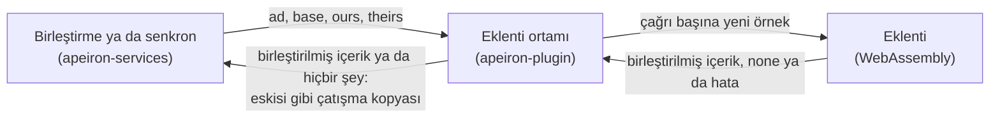

> **English:** [PLUGIN.md](PLUGIN.md)

# Eklentiler

> **Durum: Tamamlandı.** Aşama 3'ün 5. işinin tasarımıdır ([ROADMAP.tr.md](ROADMAP.tr.md) §5): eklentileri WebAssembly bileşenleri olarak çalıştırmak ve ilk eklenti türü olan tür sürücüsü (type driver). Arkasındaki kararlar ADR-005 ve ADR-025'tir ([DECISIONS.tr.md](DECISIONS.tr.md)).

Bir eklenti, çekirdeği değiştirmeden bir veri türü hakkında bilgi ekler (VISION.tr.md). İlk eklenti türü tür sürücüsüdür: tanıdığı bir dosyanın değişmiş iki sürümünü birleştirir; böylece çatışma kopyası oluşturacak bir birleştirme ya da senkron, iki değişikliği birleştirebilir. Metin diff eklentisi (6. iş) ilk gerçek tür sürücüsüdür.

## 1. Komutlar

| Komut | Ne yapar | Durum |
| --- | --- | --- |
| `apeiron plugin add <file.wasm>` | Bir eklentiyi denetler, neyi işlediğini gösterir ve kurar; aynı adlı bir eklentinin yerini alır | Tamamlandı |
| `apeiron plugin list` | Kurulu eklentileri sürümleri ve işledikleri dosya adlarıyla listeler | Tamamlandı |
| `apeiron plugin remove <name>` | Bir eklentiyi kaldırır | Tamamlandı |

Eklentiler tek bir depo için değil kullanıcı için kurulur; arka plan hizmetinin iş dosyasının yanındaki `plugins` klasörüne (DAEMON.tr.md §3): Linux'ta `~/.config/apeiron/plugins`. `APEIRON_PLUGINS` ortam değişkeni başka bir klasörü adlandırır. Her eklenti orada iki dosyadır: bileşen olan `<name>.wasm` ve kurulurken `describe`'ın döndürdüğü `<name>.json`.

## 2. Eklenti arayüzü

Bir eklenti, `crates/apeiron-plugin/wit/plugin.wit` içinde WIT ile yazılmış `apeiron:plugin/type-driver@0.1.0` arayüzünü dışa veren bir WebAssembly bileşenidir (bileşen modeli):

| İşlev | Ne döndürür |
| --- | --- |
| `describe()` | Ad (küçük harfler, rakamlar ve `-`), sürüm, açıklama, işlediği dosya adı desenleri (SEARCH.tr.md §1'deki gibi `*.txt`) ve istediği izinler |
| `merge(base, ours, theirs)` | Birleştirilmiş içerik; değişiklikler çatışıyorsa `none`; birleştiremiyorsa bir hata mesajı. Dosya ortak snapshot'ta yoksa `base` yoktur |
| `diff(old, new)` | İnsanların okuyacağı bir fark ya da `none`; metin diff eklentisinin işinde kullanılır |

Paket adındaki sürüm, programın API'sinden ayrı olan eklenti API sürümüdür (VISION.tr.md). Başka bir sürüm için yapılmış bir eklenti arayüze uymaz ve eklenirken reddedilir.

## 3. Sandbox

| Kural | Nasıl |
| --- | --- |
| Hiçbir şeye erişim yok | Eklenti dosya, ağ, ortam değişkeni ve argüman almaz; standart çıktıya ve hataya yazdıkları atılır. Yalnızca kendisine verilen baytları görür |
| Henüz izin yok | Eklenti API'sinin 0.1 sürümü hiç izin vermez; izin isteyen bir eklenti reddedilir. İzinler, depolama arka uçları gibi onlara ihtiyaç duyan eklenti türleriyle gelir ve yalnızca kullanıcının onayıyla verilir |
| Süre sınırı | 30 saniyeden uzun süren bir çağrı durdurulur |
| Bellek sınırı | Bir eklenti en çok 512 MiB bellek kullanabilir |
| Boyut sınırı | 64 MiB'tan büyük dosyalar eklentiye verilmez |
| Taze durum | Her çağrı yeni bir örnekte çalışır; böylece bir çağrı bir sonrakini etkileyemez |
| Hata sınırlanır | Çöken, süresi ya da belleği biten veya hata döndüren bir eklenti, dosyayı eklenti yokmuş gibi çatışma kopyası olarak bırakır ve sonuç bir uyarı bildirir |

## 4. Tür sürücüsüyle birleştirme

İki taraf bir dosyayı farklı değiştirdiğinde (SYNC.tr.md §4, BRANCH.tr.md §2), birleştirme dosya adına uyan bir desene sahip kurulu bir eklentiyi ad sırasıyla arar. Bulunursa ve iki sürüm de boyut sınırı içindeki dosyalarsa, dosyanın ortak snapshot'taki içeriğiyle (varsa), bizimki ve onlarınkiyle `merge`'ü çağırır:

1. Birleştirilmiş içerik: dosya bu içeriği ve bizim sürümümüzün özniteliklerini alır; çatışma kopyası olmaz. Sonuç, dosyayı ve onu birleştiren eklentiyi listeler; birleştirme mesajı da öyle.
2. `none`: değişiklikler çatışır; çatışma kopyası eskisi gibi oluşturulur.
3. Bir hata ya da başarısızlık: bir uyarı ve eskisi gibi çatışma kopyası.

Aynı eklentiler `apeiron merge`'de ve senkronda birleştirir. Eklentisi olmayan bir cihaz bunun yerine çatışma kopyası oluşturur; iki durumda da hiçbir şey kaybolmaz.

## 5. Bu işin parçası olmayanlar

| Konu | Nerede |
| --- | --- |
| Satır satır metin birleştirme ve bir farkı göstermek | Metin diff eklentisi, 6. iş |
| Diğer eklenti türleri: depolama arka ucu, içe aktarıcı, hook, entegrasyon | Daha sonra, her biri ihtiyaç duyduğu izinlerle |
| Bir depo ya da uzak kopya içinde gelen eklentiler | Daha sonra; şimdilik kullanıcı başına kurulur |
| Eklenti bulup indirmek için bir mağaza | Daha sonra |

## 6. Crate'ler

| Crate | Görev | Durum |
| --- | --- | --- |
| `apeiron-plugin` | Wasmtime üzerinde eklenti ortamı: kurma, listeleme, kaldırma, birleştirme çağrıları | Tamamlandı |
| `apeiron-services` | Çatışma kopyası oluşturmadan önce bir tür sürücüsüne sorar | Tamamlandı |
| `apeiron` | Eklenti işlemleri ve `merge` ile `sync` içinde eklentiler (API.tr.md §8.3) | Tamamlandı |
| `apeiron-cli` | `apeiron plugin` | Tamamlandı |
