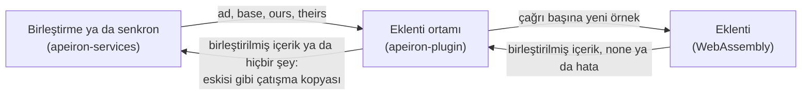

> **English:** [PLUGIN.md](PLUGIN.md)

# Eklentiler

> **Durum: Tamamlandı.** Aşama 3'ün 5. işinin tasarımıdır ([ROADMAP.tr.md](ROADMAP.tr.md) §5): eklentileri WebAssembly bileşenleri olarak çalıştırmak ve ilk eklenti türü olan tür sürücüsü (type driver). Arkasındaki kararlar ADR-005 ve ADR-025'tir ([DECISIONS.tr.md](DECISIONS.tr.md)).

Bir eklenti, çekirdeği değiştirmeden bir veri türü hakkında bilgi ekler (VISION.tr.md). İlk eklenti türü tür sürücüsüdür: tanıdığı bir dosyanın değişmiş iki sürümünü birleştirir; böylece çatışma kopyası oluşturacak bir birleştirme ya da senkron, iki değişikliği birleştirebilir. Metin diff eklentisi (6. iş) ilk gerçek tür sürücüsüdür.

## 1. Komutlar

| Komut | Ne yapar | Durum |
| --- | --- | --- |
| `apeiron plugin add <file.wasm>` | Bir eklentiyi denetler, neyi işlediğini gösterir ve kurar; aynı adlı bir eklentinin yerini alır | Tamamlandı |
| `apeiron plugin list` | Kurulu eklentileri sürümleri ve işledikleri dosya adlarıyla listeler | Tamamlandı |
| `apeiron plugin remove <name>` | Bir eklentiyi kaldırır | Tamamlandı |
| `apeiron plugin share <name>`, `plugin unshare <name>`, `plugin list --shared`, `plugin add --from-repo <name>` | Bir eklentiyi depoya koyar, depodan çıkarır, deponun taşıdıklarını listeler ya da onlardan birini kurar (§5) | Tamamlandı |
| Masaüstü arayüzünün Eklentiler sayfası (DESKTOP.tr.md §2) | Aynı üç işlem pencerede | Tamamlandı |
| `apeiron plugin search [<text>]`, `plugin install <name>`, `plugin index <file.wasm>...` | Bir mağazanın sunduklarını listeler, birini mağazanın indeksine göre denetleyip indirir ve kurar ya da bir mağaza indeksi yazar (§6) | Tamamlandı |

Eklentiler tek bir depo için değil kullanıcı için kurulur; arka plan hizmetinin iş dosyasının yanındaki `plugins` klasörüne (DAEMON.tr.md §3): Linux'ta `~/.config/apeiron/plugins`. `APEIRON_PLUGINS` ortam değişkeni başka bir klasörü adlandırır. Her eklenti orada iki dosyadır: bileşen olan `<name>.wasm` ve kurulurken `describe`'ın döndürdüğü `<name>.json`.

## 2. Eklenti arayüzü

Bir eklenti, `crates/apeiron-plugin/wit/plugin.wit` içinde WIT ile yazılmış `apeiron:plugin/type-driver@0.2.0` arayüzünü dışa veren bir WebAssembly bileşenidir (bileşen modeli):

| İşlev | Ne döndürür |
| --- | --- |
| `describe()` | Ad (küçük harfler, rakamlar ve `-`), sürüm, açıklama, birleştirdiği dosya adı desenleri (SEARCH.tr.md §1'deki gibi `*.txt`), metin okuduğu desenler (`text-patterns`) ve istediği izinler |
| `merge(base, ours, theirs)` | Birleştirilmiş içerik; değişiklikler çatışıyorsa `none`; birleştiremiyorsa bir hata mesajı. Dosya ortak snapshot'ta yoksa `base` yoktur |
| `diff(old, new)` | İnsanların okuyacağı bir fark ya da `none`; metin diff eklentisinin işinde kullanılır |
| `extract-text(content)` | Arama için bir dosyanın içindeki metin ya da metin yoksa `none` (SEARCH.tr.md §3); ilk kullanan `plugins/documents` içindeki belgeler eklentisidir |

Paket adındaki sürüm, programın API'sinden ayrı olan eklenti API sürümüdür (VISION.tr.md). Başka bir sürüm için yapılmış bir eklenti arayüze uymaz ve eklenirken reddedilir.

Bir eklenti, dışa verdiği arayüze göre üç türden biridir; `plugin add` onları bu sırayla dener ve `plugin list` türü adlandırır. İçe aktarıcı ve kanca daha sonra, tür sürücüsünü değiştirmeden aynı 0.2 sürümüne geldi; önceden yapılmış eklentiler uymaya devam eder.

| Tür | Arayüz | Ne içindir |
| --- | --- | --- |
| Tür sürücüsü | `type-driver` | Bildiği dosyaları birleştirmek, farklarını göstermek ve metinlerini okumak (§4) |
| İçe aktarıcı | `importer` | Apeiron'un bilmediği arşiv biçimlerini `apeiron import` için okumak (§2.1) |
| Kanca | `hook` | Bir yedeğe, ref'i ilerlemeden önce bakmak ve onu durdurmak (§2.2) |

### 2.1 İçe aktarıcılar

`describe()` adı, sürümü, açıklamayı, okuduğu arşivlerin `*.mbox` gibi dosya adı desenlerini ve istediği izinleri verir. `read(content)` içindeki dosyaları döndürür: her biri `/` ile ayrılmış bir yol ve içeriği, ya da bir hata mesajı.

`apeiron import <file> --ref <ref>`, ad tar, zip ve 7z'den biri değilse ve `--format` verilmemişse, deseni dosyanın adına uyan ilk içe aktarıcıyı (ada göre) kullanır (CLI.tr.md §4.2). Arşiv, her eklentide olduğu gibi en fazla 64 MiB olabilir. Yollar her arşivdeki gibi temizlenir: `..` ile dışarı çıkan bir yol bir uyarıyla dışarıda bırakılır. Sonuç eklentiyi `plugin` alanında adlandırır.

### 2.2 Kancalar

`describe()` adı, sürümü, açıklamayı, çağrıldığı olayları ve izinlerini verir; şimdilik tek olay `backup`'tır. `check(event, ref-name, changes)` uyarılar ya da durdurmak için bir gerekçe döndürür.

1. Bir yedek snapshot'ını kaydeder, sonra `backup`'ın her kancasına, ad sırasıyla, eklediği, değiştirdiği ya da sildiği her yolu; eklenen ya da değişen, en fazla 1 MiB'lık her dosyanın yeni içeriğiyle, toplamda 64 MiB'a kadar gösterir.
2. Uyarılar, eklentinin adıyla `plugin` uyarıları olarak yedeğin uyarılarına eklenir; CLI çıkış kodu 3 ile biter.
3. Durdurma gerekçesi yedeği `conflict` hatasıyla bitirir: "the plugin … stopped the backup: …". Ref ilerlemez; kaydedilen veriyi bir sonraki çöp toplama siler.
4. Çöken ya da süresi dolan bir kanca da yedeği durdurur: çalışamayan bir denetim geçilmiş sayılmaz. Eklentiyi kaldırmak yedeklerin yeniden geçmesini sağlar.

CLI'ın, arka plan hizmetinin ve web arayüzünün yedeklerinin hepsi kancaları çalıştırır. Senkron turları, birleştirmeler, içe aktarmalar ve push'lar çalıştırmaz.

Bir kanca, örneğin parola içeren dosyaları yedeklerin dışında tutabilir ya da büyük kayıt dosyaları için uyarabilir. Her eklenti gibi yalnızca kendisine verileni görür (§3).

## 3. Sandbox

| Kural | Nasıl |
| --- | --- |
| Hiçbir şeye erişim yok | Eklenti dosya, ağ, ortam değişkeni ve argüman almaz; standart çıktıya ve hataya yazdıkları atılır. Yalnızca kendisine verilen baytları görür |
| Henüz izin yok | Eklenti API'sinin 0.2 sürümü hiç izin vermez; izin isteyen bir eklenti reddedilir. İzinler, depolama arka uçları gibi onlara ihtiyaç duyan eklenti türleriyle gelir ve yalnızca kullanıcının onayıyla verilir |
| Süre sınırı | 30 saniyeden uzun süren bir çağrı durdurulur |
| Bellek sınırı | Bir eklenti en çok 512 MiB bellek kullanabilir |
| Boyut sınırı | 64 MiB'tan büyük dosyalar eklentiye verilmez |
| Taze durum | Her çağrı yeni bir örnekte çalışır; böylece bir çağrı bir sonrakini etkileyemez |
| Hata sınırlanır | Çöken, süresi ya da belleği biten veya hata döndüren bir eklenti, dosyayı eklenti yokmuş gibi çatışma kopyası olarak bırakır ve sonuç bir uyarı bildirir |

## 4. Tür sürücüsüyle birleştirme

İki taraf bir dosyayı farklı değiştirdiğinde (SYNC.tr.md §4, BRANCH.tr.md §2), birleştirme dosya adına uyan bir desene sahip kurulu bir eklentiyi ad sırasıyla arar. Bulunursa ve iki sürüm de boyut sınırı içindeki dosyalarsa, dosyanın ortak snapshot'taki içeriğiyle (varsa), bizimki ve onlarınkiyle `merge`'ü çağırır:

1. Birleştirilmiş içerik: dosya bu içeriği ve bizim sürümümüzün özniteliklerini alır; çatışma kopyası olmaz. Sonuç, dosyayı ve onu birleştiren eklentiyi listeler; birleştirme mesajı da öyle.
2. `none`: değişiklikler çatışır; çatışma kopyası eskisi gibi oluşturulur.
3. Bir hata ya da başarısızlık: bir uyarı ve eskisi gibi çatışma kopyası.

Aynı eklentiler `apeiron merge`'de ve senkronda birleştirir. Eklentisi olmayan bir cihaz bunun yerine çatışma kopyası oluşturur; iki durumda da hiçbir şey kaybolmaz.

## 5. Depodaki eklentiler

Bir depo eklenti taşıyabilir; böylece başka bir bilgisayardaki ya da bir klondan sonraki her kopyası aynı eklentileri kullanabilir. `apeiron plugin share <name>`, kurulu eklentinin iki dosyasını `apeiron/plugins` ref'ine, o ref'in yeni bir sürümü olarak koyar ve aynı eklentinin eski sürümünün yerini alır; `unshare` onları çıkarır. Ref, diğerleri gibi push, pull ve klonla taşınır ve `apeiron/` altındaki her ref gibi yalnızca bir admin'indir ve yedekler arasında listelenmez (REPLICATION.tr.md §6.1).

Taşımak kurmak değildir: bir eklenti kod çalıştırır, bu yüzden bir kopya onu asla kendiliğinden kurmaz. `apeiron plugin list --shared` deponun taşıdıklarını gösterir; `apeiron plugin add --from-repo <name>` birini, bir dosyayla aynı denetimlerden sonra, onu çalıştıran kullanıcı için kurar.

## 6. Eklenti mağazası

Mağaza, listelediği `.wasm` dosyalarının yanında duran bir indekstir: `plugins.json`. Her kaydında eklentinin adı, sürümü, açıklaması ve türü, dosyası (indeksin yanındaki bir ad ya da bir adres) ve dosyanın boyutu ile SHA-256'sı vardır. Yayın iş akışı Apeiron'un her sürümünde, ürettiği eklentileri (`plugins/text`, `plugins/documents`) listeleyen bir indeks yazar; böylece varsayılan mağaza `https://github.com/efe-clk/apeiron/releases/latest/download/plugins.json`'dur. `APEIRON_PLUGIN_STORE` ya da `--store` başka birini adlandırır: bir adres ya da diskteki bir dosya.

1. `apeiron plugin search [<text>]`, mağazanın adı ya da açıklaması metni içeren eklentilerini listeler.
2. `apeiron plugin install <name>` dosyayı indirir, boyutu ve SHA-256'sı indeksteki gibi değilse reddeder, sonra onu `plugin add`'in bütün denetimleriyle kurar (§1, §3). Kendine indekstekinden başka bir ad veren bir eklenti yeniden kaldırılır.
3. `apeiron plugin index <file.wasm>...` eklenti dosyalarının, her biri dosya adıyla anılan bir indeksini yazdırır; bir şirket kendi mağazasını bir klasörde ya da bir web sunucusunda tutabilir.

SHA-256, dosyanın indekstekiyle aynı olduğunu güvenceye alır, indeksin dürüst olduğunu değil: bir mağazaya, okunduğu adres kadar güvenilir; varsayılanda bu HTTPS'tir. Mağazadan gelen bir eklenti de diğer her eklentiyle aynı sandbox'ta çalışır.

## 7. Bu işin parçası olmayanlar

| Konu | Nerede |
| --- | --- |
| Satır satır metin birleştirme ve bir farkı göstermek | Metin eklentisi ([TEXT.tr.md](TEXT.tr.md)) |
| Eklenti olarak depolama arka uçları ve entegrasyonlar | Daha sonra; ağa ulaşmaları gerekir, bu yüzden kullanıcının verdiği izinlerle gelirler ([ROADMAP.tr.md](ROADMAP.tr.md) §8) |
| `backup` dışındaki olayların kancaları | Daha sonra, kullanımları ortaya çıktıkça |
| Eklenti olarak Git | Planlanmadı; ADR-049 ([DECISIONS.tr.md](DECISIONS.tr.md)) |

## 8. Crate'ler

| Crate | Görev | Durum |
| --- | --- | --- |
| `apeiron-plugin` | Wasmtime üzerinde eklenti ortamı: kurma, listeleme, kaldırma, birleştirme çağrıları, içe aktarıcılar, kancalar ve mağaza | Tamamlandı |
| `apeiron-services` | Çatışma kopyası oluşturmadan önce bir tür sürücüsüne sorar; bir yedek ref'ini ilerletmeden önce kancaları, `import` içinde içe aktarıcıları çalıştırır | Tamamlandı |
| `apeiron` | Eklenti işlemleri ve `merge` ile `sync` içinde eklentiler (API.tr.md §8.3) | Tamamlandı |
| `apeiron-cli` | `apeiron plugin` | Tamamlandı |
