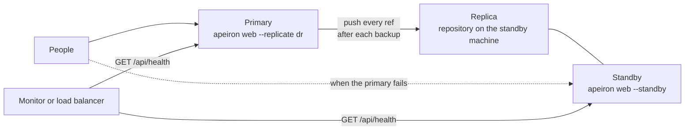

> **Türkçe:** [REPLICATION.tr.md](REPLICATION.tr.md)

# Replication and High Availability

> **Status: Done.** This is the design of Stage 5 work item 3 ([ROADMAP.md](ROADMAP.md) §7): every backup of a server is also kept on a second place, the replica, soon after it is made, and a second server, the standby, can take the place of the first when it fails. The decision behind it is ADR-033 ([DECISIONS.md](DECISIONS.md)).

A backup server that holds an organization's only copy is itself a risk: a broken disk, a fire or a stolen machine takes every backup with it. A server that is down for maintenance also leaves people without their files until it is back.

## 1. The pieces

| Piece | What it is | How it is kept |
| --- | --- | --- |
| Primary | The server people back up to | As before |
| Replica | A remote copy of the primary's repository ([FORMAT.md](FORMAT.md) §15): a folder, SFTP or S3 | The primary pushes every ref to it after each backup (§4), or a scheduled job does (§3) |
| Standby | A second web server that serves a replica | Started with `--standby`: everything works but backups (§5) |



The replica is a complete repository, with the same id, keys and objects: a backup can be restored from it directly, and it holds only encrypted data when the repository is encrypted. An SFTP or S3 replica needs an encrypted repository (FORMAT.md §15.1).

## 2. Every ref at once

Push and pull move one ref; a replica needs all of them. `apeiron push --all <remote>` pushes every ref of the repository and `apeiron pull --all <remote>` pulls every ref of the remote (FORMAT.md §15.7). The remote's index is read once for all refs, and an object copied for one ref is not copied again for the next.

| Case | What happens |
| --- | --- |
| A ref is new, behind or equal | Copied or left as it is, as for one ref |
| The other side has snapshots of a ref this copy does not | That ref is left, reported as a conflict, and the others are still copied; exit code 3 |
| Anything else fails, such as the network or a wrong repository | Everything stops, as for one ref; what was copied stays and the next run continues |

A ref deleted on the primary is not deleted on the replica: deleting is left to the people who look after the replica, so a mistake on the primary cannot empty it.

## 3. Scheduled

The background service ([DAEMON.md](DAEMON.md)) keeps a replica or a standby with `ref = "*"`, which names every ref:

```toml
[job.replica]
repo = "/srv/apeiron/main"
do = "push"
ref = "*"
push = ["dr"]
every = "15m"

[job.standby]
repo = "/srv/apeiron/standby"
do = "pull"
remote = "origin"
ref = "*"
every = "15m"
```

A `pull` job is new: it pulls one ref (`main` when `ref` is left out) or every ref from `remote`. A conflict on a ref makes the run end with `warnings` and names the ref in the log.

## 4. From the web server

`apeiron web --replicate <remote>` (once per replica) pushes every ref to each named remote of the repository:

- right after each backup made in the pages succeeds;
- and every 30 seconds when the refs differ from those last pushed, which covers backups made by other programs and replicas that were unreachable.

A replica that does not answer is tried again in the next round; nothing waits for it. Each push is recorded in the audit log as `replicate` (§7); a failure that lasts is recorded once, not every round. For tenants ([TENANTS.md](TENANTS.md)) the replicas are set per tenant, with `"replicas": ["dr"]` in `tenants.json` or `apeiron web tenant add … --replicate dr`.

How far behind the replica can be is the time of one push after a backup; with a scheduled job instead, it is the job's period.

## 5. Standby and taking over

`apeiron web --standby` serves a repository, usually a replica, with every operation except backups, which are refused with a message pointing to the primary. People can sign in, browse, search, restore and share as usual. Because the primary pushes into the standby's repository while it runs, the standby shows new backups without a restart (the index is read again when it changes).

`GET /api/health` answers without signing in, for a monitor or a load balancer:

| Answer | Meaning |
| --- | --- |
| `200 {"ok": true, "role": "primary"}` | The repository can be read; backups are taken |
| `200 {"ok": true, "role": "standby"}` | The repository can be read; backups are refused |
| `503 {"ok": false, …}` | The repository cannot be read |

Taking over is a decision of the admin, not of the program:

1. Make sure the primary is really down, so two servers do not take backups at once.
2. Restart the standby without `--standby`, and with `--replicate` toward a new replica if there is one.
3. Point the address people use (DNS or the load balancer) to it.

When the old primary comes back, its pushes of a ref the new primary has moved past stop with a conflict and change nothing (FORMAT.md §15.5). It becomes the new standby by pulling every ref; a ref with snapshots made on it after the last push is reported as a conflict and kept, to be pushed under another name if it is still needed.

## 6. What a standby needs besides the repository

| Item | How |
| --- | --- |
| Users and identity provider (`web.json`), tenants (`tenants.json`) | Copied to the standby by the admin, for example with the configuration management already in use; they hold no backup data |
| Password of an encrypted repository | The same password opens the replica |
| Audit log | Each server keeps its own; the primary's stays on the primary |
| Share links | Each server keeps its own; links made on the primary do not work on the standby |

## 7. In the pages, the JSON API, the CLI and the audit log

| Where | What |
| --- | --- |
| `apeiron push --all <remote>`, `apeiron pull --all <remote>` | §2 |
| `apeiron web --replicate <remote>`, `apeiron web --standby` | §4 and §5 |
| `apeiron web tenant add … --replicate <remote>` | §4 |
| `do = "pull"`, `ref = "*"` in `jobs.toml` | §3 |
| `push_all`, `pull_all` (API.md §8) | §2, returning a `MirrorReport`: per ref the `TransferReport` or the conflict |
| `GET /api/health` | §5 |
| Audit event `replicate` | The remote, the number of refs and objects and the refs left by a conflict, or the error; outcome `ok`, `conflict` or the error's kind |

## 8. Not part of this work item

| Item | Where |
| --- | --- |
| Taking over without an admin | Not planned: deciding that the primary is down is where automatic systems make two primaries |
| Two primaries taking backups at once | Not planned; sync between devices (SYNC.md) is the tool for two writers |
| Copying the audit log and share links to the standby | Later, if a pilot needs it |
| Deleting refs on the replica that were deleted on the primary | Left to the admin of the replica (§2) |
| Garbage collection of a replica from the primary | Later; run `apeiron gc` on the replica's machine |

## 9. Crates

| Crate | Role | Status |
| --- | --- | --- |
| `apeiron-core` | Pushing and pulling every ref with one read of the remote's index | Done |
| `apeiron` | `push_all`, `pull_all`, `MirrorReport` | Done |
| `apeiron-daemon` | `do = "pull"`, `ref = "*"` | Done |
| `apeiron-server` | Pushing to replicas, standby, `/api/health` | Done |
| `apeiron-cli` | `--all`, `--replicate`, `--standby` | Done |
