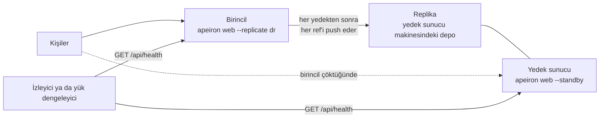

> **English:** [REPLICATION.md](REPLICATION.md)

# Replikasyon ve Yüksek Erişilebilirlik

> **Durum: Tamamlandı.** Aşama 5'in 3. işinin tasarımıdır ([ROADMAP.tr.md](ROADMAP.tr.md) §7): bir sunucunun her yedeği, alındıktan kısa süre sonra ikinci bir yerde, replikada da tutulur; ikinci bir sunucu, yedek sunucu (standby), ilki çöktüğünde onun yerini alabilir. Arkasındaki karar ADR-033'tür ([DECISIONS.tr.md](DECISIONS.tr.md)).

Bir kurumun tek kopyasını tutan bir yedek sunucusu kendisi bir risktir: bozulan bir disk, bir yangın ya da çalınan bir makine her yedeği de götürür. Bakım için kapalı olan bir sunucu da insanları, geri gelene kadar dosyalarından yoksun bırakır.

## 1. Parçalar

| Parça | Nedir | Nasıl güncel tutulur |
| --- | --- | --- |
| Birincil (primary) | İnsanların yedek aldığı sunucu | Eskisi gibi |
| Replika | Birincilin deposunun uzak bir kopyası ([FORMAT.tr.md](FORMAT.tr.md) §15): bir klasör, SFTP ya da S3 | Birincil her yedekten sonra her ref'i ona push eder (§4) ya da zamanlanmış bir iş eder (§3) |
| Yedek sunucu (standby) | Bir replikayı sunan ikinci bir web sunucusu | `--standby` ile başlatılır: yedek almak dışında her şey çalışır (§5) |



Replika, aynı kimlik, anahtarlar ve nesnelerle eksiksiz bir depodur: bir yedek doğrudan ondan geri yüklenebilir ve depo şifreliyse yalnızca şifreli veri tutar. Bir SFTP ya da S3 replikası şifreli bir depo ister (FORMAT.tr.md §15.1).

## 2. Her ref birden

Push ve pull tek bir ref'i taşır; bir replikanın hepsine ihtiyacı vardır. `apeiron push --all <uzak>` deponun her ref'ini push eder, `apeiron pull --all <uzak>` ise uzak deponun her ref'ini pull eder (FORMAT.tr.md §15.7). Uzak deponun indeksi tüm ref'ler için bir kez okunur ve bir ref için kopyalanan bir nesne sonraki için yeniden kopyalanmaz.

| Durum | Ne olur |
| --- | --- |
| Bir ref yeni, geride ya da eşit | Tek bir ref'teki gibi kopyalanır ya da olduğu gibi bırakılır |
| Öbür tarafta bir ref'in bu kopyada olmayan snapshot'ları var | O ref bırakılır, çatışma olarak bildirilir ve diğerleri yine kopyalanır; çıkış kodu 3 |
| Ağ ya da yanlış depo gibi başka bir şey başarısız olur | Tek bir ref'teki gibi her şey durur; kopyalanan kalır ve sonraki çalıştırma devam eder |

Birincilde silinen bir ref replikada silinmez: silmek replikayla ilgilenenlere bırakılır; böylece birincildeki bir hata onu boşaltamaz.

## 3. Zamanlanmış

Arka plan hizmeti ([DAEMON.tr.md](DAEMON.tr.md)), her ref'i adlandıran `ref = "*"` ile bir replikayı ya da yedek sunucuyu güncel tutar:

```toml
[job.replica]
repo = "/srv/apeiron/main"
do = "push"
ref = "*"
push = ["dr"]
every = "15m"

[job.standby]
repo = "/srv/apeiron/standby"
do = "pull"
remote = "origin"
ref = "*"
every = "15m"
```

`pull` işi yenidir: `remote` üzerinden bir ref'i (`ref` boş bırakılırsa `main`) ya da her ref'i pull eder. Bir ref'teki çatışma, çalıştırmayı `warnings` ile bitirir ve ref'i günlükte adlandırır.

## 4. Web sunucusundan

`apeiron web --replicate <uzak>` (her replika için bir kez), her ref'i deponun adlandırılan her uzak deposuna push eder:

- sayfalarda alınan her yedek başarılı olur olmaz;
- ve ref'ler en son push edilenlerden farklıyken her 30 saniyede bir; bu, başka programların aldığı yedekleri ve ulaşılamayan replikaları kapsar.

Yanıt vermeyen bir replika sonraki turda yeniden denenir; hiçbir şey onu beklemez. Her push denetim kaydına `replicate` olarak yazılır (§7); süren bir hata her turda değil, bir kez yazılır. Kiracılar ([TENANTS.tr.md](TENANTS.tr.md)) için replikalar kiracı başına, `tenants.json` içinde `"replicas": ["dr"]` ile ya da `apeiron web tenant add … --replicate dr` ile ayarlanır.

Replikanın ne kadar geride kalabileceği, bir yedekten sonraki tek bir push'un süresidir; bunun yerine zamanlanmış bir işle, işin aralığıdır.

## 5. Yedek sunucu ve görevi devralmak

`apeiron web --standby`, bir depoyu, genellikle bir replikayı, yedek almak dışındaki her işlemle sunar; yedek almak, birincili gösteren bir iletiyle reddedilir. Kişiler her zamanki gibi oturum açabilir, göz atabilir, arayabilir, geri yükleyebilir ve paylaşabilir. Birincil, yedek sunucu çalışırken onun deposuna push ettiği için yedek sunucu yeni yedekleri yeniden başlatılmadan gösterir (indeks değişince yeniden okunur).

`GET /api/health` bir izleyici ya da yük dengeleyici için oturum açmadan yanıt verir:

| Yanıt | Anlamı |
| --- | --- |
| `200 {"ok": true, "role": "primary"}` | Depo okunabiliyor; yedek alınıyor |
| `200 {"ok": true, "role": "standby"}` | Depo okunabiliyor; yedek reddediliyor |
| `503 {"ok": false, …}` | Depo okunamıyor |

Görevi devralmak programın değil, admin'in kararıdır:

1. İki sunucu aynı anda yedek almasın diye birincilin gerçekten kapalı olduğundan emin olun.
2. Yedek sunucuyu `--standby` olmadan, varsa yeni bir replikaya doğru `--replicate` ile yeniden başlatın.
3. Kişilerin kullandığı adresi (DNS ya da yük dengeleyici) ona yönlendirin.

Eski birincil geri geldiğinde, yeni birincilin ilerlediği bir ref'i push etmesi bir çatışmayla durur ve hiçbir şeyi değiştirmez (FORMAT.tr.md §15.5). Her ref'i pull ederek yeni yedek sunucu olur; son push'tan sonra onda alınmış snapshot'ları olan bir ref çatışma olarak bildirilir ve tutulur; hâlâ gerekiyorsa başka bir adla push edilir.

## 6. Yedek sunucunun depo dışında ihtiyaç duydukları

| Konu | Nasıl |
| --- | --- |
| Kullanıcılar ve kimlik sağlayıcısı (`web.json`), kiracılar (`tenants.json`) | Admin tarafından, örneğin zaten kullanılan yapılandırma yönetimiyle yedek sunucuya kopyalanır; yedek verisi tutmazlar |
| Şifreli bir deponun parolası | Aynı parola replikayı açar |
| Denetim kaydı | Her sunucu kendininkini tutar; birincilinki birincilde kalır |
| Paylaşım bağlantıları | Her sunucu kendininkini tutar; birincilde oluşturulan bağlantılar yedek sunucuda çalışmaz |

## 7. Sayfalarda, JSON API'de, CLI'da ve denetim kaydında

| Nerede | Ne |
| --- | --- |
| `apeiron push --all <uzak>`, `apeiron pull --all <uzak>` | §2 |
| `apeiron web --replicate <uzak>`, `apeiron web --standby` | §4 ve §5 |
| `apeiron web tenant add … --replicate <uzak>` | §4 |
| `jobs.toml` içinde `do = "pull"`, `ref = "*"` | §3 |
| `push_all`, `pull_all` (API.tr.md §8) | §2; bir `MirrorReport` döndürür: ref başına `TransferReport` ya da çatışma |
| `GET /api/health` | §5 |
| Denetim olayı `replicate` | Uzak depo, ref ve nesne sayısı ve bir çatışmanın bıraktığı ref'ler ya da hata; sonuç `ok`, `conflict` ya da hatanın türü |

## 8. Bu işin parçası olmayanlar

| Konu | Nerede |
| --- | --- |
| Admin olmadan görevi devralmak | Planlanmadı: birincilin kapalı olduğuna karar vermek, otomatik sistemlerin iki birincil oluşturduğu yerdir |
| Aynı anda yedek alan iki birincil | Planlanmadı; iki yazar için araç cihazlar arası senkrondur (SYNC.tr.md) |
| Denetim kaydını ve paylaşım bağlantılarını yedek sunucuya kopyalamak | Sonra, bir pilot gerektirirse |
| Birincilde silinen ref'leri replikada silmek | Replikanın admin'ine bırakılır (§2) |
| Bir replikanın çöp toplamasını birincilden yapmak | Sonra; `apeiron gc` replikanın makinesinde çalıştırılır |

## 9. Crate'ler

| Crate | Görevi | Durum |
| --- | --- | --- |
| `apeiron-core` | Uzak deponun indeksini bir kez okuyarak her ref'i push ve pull etmek | Tamamlandı |
| `apeiron` | `push_all`, `pull_all`, `MirrorReport` | Tamamlandı |
| `apeiron-daemon` | `do = "pull"`, `ref = "*"` | Tamamlandı |
| `apeiron-server` | Replikalara push etmek, yedek sunucu, `/api/health` | Tamamlandı |
| `apeiron-cli` | `--all`, `--replicate`, `--standby` | Tamamlandı |
