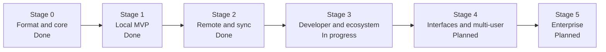

> **Türkçe:** [ROADMAP.tr.md](ROADMAP.tr.md)

# Apeiron Roadmap

The expensive decisions (format, object model, API and plugin boundary) are made in Stage 0; everything else is built on top of that foundation. Every stage leaves a product that is usable on its own. The stages and exit criteria come from [VISION.md](VISION.md).

**Current stage: Stage 3 — Developer and ecosystem (In progress).** Stage 0 and Stage 1 were completed on 2026-10-28 and Stage 2 on 2026-10-29; the one-month tests of Stage 1 and Stage 2 were skipped by the owner's decision.

## 1. Overview

| Stage | Scope | Exit criterion | Status |
| --- | --- | --- | --- |
| 0. Format and core | Object model and format specification, storage engine, integrity verification, Rust API draft | Specification written; no data loss in power-failure tests | Done |
| 1. Local MVP | CLI; taking snapshots, history, file-level diff, restore, verification; local and external disk backup targets; tar, zip and 7z export | Backing up and restoring your own data with nothing but Apeiron for one month | Done (one-month test skipped) |
| 2. Remote and sync | Background service, scheduled backup, encryption, SFTP and S3 targets, one-/two-way sync, conflict detection, restore test | One month of trouble-free sync between two devices and a remote server | Done (one-month test skipped) |
| 3. Developer and ecosystem | Branching and merging, Git import/export (goal: Git network protocol), C ABI and Python SDK, WebAssembly plugin system, text diff plugin, search | A real Git repository can be moved into Apeiron and back | In progress |
| 4. Interfaces and multi-user | Desktop and web interface, users and permissions, audit log, sharing | A non-technical user can back up and restore without the CLI | Planned |
| 5. Enterprise | Central identity, multi-tenant use, replication, high availability, immutable archive, compliance reports | First enterprise pilot installation | Planned |

## 2. Stage 0 — Format and core

**Exit criterion:** Specification written; no data loss in power-failure tests.

| # | Work item | Status | Notes |
| --- | --- | --- | --- |
| 1 | Storage format specification ([FORMAT.md](FORMAT.md)) | Done | Version 1 approved on 2026-10-27 |
| 2 | Cargo workspace skeleton and CI (fmt, clippy, test) | Done | Linux x86_64/aarch64, macOS, Windows |
| 3 | Storage engine: chunk write/read, BLAKE3 verification, atomic ref update | Done | Packs, indexes, refs and reflogs in `apeiron-core` |
| 4 | Canonical CBOR encoding of blob, tree and snapshot ([FORMAT.md](FORMAT.md) §6) | Done | With `minicbor`; non-canonical objects are rejected |
| 5 | Power-failure and corruption tests ([FORMAT.md](FORMAT.md) §10) | Done | A crash and a full disk are simulated at every change to the disk; a bit flip is tested at every byte of a pack |
| 6 | Rust API draft | Done | [API.md](API.md) §8, implemented in `apeiron-core`; the separate `apeiron` crate comes with the CLI |

On Windows, renames use `MOVEFILE_WRITE_THROUGH` ([FORMAT.md](FORMAT.md) §9.1) through the small `apeiron-sys` crate ([ADR-014](DECISIONS.md#adr-014-a-small-system-crate-for-unsafe-os-calls)).

## 3. Stage 1 — Local MVP

**Exit criterion:** Backing up and restoring your own data with nothing but Apeiron for one month.

| Work item | Status |
| --- | --- |
| CLI (all operations, JSON output, progress, cancellation) | Done |
| Taking snapshots, history, file-level diff | Done |
| Restore and verification (scrub) | Done |
| Local and external disk backup targets | Done |
| tar, zip and 7z export | Done |
| Garbage collection, repository locks, pack merging | Done |
| Opening a repository with a damaged index by rebuilding it from the packs | Done |

## 4. Stage 2 — Remote and sync

**Exit criterion:** One month of trouble-free sync between two devices and a remote server.

The work items are done in this order, because each builds on the one before: remote targets must only ever receive encrypted data, and the background service schedules what the earlier items provide.

| # | Work item | Status |
| --- | --- | --- |
| 1 | Client-side encryption ([FORMAT.md](FORMAT.md) §14) | Done |
| 2 | Remote targets (folder, SFTP, S3) with push and pull ([FORMAT.md](FORMAT.md) §15) | Done |
| 3 | Background service (daemon), scheduled backup, restore test ([DAEMON.md](DAEMON.md)) | Done |
| 4 | One-way and two-way sync, conflict detection ([SYNC.md](SYNC.md)) | Done |

## 5. Stage 3 — Developer and ecosystem

**Exit criterion:** A real Git repository can be moved into Apeiron and back.

The exit criterion comes first; it was met on 2026-10-29 with item 1, and the stage goes on with the other items. The plugin system comes before the text diff plugin, which is its first user.

| # | Work item | Status |
| --- | --- | --- |
| 1 | Git import/export ([GIT.md](GIT.md); the Git network protocol remains a goal) | Done |
| 2 | Branching and merging ([BRANCH.md](BRANCH.md)) | Done |
| 3 | Search ([SEARCH.md](SEARCH.md)) | Done |
| 4 | C ABI and Python SDK | Planned |
| 5 | WebAssembly plugin system | Planned |
| 6 | Text diff plugin | Planned |

## 6. Stage 4 — Interfaces and multi-user

**Exit criterion:** A non-technical user can back up and restore without the CLI.

| Work item | Status |
| --- | --- |
| Desktop interface | Planned |
| Web interface | Planned |
| Users and permissions | Planned |
| Audit log | Planned |
| Sharing | Planned |

## 7. Stage 5 — Enterprise

**Exit criterion:** First enterprise pilot installation.

| Work item | Status |
| --- | --- |
| Central identity | Planned |
| Multi-tenant use | Planned |
| Replication and high availability | Planned |
| Immutable archive | Planned |
| Compliance reports | Planned |
