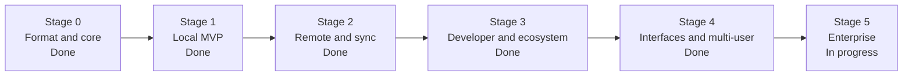

> **Türkçe:** [ROADMAP.tr.md](ROADMAP.tr.md)

# Apeiron Roadmap

The expensive decisions (format, object model, API and plugin boundary) are made in Stage 0; everything else is built on top of that foundation. Every stage leaves a product that is usable on its own. The stages and exit criteria come from [VISION.md](VISION.md).

**Current stage: Stage 5 — Enterprise (In progress).** Stage 0 and Stage 1 were completed on 2026-10-28, Stage 2 and Stage 3 on 2026-10-29, Stage 4 on 2026-10-30; the one-month tests of Stage 1 and Stage 2 were skipped by the owner's decision.

## 1. Overview

| Stage | Scope | Exit criterion | Status |
| --- | --- | --- | --- |
| 0. Format and core | Object model and format specification, storage engine, integrity verification, Rust API draft | Specification written; no data loss in power-failure tests | Done |
| 1. Local MVP | CLI; taking snapshots, history, file-level diff, restore, verification; local and external disk backup targets; tar, zip and 7z export | Backing up and restoring your own data with nothing but Apeiron for one month | Done (one-month test skipped) |
| 2. Remote and sync | Background service, scheduled backup, encryption, SFTP and S3 targets, one-/two-way sync, conflict detection, restore test | One month of trouble-free sync between two devices and a remote server | Done (one-month test skipped) |
| 3. Developer and ecosystem | Branching and merging, Git import/export (goal: Git network protocol), C ABI and Python SDK, WebAssembly plugin system, text diff plugin, search | A real Git repository can be moved into Apeiron and back | Done |
| 4. Interfaces and multi-user | Desktop and web interface, users and permissions, audit log, sharing | A non-technical user can back up and restore without the CLI | Done (installing still needs a terminal until the first release brings installers) |
| 5. Enterprise | Central identity, multi-tenant use, replication, high availability, immutable archive, compliance reports | First enterprise pilot installation | In progress |

## 2. Stage 0 — Format and core

**Exit criterion:** Specification written; no data loss in power-failure tests.

| # | Work item | Status | Notes |
| --- | --- | --- | --- |
| 1 | Storage format specification ([FORMAT.md](FORMAT.md)) | Done | Version 1 approved on 2026-10-27 |
| 2 | Cargo workspace skeleton and CI (fmt, clippy, test) | Done | Linux x86_64/aarch64, macOS, Windows |
| 3 | Storage engine: chunk write/read, BLAKE3 verification, atomic ref update | Done | Packs, indexes, refs and reflogs in `apeiron-core` |
| 4 | Canonical CBOR encoding of blob, tree and snapshot ([FORMAT.md](FORMAT.md) §6) | Done | With `minicbor`; non-canonical objects are rejected |
| 5 | Power-failure and corruption tests ([FORMAT.md](FORMAT.md) §10) | Done | A crash and a full disk are simulated at every change to the disk; a bit flip is tested at every byte of a pack |
| 6 | Rust API draft | Done | [API.md](API.md) §8, implemented in `apeiron-core`; the separate `apeiron` crate followed with the CLI in Stage 1 |

On Windows, renames use `MOVEFILE_WRITE_THROUGH` ([FORMAT.md](FORMAT.md) §9.1) through the small `apeiron-sys` crate ([ADR-014](DECISIONS.md#adr-014-a-small-system-crate-for-unsafe-os-calls)).

## 3. Stage 1 — Local MVP

**Exit criterion:** Backing up and restoring your own data with nothing but Apeiron for one month.

| Work item | Status |
| --- | --- |
| CLI (all operations, JSON output, progress, cancellation) | Done |
| Taking snapshots, history, file-level diff | Done |
| Restore and verification (scrub) | Done |
| Local and external disk backup targets | Done |
| tar, zip and 7z export | Done |
| Garbage collection, repository locks, pack merging | Done |
| Opening a repository with a damaged index by rebuilding it from the packs | Done |

## 4. Stage 2 — Remote and sync

**Exit criterion:** One month of trouble-free sync between two devices and a remote server.

The work items are done in this order, because each builds on the one before: remote targets must only ever receive encrypted data, and the background service schedules what the earlier items provide.

| # | Work item | Status |
| --- | --- | --- |
| 1 | Client-side encryption ([FORMAT.md](FORMAT.md) §14) | Done |
| 2 | Remote targets (folder, SFTP, S3) with push and pull ([FORMAT.md](FORMAT.md) §15) | Done |
| 3 | Background service (daemon), scheduled backup, restore test ([DAEMON.md](DAEMON.md)) | Done |
| 4 | One-way and two-way sync, conflict detection ([SYNC.md](SYNC.md)) | Done |

## 5. Stage 3 — Developer and ecosystem

**Exit criterion:** A real Git repository can be moved into Apeiron and back.

The exit criterion came first; it was met on 2026-10-29 with item 1, and the stage was completed the same day with the other items. The plugin system comes before the text diff plugin, which is its first user.

| # | Work item | Status |
| --- | --- | --- |
| 1 | Git import/export ([GIT.md](GIT.md); clone, fetch and push over HTTP from `apeiron web` in §7 there; SSH remains a goal) | Done |
| 2 | Branching and merging ([BRANCH.md](BRANCH.md)) | Done |
| 3 | Search ([SEARCH.md](SEARCH.md)) | Done |
| 4 | C ABI and Python SDK ([SDK.md](SDK.md)) | Done |
| 5 | WebAssembly plugin system ([PLUGIN.md](PLUGIN.md)) | Done |
| 6 | Text diff plugin ([TEXT.md](TEXT.md)) | Done |

## 6. Stage 4 — Interfaces and multi-user

**Exit criterion:** A non-technical user can back up and restore without the CLI.

The desktop interface comes first, because it alone meets the exit criterion; the web interface reuses its pages; users and permissions come before the audit log and sharing, which record and use them.

| # | Work item | Status |
| --- | --- | --- |
| 1 | Desktop interface ([DESKTOP.md](DESKTOP.md)) | Done |
| 2 | Web interface ([WEB.md](WEB.md)) | Done |
| 3 | Users and permissions ([USERS.md](USERS.md)) | Done |
| 4 | Audit log ([AUDIT.md](AUDIT.md)) | Done |
| 5 | Sharing ([SHARE.md](SHARE.md)) | Done |

## 7. Stage 5 — Enterprise

**Exit criterion:** First enterprise pilot installation.

Central identity comes first, because a pilot organization signs its people in through its own identity provider before anything else.

| # | Work item | Status |
| --- | --- | --- |
| 1 | Central identity ([IDENTITY.md](IDENTITY.md)) | Done |
| 2 | Multi-tenant use ([TENANTS.md](TENANTS.md)) | Done |
| 3 | Replication and high availability ([REPLICATION.md](REPLICATION.md)) | Done |
| 4 | Immutable archive ([ARCHIVE.md](ARCHIVE.md)) | Done |
| 5 | Compliance reports ([REPORTS.md](REPORTS.md)) | Done |

Every work item is done (2026-10-30); the stage ends with its exit criterion, the first enterprise pilot installation.

## 8. Not written yet

[VISION.md](VISION.md) and the other documents ask for these, and no stage above delivered them. Their order is the owner's decision; none of them is scheduled.

| Need | Asked for in | What happens today |
| --- | --- | --- |
| Measuring the performance targets on a Raspberry Pi 4 | [VISION.md](VISION.md), [API.md](API.md) §4 | Measured on a stronger computer ([PERFORMANCE.md](PERFORMANCE.md)); it needs the device |
| Operation log | [ARCHITECTURE.md](ARCHITECTURE.md) §2 | Reflogs record ref changes; nothing records other operations outside the web interface |
| Remote mode of the API and operating the daemon from another device | [API.md](API.md) §2, [DAEMON.md](DAEMON.md) §7 | Only the JSON API of the pages; a tenant's jobs on the Schedule page |
| Git behind the plugin interface; other plugin types and a plugin store | [DECISIONS.md](DECISIONS.md) ADR-021, [PLUGIN.md](PLUGIN.md) §6 | `apeiron-git` is a crate of its own; plugins are type drivers only |
| Text inside PDF and office files; tags on macOS and Windows; more standards in reports | [SEARCH.md](SEARCH.md) §7, [REPORTS.md](REPORTS.md) §6 | UTF-8 text only; tags on Linux only; ISO/IEC 27001 only |
| The C++ SDK, streaming through the C ABI | [SDK.md](SDK.md) §1, §7 | Python SDK over the C ABI, with the library built with Cargo |
| Review, approval and comments | [VISION.md](VISION.md) | Not written |
| Format upgrade tool | [FORMAT.md](FORMAT.md) §18 | The format is at version 1 |
| Git over SSH, SAML, sync without a remote, Let's Encrypt, installers and the first release | [GIT.md](GIT.md) §8, [IDENTITY.md](IDENTITY.md) §6, [SYNC.md](SYNC.md) §7, [WEB.md](WEB.md) §6, [DESKTOP.md](DESKTOP.md) §5 | Git over HTTP, OpenID Connect, sync through a remote, a TLS proxy, building from source |
