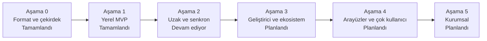

> **English:** [ROADMAP.md](ROADMAP.md)

# Apeiron Yol Haritası

Pahalı kararlar (format, nesne modeli, API ve eklenti sınırı) Aşama 0'da verilir; geri kalan her şey bu temelin üstüne kurulur. Her aşama kendi başına kullanılabilir bir ürün bırakır. Aşamalar ve çıkış kriterleri [VISION.tr.md](VISION.tr.md) belgesinden alınmıştır.

**Şu anki aşama: Aşama 2 — Uzak ve senkron (Devam ediyor).** Aşama 0 ve Aşama 1, 2026-10-28'de tamamlandı; Aşama 1'in bir aylık denemesi proje sahibinin kararıyla atlandı.

## 1. Genel bakış

| Aşama | Kapsam | Çıkış kriteri | Durum |
| --- | --- | --- | --- |
| 0. Format ve çekirdek | Nesne modeli ve format spesifikasyonu, depolama motoru, bütünlük doğrulama, Rust API taslağı | Spesifikasyon yazılı; güç kesintisi testlerinde veri kaybı yok | Tamamlandı |
| 1. Yerel MVP | CLI; snapshot alma, geçmiş, dosya düzeyi diff, geri yükleme, doğrulama; yerel ve harici disk yedek hedefi; tar, zip ve 7z dışa aktarma | Kendi verini bir ay boyunca yalnızca Apeiron ile yedekleyip geri yükleyebilmek | Tamamlandı (bir aylık deneme atlandı) |
| 2. Uzak ve senkron | Arka plan hizmeti, zamanlanmış yedek, şifreleme, SFTP ve S3 hedefleri, tek/çift yönlü senkron, çatışma tespiti, geri yükleme testi | İki cihaz ve bir uzak sunucu arasında bir ay sorunsuz senkron | Devam ediyor |
| 3. Geliştirici ve ekosistem | Dal ve birleştirme, Git içe/dışa aktarma (hedef: Git ağ protokolü), C ABI ve Python SDK, WebAssembly eklenti sistemi, metin diff eklentisi, arama | Gerçek bir Git deposu Apeiron'a taşınıp geri alınabiliyor | Planlandı |
| 4. Arayüzler ve çok kullanıcı | Masaüstü ve web arayüzü, kullanıcı ve izinler, denetim kaydı, paylaşım | Teknik olmayan bir kullanıcı CLI'sız yedek alıp geri yükleyebiliyor | Planlandı |
| 5. Kurumsal | Merkezi kimlik, çok kiracılı kullanım, replikasyon, yüksek erişilebilirlik, değiştirilemez arşiv, uyumluluk raporları | İlk kurumsal pilot kurulum | Planlandı |

## 2. Aşama 0 — Format ve çekirdek

**Çıkış kriteri:** Spesifikasyon yazılı; güç kesintisi testlerinde veri kaybı yok.

| # | İş | Durum | Not |
| --- | --- | --- | --- |
| 1 | Depolama formatı spesifikasyonu ([FORMAT.tr.md](FORMAT.tr.md)) | Tamamlandı | Sürüm 1, 2026-10-27'de onaylandı |
| 2 | Cargo workspace iskeleti ve CI (fmt, clippy, test) | Tamamlandı | Linux x86_64/aarch64, macOS, Windows |
| 3 | Depolama motoru: chunk yazma/okuma, BLAKE3 doğrulama, atomik ref güncelleme | Tamamlandı | `apeiron-core` içinde paketler, indeksler, ref'ler ve reflog'lar |
| 4 | Blob, tree ve snapshot'ın kanonik CBOR kodlaması ([FORMAT.tr.md](FORMAT.tr.md) §6) | Tamamlandı | `minicbor` ile; kanonik olmayan nesneler reddedilir |
| 5 | Güç kesintisi ve bozulma testleri ([FORMAT.tr.md](FORMAT.tr.md) §10) | Tamamlandı | Diskteki her değişiklikte çökme ve disk dolması taklit edilir; bit bozulması bir paketin her baytında denenir |
| 6 | Rust API taslağı | Tamamlandı | [API.tr.md](API.tr.md) §8, `apeiron-core` içinde uygulandı; ayrı `apeiron` crate'i CLI ile gelecek |

Windows'ta yeniden adlandırmalar küçük `apeiron-sys` crate'i üzerinden `MOVEFILE_WRITE_THROUGH` kullanır ([FORMAT.tr.md](FORMAT.tr.md) §9.1, [ADR-014](DECISIONS.tr.md#adr-014-güvensiz-sistem-çağrıları-için-küçük-bir-sistem-cratei)).

## 3. Aşama 1 — Yerel MVP

**Çıkış kriteri:** Kendi verini bir ay boyunca yalnızca Apeiron ile yedekleyip geri yükleyebilmek.

| İş | Durum |
| --- | --- |
| CLI (tüm işlemler, JSON çıktı, ilerleme, iptal) | Tamamlandı |
| Snapshot alma, geçmiş, dosya düzeyi diff | Tamamlandı |
| Geri yükleme ve doğrulama (scrub) | Tamamlandı |
| Yerel ve harici disk yedek hedefleri | Tamamlandı |
| tar, zip ve 7z dışa aktarma | Tamamlandı |
| Çöp toplama, depo kilitleri, paket birleştirme | Tamamlandı |
| İndeksi bozuk bir depoyu, indeksi paketlerden yeniden üreterek açmak | Tamamlandı |

## 4. Aşama 2 — Uzak ve senkron

**Çıkış kriteri:** İki cihaz ve bir uzak sunucu arasında bir ay sorunsuz senkron.

İşler bu sırayla yapılır, çünkü her biri bir öncekinin üzerine kurulur: uzak hedefler yalnızca şifreli veri almalıdır ve arka plan hizmeti önceki işlerin sağladıklarını zamanlar.

| # | İş | Durum |
| --- | --- | --- |
| 1 | İstemci tarafı şifreleme ([FORMAT.tr.md](FORMAT.tr.md) §14) | Tamamlandı |
| 2 | Uzak hedefler (klasör, SFTP, S3), push ve pull ile ([FORMAT.tr.md](FORMAT.tr.md) §15) | Tamamlandı |
| 3 | Arka plan hizmeti (daemon), zamanlanmış yedek, geri yükleme testi | Planlandı |
| 4 | Tek ve çift yönlü senkron, çatışma tespiti | Planlandı |

## 5. Aşama 3 — Geliştirici ve ekosistem

**Çıkış kriteri:** Gerçek bir Git deposu Apeiron'a taşınıp geri alınabiliyor.

| İş | Durum |
| --- | --- |
| Dal ve birleştirme | Planlandı |
| Git içe/dışa aktarma (hedef: Git ağ protokolü) | Planlandı |
| C ABI ve Python SDK | Planlandı |
| WebAssembly eklenti sistemi | Planlandı |
| Metin diff eklentisi | Planlandı |
| Arama | Planlandı |

## 6. Aşama 4 — Arayüzler ve çok kullanıcı

**Çıkış kriteri:** Teknik olmayan bir kullanıcı CLI'sız yedek alıp geri yükleyebiliyor.

| İş | Durum |
| --- | --- |
| Masaüstü arayüzü | Planlandı |
| Web arayüzü | Planlandı |
| Kullanıcılar ve izinler | Planlandı |
| Denetim kaydı | Planlandı |
| Paylaşım | Planlandı |

## 7. Aşama 5 — Kurumsal

**Çıkış kriteri:** İlk kurumsal pilot kurulum.

| İş | Durum |
| --- | --- |
| Merkezi kimlik | Planlandı |
| Çok kiracılı kullanım | Planlandı |
| Replikasyon ve yüksek erişilebilirlik | Planlandı |
| Değiştirilemez arşiv | Planlandı |
| Uyumluluk raporları | Planlandı |
