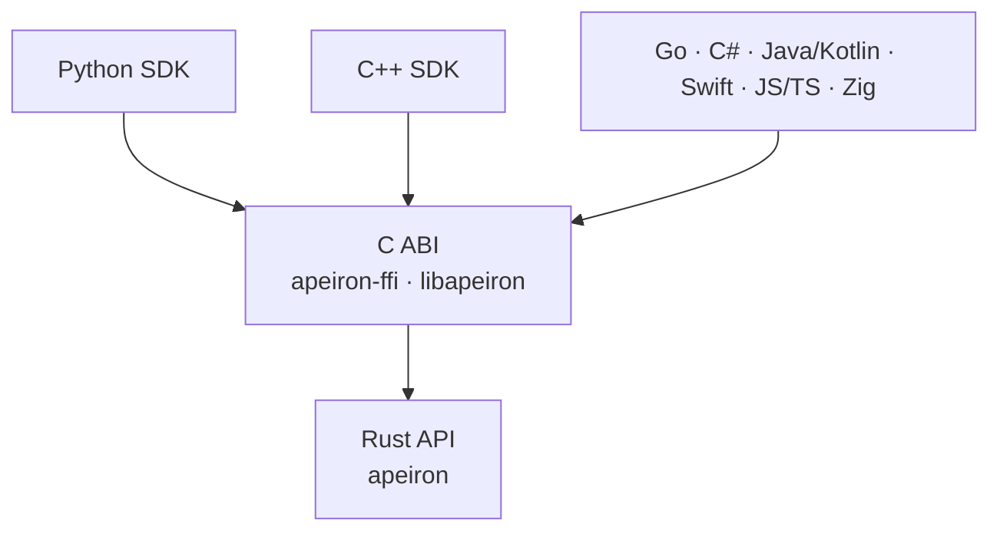

> **Türkçe:** [SDK.tr.md](SDK.tr.md)

# Apeiron C ABI and SDKs

> **Status: Draft for review.** Nothing in this document is implemented yet; the C ABI and the first SDKs are planned for Stage 3 ([ROADMAP.md](ROADMAP.md)). The design is written now so that the Rust API ([API.md](API.md) §8) is shaped for it from the start.

Apeiron is used from many languages through one C interface (the C ABI). Every SDK is a thin layer over that interface; none of them re-implements Apeiron's logic. That way the same operation gives the same result in every language.

## 1. Layers



| Part | Role | Status |
| --- | --- | --- |
| `apeiron-ffi` | Builds `libapeiron` (shared and static library) and the C header `apeiron.h` | Planned (Stage 3) |
| JSON schemas | Machine-readable description of every request, result, progress and error value | Planned (Stage 3) |
| SDKs | Idiomatic wrappers in each language, generated in part from the schemas | Planned (Stage 3 onward) |

## 2. C ABI design

The ABI is deliberately small: a handful of functions that never change, while the operations and their values are described as JSON ([ADR-015](DECISIONS.md#adr-015-json-values-at-the-c-abi-boundary)).

| Rule | Description |
| --- | --- |
| Names | Every symbol starts with `apeiron_`; types are opaque structs (`apeiron_repo`, `apeiron_job`) |
| Status codes | Every function returns an `int32_t`: `0` for success, otherwise the error code of [API.md](API.md) §8.6. `-1` (`APEIRON_PENDING`) means "not finished yet" |
| Error details | After a failure, `apeiron_last_error()` returns the error of the calling thread as JSON: code, kind, message, path |
| Values as JSON | Requests and results are UTF-8 JSON strings in the form of [API.md](API.md) §8.7 |
| Input strings | `const char*`, NUL-terminated UTF-8, borrowed only for the duration of the call |
| Output strings | Written to a `char**` out-parameter; owned by the caller and freed with `apeiron_string_free` |
| Handles | Created by `_open`/`_start` functions and released with the matching `_free` function; using a freed handle is not allowed |
| Threads | Repository handles can be used from several threads at once; a job handle from one thread at a time |
| No panics | A panic inside Apeiron never crosses the boundary; it becomes error code 11 (`Internal`) |
| Version check | `apeiron_abi_version()` returns the ABI version; an SDK refuses to load a library with a different major version |

### 2.1 Functions

| Function | What it does |
| --- | --- |
| `apeiron_abi_version()` | ABI version as `major << 16 \| minor` |
| `apeiron_repo_init(path, &repo)` | Creates a repository and opens it |
| `apeiron_repo_open(path, &repo)` | Opens a repository |
| `apeiron_repo_free(repo)` | Closes a repository handle |
| `apeiron_call(repo, operation, request_json, &result_json)` | Runs a short operation (`log`, `list`, `diff`, `refs`, `reflog`, `resolve`, `delete_ref`, `repair`, `info`) |
| `apeiron_start(repo, operation, request_json, &job)` | Starts a long operation (`backup`, `restore`, `export`, `verify`) |
| `apeiron_job_progress(job, &progress_json)` | Reads the current progress |
| `apeiron_job_cancel(job)` | Asks the job to stop |
| `apeiron_job_wait(job, timeout_ms, &result_json)` | Waits for the result; returns `APEIRON_PENDING` if the timeout passes first (`-1` waits forever) |
| `apeiron_job_free(job)` | Releases a job; a running job is cancelled first |
| `apeiron_last_error()` | Error of the last failed call on this thread, as JSON |
| `apeiron_string_free(s)` | Frees a string returned by the library |

The header is generated from the Rust code with `cbindgen` and checked in CI, so it can never drift from the library.

### 2.2 Example in C

```c
apeiron_repo *repo = NULL;
if (apeiron_repo_open("/mnt/backup/apeiron", &repo) != 0) {
    fprintf(stderr, "%s\n", apeiron_last_error());
    return 1;
}
apeiron_job *job = NULL;
apeiron_start(repo, "backup",
              "{\"source\": \"/home/ada/Documents\", \"ref\": \"main\"}", &job);
char *result = NULL;
while (apeiron_job_wait(job, 200, &result) == APEIRON_PENDING) {
    char *progress = NULL;
    apeiron_job_progress(job, &progress);
    puts(progress);
    apeiron_string_free(progress);
}
puts(result);
apeiron_string_free(result);
apeiron_job_free(job);
apeiron_repo_free(repo);
```

## 3. Schemas

Every value that crosses the ABI is described by a JSON Schema generated from the Rust types and checked into the repository. SDKs generate their typed classes from these schemas instead of writing them by hand. A schema change that is not additive raises the minor version of the API before 1.0 and the major version after it ([API.md](API.md) §6).

## 4. SDK rules

| Rule | Description |
| --- | --- |
| No logic of their own | An SDK only converts values and calls the C ABI |
| Idiomatic | Each SDK follows its language's habits: exceptions per error kind in Python and C++, context managers in Python, RAII in C++ |
| Typed | Requests and results are typed classes generated from the schemas; raw JSON is never needed |
| Jobs | Every SDK offers `progress()`, `cancel()` and `wait()` with a timeout, plus a convenience that reports progress through the language's own mechanism (iterator, callback, event) on top of polling |
| Packaging | Each SDK ships the native library inside its normal package (Python wheel, CMake package, …) for Linux, macOS and Windows |
| Same tests | Every SDK passes the shared conformance suite (section 6) |

## 5. SDK waves

| Wave | Languages | Status |
| --- | --- | --- |
| First | Rust (the `apeiron` crate itself), C (the ABI), Python, C++ | Planned (Stage 3) |
| Next | Go, C#, Java/Kotlin, Swift, JavaScript/TypeScript, Zig | Planned |

### 5.1 Example in Python

```python
import apeiron

with apeiron.Repository.open("/mnt/backup/apeiron") as repo:
    job = repo.backup(source="/home/ada/Documents", ref="main")
    for progress in job.watch(interval=0.2):
        print(progress.items_done, progress.bytes_done)
    report = job.result()
    print(report.snapshot)
```

## 6. Conformance suite

| Part | Description | Status |
| --- | --- | --- |
| Scenarios | JSON files that list operations, requests and expected results (for example: back up a fixture folder, list it, restore it, compare) | Planned (Stage 3) |
| Runners | A small runner per SDK that executes every scenario through that SDK | Planned (Stage 3) |
| CI | Every SDK runs every scenario on Linux, macOS and Windows; a difference between languages fails the build | Planned (Stage 3) |

## 7. Limits of the first version

| Limit | Plan |
| --- | --- |
| File content does not pass through the ABI; operations work on paths | Streaming read and write handles in a later ABI minor version |
| No remote mode | The same JSON values will be sent to the background service (Stage 2) |
