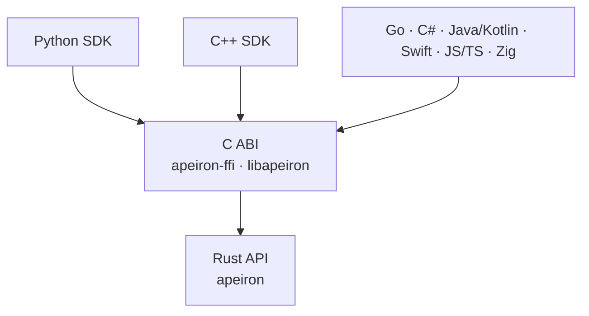

> **Türkçe:** [SDK.tr.md](SDK.tr.md)

# Apeiron C ABI and SDKs

> **Status: In progress.** Stage 3 work item 4 ([ROADMAP.md](ROADMAP.md) §5) is done: the C ABI, the Python SDK and the shared conformance suite. The JSON schemas and file content as a stream are done; the C++ SDK and the SDKs of the next wave come later. The decisions behind it are ADR-015, ADR-016 and ADR-024 ([DECISIONS.md](DECISIONS.md)).

Apeiron is used from many languages through one C interface (the C ABI). Every SDK is a thin layer over that interface; none of them re-implements Apeiron's logic. That way the same operation gives the same result in every language.

## 1. Layers



| Part | Role | Status |
| --- | --- | --- |
| `apeiron-ffi` | Builds `libapeiron` (shared and static library); its C header is `crates/apeiron-ffi/include/apeiron.h` | Done |
| Python SDK | `sdk/python`, over the C ABI with `ctypes` | Done |
| Conformance suite | `sdk/conformance`, run through the C ABI from Rust and through Python (section 6) | Done |
| JSON schemas | `sdk/schema/apeiron.schema.json`: machine-readable description of every request, result, progress and error value (section 3) | Done |
| Other SDKs | Idiomatic wrappers in each language, generated in part from the schemas | Planned |

## 2. C ABI design

The ABI is deliberately small: a handful of functions that never change, while the operations and their values are described as JSON ([ADR-015](DECISIONS.md#adr-015-json-values-at-the-c-abi-boundary)).

| Rule | Description |
| --- | --- |
| Names | Every symbol starts with `apeiron_`; types are opaque structs (`apeiron_repo`, `apeiron_job`) |
| Status codes | Every function returns an `int32_t`: `0` for success, otherwise the error code of [API.md](API.md) §8.6. `-1` (`APEIRON_PENDING`) means "not finished yet" |
| Error details | After a failure, `apeiron_last_error()` returns the error of the calling thread as JSON: code, kind, message, path. The string belongs to the library and stays valid until the next failed call on that thread |
| Values as JSON | Requests and results are UTF-8 JSON strings in the form of [API.md](API.md) §8.7; a NULL request means `{}` |
| Input strings | `const char*`, NUL-terminated UTF-8, borrowed only for the duration of the call; NULL or invalid UTF-8 is the error `invalid_input` |
| Output strings | Written to a `char**` out-parameter; owned by the caller and freed with `apeiron_string_free`. An out-parameter is NULL whenever the call fails |
| Handles | Created by the `_init`, `_open`, `_unlock` and `_start` functions and released with the matching `_free` function; using a freed handle is not allowed, freeing NULL is |
| Threads | Repository handles can be used from several threads at once; a job, reader or writer handle from one thread at a time |
| No panics | A panic inside Apeiron never crosses the boundary; it becomes error code 11 (`Internal`) |
| Version check | `apeiron_abi_version()` returns the ABI version, now 0.2; an SDK refuses a library with another major version or an older minor version |

### 2.1 Functions

| Function | What it does |
| --- | --- |
| `apeiron_abi_version()` | ABI version as `major << 16 \| minor` |
| `apeiron_repo_init(path, &repo)` | Creates a repository and opens it |
| `apeiron_repo_init_encrypted(path, password, &repo, &recovery_key)` | Creates an encrypted repository, opens it and returns its recovery key |
| `apeiron_repo_open(path, &repo)` | Opens a repository |
| `apeiron_repo_unlock(path, secret, &repo)` | Opens a repository with a password or the recovery key |
| `apeiron_repo_free(repo)` | Closes a repository handle |
| `apeiron_call(repo, operation, request_json, &result_json)` | Runs a short operation: `info`, `resolve`, `log`, `list`, `diff`, `diff_text`, `duplicates`, `refs`, `reflog`, `create_ref`, `delete_ref`, `merge`, `cherry_pick`, `rebase`, `prune`, `repair`, `keys`, `add_password`, `add_recovery_key`, `remove_key`, `remotes`, `add_remote`, `remove_remote`, `retention`, `add_retention`, `holds`, `add_hold`, `lift_hold`; with or without a `repo`: `conflicts`, `resolve_conflict`, `plugins`, `plugin_add`, `plugin_remove`, `saved_searches`, `save_search`, `forget_search` |
| `apeiron_start(repo, operation, request_json, &job)` | Starts a long operation: `backup`, `restore`, `export`, `import_archive`, `verify`, `gc`, `gc_remote`, `push`, `pull`, `push_all`, `pull_all`, `report`, `repair_from`, `restore_test`, `search`, `sync`, `switch`, `git_import`, `git_export`, and `clone` with a NULL `repo` |
| `apeiron_job_progress(job, &progress_json)` | Reads the current progress |
| `apeiron_job_cancel(job)` | Asks the job to stop |
| `apeiron_job_wait(job, timeout_ms, &result_json)` | Waits for the result; returns `APEIRON_PENDING` if the timeout passes first (a negative timeout waits without limit). The result or the job's error is given once |
| `apeiron_job_free(job)` | Releases a job; a running job is cancelled first |
| `apeiron_reader_open(repo, request_json, &reader)` | Opens a file of a snapshot for reading (section 2.3) |
| `apeiron_reader_read(reader, buffer, capacity, &read)` | Reads the next bytes; `read` is 0 at the end of the file |
| `apeiron_reader_free(reader)` | Releases a reader |
| `apeiron_writer_open(repo, request_json, &writer)` | Starts adding a file to a backup (section 2.3) |
| `apeiron_writer_write(writer, data, length)` | Adds bytes to the file |
| `apeiron_writer_finish(writer, &result_json)` | Ends the file and stores it as a new snapshot |
| `apeiron_writer_free(writer)` | Releases a writer; if it was not finished, nothing is stored |
| `apeiron_last_error()` | Error of the last failed call on this thread, as JSON |
| `apeiron_string_free(s)` | Frees a string returned by the library |

The request of an operation is the request of [API.md](API.md) §8.3 as JSON. Operations that take plain values use these fields: `resolve` `{"spec"}`, `reflog` and `remove_remote` `{"name"}`, `add_password` `{"password"}`, `remove_key` `{"id"}`, `add_remote` `{"name", "url"}`, `plugins` `{"dir"}`, `plugin_add` `{"file", "dir"}`, `plugin_remove` `{"name", "dir"}`, `add_retention` `{"refs", "days"}`, `add_hold` `{"refs", "reason"}`, `lift_hold` `{"id", "reason"}`, `conflicts` `{"folder"}`, `resolve_conflict` `{"folder", "copy", "keep"}`, `saved_searches` `{"file"}`, `save_search` `{"name", "file"}` with the fields of `search`, `forget_search` `{"name", "file"}`, where `dir` and `file` may be left out for the user's plugin folder and searches file; the others take `{}`. An unknown operation is the error `unsupported`.

The header is generated from the Rust code with `cbindgen`; a test fails when the checked-in header differs, so it can never drift from the library.

### 2.2 Example in C

`sdk/c/example.c` backs up a folder and lists the snapshot; CI builds and runs it on Linux and macOS. Its core:

```c
apeiron_repo *repo = NULL;
if (apeiron_repo_open("/mnt/backup/apeiron", &repo) != 0) {
    fprintf(stderr, "%s\n", apeiron_last_error());
    return 1;
}
apeiron_job *job = NULL;
apeiron_start(repo, "backup",
              "{\"source\": \"/home/ada/Documents\", \"ref\": \"main\"}", &job);
char *result = NULL;
while (apeiron_job_wait(job, 200, &result) == APEIRON_PENDING) {
    char *progress = NULL;
    apeiron_job_progress(job, &progress);
    puts(progress);
    apeiron_string_free(progress);
}
puts(result);
apeiron_string_free(result);
apeiron_job_free(job);
apeiron_repo_free(repo);
```

### 2.3 File content as a stream

Most operations work on paths. These functions pass the bytes of one file through the ABI, a piece at a time, with memory use independent of the size of the file ([ADR-045](DECISIONS.md#adr-045-the-c-abi-reads-without-a-thread-and-writes-with-one)). The values are in the section `streams` of the schema.

| Reader | Writer |
| --- | --- |
| Request `{"snapshot", "path"}` | Request `{"ref", "folder", "name", "message", "host"}`; a taken name gets ` (2)`, as in [SHARE.md](SHARE.md) §7 |
| A missing file, a folder or a link fails when opening | A bad name or ref fails when opening |
| Each chunk is checked before any of it is given | The result of `finish` is the snapshot, the path and the size |
| After a failure every later read fails too, so a file with a hole in it never looks whole | After a failure every later call fails too; only `finish` stores anything, and freeing the writer without it stores nothing |
| Holds no lock while it waits, so the repository stays free | Other writes to the repository wait until it is finished or freed: the thread holding a writer must not start one in between, or it waits for itself |
| A `gc` that removes the snapshot meanwhile makes a later read fail, never give wrong bytes | Nothing is lost by a crash before `finish`: the ref has not moved |

In Python, `repo.open_file(snapshot, path)` is a file object, and `repo.add_file(ref, name)` a `with` block that stores the file when it ends and nothing when an exception leaves it.

## 3. Schemas

`sdk/schema/apeiron.schema.json` describes every value that crosses the ABI, as JSON Schema generated from the Rust types and checked into the repository, so that SDKs can generate typed classes instead of writing them by hand: for each operation in `operations`, whether it is `long` and its `request` and `result`, then `progress` and `error`, with the types in `$defs`. A test fails when the file differs from the types (`APEIRON_BLESS=1 cargo test -p apeiron-ffi-rs` writes it anew), and the conformance suite checks every request, result and error it meets against it. A schema change that is not additive raises the minor version of the API before 1.0 and the major version after it ([API.md](API.md) §6).

## 4. SDK rules

| Rule | Description |
| --- | --- |
| No logic of their own | An SDK only converts values and calls the C ABI |
| Idiomatic | Each SDK follows its language's habits: exceptions per error kind in Python and C++, context managers in Python, RAII in C++ |
| Typed | Requests and results become typed classes generated from the schemas; until they are generated, Python returns records read by attribute or key |
| Jobs | Every SDK offers `progress()`, `cancel()` and `wait()` with a timeout, plus a convenience that reports progress through the language's own mechanism (iterator, callback, event) on top of polling |
| Packaging | The program and the library are built and installed with Cargo; the owner chose this over Python wheels (2026-11-06). The Python SDK finds the library through `APEIRON_LIB` |
| Same tests | Every SDK passes the shared conformance suite (section 6) |

## 5. SDK waves

| Wave | Languages | Status |
| --- | --- | --- |
| First | Rust (the `apeiron` crate itself), C (the ABI), Python | Done |
| First | C++ | Planned |
| Next | Go, C#, Java/Kotlin, Swift, JavaScript/TypeScript, Zig | Planned |

### 5.1 Example in Python

```python
import apeiron

with apeiron.Repository.open("/mnt/backup/apeiron") as repo:
    job = repo.backup("/home/ada/Documents", ref="main")
    for progress in job.watch(interval=0.2):
        print(progress.items_done, progress.bytes_done)
    report = job.result()
    print(report.snapshot)
```

Every operation has a method with the same name (`repo.search("*.pdf", history=True)` returns a job), and `repo.call(name, **request)` and `repo.start(name, **request)` reach any operation by name. Errors are exceptions named after their kind, such as `apeiron.NotFoundError` and `apeiron.PasswordError`, all subclasses of `apeiron.ApeironError`. `sdk/python/README.md` shows how to point the SDK at the library.

## 6. Conformance suite

| Part | Description | Status |
| --- | --- | --- |
| Scenarios | JSON files in `sdk/conformance` that list steps (write a file, open a repository, call or start an operation, read a file) with the expected result or error kind; an expected value matches when the result holds it | Done |
| Runners | The Rust runner calls the C functions directly; the Python runner goes through the SDK | Done |
| CI | Both runners run every scenario on Linux, macOS and Windows; a difference between languages fails the build | Done |

## 7. Limits of the first version

| Limit | Plan |
| --- | --- |
| A stream adds a file or reads one; it cannot change a file in place or seek | Not planned: objects never change, and nothing has asked for seeking |
| No typed classes in Python, no wheels | Not planned; Python stays a thin layer used from a clone of the repository |
| No remote mode | The same JSON values will be sent to the background service |
