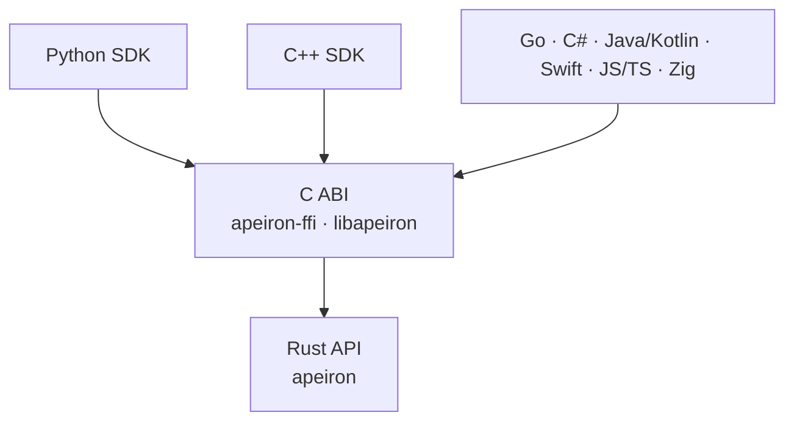

> **Türkçe:** [SDK.tr.md](SDK.tr.md)

# Apeiron C ABI and SDKs

> **Status: In progress.** Stage 3 work item 4 ([ROADMAP.md](ROADMAP.md) §5) is done: the C ABI, the Python SDK and the shared conformance suite. The C++ SDK, the JSON schemas and the SDKs of the next wave come later. The decisions behind it are ADR-015, ADR-016 and ADR-024 ([DECISIONS.md](DECISIONS.md)).

Apeiron is used from many languages through one C interface (the C ABI). Every SDK is a thin layer over that interface; none of them re-implements Apeiron's logic. That way the same operation gives the same result in every language.

## 1. Layers



| Part | Role | Status |
| --- | --- | --- |
| `apeiron-ffi` | Builds `libapeiron` (shared and static library); its C header is `crates/apeiron-ffi/include/apeiron.h` | Done |
| Python SDK | `sdk/python`, over the C ABI with `ctypes` | Done |
| Conformance suite | `sdk/conformance`, run through the C ABI from Rust and through Python (section 6) | Done |
| JSON schemas | Machine-readable description of every request, result, progress and error value | Planned |
| Other SDKs | Idiomatic wrappers in each language, generated in part from the schemas | Planned |

## 2. C ABI design

The ABI is deliberately small: a handful of functions that never change, while the operations and their values are described as JSON ([ADR-015](DECISIONS.md#adr-015-json-values-at-the-c-abi-boundary)).

| Rule | Description |
| --- | --- |
| Names | Every symbol starts with `apeiron_`; types are opaque structs (`apeiron_repo`, `apeiron_job`) |
| Status codes | Every function returns an `int32_t`: `0` for success, otherwise the error code of [API.md](API.md) §8.6. `-1` (`APEIRON_PENDING`) means "not finished yet" |
| Error details | After a failure, `apeiron_last_error()` returns the error of the calling thread as JSON: code, kind, message, path. The string belongs to the library and stays valid until the next failed call on that thread |
| Values as JSON | Requests and results are UTF-8 JSON strings in the form of [API.md](API.md) §8.7; a NULL request means `{}` |
| Input strings | `const char*`, NUL-terminated UTF-8, borrowed only for the duration of the call; NULL or invalid UTF-8 is the error `invalid_input` |
| Output strings | Written to a `char**` out-parameter; owned by the caller and freed with `apeiron_string_free`. An out-parameter is NULL whenever the call fails |
| Handles | Created by the `_init`, `_open`, `_unlock` and `_start` functions and released with the matching `_free` function; using a freed handle is not allowed, freeing NULL is |
| Threads | Repository handles can be used from several threads at once; a job handle from one thread at a time |
| No panics | A panic inside Apeiron never crosses the boundary; it becomes error code 11 (`Internal`) |
| Version check | `apeiron_abi_version()` returns the ABI version, now 0.1; an SDK refuses a library with another major version or an older minor version |

### 2.1 Functions

| Function | What it does |
| --- | --- |
| `apeiron_abi_version()` | ABI version as `major << 16 \| minor` |
| `apeiron_repo_init(path, &repo)` | Creates a repository and opens it |
| `apeiron_repo_init_encrypted(path, password, &repo, &recovery_key)` | Creates an encrypted repository, opens it and returns its recovery key |
| `apeiron_repo_open(path, &repo)` | Opens a repository |
| `apeiron_repo_unlock(path, secret, &repo)` | Opens a repository with a password or the recovery key |
| `apeiron_repo_free(repo)` | Closes a repository handle |
| `apeiron_call(repo, operation, request_json, &result_json)` | Runs a short operation: `info`, `resolve`, `log`, `list`, `diff`, `diff_text`, `refs`, `reflog`, `create_ref`, `delete_ref`, `merge`, `repair`, `keys`, `add_password`, `add_recovery_key`, `remove_key`, `remotes`, `add_remote`, `remove_remote`; with a NULL `repo`: `plugins`, `plugin_add`, `plugin_remove` |
| `apeiron_start(repo, operation, request_json, &job)` | Starts a long operation: `backup`, `restore`, `export`, `verify`, `gc`, `push`, `pull`, `restore_test`, `search`, `sync`, `git_import`, `git_export`, and `clone` with a NULL `repo` |
| `apeiron_job_progress(job, &progress_json)` | Reads the current progress |
| `apeiron_job_cancel(job)` | Asks the job to stop |
| `apeiron_job_wait(job, timeout_ms, &result_json)` | Waits for the result; returns `APEIRON_PENDING` if the timeout passes first (a negative timeout waits without limit). The result or the job's error is given once |
| `apeiron_job_free(job)` | Releases a job; a running job is cancelled first |
| `apeiron_last_error()` | Error of the last failed call on this thread, as JSON |
| `apeiron_string_free(s)` | Frees a string returned by the library |

The request of an operation is the request of [API.md](API.md) §8.3 as JSON. Operations that take plain values use these fields: `resolve` `{"spec"}`, `reflog` and `remove_remote` `{"name"}`, `add_password` `{"password"}`, `remove_key` `{"id"}`, `add_remote` `{"name", "url"}`, `plugins` `{"dir"}`, `plugin_add` `{"file", "dir"}`, `plugin_remove` `{"name", "dir"}`, where `dir` may be left out for the user's plugin folder; the others take `{}`. An unknown operation is the error `unsupported`.

The header is generated from the Rust code with `cbindgen`; a test fails when the checked-in header differs, so it can never drift from the library.

### 2.2 Example in C

`sdk/c/example.c` backs up a folder and lists the snapshot; CI builds and runs it on Linux and macOS. Its core:

```c
apeiron_repo *repo = NULL;
if (apeiron_repo_open("/mnt/backup/apeiron", &repo) != 0) {
    fprintf(stderr, "%s\n", apeiron_last_error());
    return 1;
}
apeiron_job *job = NULL;
apeiron_start(repo, "backup",
              "{\"source\": \"/home/ada/Documents\", \"ref\": \"main\"}", &job);
char *result = NULL;
while (apeiron_job_wait(job, 200, &result) == APEIRON_PENDING) {
    char *progress = NULL;
    apeiron_job_progress(job, &progress);
    puts(progress);
    apeiron_string_free(progress);
}
puts(result);
apeiron_string_free(result);
apeiron_job_free(job);
apeiron_repo_free(repo);
```

## 3. Schemas

Every value that crosses the ABI will be described by a JSON Schema generated from the Rust types and checked into the repository, so that SDKs can generate typed classes instead of writing them by hand. Until then the Rust types of [API.md](API.md) §8 and the conformance scenarios define the values. A schema change that is not additive raises the minor version of the API before 1.0 and the major version after it ([API.md](API.md) §6).

## 4. SDK rules

| Rule | Description |
| --- | --- |
| No logic of their own | An SDK only converts values and calls the C ABI |
| Idiomatic | Each SDK follows its language's habits: exceptions per error kind in Python and C++, context managers in Python, RAII in C++ |
| Typed | Requests and results become typed classes generated from the schemas; until the schemas exist, Python returns records read by attribute or key |
| Jobs | Every SDK offers `progress()`, `cancel()` and `wait()` with a timeout, plus a convenience that reports progress through the language's own mechanism (iterator, callback, event) on top of polling |
| Packaging | Each SDK will ship the native library inside its normal package (Python wheel, CMake package, …) for Linux, macOS and Windows; until then the library is built with Cargo and found through `APEIRON_LIB` |
| Same tests | Every SDK passes the shared conformance suite (section 6) |

## 5. SDK waves

| Wave | Languages | Status |
| --- | --- | --- |
| First | Rust (the `apeiron` crate itself), C (the ABI), Python | Done |
| First | C++ | Planned |
| Next | Go, C#, Java/Kotlin, Swift, JavaScript/TypeScript, Zig | Planned |

### 5.1 Example in Python

```python
import apeiron

with apeiron.Repository.open("/mnt/backup/apeiron") as repo:
    job = repo.backup("/home/ada/Documents", ref="main")
    for progress in job.watch(interval=0.2):
        print(progress.items_done, progress.bytes_done)
    report = job.result()
    print(report.snapshot)
```

Every operation has a method with the same name (`repo.search("*.pdf", history=True)` returns a job), and `repo.call(name, **request)` and `repo.start(name, **request)` reach any operation by name. Errors are exceptions named after their kind, such as `apeiron.NotFoundError` and `apeiron.PasswordError`, all subclasses of `apeiron.ApeironError`. `sdk/python/README.md` shows how to point the SDK at the library.

## 6. Conformance suite

| Part | Description | Status |
| --- | --- | --- |
| Scenarios | JSON files in `sdk/conformance` that list steps (write a file, open a repository, call or start an operation, read a file) with the expected result or error kind; an expected value matches when the result holds it | Done |
| Runners | The Rust runner calls the C functions directly; the Python runner goes through the SDK | Done |
| CI | Both runners run every scenario on Linux, macOS and Windows; a difference between languages fails the build | Done |

## 7. Limits of the first version

| Limit | Plan |
| --- | --- |
| File content does not pass through the ABI; operations work on paths | Streaming read and write handles in a later ABI minor version |
| No typed classes in Python, no wheels | With the JSON schemas and packaging |
| No remote mode | The same JSON values will be sent to the background service |
