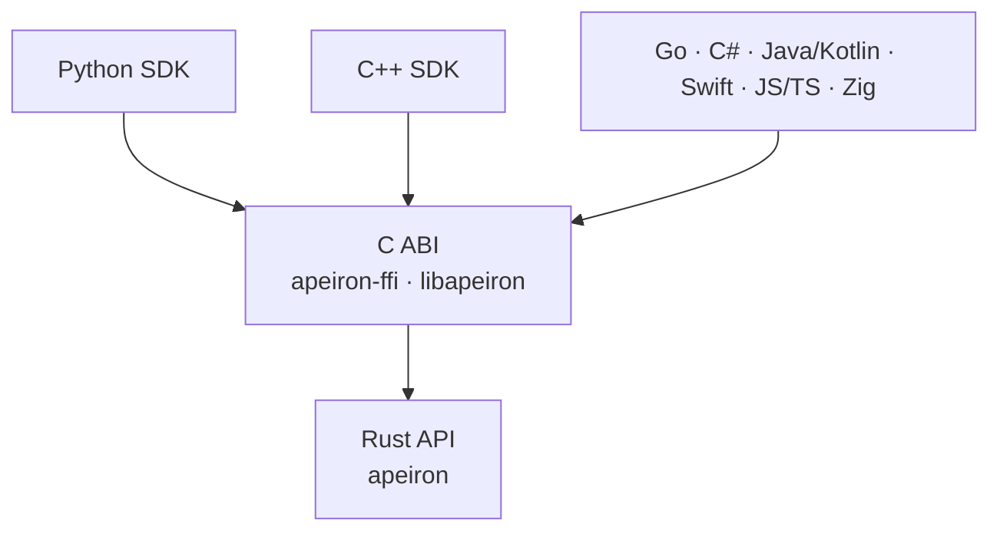

> **English:** [SDK.md](SDK.md)

# Apeiron C ABI ve SDK'lar

> **Durum: Devam ediyor.** Aşama 3'ün 4. işi ([ROADMAP.tr.md](ROADMAP.tr.md) §5) tamamlandı: C ABI, Python SDK'sı ve ortak uygunluk test paketi. C++ SDK'sı, JSON şemaları ve sonraki dalganın SDK'ları daha sonra gelir. Arkasındaki kararlar ADR-015, ADR-016 ve ADR-024'tür ([DECISIONS.tr.md](DECISIONS.tr.md)).

Apeiron, tek bir C arayüzü (C ABI) üzerinden birçok dilden kullanılır. Her SDK bu arayüzün üzerinde ince bir katmandır; hiçbiri Apeiron'un mantığını yeniden yazmaz. Böylece aynı işlem her dilde aynı sonucu verir.

## 1. Katmanlar



| Parça | Görev | Durum |
| --- | --- | --- |
| `apeiron-ffi` | `libapeiron`'u (paylaşılan ve statik kütüphane) üretir; C başlık dosyası `crates/apeiron-ffi/include/apeiron.h`'dir | Tamamlandı |
| Python SDK | `sdk/python`; C ABI'yi `ctypes` ile kullanır | Tamamlandı |
| Uygunluk test paketi | `sdk/conformance`; Rust'tan C ABI üzerinden ve Python üzerinden çalıştırılır (bölüm 6) | Tamamlandı |
| JSON şemaları | Her istek, sonuç, ilerleme ve hata değerinin makinece okunabilir tanımı | Planlandı |
| Diğer SDK'lar | Her dilde o dile uygun sarmalayıcılar; bir kısmı şemalardan üretilir | Planlandı |

## 2. C ABI tasarımı

ABI bilerek küçük tutulur: hiç değişmeyen birkaç işlev vardır; işlemler ve değerleri JSON olarak tanımlanır ([ADR-015](DECISIONS.tr.md#adr-015-c-abi-sınırında-json-değerler)).

| Kural | Açıklama |
| --- | --- |
| Adlar | Her sembol `apeiron_` ile başlar; türler opak yapılardır (`apeiron_repo`, `apeiron_job`) |
| Durum kodları | Her işlev bir `int32_t` döndürür: başarıda `0`, aksi hâlde [API.tr.md](API.tr.md) §8.6'daki hata kodu. `-1` (`APEIRON_PENDING`) "henüz bitmedi" demektir |
| Hata ayrıntıları | Bir hatadan sonra `apeiron_last_error()`, çağıran iş parçacığının hatasını JSON olarak döndürür: kod, tür, mesaj, yol. Metin kütüphaneye aittir ve o iş parçacığındaki bir sonraki başarısız çağrıya kadar geçerlidir |
| JSON değerler | İstekler ve sonuçlar, [API.tr.md](API.tr.md) §8.7 biçiminde UTF-8 JSON metinleridir; NULL bir istek `{}` demektir |
| Giriş metinleri | `const char*`, NUL ile biten UTF-8; yalnızca çağrı süresince ödünç alınır; NULL ya da geçersiz UTF-8 `invalid_input` hatasıdır |
| Çıkış metinleri | Bir `char**` çıkış parametresine yazılır; sahibi çağırandır ve `apeiron_string_free` ile serbest bırakılır. Çağrı başarısız olunca çıkış parametresi NULL'dır |
| Tutamaçlar | `_init`, `_open`, `_unlock` ve `_start` işlevleriyle oluşturulur ve eşleşen `_free` işleviyle bırakılır; bırakılmış bir tutamaç kullanılamaz, NULL bırakılabilir |
| İş parçacıkları | Depo tutamaçları aynı anda birden fazla iş parçacığından kullanılabilir; bir iş tutamacı aynı anda tek bir iş parçacığından |
| Panik yok | Apeiron içindeki bir panik asla sınırı geçmez; 11 (`Internal`) hata koduna dönüşür |
| Sürüm denetimi | `apeiron_abi_version()` ABI sürümünü döndürür, şimdi 0.1; bir SDK ana sürümü farklı ya da ara sürümü daha eski bir kütüphaneyi reddeder |

### 2.1 İşlevler

| İşlev | Ne yapar |
| --- | --- |
| `apeiron_abi_version()` | `major << 16 \| minor` biçiminde ABI sürümü |
| `apeiron_repo_init(path, &repo)` | Bir depo oluşturur ve açar |
| `apeiron_repo_init_encrypted(path, password, &repo, &recovery_key)` | Şifreli bir depo oluşturur, açar ve kurtarma anahtarını döndürür |
| `apeiron_repo_open(path, &repo)` | Bir depoyu açar |
| `apeiron_repo_unlock(path, secret, &repo)` | Bir depoyu bir parola ya da kurtarma anahtarıyla açar |
| `apeiron_repo_free(repo)` | Bir depo tutamacını kapatır |
| `apeiron_call(repo, operation, request_json, &result_json)` | Kısa bir işlemi çalıştırır: `info`, `resolve`, `log`, `list`, `diff`, `refs`, `reflog`, `create_ref`, `delete_ref`, `merge`, `repair`, `keys`, `add_password`, `add_recovery_key`, `remove_key`, `remotes`, `add_remote`, `remove_remote` |
| `apeiron_start(repo, operation, request_json, &job)` | Uzun bir işlemi başlatır: `backup`, `restore`, `export`, `verify`, `gc`, `push`, `pull`, `restore_test`, `search`, `sync`, `git_import`, `git_export` ve NULL bir `repo` ile `clone` |
| `apeiron_job_progress(job, &progress_json)` | Anlık ilerlemeyi okur |
| `apeiron_job_cancel(job)` | İşin durmasını ister |
| `apeiron_job_wait(job, timeout_ms, &result_json)` | Sonucu bekler; süre önce dolarsa `APEIRON_PENDING` döndürür (negatif bir süre sınırsız bekler). Sonuç ya da işin hatası bir kez verilir |
| `apeiron_job_free(job)` | Bir işi bırakır; çalışan bir iş önce iptal edilir |
| `apeiron_last_error()` | Bu iş parçacığındaki son başarısız çağrının hatası, JSON olarak |
| `apeiron_string_free(s)` | Kütüphanenin döndürdüğü bir metni serbest bırakır |

Bir işlemin isteği, [API.tr.md](API.tr.md) §8.3'teki isteğin JSON hâlidir. Düz değer alan işlemler şu alanları kullanır: `resolve` `{"spec"}`, `reflog` ve `remove_remote` `{"name"}`, `add_password` `{"password"}`, `remove_key` `{"id"}`, `add_remote` `{"name", "url"}`; diğerleri `{}` alır. Bilinmeyen bir işlem `unsupported` hatasıdır.

Başlık dosyası Rust kodundan `cbindgen` ile üretilir; depodaki başlık farklıysa bir test başarısız olur, böylece kütüphaneden asla ayrışamaz.

### 2.2 C ile örnek

`sdk/c/example.c` bir klasörü yedekler ve snapshot'ı listeler; CI onu Linux ve macOS'ta derler ve çalıştırır. Özü:

```c
apeiron_repo *repo = NULL;
if (apeiron_repo_open("/mnt/backup/apeiron", &repo) != 0) {
    fprintf(stderr, "%s\n", apeiron_last_error());
    return 1;
}
apeiron_job *job = NULL;
apeiron_start(repo, "backup",
              "{\"source\": \"/home/ada/Documents\", \"ref\": \"main\"}", &job);
char *result = NULL;
while (apeiron_job_wait(job, 200, &result) == APEIRON_PENDING) {
    char *progress = NULL;
    apeiron_job_progress(job, &progress);
    puts(progress);
    apeiron_string_free(progress);
}
puts(result);
apeiron_string_free(result);
apeiron_job_free(job);
apeiron_repo_free(repo);
```

## 3. Şemalar

ABI'yi geçen her değer, Rust türlerinden üretilen ve depoya eklenen bir JSON Schema ile tanımlanacak; böylece SDK'lar tipli sınıflarını elle yazmak yerine üretebilecek. O zamana kadar değerleri [API.tr.md](API.tr.md) §8'deki Rust türleri ve uygunluk senaryoları tanımlar. Eklemeli olmayan bir şema değişikliği, 1.0'dan önce API'nin ara sürümünü, sonra ana sürümünü yükseltir ([API.tr.md](API.tr.md) §6).

## 4. SDK kuralları

| Kural | Açıklama |
| --- | --- |
| Kendi mantığı yok | Bir SDK yalnızca değerleri dönüştürür ve C ABI'yi çağırır |
| Dile uygun | Her SDK kendi dilinin alışkanlıklarına uyar: Python ve C++'ta hata türü başına istisna, Python'da context manager, C++'ta RAII |
| Tipli | İstekler ve sonuçlar şemalardan üretilen tipli sınıflar olur; şemalar gelene kadar Python, alan adıyla ya da anahtarla okunan kayıtlar döndürür |
| İşler | Her SDK `progress()`, `cancel()` ve zaman aşımlı `wait()` sunar; ayrıca sorgulamanın üzerine, ilerlemeyi dilin kendi yöntemiyle (yineleyici, geri çağrı, olay) bildiren bir kolaylık ekler |
| Paketleme | Her SDK yerel kütüphaneyi kendi olağan paketinin içinde (Python wheel, CMake paketi, …) Linux, macOS ve Windows için dağıtacak; o zamana kadar kütüphane Cargo ile derlenir ve `APEIRON_LIB` ile bulunur |
| Aynı testler | Her SDK ortak uygunluk test paketinden geçer (bölüm 6) |

## 5. SDK dalgaları

| Dalga | Diller | Durum |
| --- | --- | --- |
| İlk | Rust (`apeiron` crate'inin kendisi), C (ABI), Python | Tamamlandı |
| İlk | C++ | Planlandı |
| Sonraki | Go, C#, Java/Kotlin, Swift, JavaScript/TypeScript, Zig | Planlandı |

### 5.1 Python ile örnek

```python
import apeiron

with apeiron.Repository.open("/mnt/backup/apeiron") as repo:
    job = repo.backup("/home/ada/Documents", ref="main")
    for progress in job.watch(interval=0.2):
        print(progress.items_done, progress.bytes_done)
    report = job.result()
    print(report.snapshot)
```

Her işlemin aynı adlı bir yöntemi vardır (`repo.search("*.pdf", history=True)` bir iş döndürür); `repo.call(name, **request)` ve `repo.start(name, **request)` her işleme adıyla ulaşır. Hatalar, türlerine göre adlandırılmış istisnalardır; örneğin `apeiron.NotFoundError` ve `apeiron.PasswordError`, hepsi `apeiron.ApeironError`'ın alt sınıfıdır. `sdk/python/README.md`, SDK'nın kütüphaneyi nasıl bulacağını gösterir.

## 6. Uygunluk test paketi

| Parça | Açıklama | Durum |
| --- | --- | --- |
| Senaryolar | `sdk/conformance` içinde, adımları (dosya yaz, depo aç, işlem çağır ya da başlat, dosya oku) beklenen sonuç ya da hata türüyle listeleyen JSON dosyaları; beklenen değer, sonuç onu içerdiğinde uyar | Tamamlandı |
| Çalıştırıcılar | Rust çalıştırıcısı C işlevlerini doğrudan çağırır; Python çalıştırıcısı SDK üzerinden gider | Tamamlandı |
| CI | İki çalıştırıcı da her senaryoyu Linux, macOS ve Windows'ta çalıştırır; diller arasındaki bir fark derlemeyi başarısız yapar | Tamamlandı |

## 7. İlk sürümün sınırları

| Sınır | Plan |
| --- | --- |
| Dosya içeriği ABI'den geçmez; işlemler yollar üzerinde çalışır | Sonraki bir ABI ara sürümünde akışlı okuma ve yazma tutamaçları |
| Python'da tipli sınıflar ve wheel yok | JSON şemaları ve paketlemeyle |
| Uzak kullanım yok | Aynı JSON değerler arka plan hizmetine gönderilecek |
