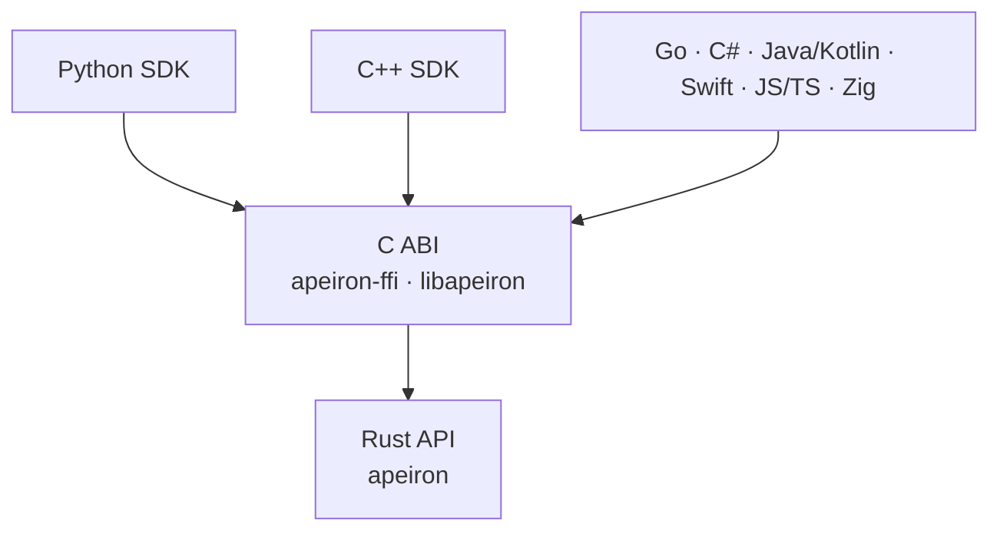

> **English:** [SDK.md](SDK.md)

# Apeiron C ABI ve SDK'lar

> **Durum: İncelemeye sunulan taslak.** Bu belgedeki hiçbir şey henüz yazılmadı; C ABI ve ilk SDK'lar Aşama 3 için planlandı ([ROADMAP.tr.md](ROADMAP.tr.md)). Tasarım, Rust API'nin ([API.tr.md](API.tr.md) §8) baştan buna göre biçimlenmesi için şimdiden yazıldı.

Apeiron, tek bir C arayüzü (C ABI) üzerinden birçok dilden kullanılır. Her SDK bu arayüzün üzerinde ince bir katmandır; hiçbiri Apeiron'un mantığını yeniden yazmaz. Böylece aynı işlem her dilde aynı sonucu verir.

## 1. Katmanlar



| Parça | Görev | Durum |
| --- | --- | --- |
| `apeiron-ffi` | `libapeiron`'u (paylaşılan ve statik kütüphane) ve C başlık dosyası `apeiron.h`'yi üretir | Planlandı (Aşama 3) |
| JSON şemaları | Her istek, sonuç, ilerleme ve hata değerinin makinece okunabilir tanımı | Planlandı (Aşama 3) |
| SDK'lar | Her dilde o dile uygun sarmalayıcılar; bir kısmı şemalardan üretilir | Planlandı (Aşama 3 ve sonrası) |

## 2. C ABI tasarımı

ABI bilerek küçük tutulur: hiç değişmeyen birkaç işlev vardır; işlemler ve değerleri JSON olarak tanımlanır ([ADR-015](DECISIONS.tr.md#adr-015-c-abi-sınırında-json-değerler)).

| Kural | Açıklama |
| --- | --- |
| Adlar | Her sembol `apeiron_` ile başlar; türler opak yapılardır (`apeiron_repo`, `apeiron_job`) |
| Durum kodları | Her işlev bir `int32_t` döndürür: başarıda `0`, aksi hâlde [API.tr.md](API.tr.md) §8.6'daki hata kodu. `-1` (`APEIRON_PENDING`) "henüz bitmedi" demektir |
| Hata ayrıntıları | Bir hatadan sonra `apeiron_last_error()`, çağıran iş parçacığının hatasını JSON olarak döndürür: kod, tür, mesaj, yol |
| JSON değerler | İstekler ve sonuçlar, [API.tr.md](API.tr.md) §8.7 biçiminde UTF-8 JSON metinleridir |
| Giriş metinleri | `const char*`, NUL ile biten UTF-8; yalnızca çağrı süresince ödünç alınır |
| Çıkış metinleri | Bir `char**` çıkış parametresine yazılır; sahibi çağırandır ve `apeiron_string_free` ile serbest bırakılır |
| Tutamaçlar | `_open`/`_start` işlevleriyle oluşturulur ve eşleşen `_free` işleviyle bırakılır; bırakılmış bir tutamaç kullanılamaz |
| İş parçacıkları | Depo tutamaçları aynı anda birden fazla iş parçacığından kullanılabilir; bir iş tutamacı aynı anda tek bir iş parçacığından |
| Panik yok | Apeiron içindeki bir panik asla sınırı geçmez; 11 (`Internal`) hata koduna dönüşür |
| Sürüm denetimi | `apeiron_abi_version()` ABI sürümünü döndürür; bir SDK ana sürümü farklı bir kütüphaneyi yüklemeyi reddeder |

### 2.1 İşlevler

| İşlev | Ne yapar |
| --- | --- |
| `apeiron_abi_version()` | `major << 16 \| minor` biçiminde ABI sürümü |
| `apeiron_repo_init(path, &repo)` | Bir depo oluşturur ve açar |
| `apeiron_repo_open(path, &repo)` | Bir depoyu açar |
| `apeiron_repo_free(repo)` | Bir depo tutamacını kapatır |
| `apeiron_call(repo, operation, request_json, &result_json)` | Kısa bir işlemi çalıştırır (`log`, `list`, `diff`, `refs`, `reflog`, `resolve`, `delete_ref`, `repair`, `info`) |
| `apeiron_start(repo, operation, request_json, &job)` | Uzun bir işlemi başlatır (`backup`, `restore`, `export`, `verify`, `gc`) |
| `apeiron_job_progress(job, &progress_json)` | Anlık ilerlemeyi okur |
| `apeiron_job_cancel(job)` | İşin durmasını ister |
| `apeiron_job_wait(job, timeout_ms, &result_json)` | Sonucu bekler; süre önce dolarsa `APEIRON_PENDING` döndürür (`-1` sonsuza kadar bekler) |
| `apeiron_job_free(job)` | Bir işi bırakır; çalışan bir iş önce iptal edilir |
| `apeiron_last_error()` | Bu iş parçacığındaki son başarısız çağrının hatası, JSON olarak |
| `apeiron_string_free(s)` | Kütüphanenin döndürdüğü bir metni serbest bırakır |

Başlık dosyası Rust kodundan `cbindgen` ile üretilir ve CI'da denetlenir; böylece kütüphaneden asla ayrışamaz.

### 2.2 C ile örnek

```c
apeiron_repo *repo = NULL;
if (apeiron_repo_open("/mnt/backup/apeiron", &repo) != 0) {
    fprintf(stderr, "%s\n", apeiron_last_error());
    return 1;
}
apeiron_job *job = NULL;
apeiron_start(repo, "backup",
              "{\"source\": \"/home/ada/Documents\", \"ref\": \"main\"}", &job);
char *result = NULL;
while (apeiron_job_wait(job, 200, &result) == APEIRON_PENDING) {
    char *progress = NULL;
    apeiron_job_progress(job, &progress);
    puts(progress);
    apeiron_string_free(progress);
}
puts(result);
apeiron_string_free(result);
apeiron_job_free(job);
apeiron_repo_free(repo);
```

## 3. Şemalar

ABI'yi geçen her değer, Rust türlerinden üretilen ve depoya eklenen bir JSON Schema ile tanımlanır. SDK'lar tipli sınıflarını elle yazmak yerine bu şemalardan üretir. Eklemeli olmayan bir şema değişikliği, 1.0'dan önce API'nin ara sürümünü, sonra ana sürümünü yükseltir ([API.tr.md](API.tr.md) §6).

## 4. SDK kuralları

| Kural | Açıklama |
| --- | --- |
| Kendi mantığı yok | Bir SDK yalnızca değerleri dönüştürür ve C ABI'yi çağırır |
| Dile uygun | Her SDK kendi dilinin alışkanlıklarına uyar: Python ve C++'ta hata türü başına istisna, Python'da context manager, C++'ta RAII |
| Tipli | İstekler ve sonuçlar şemalardan üretilen tipli sınıflardır; ham JSON hiç gerekmez |
| İşler | Her SDK `progress()`, `cancel()` ve zaman aşımlı `wait()` sunar; ayrıca sorgulamanın üzerine, ilerlemeyi dilin kendi yöntemiyle (yineleyici, geri çağrı, olay) bildiren bir kolaylık ekler |
| Paketleme | Her SDK yerel kütüphaneyi kendi olağan paketinin içinde (Python wheel, CMake paketi, …) Linux, macOS ve Windows için dağıtır |
| Aynı testler | Her SDK ortak uygunluk test paketinden geçer (bölüm 6) |

## 5. SDK dalgaları

| Dalga | Diller | Durum |
| --- | --- | --- |
| İlk | Rust (`apeiron` crate'inin kendisi), C (ABI), Python, C++ | Planlandı (Aşama 3) |
| Sonraki | Go, C#, Java/Kotlin, Swift, JavaScript/TypeScript, Zig | Planlandı |

### 5.1 Python ile örnek

```python
import apeiron

with apeiron.Repository.open("/mnt/backup/apeiron") as repo:
    job = repo.backup(source="/home/ada/Documents", ref="main")
    for progress in job.watch(interval=0.2):
        print(progress.items_done, progress.bytes_done)
    report = job.result()
    print(report.snapshot)
```

## 6. Uygunluk test paketi

| Parça | Açıklama | Durum |
| --- | --- | --- |
| Senaryolar | İşlemleri, istekleri ve beklenen sonuçları listeleyen JSON dosyaları (ör. örnek bir klasörü yedekle, listele, geri yükle, karşılaştır) | Planlandı (Aşama 3) |
| Çalıştırıcılar | Her senaryoyu o SDK üzerinden çalıştıran, SDK başına küçük bir çalıştırıcı | Planlandı (Aşama 3) |
| CI | Her SDK her senaryoyu Linux, macOS ve Windows'ta çalıştırır; diller arasındaki bir fark derlemeyi başarısız yapar | Planlandı (Aşama 3) |

## 7. İlk sürümün sınırları

| Sınır | Plan |
| --- | --- |
| Dosya içeriği ABI'den geçmez; işlemler yollar üzerinde çalışır | Sonraki bir ABI ara sürümünde akışlı okuma ve yazma tutamaçları |
| Uzak kullanım yok | Aynı JSON değerler arka plan hizmetine gönderilecek (Aşama 2) |
