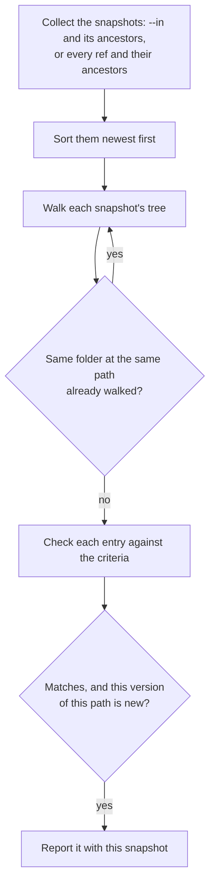

> **Türkçe:** [SEARCH.tr.md](SEARCH.tr.md)

# Search

> **Status: Done.** This is the design of Stage 3 work item 3 ([ROADMAP.md](ROADMAP.md) §5): finding files in a snapshot or in the whole history by name, metadata and text. The decision behind it is ADR-023 ([DECISIONS.md](DECISIONS.md)).

A search answers two questions: where is a file now, and where was it in the past. It reads the snapshots themselves; there is no separate index to build, store or keep in step (section 4).

## 1. Command

| Command | What it does | Status |
| --- | --- | --- |
| `apeiron search [<pattern>] [--text <text>] [--larger <size>] [--smaller <size>] [--after <date>] [--before <date>] [--tag <tag>]... [--in <snapshot>] [--history] [--limit <n>]` | Lists the files, folders and links that match every criterion given, with the snapshot each was found in | Done |

| Criterion | Matches |
| --- | --- |
| `<pattern>` | The name, with `*` for any characters and `?` for one; ignoring case. A pattern with `/` is matched against the whole path from the root, and there `*` also crosses `/` |
| `--text <text>` | Text files holding the text, ignoring case (section 3); the first such line is shown with its number |
| `--larger <size>`, `--smaller <size>` | Files of at least, or less than, the size: a number of bytes or with `K`, `M` or `G` (powers of 1024) |
| `--after <date>`, `--before <date>` | Entries modified on or after, or before, the start of the day `YYYY-MM-DD` in local time |
| `--tag <tag>` | Files that have the tag, ignoring case; given more than once, every one of them (§1.1) |

At least one criterion is needed. `--in` names the snapshot searched (default `main`). `--history` also searches every snapshot before it; without `--in` it searches the history of every ref. At most `--limit` results (default 1000) are listed; when there are more, the output says so.

### 1.1 Tags

A tag is a word or a few words put on a file, such as `invoice` or `Project X`. Apeiron keeps the tags that file managers put on files, such as Dolphin on Linux and Finder on macOS, in the attribute `user.xdg.tags` ([FORMAT.md](FORMAT.md) §6.3): a backup stores them with each version, `apeiron search --tag` finds them, `apeiron ls` and the results show them in brackets, and a restore writes them back.

| Command | What it does |
| --- | --- |
| `apeiron tag <file>...` | Shows the tags of files on disk |
| `apeiron tag <file>... --add <tag>... --remove <tag>...` | Adds or removes tags, ignoring case; the next backup keeps them |

Tags are a property of the files, so changing them changes the folder, not the versions already stored: a version keeps the tags its files had when it was made. Finder's colours are not kept: a restored tag has its name only. Windows has no tags, so backups there have none, and `apeiron tag` says so. In the JSON API the criterion is `tags`, a list, and each entry has `tags` when it has any.

Snapshots themselves are found by their message, author, host or metadata with `apeiron log --grep <text>` ([CLI.md](CLI.md)).

## 2. Searching the history

1. The snapshots are walked newest first, so each result names the newest snapshot that holds that version of the path.
2. A folder is stored once for each distinct content (FORMAT.md §6.3). When the same folder appears at the same path in an older snapshot, it was already searched and is skipped, so a long history with few changes costs little more than one snapshot.
3. A path is reported once per version: a file whose content is the same in many snapshots is listed once, a file that changed is listed once for each content it had.
4. The text of a file is read once per content, even when the same content is at several paths.

## 3. Text search

A file is searched for text when it is a text file: its content is valid UTF-8 and holds no zero byte. Files larger than 16 MiB are not read for text; the result counts them as skipped. Searching other formats, such as PDF or office documents, needs a driver that turns them into text and comes with the plugin system (VISION.md).

## 4. Why there is no index

| Concern | How it is met without an index |
| --- | --- |
| Speed on long histories | Unchanged folders and contents are searched once (section 2) |
| Encryption | Search reads the encrypted objects as every other command does; an index would be one more copy of names and text to encrypt and protect |
| Keeping in step | Nothing to rebuild after a backup, pull, merge or garbage collection |

A stored index can be added later behind the same command, if measurements show the need, for example for text search across many large files.

## 5. Duplicate files

`apeiron duplicates [<snapshot>] [--smallest <size>]` lists the files of a snapshot (default `main`) whose content is at more than one path, each group with the size of one copy and its paths. The groups whose extra copies take the most room come first, and the last line gives the room all extra copies take. Empty files, and files smaller than `--smallest`, are left out.

The repository already stores each content once, so the copies take no extra room in the backup; they take room in the source folder. The list helps clean the folder up. It reads only folders, never file contents, because files with the same content already share one blob (FORMAT.md §6.2).

## 6. Saved searches

A search that is run often can be kept under a name and run again by that name.

| Command | What it does |
| --- | --- |
| `apeiron search <criteria> --save <name>` | Saves the search, replacing one of the same name, then runs it |
| `apeiron search --saved <name> [<criteria>]` | Runs the saved search; criteria given with it replace the saved ones for this run, and `--history` is added |
| `apeiron search --list-saved` | Lists the saved searches with their criteria |
| `apeiron search --forget <name>` | Removes a saved search |

A name has 1 to 64 characters and no control characters; spaces around it are dropped. A search with no criterion is not saved. Saved searches belong to the user, as plugins do, not to a repository: they are in `searches.json` in the user's Apeiron configuration folder (on Linux `~/.config/apeiron/`), or in the file the environment variable `APEIRON_SEARCHES` names. The file is written whole to a temporary file, synced and renamed over the old one, so a power cut leaves the old or the new list. A saved search with no `--in` searches `main`, or every ref with `--history`, of whichever repository it is run on.

## 7. Not part of this work item

| Item | Where |
| --- | --- |
| Text inside PDF, office and other formats | Later, as a type driver; not scheduled ([ROADMAP.md](ROADMAP.md) §8) |
| Tags on Windows | Not planned; Windows has none |
| Hiding results a user may not see | Done in the web interface: a `member` or `reader` must name a snapshot it sees ([USERS.md](USERS.md) §4) |

## 8. Crates

| Crate | Role | Status |
| --- | --- | --- |
| `apeiron-services` | The search | Done |
| `apeiron` | `search`, `duplicates`, saved searches (API.md §8.3) | Done |
| `apeiron-cli` | `apeiron search`, `apeiron duplicates` | Done |
