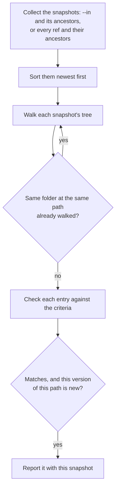

> **Türkçe:** [SEARCH.tr.md](SEARCH.tr.md)

# Search

> **Status: Done.** This is the design of Stage 3 work item 3 ([ROADMAP.md](ROADMAP.md) §5): finding files in a snapshot or in the whole history by name, metadata and text. The decision behind it is ADR-023 ([DECISIONS.md](DECISIONS.md)).

A search answers two questions: where is a file now, and where was it in the past. It reads the snapshots themselves; there is no separate index to build, store or keep in step (section 4).

## 1. Command

| Command | What it does | Status |
| --- | --- | --- |
| `apeiron search [<pattern>] [--text <text>] [--larger <size>] [--smaller <size>] [--after <date>] [--before <date>] [--in <snapshot>] [--history] [--limit <n>]` | Lists the files, folders and links that match every criterion given, with the snapshot each was found in | Done |

| Criterion | Matches |
| --- | --- |
| `<pattern>` | The name, with `*` for any characters and `?` for one; ignoring case. A pattern with `/` is matched against the whole path from the root, and there `*` also crosses `/` |
| `--text <text>` | Text files holding the text, ignoring case (section 3); the first such line is shown with its number |
| `--larger <size>`, `--smaller <size>` | Files of at least, or less than, the size: a number of bytes or with `K`, `M` or `G` (powers of 1024) |
| `--after <date>`, `--before <date>` | Entries modified on or after, or before, the start of the day `YYYY-MM-DD` in local time |

At least one criterion is needed. `--in` names the snapshot searched (default `main`). `--history` also searches every snapshot before it; without `--in` it searches the history of every ref. At most `--limit` results (default 1000) are listed; when there are more, the output says so.

## 2. Searching the history

1. The snapshots are walked newest first, so each result names the newest snapshot that holds that version of the path.
2. A folder is stored once for each distinct content (FORMAT.md §6.3). When the same folder appears at the same path in an older snapshot, it was already searched and is skipped, so a long history with few changes costs little more than one snapshot.
3. A path is reported once per version: a file whose content is the same in many snapshots is listed once, a file that changed is listed once for each content it had.
4. The text of a file is read once per content, even when the same content is at several paths.

## 3. Text search

A file is searched for text when it is a text file: its content is valid UTF-8 and holds no zero byte. Files larger than 16 MiB are not read for text; the result counts them as skipped. Searching other formats, such as PDF or office documents, needs a driver that turns them into text and comes with the plugin system (VISION.md).

## 4. Why there is no index

| Concern | How it is met without an index |
| --- | --- |
| Speed on long histories | Unchanged folders and contents are searched once (section 2) |
| Encryption | Search reads the encrypted objects as every other command does; an index would be one more copy of names and text to encrypt and protect |
| Keeping in step | Nothing to rebuild after a backup, pull, merge or garbage collection |

A stored index can be added later behind the same command, if measurements show the need, for example for text search across many large files.

## 5. Not part of this work item

| Item | Where |
| --- | --- |
| Text inside PDF, office and other formats | Type drivers of the plugin system, Stage 3 |
| Tags on files | Later; the format has no tags on files yet |
| Saved queries and duplicate file detection | Later |
| Hiding results a user may not see | Users and permissions, Stage 4 |
| Searching snapshot messages and metadata | `apeiron log` shows them; a filter comes later |

## 6. Crates

| Crate | Role | Status |
| --- | --- | --- |
| `apeiron-services` | The search | Done |
| `apeiron` | `search` (API.md §8.3) | Done |
| `apeiron-cli` | `apeiron search` | Done |
