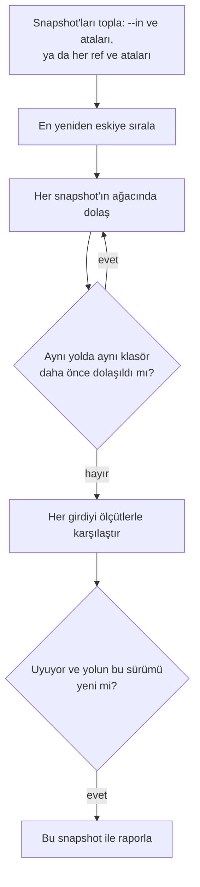

> **English:** [SEARCH.md](SEARCH.md)

# Arama

> **Durum: Tamamlandı.** Aşama 3'ün 3. işinin tasarımıdır ([ROADMAP.tr.md](ROADMAP.tr.md) §5): bir snapshot'ta ya da tüm geçmişte dosyaları ada, üst veriye ve metne göre bulmak. Arkasındaki karar ADR-023'tür ([DECISIONS.tr.md](DECISIONS.tr.md)).

Bir arama iki soruyu yanıtlar: bir dosya şimdi nerede ve geçmişte neredeydi. Snapshot'ların kendisini okur; kurulacak, saklanacak ya da güncel tutulacak ayrı bir dizin yoktur (bölüm 4).

## 1. Komut

| Komut | Ne yapar | Durum |
| --- | --- | --- |
| `apeiron search [<pattern>] [--text <text>] [--larger <size>] [--smaller <size>] [--after <date>] [--before <date>] [--tag <tag>]... [--in <snapshot>] [--history] [--limit <n>]` | Verilen her ölçüte uyan dosyaları, klasörleri ve bağlantıları, her birinin bulunduğu snapshot ile listeler | Tamamlandı |

| Ölçüt | Neye uyar |
| --- | --- |
| `<pattern>` | Ada; `*` herhangi karakterler, `?` tek karakter yerine geçer; büyük/küçük harf ayrılmaz. `/` içeren bir desen kökten başlayan tüm yolla karşılaştırılır ve orada `*` `/` üzerinden de geçer |
| `--text <text>` | Metni içeren metin dosyalarına, büyük/küçük harf ayırmadan (bölüm 3); metni içeren ilk satır numarasıyla gösterilir |
| `--larger <size>`, `--smaller <size>` | En az, ya da daha küçük, boyuttaki dosyalara: bayt sayısı ya da `K`, `M` veya `G` ile (1024'ün kuvvetleri) |
| `--after <date>`, `--before <date>` | Yerel saatle `YYYY-MM-DD` gününün başında ya da sonrasında, veya öncesinde değiştirilmiş girdilere |
| `--tag <tag>` | Etikete sahip dosyalara, büyük/küçük harf ayırmadan; birden çok kez verilirse hepsine (§1.1) |

En az bir ölçüt gerekir. `--in` aranan snapshot'ı adlandırır (varsayılan `main`). `--history` ondan önceki her snapshot'ı da arar; `--in` olmadan her ref'in geçmişini arar. En çok `--limit` sonuç (varsayılan 1000) listelenir; daha fazlası varsa çıktı bunu söyler.

### 1.1 Etiketler

Etiket, bir dosyaya konan bir ya da birkaç kelimedir; örneğin `fatura` ya da `Proje X`. Apeiron, Linux'ta Dolphin gibi dosya yöneticilerinin dosyalara koyduğu etiketleri `user.xdg.tags` özniteliğinde tutar ([FORMAT.tr.md](FORMAT.tr.md) §6.3): bir yedek onları her sürümle saklar, `apeiron search --tag` onları bulur, `apeiron ls` ve sonuçlar onları köşeli parantez içinde gösterir ve geri yükleme onları geri yazar.

| Komut | Ne yapar |
| --- | --- |
| `apeiron tag <dosya>...` | Diskteki dosyaların etiketlerini gösterir |
| `apeiron tag <dosya>... --add <etiket>... --remove <etiket>...` | Büyük/küçük harf ayırmadan etiket ekler ya da kaldırır; sonraki yedek onları saklar |

Etiketler dosyaların bir özelliğidir; bu yüzden onları değiştirmek saklanmış sürümleri değil klasörü değiştirir: bir sürüm, oluşturulduğunda dosyalarının sahip olduğu etiketleri tutar. Başka sistemler etiketleri başka yerde tutar (macOS Finder'ın kendi özniteliğinde, Windows hiç tutmaz); bu yüzden oralardaki yedeklerde henüz etiket yoktur ve `apeiron tag` bunu söyler. JSON API'de ölçüt bir liste olan `tags`'tir ve etiketi olan her girişin `tags` alanı vardır.

Snapshot'ların kendileri mesajlarına, yazarlarına, makinelerine ya da üst verilerine göre `apeiron log --grep <metin>` ile bulunur ([CLI.tr.md](CLI.tr.md)).

## 2. Geçmişte arama

1. Snapshot'lar en yeniden eskiye dolaşılır; böylece her sonuç, yolun o sürümünü tutan en yeni snapshot'ı adlandırır.
2. Bir klasör her farklı içerik için bir kez saklanır (FORMAT.tr.md §6.3). Aynı klasör daha eski bir snapshot'ta aynı yolda görünürse zaten aranmıştır ve atlanır; böylece az değişikliği olan uzun bir geçmiş, tek bir snapshot'tan pek fazla tutmaz.
3. Bir yol her sürümü için bir kez raporlanır: içeriği birçok snapshot'ta aynı olan bir dosya bir kez, değişmiş bir dosya sahip olduğu her içerik için bir kez listelenir.
4. Bir dosyanın metni, aynı içerik birkaç yolda olsa bile içerik başına bir kez okunur.

## 3. Metin arama

Bir dosya metin dosyasıysa metin için aranır: içeriği geçerli UTF-8'dir ve sıfır baytı yoktur. 16 MiB'tan büyük dosyalar metin için okunmaz; sonuç onları atlanmış olarak sayar. PDF ya da ofis belgeleri gibi diğer biçimlerde aramak, onları metne çeviren bir sürücü gerektirir ve eklenti sistemiyle gelir (VISION.tr.md).

## 4. Neden dizin yok

| Kaygı | Dizin olmadan nasıl karşılanır |
| --- | --- |
| Uzun geçmişlerde hız | Değişmemiş klasörler ve içerikler bir kez aranır (bölüm 2) |
| Şifreleme | Arama, şifreli nesneleri her komut gibi okur; bir dizin, şifrelenip korunması gereken adların ve metnin bir kopyası daha olurdu |
| Güncel tutmak | Bir yedekten, pull'dan, birleştirmeden ya da çöp toplamadan sonra yeniden kurulacak bir şey yoktur |

Ölçümler gerek gösterirse, örneğin çok sayıda büyük dosyada metin araması için, aynı komutun arkasına saklanan bir dizin sonradan eklenebilir.

## 5. Kopya dosyalar

`apeiron duplicates [<snapshot>] [--smallest <boyut>]`, bir snapshot'ta (varsayılan `main`) içeriği birden fazla yolda bulunan dosyaları listeler; her grup bir kopyanın boyutu ve yollarıyla gösterilir. Fazla kopyaları en çok yer kaplayan gruplar önce gelir; son satır bütün fazla kopyaların kapladığı yeri verir. Boş dosyalar ve `--smallest`'tan küçük dosyalar dışarıda kalır.

Depo her içeriği zaten bir kez saklar; bu yüzden kopyalar yedekte fazladan yer kaplamaz, kaynak klasörde kaplar. Liste o klasörü temizlemeye yardım eder. Yalnızca klasörleri okur, dosya içeriklerini hiç okumaz; çünkü aynı içerikli dosyalar zaten tek bir blob'u paylaşır (FORMAT.tr.md §6.2).

## 6. Kayıtlı aramalar

Sık yapılan bir arama bir adla saklanabilir ve o adla yeniden çalıştırılabilir.

| Komut | Ne yapar |
| --- | --- |
| `apeiron search <ölçütler> --save <ad>` | Aramayı, aynı adlı olanın yerine geçerek kaydeder, sonra çalıştırır |
| `apeiron search --saved <ad> [<ölçütler>]` | Kayıtlı aramayı çalıştırır; onunla verilen ölçütler bu çalıştırma için kayıtlı olanların yerine geçer, `--history` eklenir |
| `apeiron search --list-saved` | Kayıtlı aramaları ölçütleriyle listeler |
| `apeiron search --forget <ad>` | Kayıtlı bir aramayı siler |

Bir ad 1 ile 64 karakter arasıdır ve denetim karakteri içermez; çevresindeki boşluklar atılır. Ölçütsüz bir arama kaydedilmez. Kayıtlı aramalar, eklentiler gibi bir depoya değil kullanıcıya aittir: kullanıcının Apeiron yapılandırma klasöründeki `searches.json` dosyasında (Linux'ta `~/.config/apeiron/`) ya da `APEIRON_SEARCHES` ortam değişkeninin adlandırdığı dosyadadır. Dosya bütün olarak geçici bir dosyaya yazılır, diske işlenir ve eskisinin üstüne yeniden adlandırılır; böylece bir elektrik kesintisi eski ya da yeni listeyi bırakır. `--in` içermeyen kayıtlı bir arama, hangi depoda çalıştırılırsa onun `main`'ini, `--history` ile de her ref'ini arar.

## 7. Bu işin parçası olmayanlar

| Konu | Nerede |
| --- | --- |
| PDF, ofis ve diğer biçimlerin içindeki metin | Daha sonra, bir tür sürücüsü olarak; zamanlanmadı ([ROADMAP.tr.md](ROADMAP.tr.md) §8) |
| macOS ve Windows'ta etiketler | Daha sonra; macOS onları Finder'ın kendi özniteliğinde tutar, Windows'ta yoktur |
| Kullanıcının göremeyeceği sonuçları gizlemek | Web arayüzünde tamamlandı: `member` ya da `reader` gördüğü bir snapshot'ı adlandırmalıdır ([USERS.tr.md](USERS.tr.md) §4) |

## 8. Crate'ler

| Crate | Görev | Durum |
| --- | --- | --- |
| `apeiron-services` | Arama | Tamamlandı |
| `apeiron` | `search`, `duplicates`, kayıtlı aramalar (API.tr.md §8.3) | Tamamlandı |
| `apeiron-cli` | `apeiron search`, `apeiron duplicates` | Tamamlandı |
