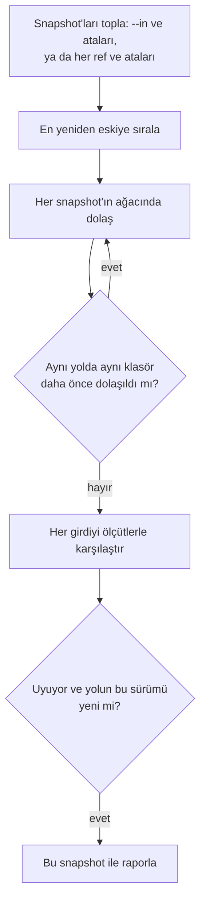

> **English:** [SEARCH.md](SEARCH.md)

# Arama

> **Durum: Tamamlandı.** Aşama 3'ün 3. işinin tasarımıdır ([ROADMAP.tr.md](ROADMAP.tr.md) §5): bir snapshot'ta ya da tüm geçmişte dosyaları ada, üst veriye ve metne göre bulmak. Arkasındaki karar ADR-023'tür ([DECISIONS.tr.md](DECISIONS.tr.md)).

Bir arama iki soruyu yanıtlar: bir dosya şimdi nerede ve geçmişte neredeydi. Snapshot'ların kendisini okur; kurulacak, saklanacak ya da güncel tutulacak ayrı bir dizin yoktur (bölüm 4).

## 1. Komut

| Komut | Ne yapar | Durum |
| --- | --- | --- |
| `apeiron search [<pattern>] [--text <text>] [--larger <size>] [--smaller <size>] [--after <date>] [--before <date>] [--in <snapshot>] [--history] [--limit <n>]` | Verilen her ölçüte uyan dosyaları, klasörleri ve bağlantıları, her birinin bulunduğu snapshot ile listeler | Tamamlandı |

| Ölçüt | Neye uyar |
| --- | --- |
| `<pattern>` | Ada; `*` herhangi karakterler, `?` tek karakter yerine geçer; büyük/küçük harf ayrılmaz. `/` içeren bir desen kökten başlayan tüm yolla karşılaştırılır ve orada `*` `/` üzerinden de geçer |
| `--text <text>` | Metni içeren metin dosyalarına, büyük/küçük harf ayırmadan (bölüm 3); metni içeren ilk satır numarasıyla gösterilir |
| `--larger <size>`, `--smaller <size>` | En az, ya da daha küçük, boyuttaki dosyalara: bayt sayısı ya da `K`, `M` veya `G` ile (1024'ün kuvvetleri) |
| `--after <date>`, `--before <date>` | Yerel saatle `YYYY-MM-DD` gününün başında ya da sonrasında, veya öncesinde değiştirilmiş girdilere |

En az bir ölçüt gerekir. `--in` aranan snapshot'ı adlandırır (varsayılan `main`). `--history` ondan önceki her snapshot'ı da arar; `--in` olmadan her ref'in geçmişini arar. En çok `--limit` sonuç (varsayılan 1000) listelenir; daha fazlası varsa çıktı bunu söyler.

## 2. Geçmişte arama

1. Snapshot'lar en yeniden eskiye dolaşılır; böylece her sonuç, yolun o sürümünü tutan en yeni snapshot'ı adlandırır.
2. Bir klasör her farklı içerik için bir kez saklanır (FORMAT.tr.md §6.3). Aynı klasör daha eski bir snapshot'ta aynı yolda görünürse zaten aranmıştır ve atlanır; böylece az değişikliği olan uzun bir geçmiş, tek bir snapshot'tan pek fazla tutmaz.
3. Bir yol her sürümü için bir kez raporlanır: içeriği birçok snapshot'ta aynı olan bir dosya bir kez, değişmiş bir dosya sahip olduğu her içerik için bir kez listelenir.
4. Bir dosyanın metni, aynı içerik birkaç yolda olsa bile içerik başına bir kez okunur.

## 3. Metin arama

Bir dosya metin dosyasıysa metin için aranır: içeriği geçerli UTF-8'dir ve sıfır baytı yoktur. 16 MiB'tan büyük dosyalar metin için okunmaz; sonuç onları atlanmış olarak sayar. PDF ya da ofis belgeleri gibi diğer biçimlerde aramak, onları metne çeviren bir sürücü gerektirir ve eklenti sistemiyle gelir (VISION.tr.md).

## 4. Neden dizin yok

| Kaygı | Dizin olmadan nasıl karşılanır |
| --- | --- |
| Uzun geçmişlerde hız | Değişmemiş klasörler ve içerikler bir kez aranır (bölüm 2) |
| Şifreleme | Arama, şifreli nesneleri her komut gibi okur; bir dizin, şifrelenip korunması gereken adların ve metnin bir kopyası daha olurdu |
| Güncel tutmak | Bir yedekten, pull'dan, birleştirmeden ya da çöp toplamadan sonra yeniden kurulacak bir şey yoktur |

Ölçümler gerek gösterirse, örneğin çok sayıda büyük dosyada metin araması için, aynı komutun arkasına saklanan bir dizin sonradan eklenebilir.

## 5. Bu işin parçası olmayanlar

| Konu | Nerede |
| --- | --- |
| PDF, ofis ve diğer biçimlerin içindeki metin | Eklenti sisteminin tür sürücüleri, Aşama 3 |
| Dosyalara etiket | Daha sonra; formatta henüz dosyalara etiket yok |
| Kayıtlı sorgular ve kopya dosya tespiti | Daha sonra |
| Kullanıcının göremeyeceği sonuçları gizlemek | Kullanıcılar ve izinler, Aşama 4 |
| Snapshot mesajlarında ve üst verisinde arama | `apeiron log` onları gösterir; bir süzgeç daha sonra gelir |

## 6. Crate'ler

| Crate | Görev | Durum |
| --- | --- | --- |
| `apeiron-services` | Arama | Tamamlandı |
| `apeiron` | `search` (API.tr.md §8.3) | Tamamlandı |
| `apeiron-cli` | `apeiron search` | Tamamlandı |
