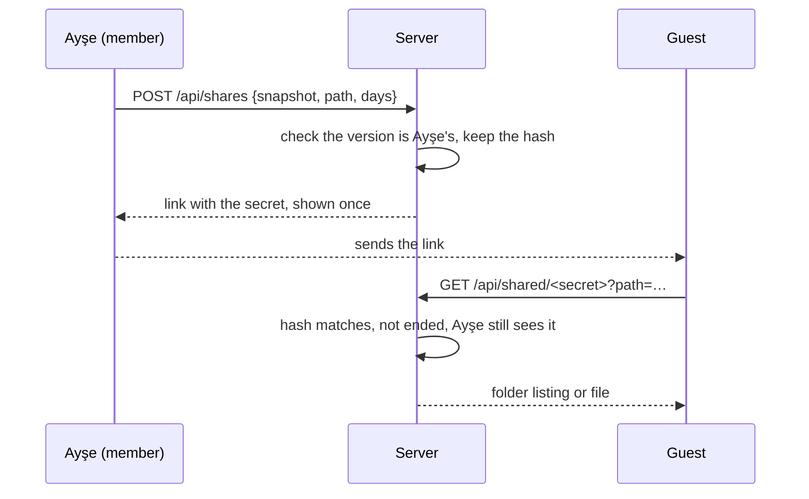

> **Türkçe:** [SHARE.tr.md](SHARE.tr.md)

# Sharing

> **Status: Done.** This is the design of Stage 4 work item 5 ([ROADMAP.md](ROADMAP.md) §6): a user of the web interface ([WEB.md](WEB.md)) gives a link to someone without an account, who can then see and download one version of a backup, or a folder or file in it, until the link ends. The decision behind it is ADR-030 ([DECISIONS.md](DECISIONS.md)).

Ayşe wants to send her accountant last month's invoices folder, or a relative the photos of one trip, without making them a user of the server and without copying the files somewhere else first.

## 1. What can be shared

| Rule | Detail |
| --- | --- |
| What | One version of a backup: all of it, one folder or one file in it |
| Who shares | An `admin` any version; a `member` only versions it can see (USERS.md §1); a `reader` nothing |
| What the link gives | Reading only: listing folders and downloading files below the shared path, without signing in |
| Which version | The one named when the link was made, by its id; later backups do not change what the link shows |

## 2. Links

A link looks like `https://<server>/s/<secret>`. The secret is 32 random bytes as 64 hex characters, so links cannot be guessed. The server keeps only its SHA-256 hash; the link is shown once, when it is made, and cannot be shown again.

A link works until the first of these:

| End | Detail |
| --- | --- |
| Its time is up | 1, 7 or 30 days, chosen when it is made; 7 by default, at most 30 |
| It is removed | By its owner or an `admin`, in the pages or with `apeiron web share remove` |
| Its owner may no longer share it | The owner was removed, became a `reader`, or no longer sees the version |

A link can also ask for a password, of at least 8 characters, chosen when it is made; the owner sends it another way than the link. The server keeps only its Argon2id hash. Until the password is given, the link shows nothing but a password field. A right password sets the cookie `apeiron_share` for the link's own path (`HttpOnly`, `Secure`, `SameSite=Strict`, until the browser closes): a SHA-256 of the secret and the stored hash, which no one can make without the password, and which opens no other link. Wrong passwords pause like wrong sign-ins (WEB.md): after 5 in a row, every link's password waits a minute.



## 3. The shares file

Links are kept in `shares.json` in the state folder (`~/.local/state/apeiron` on Linux), readable only by its owner:

```json
{
  "shares": [
    {"id": "4661079506c34678", "hash": "4661079506c34678…", "owner": "ayse",
     "snapshot": "e63639f3…", "path": "invoices/2026-09",
     "made": "2026-10-30T10:30:55Z", "expires": "2026-11-06T10:30:55Z"}
  ]
}
```

| Field | Meaning |
| --- | --- |
| `id` | The first 16 characters of `hash`; names the link in lists and for removing it |
| `hash` | SHA-256 of the secret, hex |
| `owner` | The user who made the link |
| `snapshot` | The id of the shared version |
| `path` | The shared path inside it; empty for all of it |
| `made`, `expires` | UTC times |
| `protected`, `password` | Whether the link asks for a password, and its Argon2id hash as a PHC string; `password` is left out for a link without one |

The server and `apeiron web share` change the file under a lock (`shares.lock`) and replace it whole with a new file written and flushed beside it, so a crash leaves the old file or the new one. Ended links are dropped whenever the file changes. A damaged file is reported, never replaced.

## 4. What the link holder sees

Opening the link shows a page with the shared folder, its subfolders and a Download button for each file; a shared file is shown alone. Files are sent as they are read, so a large file does not fill the server's memory. Links inside the backup are listed but not followed.

Nothing above or beside the shared path can be reached: a path with `.` or `..` is refused. An unknown, ended or removed link, and one whose owner may no longer share it, all give the same "not found" answer. Pages answer with `Referrer-Policy: no-referrer`, so the link does not leave with a request to another site.

## 5. In the pages, the JSON API and the CLI

| Where | What |
| --- | --- |
| Share buttons while looking inside a version | Make a link to a file, a folder or the whole version; for an `admin` and a `member` |
| The Links page | The user's live links with their end; an `admin` sees everyone's; Remove |
| `POST /api/shares` `{"snapshot", "path", "days", "password"}` | Makes a link, with a password when one is given; answers `{"share", "secret"}` |
| `GET /api/shares` | The user's live links, without hashes; all of them for an `admin` |
| `POST /api/shares/<id>/remove` | Removes a link of the user; any link for an `admin` |
| `GET /api/shared/<secret>?path=<path>` | Without signing in: the entry at the path below the link, a folder's entries, the version's time and the link's end |
| `GET /api/shared/<secret>/file?path=<path>` | Without signing in: the file at the path, as a download |
| `POST /api/shared/<secret>/unlock` `{"password"}` | Without signing in: checks the link's password and sets its cookie; the two requests above answer `key` (401) for a link with a password until then |
| `apeiron web share list` | The live links of all users |
| `apeiron web share remove <id>` | Removes a link |

The desktop interface has no sharing: it serves only the person who runs it, on their own computer.

## 6. In the audit log

| Event | Detail |
| --- | --- |
| `share_add` | The link's id, version, path and end; on failure the request |
| `share_remove` | The link's id |
| `shared:list`, `shared:read` | The link's id and the path asked for; no user, the address of the connection |
| `shared:unlock` | The link's id and whether the password was right (`ok`, `key`, `locked`); never the password |

The secret is never recorded ([AUDIT.md](AUDIT.md)).

## 7. Not part of this work item

| Item | Where |
| --- | --- |
| Downloading a whole folder as one archive | Later; `apeiron export` does it on the server |
| Links that let others upload | Later |
| Limiting how often a link can be used | Later |
| Sharing with named users of the server | Not needed: give the user the backup in the users file (USERS.md §2) |

## 8. Crates

| Crate | Role | Status |
| --- | --- | --- |
| `apeiron` | `Repository::read_file`: the content of a file in a version, as a stream ([API.md](API.md) §8.3) | Done |
| `apeiron-server` | The shares file, the checks, `/api/shares`, `/api/shared`, the Links page and the link holder's page | Done |
| `apeiron-cli` | `apeiron web share` | Done |
