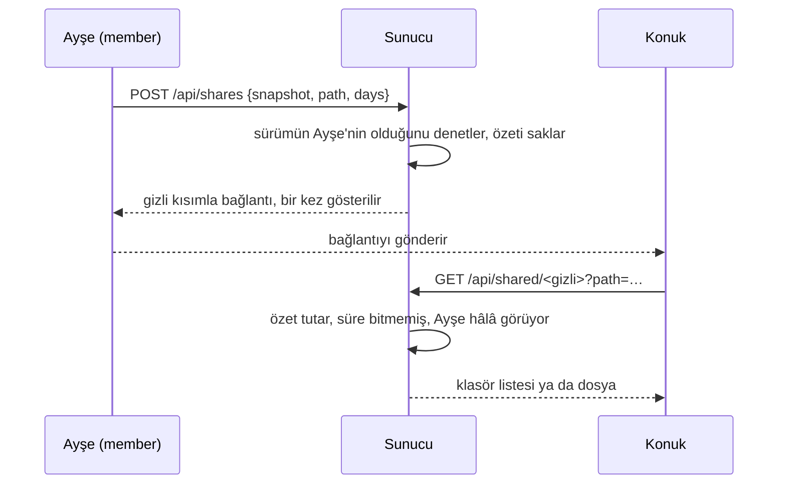

> **English:** [SHARE.md](SHARE.md)

# Paylaşım

> **Durum: Tamamlandı.** Aşama 4'ün 5. işinin tasarımıdır ([ROADMAP.tr.md](ROADMAP.tr.md) §6): web arayüzünün ([WEB.tr.md](WEB.tr.md)) bir kullanıcısı, hesabı olmayan birine bir bağlantı verir; o kişi bağlantı bitene kadar bir yedeğin bir sürümünü ya da içindeki bir klasörü veya dosyayı görüp indirebilir. Arkasındaki karar ADR-030'dur ([DECISIONS.tr.md](DECISIONS.tr.md)).

Ayşe, geçen ayın fatura klasörünü muhasebecisine ya da bir gezinin fotoğraflarını bir akrabasına göndermek ister; onları sunucunun kullanıcısı yapmadan ve dosyaları önce başka bir yere kopyalamadan.

## 1. Neler paylaşılabilir

| Kural | Ayrıntı |
| --- | --- |
| Ne | Bir yedeğin bir sürümü: tamamı, içindeki bir klasör ya da bir dosya |
| Kim paylaşır | Bir `admin` her sürümü; bir `member` yalnızca görebildiği sürümleri (USERS.tr.md §1); bir `reader` hiçbirini |
| Bağlantının verdiği | Yalnızca okuma: oturum açmadan, paylaşılan yolun altındaki klasörleri listelemek ve dosyaları indirmek |
| Hangi sürüm | Bağlantı oluşturulurken kimliğiyle belirtilen; sonraki yedekler bağlantının gösterdiğini değiştirmez |

## 2. Bağlantılar

Bir bağlantı `https://<sunucu>/s/<gizli>` biçimindedir. Gizli kısım 64 onaltılık karakterle yazılmış 32 rastgele bayttır, bu yüzden bağlantılar tahmin edilemez. Sunucu yalnızca onun SHA-256 özetini tutar; bağlantı oluşturulduğunda bir kez gösterilir ve bir daha gösterilemez.

Bir bağlantı, şunlardan ilki olana kadar çalışır:

| Bitiş | Ayrıntı |
| --- | --- |
| Süresi dolar | Oluşturulurken seçilen 1, 7 ya da 30 gün; varsayılan 7, en çok 30 |
| Kaldırılır | Sahibi ya da bir `admin` tarafından, sayfalarda ya da `apeiron web share remove` ile |
| Sahibi artık onu paylaşamaz | Sahibi silinmiş, `reader` olmuş ya da sürümü artık görmüyordur |

Bir bağlantı, oluşturulurken seçilen en az 8 karakterlik bir parola da isteyebilir; sahibi parolayı bağlantıdan başka bir yoldan iletir. Sunucu yalnızca parolanın Argon2id özetini tutar. Parola girilene kadar bağlantı bir parola alanından başka bir şey göstermez. Doğru parola, bağlantının kendi yolu için `apeiron_share` çerezini koyar (`HttpOnly`, `Secure`, `SameSite=Strict`, tarayıcı kapanana kadar): gizli kısmın ve saklanan özetin SHA-256 özeti; bunu parolayı bilmeyen kimse üretemez ve başka hiçbir bağlantıyı açmaz. Yanlış parolalar, yanlış oturum açmalar gibi bekletilir (WEB.tr.md): art arda 5 yanlıştan sonra bütün bağlantıların parolaları bir dakika bekler.



## 3. Paylaşımlar dosyası

Bağlantılar, durum klasöründeki (Linux'ta `~/.local/state/apeiron`) ve yalnızca sahibinin okuyabildiği `shares.json` dosyasında tutulur:

```json
{
  "shares": [
    {"id": "4661079506c34678", "hash": "4661079506c34678…", "owner": "ayse",
     "snapshot": "e63639f3…", "path": "invoices/2026-09",
     "made": "2026-10-30T10:30:55Z", "expires": "2026-11-06T10:30:55Z"}
  ]
}
```

| Alan | Anlamı |
| --- | --- |
| `id` | `hash` alanının ilk 16 karakteri; bağlantıyı listelerde ve kaldırırken adlandırır |
| `hash` | Gizli kısmın SHA-256 özeti, onaltılık |
| `owner` | Bağlantıyı oluşturan kullanıcı |
| `snapshot` | Paylaşılan sürümün kimliği |
| `path` | İçinde paylaşılan yol; tamamı için boş |
| `made`, `expires` | UTC zamanları |
| `protected`, `password` | Bağlantının parola isteyip istemediği ve parolanın PHC dizesi olarak Argon2id özeti; parolasız bir bağlantıda `password` yazılmaz |

Sunucu ve `apeiron web share` dosyayı bir kilit (`shares.lock`) altında değiştirir ve onu, yanına yazılıp diske aktarılmış yeni bir dosyayla bütünüyle değiştirir; böylece bir çökme ya eski dosyayı ya yenisini bırakır. Biten bağlantılar dosya her değiştiğinde atılır. Bozuk bir dosya bildirilir, asla yerine yenisi yazılmaz.

## 4. Bağlantıyı açan kişinin gördükleri

Bağlantıyı açmak, paylaşılan klasörü, alt klasörlerini ve her dosya için bir İndir düğmesini gösteren bir sayfa açar; paylaşılan bir dosya tek başına gösterilir. Dosyalar okundukça gönderilir, böylece büyük bir dosya sunucunun belleğini doldurmaz. Yedeğin içindeki bağlantılar (symlink) listelenir ama izlenmez.

Paylaşılan yolun üstündeki ya da yanındaki hiçbir şeye ulaşılamaz: `.` ya da `..` içeren bir yol reddedilir. Bilinmeyen, bitmiş ya da kaldırılmış bir bağlantı ve sahibi artık paylaşamayan bir bağlantı hep aynı "bulunamadı" yanıtını verir. Sayfalar `Referrer-Policy: no-referrer` ile yanıt verir, böylece bağlantı başka bir siteye giden bir istekle dışarı çıkmaz.

## 5. Sayfalarda, JSON API'de ve CLI'da

| Nerede | Ne |
| --- | --- |
| Bir sürümün içine bakarken Paylaş düğmeleri | Bir dosyaya, bir klasöre ya da sürümün tamamına bağlantı oluşturur; bir `admin` ve bir `member` için |
| Bağlantılar sayfası | Kullanıcının çalışan bağlantıları ve bitişleri; bir `admin` herkesinkini görür; Kaldır |
| `POST /api/shares` `{"snapshot", "path", "days", "password"}` | Bir bağlantı oluşturur, parola verilmişse parolalı; `{"share", "secret"}` ile yanıt verir |
| `GET /api/shares` | Kullanıcının çalışan bağlantıları, özetler olmadan; bir `admin` için hepsi |
| `POST /api/shares/<id>/remove` | Kullanıcının bir bağlantısını kaldırır; bir `admin` için herhangi birini |
| `GET /api/shared/<gizli>?path=<yol>` | Oturum açmadan: bağlantının altındaki yoldaki öğe, bir klasörün içindekiler, sürümün zamanı ve bağlantının bitişi |
| `GET /api/shared/<gizli>/file?path=<yol>` | Oturum açmadan: yoldaki dosya, indirme olarak |
| `POST /api/shared/<gizli>/unlock` `{"password"}` | Oturum açmadan: bağlantının parolasını denetler ve çerezini koyar; o zamana kadar parolalı bir bağlantı için yukarıdaki iki istek `key` (401) ile yanıt verir |
| `apeiron web share list` | Bütün kullanıcıların çalışan bağlantıları |
| `apeiron web share remove <id>` | Bir bağlantıyı kaldırır |

Masaüstü arayüzünde paylaşım yoktur: yalnızca onu kendi bilgisayarında çalıştıran kişiye hizmet eder.

## 6. Denetim kaydında

| Olay | Ayrıntı |
| --- | --- |
| `share_add` | Bağlantının kimliği, sürümü, yolu ve bitişi; başarısız olursa istek |
| `share_remove` | Bağlantının kimliği |
| `shared:list`, `shared:read` | Bağlantının kimliği ve istenen yol; kullanıcı yok, bağlantının adresi var |
| `shared:unlock` | Bağlantının kimliği ve parolanın doğru olup olmadığı (`ok`, `key`, `locked`); parolanın kendisi asla |

Gizli kısım asla kaydedilmez ([AUDIT.tr.md](AUDIT.tr.md)).

## 7. Bu işin parçası olmayanlar

| Konu | Nerede |
| --- | --- |
| Bütün bir klasörü tek bir arşiv olarak indirmek | Sonra; sunucuda `apeiron export` bunu yapar |
| Başkalarının yükleme yapabildiği bağlantılar | Sonra |
| Bir bağlantının ne sıklıkla kullanılabileceğini sınırlamak | Sonra |
| Sunucunun adı belli kullanıcılarıyla paylaşmak | Gerekmez: kullanıcılar dosyasında yedeği kullanıcıya verin (USERS.tr.md §2) |

## 8. Crate'ler

| Crate | Görevi | Durum |
| --- | --- | --- |
| `apeiron` | `Repository::read_file`: bir sürümdeki bir dosyanın içeriği, akış olarak ([API.tr.md](API.tr.md) §8.3) | Tamamlandı |
| `apeiron-server` | Paylaşımlar dosyası, denetimler, `/api/shares`, `/api/shared`, Bağlantılar sayfası ve bağlantıyı açan kişinin sayfası | Tamamlandı |
| `apeiron-cli` | `apeiron web share` | Tamamlandı |
