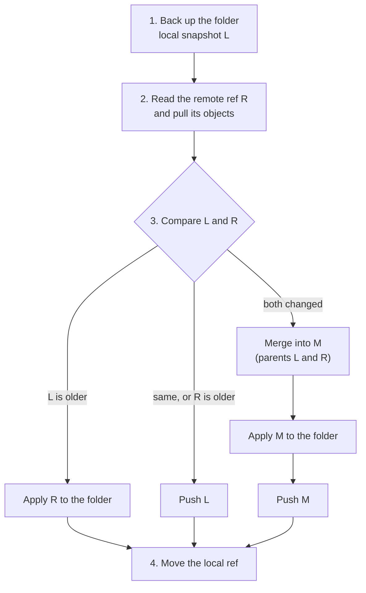

> **Türkçe:** [SYNC.tr.md](SYNC.tr.md)

# Apeiron Sync

> **Status: Planned (draft, awaiting approval).** This is the design of Stage 2 work item 4 ([ROADMAP.md](ROADMAP.md) §4): one- and two-way sync of a folder between devices, with conflict detection. The decision behind it is ADR-020 ([DECISIONS.md](DECISIONS.md)).

Sync keeps the same folder, such as `~/Documents`, equal on several devices. It is built from what exists: a backup records the folder as a snapshot, push and pull move snapshots through a remote ([FORMAT.md](FORMAT.md) §15), and a merge joins changes made on two devices.

## 1. Principles

| Principle | Rule | Status |
| --- | --- | --- |
| Through a remote | Devices meet at a remote (a disk, an SFTP server or S3); they never need to be online at the same time | Planned |
| Sync is not backup | Every sync is a snapshot in the history of each device; a deletion or damage that spreads can be undone from that history | Planned |
| No silent loss | When both devices changed the same file, both versions are kept; nothing is overwritten that was not seen | Planned |
| Preview | `--dry-run` shows what would change on this device and on the remote | Planned |
| Safe to interrupt | A sync stopped at any point is simply run again | Planned |

## 2. Commands

| Command | What it does | Status |
| --- | --- | --- |
| `apeiron clone <url> <path>` | Creates a local repository that is a copy of a remote one: the same config and keys, then pulls every ref | Planned |
| `apeiron sync <folder> <remote> [--ref <name>] [--mode two-way\|send\|receive] [--dry-run]` | Runs one sync round (section 3); the default ref is `sync/<folder name>` | Planned |

The background service runs sync as a job (`do = "sync"`, [DAEMON.md](DAEMON.md)), for example every 15 minutes. A second device starts with `apeiron clone`, then `apeiron sync`.

## 3. One sync round

The local ref (for example `sync/documents`) always points to the snapshot that equals the folder as of the last finished round.

1. Back up the folder as snapshot L, with the previous local snapshot as parent. Nothing changed: L is the previous snapshot.
2. Read the remote ref R and pull the objects it reaches, without moving any local ref.
3. Compare L and R by their history:
   - Same snapshot, or R is an ancestor of L: push L.
   - L is an ancestor of R: apply R to the folder (section 5) and move the local ref to R.
   - Otherwise both devices changed something since their last common snapshot B: merge (section 4) into a new snapshot M with parents L and R, apply M, push M.
4. A push that loses against a device that pushed in the meantime (FORMAT.md §15.5) starts the round again, at most three times.

| Mode | What it does |
| --- | --- |
| `two-way` | All of the above |
| `send` | Backs up and pushes; the folder is never changed. If the remote has snapshots this device does not have, the round stops with a conflict |
| `receive` | Pulls and applies; this device's snapshots are never pushed. A file changed here is kept, and the remote version is written as a conflict copy (section 4) |

## 4. Merge

The merge compares the base B, L and R path by path, recursing into folders that are folders on every side.

| B → L | B → R | Result |
| --- | --- | --- |
| unchanged | changed or deleted | R's version |
| changed or deleted | unchanged | L's version |
| changed | changed the same way | That version |
| changed | changed differently | **Conflict:** L's version stays at the path; R's version is added as `name (conflict HOST YYYY-MM-DD HH-MM).ext` |
| deleted | changed | **Conflict:** the changed file is kept |
| changed | deleted | **Conflict:** the changed file is kept |
| added | added differently | **Conflict:** as "changed differently" |

Two entries are the same when their kind, content and permission bits are equal; a different modification time alone is not a change. `HOST` is the host of the snapshot that brought the other version. Every conflict is listed in the result of the round and in the message of M, so it can be found in `apeiron log` later.

## 5. Applying a snapshot to the folder

The folder may change while a round runs. Every step is checked against L, the snapshot that recorded the folder in step 1:

- A file is replaced or deleted only if its size and modification time are still those in L; otherwise it is left alone and reported as "changed during sync", and the next round picks it up.
- A new or replaced file is written to a temporary file in the same folder and renamed over the target, so a file is either old or new, never half.
- A folder is removed only when it is empty after its files were removed; a file that appeared in it meanwhile keeps it.
- Permissions and modification times are set as in `restore`.

The local ref moves only after the folder has been applied. An interrupted apply leaves some files new and some old; the next round backs that up as a new L, and the merge finds that those files changed the same way on both sides.

## 6. Clone

`apeiron clone` creates a new local repository from a remote (FORMAT.md §15.6, new): it copies `config` and `keys/`, creates the folders of a repository, then pulls every ref of the remote. The password of the remote repository opens the clone. This is the only operation that copies keys from a remote.

## 7. Not part of this work item

| Item | Where |
| --- | --- |
| Peer-to-peer sync without a remote | Later; a remote covers Stage 2 |
| Exclusion rules and selective sync | With the backup service's exclusion rules, Stage 3 |
| Bandwidth limits | Later |
| A tool to resolve conflicts | The desktop interface (Stage 4); conflict copies are plain files until then |
| Operating the daemon from another device (remote API) | The desktop and web interfaces (Stage 4); [DAEMON.md](DAEMON.md) is updated |

## 8. Crates

| Crate | Role | Status |
| --- | --- | --- |
| `apeiron-services` | Merge and applying a snapshot to a folder | Planned |
| `apeiron` | `clone` and `sync` operations (API.md §8.3) | Planned |
| `apeiron-cli`, `apeiron-daemon` | `apeiron clone`, `apeiron sync`, `do = "sync"` | Planned |
