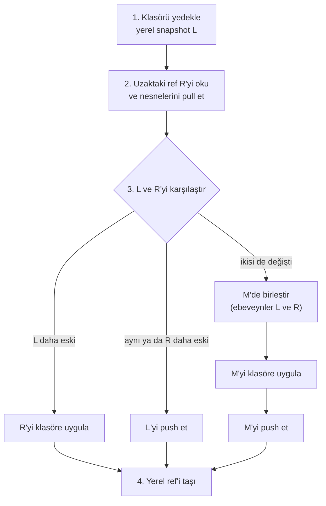

> **English:** [SYNC.md](SYNC.md)

# Apeiron Senkron

> **Durum: Devam ediyor** (klon tamamlandı). Aşama 2'nin 4. işinin tasarımıdır ([ROADMAP.tr.md](ROADMAP.tr.md) §4): bir klasörün cihazlar arasında tek ve çift yönlü senkronu ve çatışma tespiti. Arkasındaki karar ADR-020'dir ([DECISIONS.tr.md](DECISIONS.tr.md)).

Senkron, `~/Documents` gibi aynı klasörü birden fazla cihazda eşit tutar. Var olanlardan kurulur: bir yedek klasörü bir snapshot olarak kaydeder, push ve pull snapshot'ları bir uzak depo üzerinden taşır ([FORMAT.tr.md](FORMAT.tr.md) §15) ve bir birleştirme, iki cihazda yapılan değişiklikleri birleştirir.

## 1. İlkeler

| İlke | Kural | Durum |
| --- | --- | --- |
| Bir uzak depo üzerinden | Cihazlar bir uzak depoda buluşur (bir disk, bir SFTP sunucusu ya da S3); aynı anda çevrim içi olmaları gerekmez | Planlandı |
| Senkron yedek değildir | Her senkron, her cihazın geçmişinde bir snapshot'tır; yayılan bir silme ya da bozulma o geçmişten geri alınabilir | Planlandı |
| Sessiz kayıp yok | İki cihaz da aynı dosyayı değiştirdiyse iki sürüm de tutulur; görülmemiş hiçbir şeyin üzerine yazılmaz | Planlandı |
| Önizleme | `--dry-run`, bu cihazda ve uzak depoda neyin değişeceğini gösterir | Planlandı |
| Kesintiye dayanıklı | Herhangi bir noktada durdurulan bir senkron yeniden çalıştırılır | Planlandı |

## 2. Komutlar

| Komut | Ne yapar | Durum |
| --- | --- | --- |
| `apeiron clone <url> <path>` | Bir uzak deponun kopyası olan yerel bir depo oluşturur: aynı config ve anahtarlar, ardından her ref pull edilir; uzak depo artık `origin` adını taşır | Tamamlandı |
| `apeiron sync <folder> <remote> [--ref <name>] [--mode two-way\|send\|receive] [--dry-run]` | Bir senkron turu çalıştırır (bölüm 3); varsayılan ref `sync/<klasör adı>`'dır | Planlandı |

Arka plan hizmeti senkronu bir iş olarak çalıştırır (`do = "sync"`, [DAEMON.tr.md](DAEMON.tr.md)), örneğin 15 dakikada bir. İkinci bir cihaz `apeiron clone`, ardından `apeiron sync` ile başlar.

## 3. Bir senkron turu

Yerel ref (örneğin `sync/documents`) her zaman, son biten turdaki hâliyle klasöre eşit olan snapshot'ı gösterir.

1. Klasörü, önceki yerel snapshot'ı ebeveyn alan snapshot L olarak yedekle. Hiçbir şey değişmediyse L önceki snapshot'tır.
2. Uzaktaki ref R'yi oku ve ulaştığı nesneleri, hiçbir yerel ref'i taşımadan pull et.
3. L ile R'yi geçmişlerine göre karşılaştır:
   - Aynı snapshot ya da R, L'nin atası: L'yi push et.
   - L, R'nin atası: R'yi klasöre uygula (bölüm 5) ve yerel ref'i R'ye taşı.
   - Aksi hâlde iki cihaz da son ortak snapshot B'den beri bir şey değiştirmiştir: L ve R'yi ebeveyn alan yeni bir snapshot M'de birleştir (bölüm 4), M'yi uygula, M'yi push et.
4. Bu arada push etmiş bir cihaza karşı kaybeden bir push (FORMAT.tr.md §15.5) turu baştan başlatır, en fazla üç kez.

| Kip | Ne yapar |
| --- | --- |
| `two-way` | Yukarıdakilerin hepsi |
| `send` | Yedekler ve push eder; klasör asla değişmez. Uzak depoda bu cihazda olmayan snapshot'lar varsa tur bir çatışmayla durur |
| `receive` | Pull eder ve uygular; bu cihazın snapshot'ları asla push edilmez. Burada değişen bir dosya tutulur ve uzaktaki sürüm bir çatışma kopyası olarak yazılır (bölüm 4) |

## 4. Birleştirme

Birleştirme, B'yi, L'yi ve R'yi yol yol karşılaştırır; her tarafta klasör olan klasörlerin içine girer.

| B → L | B → R | Sonuç |
| --- | --- | --- |
| değişmedi | değişti ya da silindi | R'nin sürümü |
| değişti ya da silindi | değişmedi | L'nin sürümü |
| değişti | aynı şekilde değişti | O sürüm |
| değişti | farklı değişti | **Çatışma:** L'nin sürümü yolunda kalır; R'nin sürümü `name (conflict HOST YYYY-MM-DD HH-MM).ext` olarak eklenir |
| silindi | değişti | **Çatışma:** değişen dosya tutulur |
| değişti | silindi | **Çatışma:** değişen dosya tutulur |
| eklendi | farklı eklendi | **Çatışma:** "farklı değişti" gibi |

İki girdi; türleri, içerikleri ve izin bitleri eşitse aynıdır; yalnızca farklı bir değişiklik zamanı bir değişiklik değildir. `HOST`, öteki sürümü getiren snapshot'ın sunucu adıdır. Her çatışma turun sonucunda ve M'nin mesajında listelenir; böylece daha sonra `apeiron log` ile bulunabilir.

## 5. Bir snapshot'ı klasöre uygulama

Klasör, bir tur çalışırken değişebilir. Her adım, klasörü 1. adımda kaydeden snapshot L'ye göre denetlenir:

- Bir dosya, ancak boyutu ve değişiklik zamanı hâlâ L'dekilerse değiştirilir ya da silinir; aksi hâlde ona dokunulmaz, "senkron sırasında değişti" olarak raporlanır ve sonraki tur onu alır.
- Yeni ya da değiştirilen bir dosya aynı klasörde geçici bir dosyaya yazılır ve hedefin üzerine yeniden adlandırılır; böylece bir dosya ya eski ya yenidir, asla yarım değildir.
- Bir klasör, ancak dosyaları silindikten sonra boşsa silinir; bu arada içinde beliren bir dosya onu korur.
- İzinler ve değişiklik zamanları `restore`'daki gibi ayarlanır.

Yerel ref ancak klasör uygulandıktan sonra taşınır. Yarıda kalan bir uygulama, bazı dosyaları yeni, bazılarını eski bırakır; sonraki tur bunu yeni bir L olarak yedekler ve birleştirme, bu dosyaların iki tarafta aynı şekilde değiştiğini bulur.

## 6. Klon

`apeiron clone`, bir uzak depodan yeni bir yerel depo oluşturur (FORMAT.tr.md §15.6, yeni): `config`'i ve `keys/`'i kopyalar, bir deponun klasörlerini oluşturur, ardından uzak deponun her ref'ini pull eder ve ona `origin` adını verir. Uzak deponun parolası klonu açar. Uzak depodan anahtar kopyalayan tek işlem budur.

## 7. Bu işin parçası olmayanlar

| Konu | Nerede |
| --- | --- |
| Uzak depo olmadan eşler arası senkron | Daha sonra; Aşama 2 için bir uzak depo yeterlidir |
| Dışlama kuralları ve seçmeli senkron | Yedek hizmetinin dışlama kurallarıyla, Aşama 3 |
| Bant genişliği sınırları | Daha sonra |
| Çatışmaları çözmek için bir araç | Masaüstü arayüzü (Aşama 4); o zamana kadar çatışma kopyaları düz dosyalardır |
| Daemon'u başka bir cihazdan yönetmek (uzak API) | Masaüstü ve web arayüzleri (Aşama 4); [DAEMON.tr.md](DAEMON.tr.md) güncellenir |

## 8. Crate'ler

| Crate | Görev | Durum |
| --- | --- | --- |
| `apeiron-services` | Birleştirme ve bir snapshot'ı bir klasöre uygulama | Planlandı |
| `apeiron` | `clone` (API.tr.md §8.2) | Tamamlandı |
| `apeiron` | `sync` işlemi (API.tr.md §8.3) | Planlandı |
| `apeiron-cli` | `apeiron clone` | Tamamlandı |
| `apeiron-cli`, `apeiron-daemon` | `apeiron sync`, `do = "sync"` | Planlandı |
