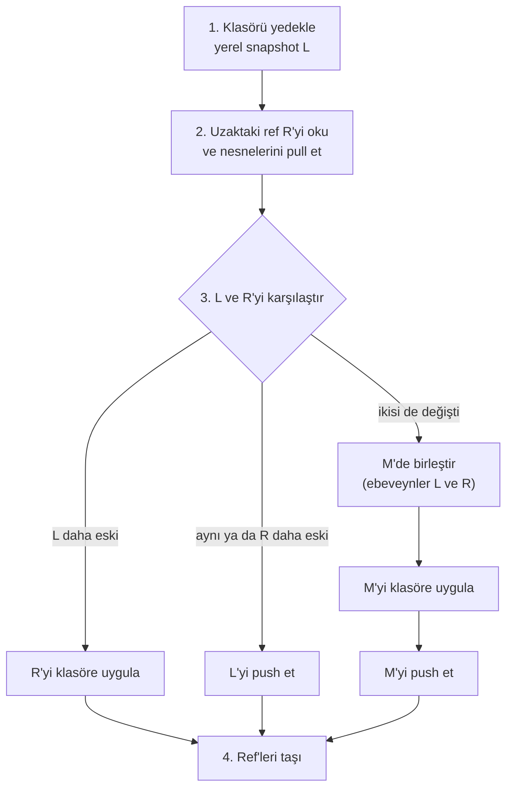

> **English:** [SYNC.md](SYNC.md)

# Apeiron Senkron

> **Durum: Tamamlandı.** Aşama 2'nin 4. işinin tasarımıdır ([ROADMAP.tr.md](ROADMAP.tr.md) §4): bir klasörün cihazlar arasında tek ve çift yönlü senkronu ve çatışma tespiti. Arkasındaki karar ADR-020'dir ([DECISIONS.tr.md](DECISIONS.tr.md)).

Senkron, `~/Documents` gibi aynı klasörü birden fazla cihazda eşit tutar. Var olanlardan kurulur: bir yedek klasörü bir snapshot olarak kaydeder, push ve pull snapshot'ları bir uzak depo üzerinden taşır ([FORMAT.tr.md](FORMAT.tr.md) §15) ve bir birleştirme, iki cihazda yapılan değişiklikleri birleştirir.

## 1. İlkeler

| İlke | Kural | Durum |
| --- | --- | --- |
| Bir uzak depo üzerinden | Cihazlar bir uzak depoda buluşur (bir disk, bir SFTP sunucusu ya da S3); aynı anda çevrim içi olmaları gerekmez | Tamamlandı |
| Senkron yedek değildir | Her senkron, her cihazın geçmişinde bir snapshot'tır; yayılan bir silme ya da bozulma o geçmişten geri alınabilir | Tamamlandı |
| Sessiz kayıp yok | İki cihaz da aynı dosyayı değiştirdiyse iki sürüm de tutulur; görülmemiş hiçbir şeyin üzerine yazılmaz | Tamamlandı |
| Önizleme | `--dry-run`, bu cihazda ve uzak depoda neyin değişeceğini gösterir | Tamamlandı |
| Kesintiye dayanıklı | Herhangi bir noktada durdurulan bir senkron yeniden çalıştırılır | Tamamlandı |

## 2. Komutlar

| Komut | Ne yapar | Durum |
| --- | --- | --- |
| `apeiron clone <url> <path>` | Bir uzak deponun kopyası olan yerel bir depo oluşturur: aynı config ve anahtarlar, ardından her ref pull edilir; uzak depo artık `origin` adını taşır | Tamamlandı |
| `apeiron sync <folder> <remote> [--ref <name>] [--mode two-way\|send\|receive] [--dry-run] [--exclude <pattern>]... [--gitignore]` | Bir senkron turu çalıştırır (bölüm 3); varsayılan ref `sync/<klasör adı>`'dır; ad küçük harfe çevrilir ve `a-z 0-9 . _ -` dışındaki karakterler `-` olur; çatışma ya da sonraki tura bırakılan dosya varsa çıkış kodu 3'tür | Tamamlandı |

Arka plan hizmeti senkronu bir iş olarak çalıştırır (`do = "sync"`, [DAEMON.tr.md](DAEMON.tr.md)), örneğin 15 dakikada bir. İkinci bir cihaz `apeiron clone`, ardından `apeiron sync` ile başlar. `--dry-run`, klasörün yeni içeriğini depoya kaydeder (çöp toplama onu siler), ama hiçbir ref'i taşımaz; ne klasörü ne de uzak depoyu değiştirir.

`--rate <hız>`, örneğin saniyede `500K` ya da `2M` bayt, `sync`, `clone`, `push` ve `pull` komutlarının uzak depodan ne kadar hızlı okuyup ona ne kadar hızlı yazdığını sınırlar; böylece bir aktarım yavaş bir hatta yer bırakır. Arka plan hizmetinin bir işi bunu `rate_kb` ile ayarlar ([DAEMON.tr.md](DAEMON.tr.md) §3). Sınır ortalamada geçerlidir: her dosyadan sonra aktarım, o ana kadarki baytlar hıza uyana kadar bekler; bu yüzden tek bir büyük dosya yine tam hızla gider ve bekleme ondan sonra gelir. Dosyaları listelemek ve ref okumak sayılmaz.

## 3. Bir senkron turu

Senkronlanan bir klasörün iki yerel ref'i vardır. Klasör ref'i `folder/<ref>` (örneğin `folder/sync/documents`), son biten turdaki hâliyle klasöre eşit olan snapshot'ı gösterir; onu yalnızca senkron taşır. Ortak ref (`sync/documents`) push ve pull edilendir; klasör dosyalarını almadan önce `clone` ya da `pull` ile de gelebilir, bu yüzden asla klasörün yerine geçmez. Yeni bir klon gibi klasör ref'i olmayan bir cihaz, klasörü yeniymiş gibi senkronlar: içindeki hiçbir şey silinmez ve uzak depodakinden farklı dosyalar çatışma olur.



1. Klasörü, klasör ref'inin snapshot'ını ebeveyn alan snapshot L olarak yedekle ve klasör ref'ini ona taşı. Hiçbir şey değişmediyse L önceki snapshot'tır. Yalnızca zamanların değişmesi (bir klasörün zamanı, içindeki bir dosya değiştirildiğinde değişir) L'ye kaydedilir ama aşağıda değişiklik sayılmaz; böylece iki cihaz birbirine asla böyle snapshot'lar göndermez.
2. Uzaktaki ref R'yi oku ve ulaştığı nesneleri, hiçbir yerel ref'i taşımadan pull et.
3. L ile R'yi geçmişlerine göre karşılaştır:
   - Aynı snapshot ya da R, L'nin atası: L'yi push et.
   - L, R'nin atası: R'yi klasöre uygula (bölüm 5) ve yerel ref'i R'ye taşı.
   - Aksi hâlde iki cihaz da son ortak snapshot B'den beri bir şey değiştirmiştir: L ve R'yi ebeveyn alan yeni bir snapshot M'de birleştir (bölüm 4), M'yi uygula, M'yi push et. İçerikçe R'ye eşit bir birleştirme R olarak uygulanır.

   Ardından klasör ref'i ve ortak ref sonucu gösterir.
4. Bu arada push etmiş bir cihaza karşı kaybeden bir push (FORMAT.tr.md §15.5) turu baştan başlatır, en fazla üç kez.

| Kip | Ne yapar |
| --- | --- |
| `two-way` | Yukarıdakilerin hepsi |
| `send` | Yedekler ve push eder; klasör asla değişmez. Uzak depoda bu cihazda olmayan snapshot'lar varsa tur bir çatışmayla durur (çıkış kodu 1, hata türü `conflict`) |
| `receive` | Pull eder ve uygular; bu cihazın snapshot'ları asla push edilmez. Burada değişen bir dosya tutulur ve uzaktaki sürüm bir çatışma kopyası olarak yazılır (bölüm 4) |

## 4. Birleştirme

Birleştirme, B'yi, L'yi ve R'yi yol yol karşılaştırır; her tarafta klasör olan klasörlerin içine girer.

| B → L | B → R | Sonuç |
| --- | --- | --- |
| değişmedi | değişti ya da silindi | R'nin sürümü |
| değişti ya da silindi | değişmedi | L'nin sürümü |
| değişti | aynı şekilde değişti | O sürüm |
| değişti | farklı değişti | **Çatışma:** L'nin sürümü yolunda kalır; R'nin sürümü `name (conflict HOST YYYY-MM-DD HH-MM).ext` olarak eklenir |
| silindi | değişti | **Çatışma:** değişen dosya tutulur |
| değişti | silindi | **Çatışma:** değişen dosya tutulur |
| eklendi | farklı eklendi | **Çatışma:** "farklı değişti" gibi |

İki girdi; türleri, içerikleri ve izin bitleri eşitse aynıdır; yalnızca farklı bir değişiklik zamanı bir değişiklik değildir. `HOST`, öteki sürümü getiren snapshot'ın sunucu adıdır ve zaman o snapshot'ın zamanıdır (UTC); ad doluysa kapanan parantezden önce bir sayı eklenir. Her çatışma turun sonucunda ve M'nin mesajında listelenir; böylece daha sonra `apeiron log` ile bulunabilir.

Bir çatışma bir sürümü tutarak çözülür: kopyayı silmek yoldaki dosyayı tutar, kopyayı yolun üzerine taşımak öteki sürümü tutar. Masaüstü arayüzünün Senkron sayfası ikisini de tek düğmeyle yapar (DESKTOP.tr.md §2); API'nin `conflicts` ve `resolve_conflict` işlevleri programlar için aynısını yapar (API.tr.md §8). Bir sonraki tur seçimi, diğer her değişiklik gibi öteki cihazlara götürür.

## 5. Bir snapshot'ı klasöre uygulama

Klasör, bir tur çalışırken değişebilir. Her adım, klasörü 1. adımda kaydeden snapshot L'ye göre denetlenir:

- Bir dosya, ancak boyutu ve değişiklik zamanı hâlâ L'dekilerse değiştirilir ya da silinir; aksi hâlde ona dokunulmaz, "senkron sırasında değişti" olarak raporlanır ve sonraki tur onu alır. Onun yerine geçemeyen ya da bu arada bir dosyanın belirdiği yere yazılacak olan sürüm, yanına bir çatışma kopyası olarak yazılır.
- Yeni ya da değiştirilen bir dosya aynı klasörde `.apeiron-sync-…` adlı geçici bir dosyaya yazılır ve hedefin üzerine yeniden adlandırılır; böylece bir dosya ya eski ya yenidir, asla yarım değildir. Senkron bu dosyaları asla saklamaz ve yarıda kalan bir turdan kalan, bir saatten eski olanları siler.
- Bir klasör, ancak dosyaları silindikten sonra boşsa silinir; bu arada içinde beliren bir dosya onu korur.
- İzinler ve değişiklik zamanları `restore`'daki gibi ayarlanır; sahipler ayarlanmaz.

Klasör ref'i ancak klasör uygulandıktan sonra taşınır. Yarıda kalan bir uygulama, bazı dosyaları yeni, bazılarını eski bırakır; sonraki tur bunu yeni bir L olarak yedekler ve birleştirme, bu dosyaların iki tarafta aynı şekilde değiştiğini bulur.

### 5.1 Dokunulmayan yollar

`--exclude <pattern>` ve klasörün `.apeironignore` dosyası ([CLI.tr.md](CLI.tr.md) §4.1), bu cihazın dokunmadığı yolları adlandırır; bu aynı zamanda seçmeli senkron sağlar: diğer cihazlar böyle bir dosyayı tutar, bu cihaz onu ne alır ne de siler.

- L, dışarıda bırakılan bir yolun girdisini diskten değil, klasör ref'inin snapshot'ından alır; böylece dışarıda bırakmak silme sayılmaz ve kimseye yayılmaz. Diskten kaybolan bir klasör L'de yalnızca dışarıda bırakılan yollarını tutar. Daha önceki hiçbir snapshot'ın tutmadığı yol yalnızca bu cihazda kalır.
- Bu cihazın son turunda dışarıda bıraktığı, değişen bir kuralın artık dışarıda bırakmadığı bir yol da silme sayılmaz: diskte yokken L onun girdisini tutar ve tur bitince yeni snapshot'tan diske yazılır. Son turun kuralları yalnızca deponun bu kopyasında tutulur (FORMAT.tr.md §2).
- Bir snapshot uygulanırken dışarıda bırakılan yollar atlanır: diskte orada olan değiştirilmez ya da silinmez ve oraya bir şey yazılmaz. Başka bir cihazın sildiği klasör, içinde dışarıda bırakılan dosya oldukça kalır ve sonraki tura bırakılmış olarak bildirilir.
- `.apeironignore` her dosya gibi eşitlenir, bu yüzden bir cihaza eklenen kural sonraki turda diğerlerine ulaşır; `--exclude`, onu veren cihaz için geçerlidir ve cihaz başına seçimin yoludur.
- `apeiron switch`, klasörün `.apeironignore` dosyasının adlandırdıklarına aynı şekilde dokunmaz.

## 6. Klon

`apeiron clone`, bir uzak depodan yeni bir yerel depo oluşturur (FORMAT.tr.md §15.6): `config`'i ve `keys/`'i kopyalar, bir deponun klasörlerini oluşturur, ardından uzak deponun her ref'ini pull eder ve ona `origin` adını verir. Uzak deponun parolası klonu açar. Uzak depodan anahtar kopyalayan tek işlem budur.

## 7. Uzak depo olmadan

İki cihaz aralarında bir disk ya da sunucu olmadan eşitlenebilir: biri kendi deposunu sunar, öbürü onu uzak deposu olarak kullanır. İkisinin de aynı şifreli depoya ihtiyacı vardır; onları içeri alan anahtardır.

```text
# Depoyu tutan masaüstünde:
$ apeiron peer serve --pair
On your other devices, with the same repository's key:
  apeiron remote add desktop 'peer://desktop:7865#3f9a…e1'
For ten minutes a new device may also copy it: apeiron clone 'peer://desktop:7865#3f9a…e1' <folder>
# Dizüstünde, ilk kez:
$ apeiron clone 'peer://desktop:7865#3f9a…e1' ~/apeiron
$ apeiron sync ~/Documents origin
```

| Kural | Ayrıntı |
| --- | --- |
| Adres | `peer://<host>[:<port>]#<parmak izi>`, varsayılan bağlantı noktası 7865; parmak izi, cihazın kendinden imzalı sertifikasının SHA-256'sıdır; her depo klasörü için bir kez yapılır ve durum klasöründe (`peer/`) tutulur, böylece adres değişmez |
| Bağlantı | HTTPS; sertifika tam olarak adresin adlandırdığı olmalıdır, böylece aradaki kimse cihaz gibi davranamaz |
| Erişim | Her istek, yalnızca deponun veri anahtarına sahip birinin yapabileceği bir belirteç gösterir (FORMAT.tr.md §15.9); bu anahtarı olmayan bir cihaz reddedilir. Adres sır taşımaz; yazılabilir ya da raporlarda gösterilebilir |
| Eşleştirme | `--pair`, on dakika boyunca bir cihazın belirteç olmadan okumasına da izin verir; böylece yeni bir cihaz, anahtara sahip olmadan önce kopyalayabilir. Okumak şifreli veriyi ve parolayla korunan anahtar dosyalarını verir (FORMAT.tr.md §14.2); bunu güvendiğiniz bir ağda kullanın |
| Senkron | Sunan cihaz diğerleri gibi bir uzak depodur: senkron, push, pull ve `gc --remote` onun üzerinden çalışır. Sunmakla kendi klasörünü eşitlemez; öbür cihaza karşı `apeiron sync` çalıştırır |

İki cihaz da ağda ulaşılabilir olmalıdır; yerel ağda adres olmadan birbirini bulmak yapılmaz.

## 8. Dotfiles

`apeiron dotfiles`, ev klasörünün `.bashrc`, `.gitconfig` ve `.config/nvim` gibi seçilmiş dosyalarını, ev klasörünün geri kalanını senkronlamadan birkaç cihazda eşit tutar.

| Komut | Ne yapar |
| --- | --- |
| `apeiron dotfiles add <path>...` | Ev klasörü içindeki dosya ya da klasörleri `~/.apeiron-dotfiles` listesine ekler: satır başına ev klasöründen bir yol |
| `apeiron dotfiles remove <path>...` | Onları listeden çıkarır; ne burada ne başka yerde bir şey silinir |
| `apeiron dotfiles list` | Listeyi gösterir |
| `apeiron dotfiles sync <remote>` | Ev klasörünü `sync/dotfiles` ref'iyle senkronlar; liste ve listedeki yollar dışında her şeyi dışarıda bırakır (`+` kalıpları, CLI.tr.md §4.1) |

Liste de senkronlanır; bu yüzden yeni bir cihaz için yalnızca `apeiron clone` ve `apeiron dotfiles sync origin` yeter: ilk tur listeyi getirir, aynı komuttaki ikinci tur listenin adlandırdıklarını getirir. Bir yolu listeden çıkarmak, dışarıda bırakılan her yol gibi onu olduğu gibi bırakır (bölüm 5.1). İlk turda iki cihazda farklı olan bir dosya çatışma kopyası olur; yeni bir cihazda `--mode receive` kendi sürümlerini göndermeden öbür cihazın sürümlerini alır.

## 9. Bu işin parçası olmayanlar

| Konu | Nerede |
| --- | --- |
| Yerel ağda cihazları bulmak | Daha sonra; bir cihaz adresiyle anılır (bölüm 7) |
| Eşitlenmeyen bir dosyayla cihaz başına seçim | Şimdilik `--exclude` karşılar |

## 10. Crate'ler

| Crate | Görev | Durum |
| --- | --- | --- |
| `apeiron-services` | Tur, birleştirme ve bir snapshot'ı bir klasöre uygulama | Tamamlandı |
| `apeiron` | `clone` (API.tr.md §8.2) | Tamamlandı |
| `apeiron` | `sync` işlemi (API.tr.md §8.3) | Tamamlandı |
| `apeiron-cli` | `apeiron clone` | Tamamlandı |
| `apeiron-cli`, `apeiron-daemon` | `apeiron sync`, `do = "sync"` | Tamamlandı |
| `apeiron-remote`, `apeiron-server`, `apeiron-cli` | `peer://` uzak depoları, `apeiron peer serve` (bölüm 7) | Tamamlandı |
