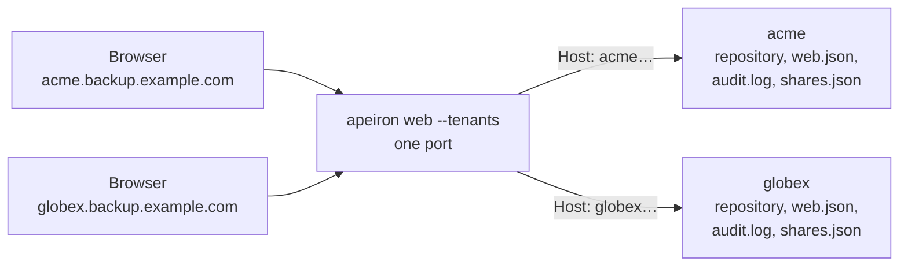

> **Türkçe:** [TENANTS.tr.md](TENANTS.tr.md)

# Multi-Tenant Use

> **Status: Done.** This is the design of Stage 5 work item 2 ([ROADMAP.md](ROADMAP.md) §7): one web server ([WEB.md](WEB.md)) serves several organizations, or several teams of one organization, that must not see each other. Each one is a tenant. The decision behind it is ADR-032 ([DECISIONS.md](DECISIONS.md)).

A company that runs backups for its customers, or a group with companies of its own, should not need one server program per customer. It also must not let a mistake in a role or a backup pattern show one customer's files to another.

## 1. What a tenant has

Every tenant has its own copy of everything a web server has, and shares nothing with the others but the program and the network port:

| Part | Of each tenant |
| --- | --- |
| Address | A host name of its own, such as `acme.backup.example.com` |
| Repository | Its own; an encrypted one has its own password and key |
| Users and identity provider | Its own `web.json` (USERS.md §2, IDENTITY.md §2); each has at least one `admin` |
| Folders | The folders of the server its users may be given |
| Audit log | Its own `audit.log`, with its own chain of hashes (AUDIT.md §2) |
| Share links | Its own `shares.json` (SHARE.md §3) |
| Sessions, jobs, wrong-password pauses | Kept apart in memory |



An `admin` of a tenant is an admin of that tenant only. Whoever runs the server manages the tenants with the commands of §4; no page or JSON request reaches more than one tenant.

## 2. Settings

The tenants are listed in `tenants.json` in the configuration folder (`~/.config/apeiron` on Linux):

```json
{
  "tenants": [
    {"name": "acme", "host": "acme.backup.example.com", "repo": "/srv/apeiron/acme",
     "folders": ["/srv/data/acme"]},
    {"name": "globex", "host": "globex.backup.example.com", "repo": "/srv/apeiron/globex",
     "password_file": "/etc/apeiron/globex.key"}
  ]
}
```

| Field | Meaning |
| --- | --- |
| `name` | 1 to 32 lowercase letters, digits, `-` and `_`; no two tenants share one |
| `host` | The host name browsers reach the tenant at, lowercase; no two tenants share one |
| `repo` | The tenant's repository, made beforehand with `apeiron init` |
| `folders` | Full paths of folders its users may be given; none if left out |
| `password_file` | For an encrypted repository: the file its password is read from; the server asks at start if left out |

The other files of a tenant are kept by its name:

| File | Where |
| --- | --- |
| Users, `web.json` | `<configuration folder>/tenants/<name>/web.json` |
| Audit log, `audit.log` | `<state folder>/tenants/<name>/audit.log` (`~/.local/state/apeiron` on Linux) |
| Share links, `shares.json` | `<state folder>/tenants/<name>/shares.json` |

Removing a tenant takes it off the list only; its repository and files stay, and adding it again with the same name brings them back.

## 3. Serving

`apeiron web --tenants` serves every listed tenant on one port. Each request goes to the tenant whose host its `Host` header names; the port and the case of the name do not matter. A request for any other host, such as the bare address of the server, gets `421 Misdirected Request` and nothing of any tenant, not even the pages.

Because every tenant has its own host, browsers keep its session cookie apart from the others' by themselves; a cookie sent to the wrong host is no session there either. Share links (`https://<host>/s/<secret>`) and the identity provider's redirect address (`https://<host>/api/oidc/callback`) are the tenant's own as well, so each tenant can register the server at its own provider.

The server does not start when a tenant cannot work: when its repository cannot be opened, a folder does not exist, or it has no `admin`. The error names the tenant.

| TLS | What to do |
| --- | --- |
| `--cert`, `--key` | A certificate valid for every tenant's host, such as one for `*.backup.example.com` |
| Neither | A self-signed certificate for `localhost`, the listen address and every tenant's host, kept in `<configuration folder>/tenants`. It is made again, with a new fingerprint, when a tenant with a new host is added |
| `--plain` | Behind a proxy that adds TLS and passes the `Host` header on unchanged |

The host names must lead to the server, through DNS records or the proxy.

## 4. Commands

| Command | What it does |
| --- | --- |
| `apeiron web tenant add <name> --host <host> --repo <path> [--folder <path>]... [--password-file <path>]` | Adds a tenant and prints the command for its first admin |
| `apeiron web tenant list` | Lists the tenants with their hosts and repositories |
| `apeiron web tenant remove <name>` | Stops serving a tenant; its files stay |
| `apeiron web --tenants [--listen <address>] [--cert <file> --key <file> \| --plain]` | Serves every tenant |
| `apeiron web user …`, `audit …`, `share …`, `oidc …` with `--tenant <name>` | Manages that tenant's users, audit log, links or identity provider, for example `apeiron web user add efe --role admin --tenant acme` |

Without `--tenants` and `--tenant`, `apeiron web` and its commands work as before, on the one repository of `--repo` and the files of WEB.md.

## 5. In the audit log

| Event | Where | Detail |
| --- | --- | --- |
| `tenant_add` | The new tenant's log | Its name, host, repository, folders and password file |
| `tenant_remove` | The removed tenant's log | Its name |

## 6. Not part of this work item

| Item | Where |
| --- | --- |
| Tenants told apart by a path, such as `/t/acme/`, instead of a host | Not planned: one host per tenant is what keeps their cookies apart |
| Limits of storage or jobs per tenant | Later, if a pilot needs them |
| Several tenants sharing one repository and its deduplication | Not planned: a separate repository and key are what keep their data apart |
| Managing tenants in the pages | Later; the commands of §4 until then |
| The background service and sync per tenant | Later; jobs (DAEMON.md) run for the user who runs them |

## 7. Crates

| Crate | Role | Status |
| --- | --- | --- |
| `apeiron-server` | `tenants.json`, a site per tenant, sending each request to its tenant's site | Done |
| `apeiron-cli` | `apeiron web tenant`, `--tenants`, `--tenant` | Done |
