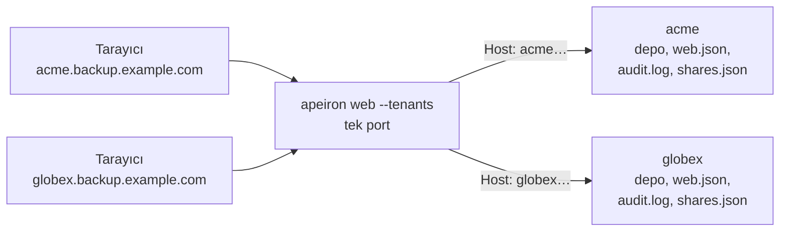

> **English:** [TENANTS.md](TENANTS.md)

# Çok Kiracılı Kullanım

> **Durum: Tamamlandı.** Aşama 5'in 2. işinin tasarımıdır ([ROADMAP.tr.md](ROADMAP.tr.md) §7): tek bir web sunucusu ([WEB.tr.md](WEB.tr.md)), birbirini görmemesi gereken birkaç kuruma ya da bir kurumun birkaç ekibine hizmet eder. Her biri bir kiracıdır (tenant). Arkasındaki karar ADR-032'dir ([DECISIONS.tr.md](DECISIONS.tr.md)).

Müşterileri için yedek tutan bir şirket ya da kendi şirketleri olan bir grup, her müşteri için ayrı bir sunucu programı çalıştırmak zorunda kalmamalıdır. Bir roldeki ya da bir yedek kalıbındaki bir hata da bir müşterinin dosyalarını başka birine göstermemelidir.

## 1. Bir kiracının nesi vardır

Her kiracının, bir web sunucusunda olan her şeyin kendine ait bir kopyası vardır; diğerleriyle program ve ağ portu dışında hiçbir şey paylaşmaz:

| Parça | Her kiracının |
| --- | --- |
| Adres | Kendine ait bir ana makine adı, örneğin `acme.backup.example.com` |
| Depo | Kendisinin; şifreli bir deponun kendi parolası ve anahtarı vardır |
| Kullanıcılar ve kimlik sağlayıcısı | Kendi `web.json` dosyası (USERS.tr.md §2, IDENTITY.tr.md §2); her birinde en az bir `admin` vardır |
| Klasörler | Sunucunun, kullanıcılarına verilebilecek klasörleri |
| Denetim kaydı | Kendi özet zinciriyle kendi `audit.log` dosyası (AUDIT.tr.md §2) |
| Paylaşım bağlantıları | Kendi `shares.json` dosyası (SHARE.tr.md §3) |
| Oturumlar, işler, yanlış parola duraklamaları | Bellekte ayrı tutulur |



Bir kiracının `admin`'i yalnızca o kiracının admin'idir. Sunucuyu çalıştıran kişi kiracıları §4'teki komutlarla yönetir; hiçbir sayfa ya da JSON isteği birden fazla kiracıya ulaşmaz.

## 2. Ayarlar

Kiracılar, yapılandırma klasöründeki (Linux'ta `~/.config/apeiron`) `tenants.json` dosyasında listelenir:

```json
{
  "tenants": [
    {"name": "acme", "host": "acme.backup.example.com", "repo": "/srv/apeiron/acme",
     "folders": ["/srv/data/acme"]},
    {"name": "globex", "host": "globex.backup.example.com", "repo": "/srv/apeiron/globex",
     "password_file": "/etc/apeiron/globex.key"}
  ]
}
```

| Alan | Anlamı |
| --- | --- |
| `name` | 1 ile 32 arası küçük harf, rakam, `-` ve `_`; iki kiracının adı aynı olamaz |
| `host` | Tarayıcıların kiracıya ulaştığı ana makine adı, küçük harfle; iki kiracınınki aynı olamaz |
| `repo` | Kiracının, önceden `apeiron init` ile oluşturulmuş deposu |
| `folders` | Kullanıcılarına verilebilecek klasörlerin tam yolları; boş bırakılırsa hiçbiri |
| `password_file` | Şifreli bir depo için parolanın okunduğu dosya; boş bırakılırsa sunucu başlarken sorar |

Bir kiracının diğer dosyaları adıyla tutulur:

| Dosya | Nerede |
| --- | --- |
| Kullanıcılar, `web.json` | `<yapılandırma klasörü>/tenants/<ad>/web.json` |
| Denetim kaydı, `audit.log` | `<durum klasörü>/tenants/<ad>/audit.log` (Linux'ta `~/.local/state/apeiron`) |
| Paylaşım bağlantıları, `shares.json` | `<durum klasörü>/tenants/<ad>/shares.json` |

Bir kiracıyı kaldırmak onu yalnızca listeden çıkarır; deposu ve dosyaları kalır ve aynı adla yeniden eklemek onları geri getirir.

## 3. Sunmak

`apeiron web --tenants`, listelenen her kiracıyı tek bir portta sunar. Her istek, `Host` başlığının adlandırdığı ana makinenin kiracısına gider; port ve adın büyük-küçük harfi önemli değildir. Sunucunun çıplak adresi gibi başka bir ana makine için gelen bir istek `421 Misdirected Request` alır ve hiçbir kiracıdan hiçbir şey almaz, sayfaları bile.

Her kiracının kendi ana makinesi olduğu için tarayıcılar onun oturum çerezini diğerlerininkinden kendiliğinden ayrı tutar; yanlış ana makineye gönderilen bir çerez orada da oturum değildir. Paylaşım bağlantıları (`https://<ana makine>/s/<gizli>`) ve kimlik sağlayıcısının geri dönüş adresi (`https://<ana makine>/api/oidc/callback`) de kiracının kendisinindir; böylece her kiracı sunucuyu kendi sağlayıcısına kaydedebilir.

Bir kiracı çalışamıyorsa sunucu başlamaz: deposu açılamıyorsa, bir klasörü yoksa ya da hiç `admin`'i yoksa. Hata kiracıyı adlandırır.

| TLS | Ne yapılır |
| --- | --- |
| `--cert`, `--key` | Her kiracının ana makinesi için geçerli bir sertifika, örneğin `*.backup.example.com` için bir tane |
| İkisi de yok | `localhost`, dinlenen adres ve her kiracının ana makinesi için kendinden imzalı, `<yapılandırma klasörü>/tenants` içinde tutulan bir sertifika. Yeni bir ana makineli bir kiracı eklenince yeni bir parmak iziyle yeniden oluşturulur |
| `--plain` | TLS ekleyen ve `Host` başlığını değiştirmeden ileten bir vekil sunucunun arkasında |

Ana makine adları, DNS kayıtları ya da vekil sunucu üzerinden sunucuya ulaşmalıdır.

## 4. Komutlar

| Komut | Ne yapar |
| --- | --- |
| `apeiron web tenant add <ad> --host <ana makine> --repo <yol> [--folder <yol>]... [--password-file <yol>]` | Bir kiracı ekler ve ilk admin'i için komutu yazar |
| `apeiron web tenant list` | Kiracıları ana makineleri ve depolarıyla listeler |
| `apeiron web tenant remove <ad>` | Bir kiracıyı sunmayı bırakır; dosyaları kalır |
| `apeiron web --tenants [--listen <adres>] [--cert <dosya> --key <dosya> \| --plain]` | Her kiracıyı sunar |
| `--tenant <ad>` ile `apeiron web user …`, `audit …`, `share …`, `oidc …` | O kiracının kullanıcılarını, denetim kaydını, bağlantılarını ya da kimlik sağlayıcısını yönetir, örneğin `apeiron web user add efe --role admin --tenant acme` |

`--tenants` ve `--tenant` olmadan `apeiron web` ve komutları eskisi gibi, `--repo` deposu ve WEB.tr.md'deki dosyalarla çalışır.

## 5. Denetim kaydında

| Olay | Nerede | Ayrıntı |
| --- | --- | --- |
| `tenant_add` | Yeni kiracının kaydı | Adı, ana makinesi, deposu, klasörleri ve parola dosyası |
| `tenant_remove` | Kaldırılan kiracının kaydı | Adı |

## 6. Bu işin parçası olmayanlar

| Konu | Nerede |
| --- | --- |
| Kiracıları ana makine yerine `/t/acme/` gibi bir yolla ayırmak | Planlanmadı: çerezlerini ayrı tutan, kiracı başına bir ana makinedir |
| Kiracı başına depolama ya da iş sınırları | Sonra, bir pilot gerektirirse |
| Birkaç kiracının bir depoyu ve onun tekilleştirmesini paylaşması | Planlanmadı: verilerini ayrı tutan, ayrı bir depo ve anahtardır |
| Kiracıları sayfalarda yönetmek | Sonra; o zamana kadar §4'teki komutlar |
| Kiracı başına arka plan hizmeti ve senkron | Sonra; işler (DAEMON.tr.md) onları çalıştıran kullanıcı için çalışır |

## 7. Crate'ler

| Crate | Görevi | Durum |
| --- | --- | --- |
| `apeiron-server` | `tenants.json`, kiracı başına bir site, her isteği kiracısının sitesine göndermek | Tamamlandı |
| `apeiron-cli` | `apeiron web tenant`, `--tenants`, `--tenant` | Tamamlandı |
